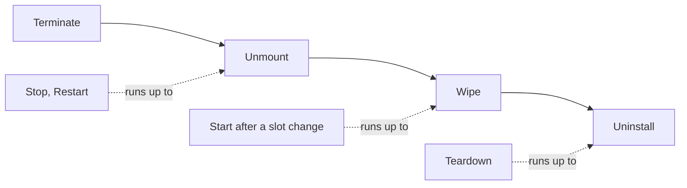
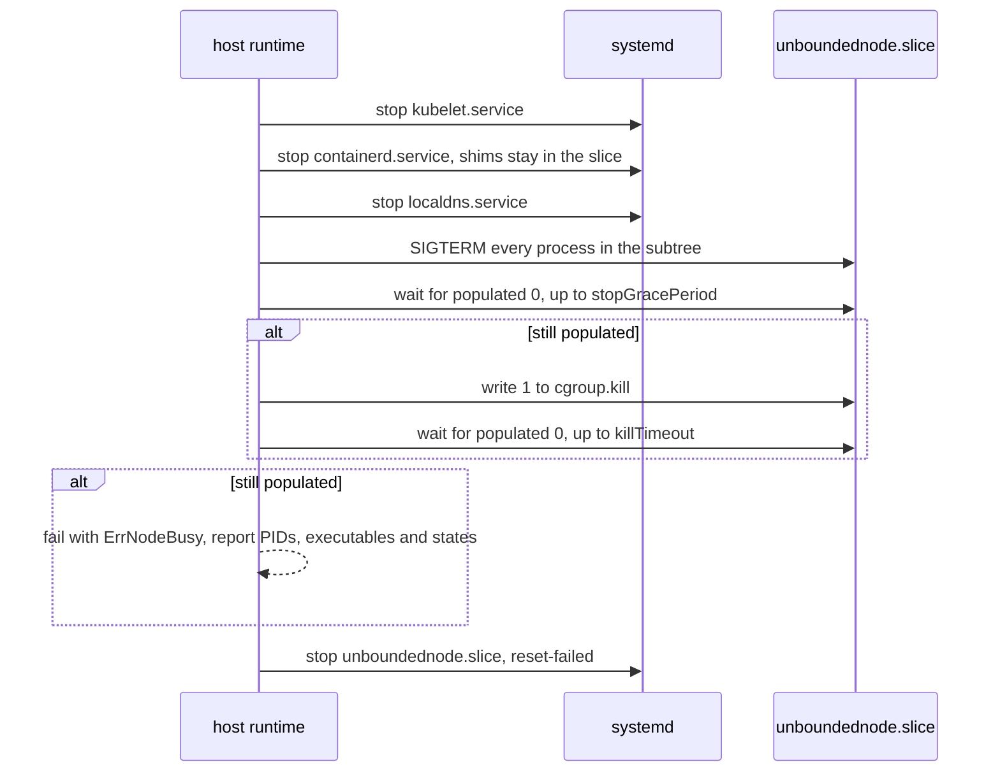
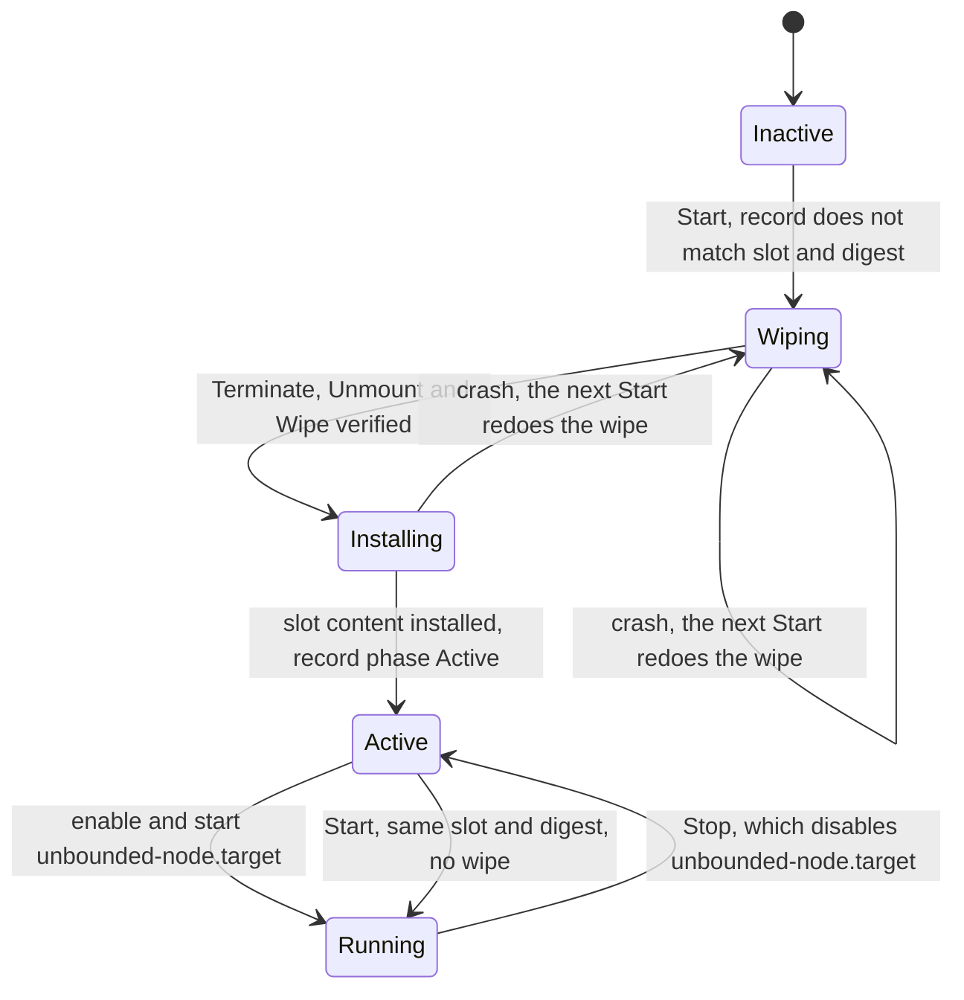
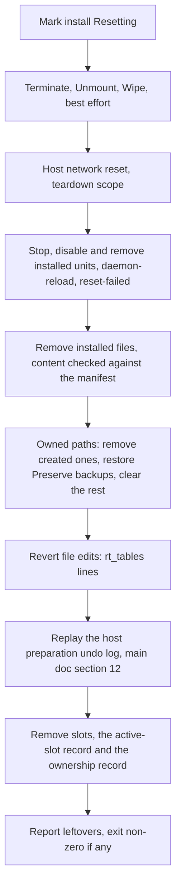

# Unbounded Agent v2: Host Runtime Cleanup

| Field | Value |
|---|---|
| Status | Draft for review |
| Scope | How the `host` runtime of the v2 agent stops, cleans up and removes a node that runs directly on the host |
| Parent document | [`agent-v2.md`](agent-v2.md), referred to here as the main doc |
| Repository baseline | `main` at `dca6c964d1d4d03614fe190fcd60ce49c380e914` |
| Date | 2026-10-29 |

This document expands section 10 of the main doc. References of the form
"main doc, section N" point there. Code citations and *(inference)* marks follow
the main doc's conventions.


## 1. Why the host runtime needs explicit cleanup

In `nspawn-container`, the container is the cleanup boundary. The `host`
runtime has no container, so it has to provide each guarantee itself.

| Resource | `nspawn-container` gets it for free because | `host` must |
|---|---|---|
| Node processes: kubelet, containerd, shims, pods | Stopping the machine kills its whole cgroup scope (`pkg/agent/phases/reset/machine.go:33-91`) | Contain them in one slice and kill it (section 6) |
| Pod mounts, overlay rootfs, `/run/netns/cni-*` | They live in the container's mount namespace and its `/run` *(inference)* | Unmount and remove them (section 7) |
| kubelet, containerd and CNI state | A repave unpacks a new rootfs | Wipe the owned paths (section 8) |
| Pod hostPath data | hostPaths resolve inside the rootfs, e.g. `/etc/wireguard`, `/opt/cni/bin` (`deploy/net/node/03-daemonset.yaml.tmpl:135-155`) and `/var/lib/gantry/libp2p` (`deploy/gantry/chart/templates/daemonset.yaml:134-135`) | Wipe the known and declared paths, report the rest (sections 8 and 12) |
| Network: links, routes, rules, nftables and iptables | Nothing: the network namespace is already shared (`pkg/agent/phases/rootfs/assets/nspawn.conf:20-21`) | The same network reset as today (main doc, section 11) |
| eBPF pins | Each machine gets its own bpffs (`nspawn.conf:27-29`) | Pins land in the host's bpffs; only declared pins are cleaned (section 12) |

## 2. Principles

1. **Delete only what is provably owned.** A path is deleted only if it is in
   the ownership record or the installed-files manifest.
2. **Never cross a mount or follow a symlink while deleting.** A mount found
   inside a tree being deleted aborts the deletion. Pod volumes are often bind
   mounts of host data, and deleting through one destroys that data.
3. **Contain processes in a slice** that can be killed as a unit.
4. **Every level is idempotent and restartable.** Intent is written durably
   before acting.
5. **Refuse to start on unclean state; clean up as much as possible on
   teardown.** A failed check before starting a fresh node blocks the start.
   Teardown runs every step even if some fail, then reports leftovers.
6. **Report what cannot be cleaned** rather than ignoring it.

## 3. Ownership and adoption

The `host` runtime records every host path it owns in its ownership record,
`/var/lib/unbounded/agent-v2/host-runtime/owned-paths.json`, mode 0600, written
durably with a `.sha256` sidecar.

```json
{
  "schemaVersion": 1,
  "installID": "4f1c...",
  "paths": [
    { "path": "/var/lib/kubelet", "class": "persistent", "created": true, "preexistingMount": false },
    {
      "path": "/opt/cni/bin", "class": "persistent", "created": false, "preexistingMount": false,
      "adopted": "Preserve",
      "backup": "/var/lib/unbounded/agent-v2/host-runtime/adopted/9c1e...",
      "backupSHA256": "..."
    }
  ],
  "installedFiles": [ { "path": "/etc/systemd/system/kubelet.service", "sha256": "..." } ],
  "originalSysctls": { "net.ipv4.ip_forward": "0", "net.ipv4.conf.eth0.rp_filter": "2" },
  "rtTablesExisted": true,
  "observedHostPaths": [ "/var/lib/some-daemonset" ]
}
```

The runtime takes ownership of each path on the first slot change (section 8). It
records the path before creating anything there.

| State of the path when the runtime takes ownership | Result |
|---|---|
| Absent | Create it; record `created: true` |
| Exists and empty | Record `created: false` |
| Exists and is a mount point, such as a dedicated disk for `/var/lib/containerd` | Record `preexistingMount: true`. The mount is never unmounted; only its contents are wiped. |
| Exists, non-empty, no adoption entry | Preflight error `existing-node-state`, listing the path |
| Exists, non-empty, adoption `Preserve` | Copy the contents into a backup, then take ownership with `adopted: "Preserve"`. Teardown restores the backup. |
| Exists, non-empty, adoption `Discard` | Take ownership with `adopted: "Discard"`. The contents are deleted at the first wipe. Teardown leaves the path empty. |

`Preserve` backups:

- live in `/var/lib/unbounded/agent-v2/host-runtime/adopted/<sha256-of-path>/`;
- keep mode, ownership, extended attributes and SELinux labels;
- are capped at `runtime.host.adoptPreserveMaxBytes`, 1 GiB by default; above
  the cap, preflight fails and suggests `Discard`;
- must stay within one filesystem; a mount inside the tree fails the adoption.

Preflight reports the adoption plan before anything changes: each path, its
mode, its size and file count, and the owning OS package if there is one
(`dpkg -S` or `rpm -qf`). An owned package gets a warning that a package
upgrade could write into a path the node now owns; removing the package is the
recommended alternative.

Without an ownership record, Teardown is conservative (section 9).

## 4. Owned resources

Classes: **volatile** paths are cleared at Unmount, **persistent** paths at
Wipe, **installed** items at Uninstall, and **file edits** (line-level changes
to host files) are reverted at Uninstall.

| Path or resource | Created by | Class | Notes |
|---|---|---|---|
| Processes in `unboundednode.slice` | runtime, kubelet, containerd | process | Section 6 |
| Mounts under `/var/lib/kubelet`, `/var/lib/containerd`, `/run/containerd` | kubelet, containerd | mount | Section 7 |
| `/run/netns/cni-*`, these entries only | containerd and CNI *(inference)* | network namespace | Section 7 |
| `/run/containerd` | containerd; gantry hostPath (`deploy/gantry/chart/values.yaml:26`) | volatile | |
| `/run/unbounded-net` | unbounded-net hostPath (`deploy/net/node/03-daemonset.yaml.tmpl:136-139`) | volatile | IPAM socket |
| `/run/racer` | racer hostPath (`internal/racer/workload/workload.go:292`) | volatile | |
| `/var/run/cdi/nvidia.yaml` | runtime pre-start hook | volatile | Regenerated on every start |
| `/var/lib/kubelet` | kubelet, bundle | persistent | Includes kubelet client certificates, so a wipe forces TLS bootstrapping again |
| `/var/lib/containerd` | containerd | persistent | Images and gantry's content cache; see `retainContainerImages` (section 8) |
| `/etc/kubernetes`, `/etc/containerd` including `certs.d` | bundle; gantry (`deploy/gantry/chart/values.yaml:34`) | persistent | Rewritten from the bundle on each slot change |
| `/opt/cni/bin` | bundle; unbounded-net init container (`images/net/node-agent-init.sh:55-65`) | persistent | Bundle plugins are installed again after the wipe |
| `/etc/cni/net.d` | unbounded-net (`cmd/unbounded-net-node/bootstrap_helpers.go:314-319`) | persistent | |
| `/var/lib/cni` | CNI IPAM *(inference)* | persistent | |
| `/var/log/pods`, `/var/log/containers` | kubelet *(inference)* | persistent | |
| `/etc/wireguard/server.priv` and `server.pub`, these files only | unbounded-net (`cmd/unbounded-net-node/bootstrap_helpers.go:372`) | persistent | The directory is left alone; the host may have its own WireGuard configuration |
| `/var/lib/gantry` | gantry (`deploy/gantry/chart/templates/daemonset.yaml:134-135`) | persistent | libp2p identity |
| `/var/lib/racer` | racer (`internal/racer/workload/workload.go:292`) | persistent | |
| `/etc/iproute2/rt_tables` lines `<id>\twg<id>` with id 51820 or higher | unbounded-net, only with policy routing (`internal/net/netlink/route_table_setup.go:28-105`) | file edit | Lines removed at Uninstall. If the file did not exist when the runtime took ownership, and only default content remains, the file is removed. |
| Slot directories | runtime | staged | Removed by `Destroy` or Teardown |
| Units and drop-ins: `kubelet`, `containerd`, `localdns` and its slice, `unboundednode.slice`, `unbounded-node.target`, `unbounded-node-prestart.service`, the LocalDNS network unit and helper, extension host units | runtime | installed | |
| Extension `cleanup.statePaths` | consumer | as declared | Section 13 |

## 5. Cleanup levels

Each level includes every level before it.

| Level | Removes | `nspawn-container` equivalent |
|---|---|---|
| Terminate | All node processes | `machinectl terminate`, or stopping the machine |
| Unmount | Node mounts, pod network namespace files under `/run/netns`, and the runtime directories under `/run` | The machine's mount namespace and `/run` going away |
| Wipe | All persistent node state | A new rootfs |
| Uninstall | Everything the runtime installed: units, files, slots, file edits, the ownership record | `machinectl remove` and removal of the nspawn configuration |



| Method | `host` runtime behavior |
|---|---|
| `Stop(slot)` | Terminate, then Unmount, then disable `unbounded-node.target` |
| `Restart(slot)` | Terminate, Unmount, then start the node units again; starting them runs the prerequisites and the pre-start boot hook first (main doc, section 8.3) |
| `Start(slot)`, same slot and bundle as last time | Enable `unbounded-node.target` and start it. No wipe. |
| `Start(slot)` after a slot change | Terminate, Unmount, Wipe, verify, install the slot's content, write the active-slot record, then enable and start `unbounded-node.target` (section 8) |
| `Destroy(slot)` | Remove the slot directory only. Returns `ErrSlotEnabled` for the enabled slot. |
| `Teardown()` | Every level through Uninstall (section 9) |

The host network reset is not a runtime method. The node manager runs it for
both runtimes (main doc, section 11).

## 6. Terminate

Containment:

- `containerd.service`, `kubelet.service` and `localdns.service` get
  `Slice=unboundednode.slice`.
- kubelet gets `cgroupDriver: systemd` and `cgroupRoot: /unboundednode`, so
  pods land under `unboundednode-kubepods.slice` *(inference: kubelet's
  systemd cgroup naming)*.
- Shims start in `containerd.service`'s cgroup, so they are in the slice even
  though `KillMode=process` keeps them alive when containerd stops
  (`pkg/agent/phases/nodestart/assets/containerd.service:10-11`).
- The slice name has no hyphen. systemd treats `-` as the slice hierarchy
  separator, and kubelet escapes `-` in `cgroupRoot` *(inference)*.



- `stopGracePeriod` defaults to 30 seconds and `killTimeout` to 15 seconds,
  matching v1's machine stop and terminate waits
  (`pkg/agent/phases/reset/machine.go:66,83`).
- Signals are sent to the whole cgroup, not per pod through the CRI. That
  matches v1, where pods get SIGTERM and then SIGKILL as the machine scope
  stops *(inference)*.
- A process stuck in uninterruptible sleep, for example on a dead NFS mount,
  leaves the cgroup populated. Terminate then fails, and Wipe never runs over
  live state.

Preflight for the `host` runtime requires the unified cgroup v2 hierarchy and
`cgroup.kill` (Linux 5.14 or later). If `cgroup.kill` is missing, the runtime
falls back to repeated SIGKILL over `cgroup.procs` until the cgroup is empty.
v1 only checks that `/sys/fs/cgroup` exists
(`pkg/agent/phases/host/preflight_host.go:476-491`).

## 7. Unmount

Unmount runs only after Terminate has verified that no node processes remain.

1. Read `/proc/self/mountinfo`. Select mount points under the owned paths that
   hold mounts (`/var/lib/kubelet`, `/var/lib/containerd`, `/run/containerd`)
   and under `/run/netns/cni-*`. Leave out any path marked `preexistingMount`.
2. Unmount deepest first: `umount2(path, 0)`; on `EBUSY`, retry three times one
   second apart; then `umount2(path, MNT_DETACH)` and record a warning.
3. Repeat until no selected mounts remain, at most five passes, since mounts
   shared with other mount namespaces can reappear *(inference)*. If mounts
   remain, fail with `ErrMountsRemain`.
4. For each pod network namespace file `/run/netns/cni-*`, unmount it if
   needed, then delete it. With no processes using them, the kernel frees the
   namespaces and their veth peers disappear from the host *(inference)*.
5. Clear volatile paths with the safe remover (section 8).

## 8. Wipe and slot changes

The active-slot record,
`/var/lib/unbounded/agent-v2/host-runtime/active-slot.json`, holds
`{slot, bundleDigest, phase}`. When `Start` is called with a slot or bundle
digest that differs from the record, the runtime is making a *slot change*, and
it wipes node state first. This is how the `host` runtime keeps rule 4 of the
main doc's section 7.1: the first time a slot starts after its content was
provisioned, it begins with fresh state. The digest is read from the slot's
saved bundle manifest and leaves out secret contents (main doc, section 7.2),
so a refreshed bootstrap token never causes a wipe.

This record is the `host` runtime's own record of which slot is installed into
the shared paths. The node manager keeps no copy of it. `Inspect` reports it
like this:

| Host state | `Inspect` reports for the slot |
|---|---|
| No slot directory, or no completion marker | Absent |
| Complete slot directory, not the slot in the record | Provisioned |
| The slot in the record, with phase `Wiping` or `Installing` | Provisioned: a slot change is in progress, and the next `Start` finishes it |
| The slot in the record, phase `Active`, node units running | Running |
| The slot in the record, phase `Active`, node units stopped | Stopped |

`Enabled` is true for the slot in the record while `unbounded-node.target` is enabled.



Wipe:

1. Write `phase: Wiping` durably.
2. Terminate and Unmount, both verified.
3. Clear every persistent path in the ownership record and every declared
   `cleanup.statePaths` entry. Directories keep their mode and SELinux label;
   only their contents are removed. The WireGuard and CDI entries are single
   files.
4. The safe remover opens with `O_NOFOLLOW`, compares `st_dev` with the root's
   device at every directory and aborts with `ErrMountInTree` on a mismatch,
   unlinks symlinks without following them, and refuses if an owned path has
   become a symlink.
5. Delete declared eBPF pins (section 13).
6. Verify (section 10). Write `phase: Installing`, install the slot's units,
   configuration, binaries and CNI plugins, then write `phase: Active` with the
   slot and digest.

With `runtime.host.repave.retainContainerImages: true`, step 3 does not clear
`/var/lib/containerd`. Instead it performs an image-preserving reset:

1. Start a temporary maintenance containerd: the binary from the slot being
   switched to, a private configuration and socket under
   `/run/unbounded-agent-v2/containerd-maint/`, the CRI plugin disabled (so no
   CNI work or sandbox recovery), running in `unboundednode.slice`.
2. Through the containerd Go client, which is already a dependency
   (`go.mod:39`), delete all tasks, containers and sandboxes in every
   namespace, delete all leases except image leases, and run garbage
   collection. Images, their content and their unpacked snapshots remain,
   including gantry's cache.
3. Stop the maintenance instance and run Terminate on its slice again.
4. Delete the CRI plugin's state directory under `/var/lib/containerd`
   (`io.containerd.grpc.v1.cri`). Nothing else inside containerd's root is
   deleted file by file, so its metadata stays consistent.
5. If the maintenance instance did not report zero containers, tasks and
   sandboxes, fall back to a full clear and log why.

This option does not apply to `nspawn-container`, where a repave always
unpacks a new rootfs. The mechanism needs a prototype (main doc, validation task V2).

## 9. Teardown



- A file whose content no longer matches the manifest is still removed, because
  the path is owned. The mismatch is logged.
- `Preserve` backups are deleted only after a verified restore.
- The ownership record is removed last, so a crash anywhere earlier repeats the
  full Teardown.

Without an ownership record, Teardown is conservative:

- It removes only paths and units unique to v2: slot directories,
  `unboundednode.slice`, `unbounded-node.target`, `unbounded-node-prestart.service`,
  v2 state, the LocalDNS network unit and `nftables-flush.service`.
- Every non-empty standard path in section 4 is reported as a leftover.
- `v2 reset --force-standard-paths` clears their contents, using the safe
  remover. It never removes the directories.
- The original sysctl values cannot be restored without the record. That is
  reported with the list of keys.

## 10. Post-conditions

| After | Must be true | On violation |
|---|---|---|
| Terminate | `unboundednode.slice` reports `populated 0`; no process runs an executable from a slot directory | `ErrNodeBusy`; Wipe and Start do not run |
| Unmount | No mounts under the owned paths apart from `preexistingMount` paths; no `/run/netns/cni-*` files | `ErrMountsRemain`; Wipe does not run |
| Wipe | Every persistent owned path is empty; no declared pins remain | `ErrStateRemains`; the slot change does not continue |
| Host network reset | No owned links, rules or tables; no `unbounded_localdns` table; on Teardown, no owned chains | Repave: error, retried by `Recover`. Teardown: leftover. |
| Teardown | None of the runtime's owned resources remain; no ownership record | Leftovers reported; non-zero exit |

Leftovers are reported as `{kind, id, reason}` in `v2 reset` output, in
`v2 status`, and through the status sink.

## 11. Crash behavior

| Interrupted during | Next action |
|---|---|
| Terminate or Unmount inside `Stop` | `Stop` is idempotent; `Recover` or the caller runs it again |
| `phase: Wiping` or `Installing` | The next `Start` wipes again, then installs |
| `phase: Active`, before the node target starts | `Start` with the same slot and digest, no wipe |
| Teardown | Run again from the beginning; every step tolerates absent state |
| A repave | `nodemanager.Recover` (main doc, section 8.5) drives the runtime methods above |

## 12. Not cleaned

1. **Undeclared hostPath directories** outside the owned list. Before each
   Terminate, the runtime lists the host sources of all container mounts through
   the CRI API and records them as `observedHostPaths`. Wipe and Teardown
   report them but never delete them, so the gap with `nspawn-container` stays
   visible.
2. **Mounts made in the host mount namespace by privileged pods**, for example
   through `nsenter -t 1` or bidirectional mount propagation, outside the owned
   paths.
3. **eBPF pins** in the host's `/sys/fs/bpf` from other eBPF CNIs, unless
   declared. unbounded-net pins nothing; its program is attached only to
   `unbounded0` (`cmd/unbounded-net-node/tunnel_config.go:95-105`,
   `internal/net/ebpf/tunnel_map.go:182`) and goes away when that link is
   deleted *(inference)*.
4. **Kernel modules, conntrack entries, and sysctls whose original values were
   not recorded.** These last until the host reboots.
5. **journald logs and Kubernetes API objects** (Node, CSRs, Machine), as in
   v1.

## 13. Extension cleanup declarations

Consumers that install their own node networking, such as an unmanaged Cilium,
declare its state:

```json
"cleanup": {
  "statePaths": [
    { "path": "/var/lib/cilium", "class": "persistent" },
    { "path": "/run/cilium", "class": "volatile" }
  ],
  "links": [ { "name": "cilium_host", "kind": "veth" }, { "name": "cilium_vxlan", "kind": "vxlan" } ],
  "iptablesChainPrefixes": [ "CILIUM_" ],
  "nftTables": [ { "family": "inet", "name": "cilium" } ],
  "bpfPins": [ "/sys/fs/bpf/tc/globals", "/sys/fs/bpf/cilium" ]
}
```

- The runtime takes ownership of declared paths under the same rules as
  built-in ones (section 3).
- `bpfPins` must be under `/sys/fs/bpf`.
- Declared links are deleted only when both name and kind match.

## 14. Internal interfaces

```go
package host // internal/agentv2/runtime/host

// Level is a cleanup depth. Each level includes all lower levels.
type Level int

const (
	LevelTerminate Level = iota + 1 // no node processes
	LevelUnmount                    // no node mounts, pod network namespace files or volatile state
	LevelWipe                       // no persistent node state
	LevelUninstall                  // nothing the runtime installed
)

type Leftover struct {
	Kind   string // process, mount, netns, path, unit, link, rule, chain, pin, sysctl
	ID     string
	Reason string
}

type cleaner struct {
	sys    SystemOps
	owned  *OwnershipStore
	limits Limits // StopGracePeriod, KillTimeout, UnmountRetries
	log    *slog.Logger
}

func (c *cleaner) To(ctx context.Context, lvl Level) error
func (c *cleaner) Verify(ctx context.Context, lvl Level) ([]Leftover, error)

// SystemOps is the boundary between the cleaner and the operating system.
// Fakes drive unit tests for ordering and safety.
type SystemOps interface {
	Systemd() Systemd // Stop, Disable, DaemonReload, ResetFailed
	Cgroups() Cgroups // Signal, Kill, Populated, Procs
	Mounts() Mounts   // List, Unmount
	FS() SafeFS       // ClearContents, RemoveTree, WriteDurable; never crosses st_dev or follows symlinks
	Netns() Netns     // List with a prefix, Remove
	CRI() CRI         // container mount sources, for observedHostPaths
	Sysctl() Sysctl   // Read, Write
}
```
