# Unbounded Agent v2: Pluggable Node Runtime

| Field | Value |
|---|---|
| Status | Draft for review |
| Scope | A new, experimental implementation of the unbounded agent with a defined interface for hosting kubelet, and a binary-level extension model for downstream consumers |
| Audience | Maintainers, AKS Flex Node maintainers, and reviewers of agent lifecycle changes |
| Repository baseline | `main` at `dca6c964d1d4d03614fe190fcd60ce49c380e914` |
| Date | 2026-10-29 |

## Review guide

- Sections 1-4 explain the problem, the goals and the core decisions.
- Section 5 is the external contract that consumers such as AKS Flex Node would
  build against: the CLI, the configuration file, plugins, hooks and
  declarative extensions.
- Sections 6-8 are the internal code interfaces and the lifecycles, with
  diagrams.
- Sections 9-11 describe the two runtimes, how the `host` runtime cleans up
  after itself, and how host preparation is reversed.
- Sections 12-16 cover operations, parity with v1, the export policy, testing
  and risks.
- Section 17 records the decisions already made in design discussion.
  Section 18 lists what is still open. Please focus review comments there and
  on anything in sections 5, 7 and 10 that looks wrong.

Code citations are `file:line` against the baseline above. Statements that rely
on upstream behavior (Kubernetes, containerd, CNI, systemd, the kernel) rather
than code in this repository are marked *(inference)*.

## 1. Purpose and context

The unbounded agent (`unbounded-agent`) bootstraps a host and runs a
Kubernetes worker node on it. Today that node always runs inside a
systemd-nspawn container. We want an agent with a clearly defined interface
for starting and managing kubelet, so the node can run either directly on the
host or in an nspawn container, without the rest of the agent caring which.

We also want to change how downstream projects consume the agent. AKS Flex
Node currently imports `pkg/agent` and builds its own agent from the pieces.
The goal is for consumers to use the agent *binary*, customizing it through
well-defined hook points.

This document proposes v2: a new implementation, shipped inside the existing
binary under a `v2` subcommand, marked experimental.

### 1.1 The v1 agent

v1 is organized in four layers:

- **Commands.** `start`, `preflight`, `daemon`, `reset`, `agent-upgrade`,
  `version`, plus hidden `nspawn-lifecycle` and
  `record-agent-upgrade-failure-signal` (`cmd/agent/internal/cmd/cmd.go:30-39`).
- **Bootstrap coordinator.** Runs `PrepareHost`, `PrepareRootFS`,
  `EnsureNodeStarted` and `EnsureDaemonInstalled` under an install lock and an
  install record that classifies each run as fresh, resumed or complete
  (`cmd/agent/internal/bootstrap/coordinator.go:29-38`).
- **Goal state and phases.** Configuration resolves to
  `MachineGoalState{RootFS, NodeStart}` (`pkg/agent/goalstates/resolve.go:37-40`).
  Work is composed from `phases.Task` values with `Serial` and `Parallel`
  (`pkg/agent/phases/phases.go:17-20`).
- **Daemon.** A controller-runtime manager that repaves when its Node is
  deleted and handles the `NodeReboot`, `AgentUpgrade` and `AgentReset`
  MachineOperations (`cmd/agent/internal/daemon/controller.go:95-99`). Node
  work goes through an unexported `nodeOperator` interface
  (`cmd/agent/internal/daemon/nodeoperator.go:37-70`).

### 1.2 Where nspawn is built in

The nspawn assumption appears in every layer, which is why v2 is a new
implementation rather than a switch added to v1.

| Layer | Coupling | Citation |
|---|---|---|
| Goal state | `RootFS` carries nspawn file paths; the machine directory is `/var/lib/machines/<m>`; `NodeStart.MachineName` is the `systemd-run` target | `pkg/agent/goalstates/rootfs.go:11-58`, `resolve.go:86-97`, `nodestart.go:6-9` |
| Writing node files | Every node file is written from the host into the machine directory | e.g. `pkg/agent/phases/nodestart/kubelet.go:75` |
| Running commands in the node | One funnel: `systemd-run --machine=<m> --pipe --wait` | `internal/executil/exec.go:258-267` |
| Bootstrap | Always targets `kube1`; uses `machinectl list` to decide whether the rootfs needs building | `cmd/agent/internal/cmd/bootstrap.go:92,161,220` |
| Host preparation | Masks the host `containerd` and `kubelet` units, which a host runtime needs | `bootstrap.go:111`, `pkg/agent/phases/host/disable_systemd_unit.go:36-43` |
| Daemon | Defaults to the nspawn operator, and hardcodes it in `RepairDaemon`; repave alternates `kube1` and `kube2` | `cmd/agent/internal/daemon/daemon.go:101`, `lifecycle.go:461`, `nodeoperator.go:248-296` |
| Reset | Hardcodes `kube1` and `kube2` and the nspawn teardown | `cmd/agent/internal/daemon/reset.go:168-195` |
| Lifecycle hooks | systemd runs `nspawn-lifecycle pre-start` and `post-start` around `systemd-nspawn@<m>` | `pkg/agent/nspawnlifecycle/lifecycle.go:67-129` |

### 1.3 How AKS Flex Node consumes v1 today

This summary is based on `github.com/Azure/AKSFlexNode` at `main`
(`2c149e991fee3ff59f4180b5c5a6a3b3108bc012`), which pins unbounded `v0.18.0`.

Flex translates its own configuration schema into `pkg/agent/config` types and
then composes its own agent from `pkg/agent` packages: its own task graphs for
host setup, start, reboot, repave and reset; its own daemon around
`daemon.SetupController`; and its own upgrade orchestration over
`pkg/agent/agentbinary`.

On top of that it adds:

- an ARM Machine backend for desired state and status, using the ARM ETag as a
  settings version;
- fresh bootstrap data fetched from ARM before a repave;
- an exec credential for kubelet and the daemon (`aks-flex-node token
  kubelogin`), which requires copying its binary into the nspawn rootfs;
- static host routes ordered before `systemd-nspawn@`;
- Node Problem Detector, downloaded into the rootfs and started with
  `systemd-run --machine`;
- extra `Requires=` dependencies on the nspawn unit;
- an AKS LocalDNS Corefile template that uses unbounded's template variables;
- Arc and NPD preflight checks;
- a taint-based reset trigger.

Several patterns in Flex point to missing extension points:

- It copies unbounded's list of host tasks so it can add its own
  (`pkg/daemon/start.go`), so new unbounded host tasks are silently missed.
- It re-composes the node start sequence in three places (`pkg/daemon/start.go`,
  `pkg/daemon/nodeoperator.go`).
- It writes content directly into the machine directory after provisioning
  (`pkg/daemon/install.go`, `pkg/npd/download.go`).
- Its `scripts/uninstall.sh` hardcodes unbounded unit and path names.
- It copies an unexported marker name from unbounded's `internal/hostroot`
  (`pkg/daemon/hostroot_move.go`).

Flex needs about a dozen customization points. It does not need the whole
library.

## 2. Goals and non-goals

### 2.1 Goals

- **G1.** One interface for hosting a Kubernetes node, with two
  implementations: `host` and `nspawn-container`.
- **G2.** Feature parity with v1 (section 13).
- **G3.** Consumers customize the agent binary through hook points. They do
  not link against agent Go packages.
- **G4.** v1 behavior is unchanged. v2 is opt-in through
  `unbounded-agent v2 ...`.
- **G5.** Code is internal by default. Exporting any of it is an explicit,
  recorded decision (section 14).

### 2.2 Non-goals

- Other runtime kinds, including virtual machines. The runtime kind is an open
  set, but nothing in the interface is designed for a specific future kind.
- Machina API changes.
- In-place migration from v1 to v2. Switching a host requires a reset.
- Changing `pkg/agent` behavior for its existing consumers.

## 3. Core decisions

| ID | Decision |
|---|---|
| D1 | v2 ships as `unbounded-agent v2 <command>` in the existing binary. The only v1 command change is registering the `v2` group in `cmd/agent/internal/cmd/cmd.go:30-39`. |
| D2 | Every `v2` command logs a warning before doing any work (section 5.1). |
| D3 | All v2 code lives under `internal/agentv2`. It may use existing `pkg/agent` and `internal` packages as libraries without changing their v1 behavior. Code it needs from `cmd/agent/internal` is copied (section 6.2). |
| D4 | Node content is described declaratively as a `NodeBundle` and handed to the runtime. The orchestrator never writes into a node after it starts. |
| D5 | Consumers extend the agent with, in order of preference: configuration, declarative extensions, and exec plugins. There are no in-process Go plugins. |
| D6 | v2 has its own state directories, units and locks. It shares only the agent binary layout under `/opt/unbounded/agent/bin`, because the binary is the same (section 5.6). *(Open for review, section 18.)* |

Why D4 still matters with only two runtimes:

- The `host` runtime needs an exact record of what it installed, for cleanup
  and for deciding when a node must start with fresh state.
- A bundle can be staged into the inactive slot while the active node keeps
  running.
- Rendering is a pure function, so it can be tested against v1's golden files.
- Extensions merge into the bundle, replacing Flex's pattern of writing into
  the machine directory after provisioning.

## 4. Architecture overview

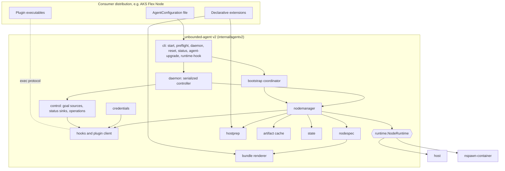

Data flows in three steps:

1. The `AgentConfiguration` and bootstrap credentials resolve to a `NodeSpec`:
   *what* to run.
2. The `NodeSpec`, the runtime's `Layout(slot)` and the resolved extensions
   render to a `NodeBundle`.
3. The bundle is handed to `NodeRuntime.Provision(slot, bundle)`, which decides
   *where* it runs.

Both runtimes share the host kernel and the host network namespace with the
node. The orchestrator relies on this: it configures host sysctls for the node
and cleans host network state after stopping a node. A future runtime that
breaks this assumption would need to add a capability to the interface.

## 5. External contract

This section is what a consumer builds against. Everything here is versioned
and experimental until section 14 promotes it.

### 5.1 CLI

| Command | Purpose |
|---|---|
| `v2 start` | Bootstrap: admission, host preparation, provision, start the node, install the daemon |
| `v2 preflight [--output json] [--ignore-errors]` | Read-only checks: built-in, runtime, extension and plugin checks |
| `v2 daemon` | Long-running reconciler, run by `unbounded-agent-v2-daemon.service` |
| `v2 reset [--force-standard-paths]` | Remove the node, the runtime footprint, extensions, host preparation and agent state |
| `v2 status [--output json]` | New. Runtime, slots, applied goal version, node readiness and any cleanup leftovers |
| `v2 agent-upgrade [--preflight]` | Upgrade the agent binary from the host |
| `v2 runtime-hook <pre-start\|post-start> <slot>` (hidden) | Called by systemd around the node boot unit |
| `v2 record-agent-upgrade-failure-signal` (hidden) | Used by the daemon recovery script |
| `v2 version` | Prints the version; also used to verify an upgrade candidate supports v2 |

The `v2` group is listed in `unbounded-agent --help` as "Experimental v2 agent
(unstable)". Its `PersistentPreRunE` sets up logging and immediately logs:

> unbounded-agent v2 is experimental: configuration, plugin protocol and
> on-host layout may change without notice; not supported for production use.

v1 commands set up logging inside `RunE` (`cmd/agent/internal/cmd/start.go:31`).
v2 does it earlier so the warning is always the first line of output.

Configuration is read from `--config` or `UNBOUNDED_AGENT_CONFIG_FILE`, the
variable cloud-init and Ignition already set
(`cmd/kubectl-unbounded/app/ignition.go:187`). v2 does not read configuration
from other environment variables.

`--force-standard-paths` only has an effect when the host runtime's claims
record is missing (section 10.10). MachineOperations and goal-driven resets
never set it.

### 5.2 Configuration

The configuration file is versioned. A file without `apiVersion` is treated as
v1 `UnboundedAgentConfig` JSON and converted, so existing machina provisioning
works unchanged.

```json
{
  "apiVersion": "agent.unbounded-cloud.io/v1alpha1",
  "kind": "AgentConfiguration",
  "machine": { "name": "m-01", "nodeName": "m-01" },
  "cluster": {
    "apiServer": "https://cluster.example:443",
    "caCertBase64": "...",
    "kubernetesVersion": "1.33.1",
    "clusterDNS": "10.0.0.10"
  },
  "kubelet": {
    "nodeIP": "",
    "labels": {},
    "registerWithTaints": [],
    "configuration": {},
    "imageCredentialProvider": null
  },
  "components": {
    "containerd": {},
    "runc": {},
    "cni": {},
    "gantry": {},
    "localDNS": { "corefileTemplate": "" }
  },
  "artifacts": { "downloads": {}, "offline": null },
  "runtime": {
    "type": "nspawn-container",
    "nspawnContainer": { "image": "", "additionalHostDevices": [], "additionalHostMounts": [] },
    "host": {
      "stopGracePeriod": "30s",
      "killTimeout": "15s",
      "repave": { "retainContainerImages": false },
      "adoptExistingPaths": [],
      "adoptPreserveMaxBytes": 1073741824
    }
  },
  "credentials": {
    "bootstrap": { "type": "static", "static": { "token": "..." } },
    "kubelet": { "type": "bootstrap" },
    "daemon": { "type": "csr", "csr": { "group": "unbounded-agent-daemons" } }
  },
  "control": {
    "goal": { "type": "machina" },
    "status": { "type": "machina" },
    "operations": { "type": "machina" }
  },
  "plugins": [
    { "name": "aks", "command": ["/opt/aks-flex-node/bin/aks-flex-node-plugin"] }
  ],
  "hooks": [
    { "event": "node.ready", "plugin": "aks", "timeout": "2m", "failurePolicy": "Fail" }
  ],
  "extensions": []
}
```

Enumerated fields:

| Field | Values |
|---|---|
| `runtime.type` | `host`, `nspawn-container`. Defaults to `nspawn-container` *(open for review, section 18)*. |
| `credentials.bootstrap.type` | `static`, `tpm` (metalman attestation), `plugin` |
| `credentials.kubelet.type` | `bootstrap`, `kubeconfig`, `exec` |
| `credentials.daemon.type` | `csr`, `kubeconfig`, `exec` |
| `control.goal.type` | `machina`, `static` (the configuration file is the goal), `plugin` |
| `control.status.type` | `machina`, `none`, `plugin` |
| `control.operations.type` | `machina`, `disabled` |
| `hooks[].failurePolicy` | `Fail`, `Ignore` |
| `runtime.host.adoptExistingPaths[].mode` | `Preserve`, `Discard` (section 10.3) |

Validation rules:

- `runtime.nspawnContainer` settings are rejected when `runtime.type` is
  `host`, and `runtime.host` settings are rejected for `nspawn-container`.
- `runtime.host.adoptExistingPaths[].path` must be a built-in owned path
  (section 10.4) or an extension-declared state path.
- For the `host` runtime, `cgroupRoot` and `cgroupDriver` are reserved and
  rejected in `kubelet.configuration`, in addition to v1's reserved fields
  (`pkg/agent/config/config.go:615-623`).
- `credentials.kubelet.exec.command` and `credentials.daemon.exec.command` are
  host paths. The runtime makes the kubelet command visible inside the node
  (section 9).

The LocalDNS Corefile template variables become a documented contract:
`NodeListenerIP`, `ClusterListenerIP`, `NodeUpstreamIPsJoined`,
`ClusterDNSServiceIP` and `MetricsAddress`
(`pkg/agent/goalstates/assets/default-localdns.Corefile.tmpl:2-33`). Flex's
LocalDNS rendering depends on these names.

### 5.3 Extension mechanisms

| Mechanism | Use it for | Can it replace built-in behavior? |
|---|---|---|
| Configuration | Kubelet settings, labels, taints, versions, the LocalDNS template, credential modes | Not applicable |
| Declarative extensions (5.4) | Extra node binaries, files and units; extra host units; ordering before node boot; cleanup declarations | No, additive only |
| Providers, through exec plugins (5.5) | Goal source, status sink, bootstrap credentials, daemon credentials, extra preflight checks | Yes, a provider replaces one built-in implementation |
| Lifecycle hooks, through exec plugins (5.5) | Side effects at fixed points | No. Hooks observe, and can fail the operation. |

Lifecycle hook events:

| Event | Fires | Payload | Default failure policy |
|---|---|---|---|
| `bootstrap.starting` | After admission, before host preparation | machine, runtime, admission kind | `Fail` |
| `host.prepared` | After host preparation | runtime | `Fail` |
| `node.provisioned` | After `Provision(slot)`, before `Start` | slot, bundle digest, goal version | `Fail` |
| `node.ready` | After the node is ready (bootstrap, repave, reboot) | slot, node name, goal version | `Fail` |
| `node.stopping` | Before `Stop` (repave, reboot, reset) | slot, reason | `Ignore` |
| `repave.starting` | Before a repave | from slot, to slot, goal versions | `Fail` |
| `repave.finished` | After a repave | result | `Ignore` |
| `agent.upgraded` | When the new daemon publishes an upgrade result | old and new version, result | `Ignore` |
| `reset.starting` | Before a reset | trigger: CLI, operation or goal | `Ignore` |
| `reset.finished` | After a reset | leftovers | `Ignore` |

### 5.4 Declarative extensions

An extension adds content to the node and the host. It cannot change what the
agent itself renders.

```json
{
  "name": "node-problem-detector",
  "artifacts": [
    {
      "name": "npd",
      "url": "https://example.invalid/npd.tar.gz",
      "sha256": "...",
      "extract": "bin/node-problem-detector",
      "nodePath": "/usr/local/bin/node-problem-detector",
      "mode": "0755"
    }
  ],
  "node": {
    "files": [ { "path": "/etc/npd/kernel-monitor.json", "mode": "0644", "content": "..." } ],
    "units": [ { "name": "node-problem-detector.service", "content": "...", "start": "AfterKubelet" } ]
  },
  "host": {
    "units": [ { "name": "static-routes.service", "content": "...", "orderBeforeNode": true } ],
    "files": [ { "path": "/etc/aks-flex-node/static-routes.sh", "mode": "0755", "content": "..." } ]
  },
  "hostExposures": [ { "hostPath": "/opt/aks-flex-node/bin", "nodePath": "/opt/aks-flex-node/bin", "readOnly": true } ],
  "nodeDependencies": { "requires": ["systemd-udev-settle.service", "himdsd.service"] },
  "cleanup": {}
}
```

Rules:

- Extension artifacts go through the same artifact cache, offline sources and
  preflight reachability checks as built-in artifacts.
- `host.units` with `orderBeforeNode` get `Before=` and
  `RequiredBy=unbounded-node-pre.target`.
- `hostExposures` are realized by the runtime: a bind mount for
  `nspawn-container`, the path itself for `host`.
- `cleanup` declares state the extension's workloads create (section 10.14).
- Everything an extension creates is recorded in state and removed by reset.

Two stable systemd anchors replace the hardcoded `systemd-nspawn@`
dependencies in v1's assets and in Flex:

| Anchor | Meaning |
|---|---|
| `unbounded-node-pre.target` | Everything the node needs from the host: the nftables flush, the LocalDNS network helper and extension host units. The runtime's node boot unit `Requires=` and is `After=` this target. |
| `unbounded-node.target` | The node itself. Consumers order `After=` it. |

### 5.5 Plugin protocol

A plugin is an executable owned by the consumer. The agent runs
`<command...> <method>` with a JSON request on stdin and reads a JSON response
from stdout. A non-zero exit or an `error` object means failure. stderr goes to
the agent log, size-bounded. Secrets travel only on stdin, never in arguments
or the environment.

```json
{
  "apiVersion": "plugin.agent.unbounded-cloud.io/v1alpha1",
  "kind": "Request",
  "method": "goal.get",
  "context": { "machine": "m-01", "node": "m-01", "runtime": "host", "agentVersion": "..." },
  "payload": {
    "node": { "exists": true, "uid": "...", "labels": {}, "taints": [] },
    "applied": { "goalVersion": "..." }
  }
}
```

| Method | Request payload | Response payload |
|---|---|---|
| `describe` | None | `{protocolVersions[], methods[]}`. Called at startup. A configured method the plugin does not list fails startup. |
| `goal.register` | Machine identity, runtime, versions | None |
| `goal.get` | Node observation, applied state | `{version, config, disposition}`. `config` is a full `AgentConfiguration`; `disposition` is `Active` or `Delete`. |
| `status.report` | `{phase, reason, message, appliedVersion, runtime}` | None |
| `credentials.bootstrap` | None | `{apiServer, caCertBase64, token}` |
| `credentials.cluster` | None | A Kubernetes `ExecCredential` |
| `preflight.check` | Configuration summary | `[{name, severity, message}]` |
| `hook.<event>` | The event payload (5.3) | None |

Operational rules:

- Each method has a configurable timeout. On timeout or cancellation the
  plugin gets SIGTERM, then SIGKILL.
- The plugin path must be absolute, owned by root, and not writable by group
  or others. Plugins run as root.
- The agent never upgrades plugins. Compatibility is negotiated through
  `describe`.

The exec model follows the kubelet credential provider and CNI patterns:
there is no plugin process to supervise and each call is easy to test. Goal
changes are picked up by polling plus Node events. A streaming transport can be
added later as a new protocol version.

### 5.6 On-host footprint

| Item | Location |
|---|---|
| Agent binary, shared with v1 | `/opt/unbounded/agent/bin/unbounded-agent{,-blue,-green,-current,-last-good}` |
| Binary activation lock, shared with v1 | `/run/unbounded-agent-upgrade.lock` |
| Install record | `/var/lib/unbounded/agent-v2/install.json` |
| Install lock | `/run/unbounded-agent-v2-install.lock` |
| Node state | `/var/lib/unbounded/agent-v2/node-state.json` and `.sha256` |
| Host preparation journal | `/var/lib/unbounded/agent-v2/hostprep.json` |
| Artifact cache | `/var/lib/unbounded/agent-v2/artifacts/<sha256>` |
| Host runtime state | `/var/lib/unbounded/agent-v2/host-runtime/` (claims, activation, adoption backups) |
| Host runtime slots | `/var/lib/unbounded/agent-v2/slots/{a,b}` |
| Configuration copy, daemon credentials, upgrade signal | `/etc/unbounded/agent-v2/` |
| Units, both runtimes | `unbounded-agent-v2-daemon.service`, `unbounded-agent-v2-daemon-recovery.service`, `unbounded-node-pre.target`, `unbounded-node.target`, `nftables-flush.service` |
| `nspawn-container` runtime | `/var/lib/machines/kube{1,2}`, `/etc/systemd/nspawn/kube{1,2}.nspawn`, `systemd-nspawn@kube{1,2}.service.d/` |
| `host` runtime | `unboundednode.slice`, `containerd.service`, `kubelet.service`, `localdns.service`, plus the owned paths in section 10.4 |

On-host names are fixed. Consumers cannot rename units or paths. Only the
identity the cluster sees is configurable: the daemon CSR group and name
(`credentials.daemon.csr`).

### 5.7 Mapping AKS Flex Node customizations

| Flex today | v2 mechanism |
|---|---|
| Own configuration schema, translated with `ToAgentConfig` | Flex's bootstrap script renders an `AgentConfiguration`; dynamic values come from providers |
| ARM Machine backend: create, get, ETag, status | `goal` and `status` plugin providers |
| Reset on a deleting taint plus a missing ARM Machine | `goal.get` sees the Node's taints and returns `disposition: Delete` |
| Fresh bootstrap data before a repave | `credentials.bootstrap` provider, called before every provision |
| Kubelet exec credential, binary copied into the rootfs | `credentials.kubelet.type: exec` plus a `hostExposures` entry |
| Daemon exec credential, host path rewritten | `credentials.daemon.type: exec` |
| CSR group `aks-flex-node-daemons` | `credentials.daemon.csr.group` |
| Static routes with `RequiredBy=systemd-nspawn@.service` | Host extension unit with `orderBeforeNode` |
| `additionalRequiredServices` and the udev-settle drop-in | `nodeDependencies.requires` |
| NPD written into the rootfs and started with `systemd-run` | Node extension: an artifact plus a unit with `start: AfterKubelet` |
| Arc and NPD preflight checks | `preflight.check`, plus automatic reachability checks for extension artifacts |
| `maxPods`, reserved resources, forced labels | `kubelet.configuration` and `kubelet.labels` |
| AKS LocalDNS template | `components.localDNS.corefileTemplate` plus the variable contract |
| `machineOperationMode: disable` | `control.operations.type: disabled` |
| Startup gate around its reconcilers | Built in (section 8.4) |
| Own blue/green upgrade, signal file, recovery unit and unit names | Built in (section 8.7) |
| Host-root move; `uninstall.sh` that hardcodes unbounded names | Not needed: `v2 reset` plus the documented footprint |

## 6. Code layout

### 6.1 Packages

```
cmd/agent/internal/cmd/v2.go     registers the "v2" group, delegates to internal/agentv2/cli
internal/agentv2/
  cli/            cobra commands and the experimental warning
  config/         AgentConfiguration v1alpha1, defaults, validation, v1 JSON conversion
  nodespec/       NodeSpec and Resolve
  bundle/         NodeBundle, Layout, Render (pure), templates
  runtime/        NodeRuntime interface, types, errors, registry
    runtimetest/  fake runtime and conformance suite
    host/         the host runtime, including cleanup (section 10)
    nspawn/       the nspawn-container runtime
  hostprep/       host preparation tasks, requirement merging, the undo journal
  hostnet/        host network reset, used for both runtimes
  artifacts/      cache, download, verification, offline sources
  state/          install record, node state, locks
  bootstrap/      admission and stages
  nodemanager/    Ensure, Apply, Reboot, Reset, Recover, Decide
  control/        goal sources, status sinks, operation source (machina, static, plugin)
  credentials/    bootstrap (static, tpm, plugin), kubelet, daemon (csr, kubeconfig, exec)
  daemon/         controller wiring, startup gate, operation handlers, unit assets
  agentupgrade/   MachineOperation and CLI upgrade over pkg/agent/agentbinary
  plugin/         exec client, protocol types, describe negotiation
  hooks/          event runner
  extensions/     validation, resolution, merge into bundle and hostprep
  preflight/      check composition
```

### 6.2 Code copied from v1

Go's `internal` rule prevents `internal/agentv2` from importing
`cmd/agent/internal`. v2 copies what it needs rather than moving shared code,
so v1 stays untouched and the copies can diverge.

| Source | Destination | Expected divergence |
|---|---|---|
| `cmd/agent/internal/installstate` | `internal/agentv2/state` | The record gains the runtime kind |
| `cmd/agent/internal/bootstrap` | `internal/agentv2/bootstrap` | Stages renamed for runtime-neutral work |
| `cmd/agent/internal/attest` | `internal/agentv2/credentials` (the `tpm` provider) | Wrapped as a bootstrap credential provider |
| `cmd/agent/internal/daemon` unit and recovery assets, enable, stop and repair logic | `internal/agentv2/daemon` | Unit runs `<current> v2 daemon` |
| `cmd/agent/internal/daemon/bootstrap_status.go` and Machine registration (`daemon.go:303-406`) | `internal/agentv2/control` (the `machina` providers) | Behind the goal and status interfaces |
| `cmd/agent/internal/daemon/agentupgrade.go`, `hostupgrade.go` | `internal/agentv2/agentupgrade` | Verifies `v2` support in candidates |
| The MachineOperation reconciler in `pkg/agent/daemon/machineoperation.go` | `internal/agentv2/control` | Fails unsupported agent-domain operations (section 12) |
| Rendering templates from `pkg/agent/phases/nodestart/assets` and `pkg/agent/phases/rootfs/assets` | `internal/agentv2/bundle` and `runtime/nspawn` | None at first; parity is enforced by golden tests (section 15) |

Each copied file starts with a comment naming its source path and the commit it
was copied from. This list is kept current so v1 bug fixes can be checked
against the copies.

### 6.3 Existing packages used as libraries

v2 imports these unchanged: `pkg/agent/phases`, `pkg/agent/preflight`,
`pkg/agent/agentbinary`, `pkg/agent/daemoncred`, `pkg/agent/artifactsource`,
`pkg/agent/bootstrapartifacts`, the resolvers in `pkg/agent/goalstates`, the
OCI unpack in `pkg/agent/phases/rootfs/oci`, `pkg/agent/daemon` (controller
shell only), `internal/executil`, `internal/fsutil` and `internal/hostroot`.

The only v1 change besides adding the `v2` command group is in
`pkg/agent/phases/host/preflight_existing_deployment.go:130-139`: v1's
existing-deployment preflight also detects v2's install record and daemon unit.
Without it, v1 `start` on a v2 `host` runtime would mask v2's `kubelet` and
`containerd` units. The check is additive; it only fires on hosts with v2
installed, including for Flex, which calls `host.Preflight`.

## 7. Internal interfaces

The Go below is a sketch of the intended shape. Names may change during
implementation; the contracts should not.

### 7.1 Node runtime

```go
package runtime

type Kind string

const (
	KindHost            Kind = "host"
	KindNSpawnContainer Kind = "nspawn-container"
)

// Slot names one of the two node instances a runtime can hold.
type Slot string

const (
	SlotA Slot = "a" // nspawn-container: kube1
	SlotB Slot = "b" // nspawn-container: kube2
)

// NodeRuntime hosts Kubernetes node instances. The agent reaches a node only
// through this interface.
//
// Every runtime shares the host kernel and the host network namespace with
// the node. The orchestrator relies on this: it configures host sysctls for
// the node and cleans host network state after Stop.
type NodeRuntime interface {
	Kind() Kind

	// HostRequirements reports what the host must provide or give up:
	// packages, commands, units to mask or own, kernel modules.
	HostRequirements(spec *nodespec.NodeSpec) HostRequirements
	// Preflight returns read-only runtime checks.
	Preflight(spec *nodespec.NodeSpec) []preflight.Checker
	// Footprint lists every unit, path and link the runtime may create.
	Footprint() Footprint
	// Layout tells the renderer where node content lives, from the node's view.
	Layout(slot Slot) bundle.Layout

	Inspect(ctx context.Context) (State, error)
	Provision(ctx context.Context, slot Slot, b *bundle.NodeBundle) error
	Start(ctx context.Context, slot Slot) error
	Stop(ctx context.Context, slot Slot) error
	Restart(ctx context.Context, slot Slot) error
	Destroy(ctx context.Context, slot Slot) error
	// Teardown removes everything in Footprint, with or without state records.
	Teardown(ctx context.Context) error

	// Access observes a started node: readiness and diagnostics.
	Access(slot Slot) NodeAccess
	// Hook runs runtime-owned work that systemd triggers around node boot.
	Hook(ctx context.Context, phase HookPhase, slot Slot, b *bundle.NodeBundle) error
}

type SlotPhase string // Absent, Provisioned, Running, Stopped

type SlotState struct {
	Phase        SlotPhase
	BundleDigest string
	NeverStarted bool // the next Start begins with fresh node state
}

type State struct{ Slots map[Slot]SlotState }

type NodeAccess interface {
	UnitActive(ctx context.Context, unit string) (bool, error)
	FileNonEmpty(ctx context.Context, path string) (bool, error)
	Exec(ctx context.Context, argv ...string) ([]byte, error)
}

type HookPhase string

const (
	HookPreStart  HookPhase = "pre-start"
	HookPostStart HookPhase = "post-start"
)

var (
	ErrSlotBusy   = errors.New("another slot is running")
	ErrSlotActive = errors.New("slot is the active slot")
)
```

Rules every runtime must follow. A shared conformance suite,
`runtimetest.Conformance(t, factory)`, enforces them.

1. Every method is idempotent and safe to repeat after a crash.
2. `Provision` and `Destroy` on one slot never affect the other slot while it
   runs.
3. `Start(x)` returns `ErrSlotBusy` while another slot is running.
4. The first `Start` after `Provision` begins with empty kubelet and containerd
   state. The one exception is container image content, when the runtime is
   configured to keep it (`runtime.host.repave.retainContainerImages`).
   `Restart` keeps all state.
5. The orchestrator puts content into a node only through `Provision`.
   Runtime-owned hooks may change the node, for example NVIDIA wiring in the
   `nspawn-container` post-start hook.
6. Runtimes do not download artifacts, call the Kubernetes API, or run plugins.

### 7.2 Node spec and bundle

```go
package nodespec

type NodeSpec struct {
	Identity     Identity     // machine name, node name, hostname
	Kubernetes   Kubernetes   // version, kubelet config, flags, labels, taints, node IP, auth
	Containerd   Containerd   // version, sandbox image, Gantry mirror, NVIDIA runtime
	CNI          CNI
	LocalDNS     *LocalDNS
	Accelerators Accelerators // NVIDIA and AMD discovery results
	Devices      HostDevices
	Mounts       []Mount
	Artifacts    []ArtifactRequest
	Images       []ImageArchiveRequest
}

func Resolve(ctx context.Context, cfg *config.AgentConfiguration, creds *credentials.Bootstrap, probe HostProbe) (*NodeSpec, error)
```

```go
package bundle

type Layout struct {
	BinDir             string // nspawn-container: /usr/local/bin; host: /var/lib/unbounded/agent-v2/slots/<slot>/bin
	CNIBinDir          string
	ImageArchiveDir    string
	OwnsSystemResolver bool // nspawn-container: true; host: false
}

type NodeBundle struct {
	Digest        string
	Artifacts     []Artifact     // verified files in the host artifact cache, with node paths
	Files         []File         // configs, kubeconfigs, CA, unit drop-ins
	Units         []Unit         // units that run inside the node
	HostExposures []HostExposure // host paths the node must see
	Devices       DeviceRequest  // GPUs, KVM, InfiniBand, block, additional devices
	Boot          []BootStep     // ordered: localdns, containerd, image import, kubelet, extensions
	Readiness     Readiness      // kubelet active, kubeconfig non-empty, LocalDNS ready URLs
}

type File struct {
	NodePath string
	Mode     fs.FileMode
	Content  []byte
	Secret   bool // never logged or included in diagnostics
}

// Render is pure. The same inputs produce the same bundle and digest.
func Render(spec *nodespec.NodeSpec, layout Layout, ext []extensions.Resolved) (*NodeBundle, error)
```

The bundle is not persisted. It is rendered again from the applied
configuration whenever it is needed, for example by the boot hooks.

### 7.3 Control plane integration

```go
package control

type Disposition string

const (
	Active Disposition = "Active"
	Delete Disposition = "Delete"
)

type Goal struct {
	// Version is opaque: a MachineConfigurationVersion name, an ARM ETag or a
	// digest of the configuration file. It is compared for equality only.
	Version     string
	Config      *config.AgentConfiguration
	Disposition Disposition
}

type Observation struct {
	Node    *NodeObservation // nil when the Node object does not exist
	Applied *state.Applied
}

type GoalSource interface {
	Register(ctx context.Context, r Registration) error
	Get(ctx context.Context, obs Observation) (*Goal, error)
	Trigger() Trigger // an event source, or a poll interval
}

type StatusSink interface {
	Report(ctx context.Context, s Status) error
}
```

Built-in providers:

- `machina`: registers the Machine, reads the desired configuration from the
  Machine and its MachineConfigurationVersion as v1 does
  (`cmd/agent/internal/daemon/controller_node.go:75-105`), and writes Machine
  status.
- `static`: the configuration file is the goal; the version is its digest.
- `plugin`: delegates to a plugin (section 5.5).

### 7.4 Credentials

```go
package credentials

type Bootstrap struct {
	APIServer string
	CACert    []byte
	Token     string // empty when kubelet uses exec or kubeconfig auth
}

type BootstrapProvider interface {
	Bootstrap(ctx context.Context) (*Bootstrap, error)
}

type ClusterAuth interface {
	RESTConfig() *rest.Config
	Run(ctx context.Context) error // rotation
}
```

The `csr` daemon credential reuses `pkg/agent/daemoncred`. The kubelet's three
authentication modes (bootstrap token, kubeconfig, exec credential) are carried
over from v1 (`pkg/agent/phases/nodestart/kubelet.go:282-379`).

### 7.5 Hooks and plugins

```go
package hooks

type Event string

type Runner interface {
	Fire(ctx context.Context, e Event, payload any) error
}
```

```go
package plugin

type Client interface {
	Describe(ctx context.Context) (*Description, error)
	Call(ctx context.Context, method string, req, resp any) error
}
```

### 7.6 Node manager

```go
package nodemanager

type Manager interface {
	Ensure(ctx context.Context, cfg *config.AgentConfiguration) error // bootstrap on slot A
	Apply(ctx context.Context, g *control.Goal) error                 // repave to the inactive slot
	Reboot(ctx context.Context) error
	Reset(ctx context.Context, trigger ResetTrigger) error
	Recover(ctx context.Context) error // finish or clean up interrupted work
	Observe(ctx context.Context) (control.Observation, error)
}

type Action string // Steady, Wait, Repave, Reset

func Decide(obs control.Observation, g *control.Goal, drift func(applied, desired *config.AgentConfiguration) bool) Action
```

The drift function starts from v1's `hasDrift`
(`cmd/agent/internal/daemon/nodeoperator.go:134-187`). Fields that only matter
for one runtime, such as the nspawn OCI image, are contributed by that runtime.

### 7.7 State

```go
package state

type Applied struct {
	Runtime      runtime.Kind
	ActiveSlot   runtime.Slot
	Pending      *Pending // non-nil while a repave is in flight
	GoalVersion  string
	Config       *config.AgentConfiguration
	BundleDigest string
	NodeUID      string // UID of the Node the active slot registered, once observed
}

type Pending struct {
	Slot        runtime.Slot
	GoalVersion string
	Config      *config.AgentConfiguration
}
```

A single `Applied` record replaces v1's per-slot applied-configuration files.
It removes an ambiguity in v1: `FindActiveMachine` returns `kube1` whenever
both slots have a configuration file
(`cmd/agent/internal/daemon/nodeoperator.go:77`), which can happen after a
crash during a repave.

## 8. Lifecycles

### 8.1 Slot states

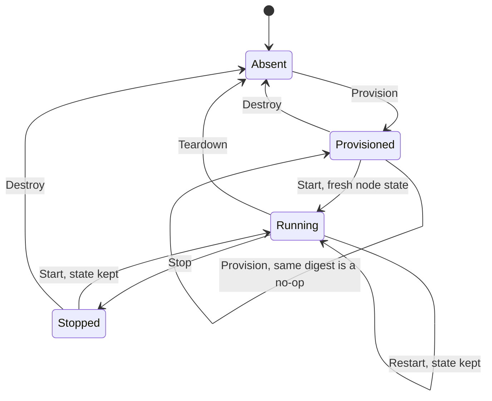

### 8.2 Bootstrap (`v2 start`)

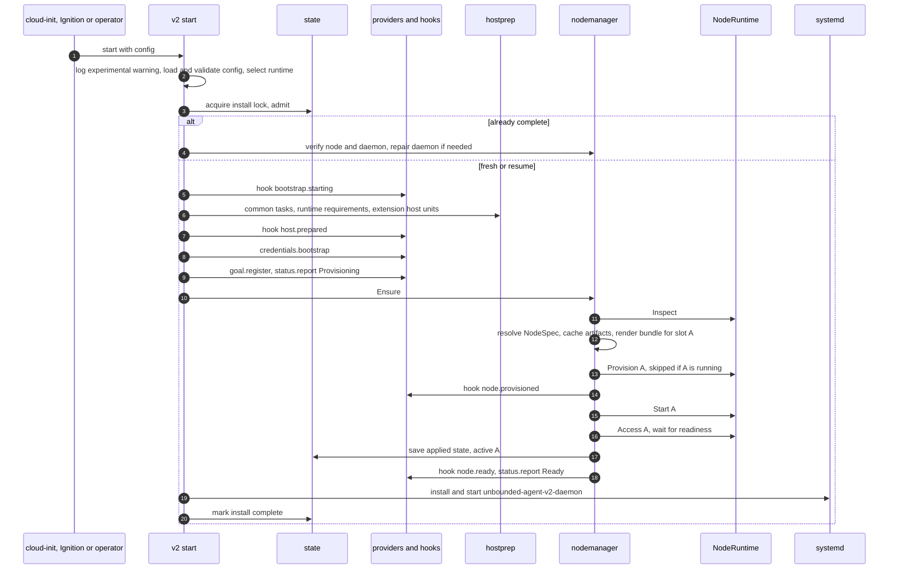

### 8.3 Host boot

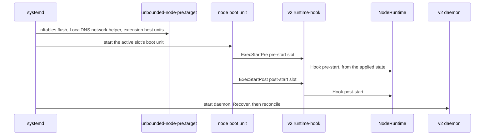

The node boot unit is `systemd-nspawn@kube1.service` or `@kube2` for
`nspawn-container`, and `containerd.service` plus `kubelet.service`, grouped by
`unbounded-node.target`, for `host`.

v1 runs its hooks through a separate copy of the binary that survives an
upgrade rollback (`pkg/agent/phases/rootfs/lifecycle_helper.go:34-37`). Whether
v2 can use the `current` link instead is listed in section 18.

### 8.4 Daemon reconcile

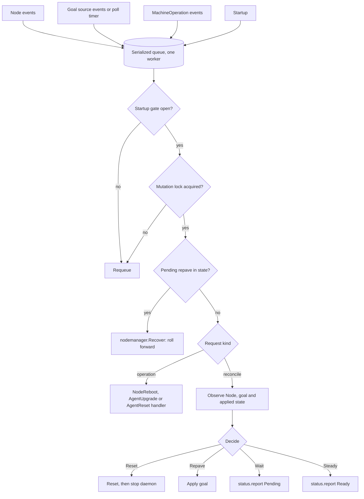

The startup gate opens after a pending AgentUpgrade result is published,
`Recover` has finished, and the caches have synced.

`Decide`:

| Goal disposition | Node object | Goal version vs applied | Drift | Action |
|---|---|---|---|---|
| `Delete` | Any | Any | Any | Reset |
| `Active` | Never observed for the active slot | Any | Any | Wait: kubelet has not registered yet |
| `Active` | Present | Equal | Not applicable | Steady; record the Node UID |
| `Active` | Present | Differs | No | Steady; mark the version applied |
| `Active` | Present | Differs | Yes | Wait: repave pending until the Node is deleted |
| `Active` | Deleted: UID seen before, now absent | Any | Yes | Repave |
| `Active` | Deleted | Any | No | Steady; mark applied, matching v1 (`cmd/agent/internal/daemon/controller_node.go:54-62`) |

Unlike v1, which reacts only to Node delete events, this is level-triggered: a
Node deleted while the daemon was down is still noticed. The recorded Node UID
keeps a node that has not registered yet from looking deleted.

### 8.5 Repave

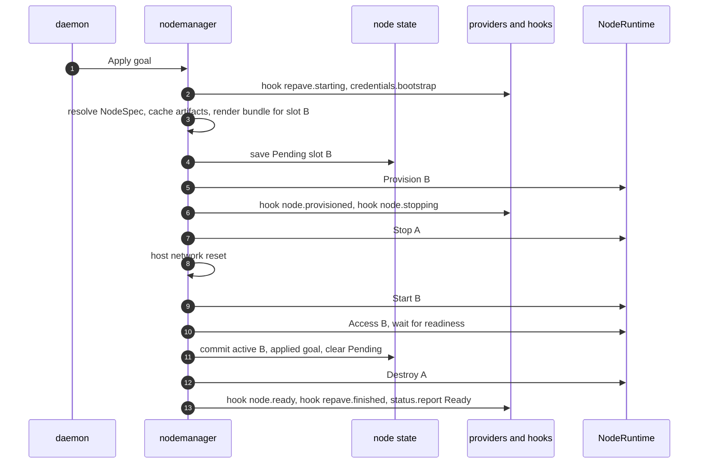

`Recover` after a crash:

- `Pending` is set and A was never stopped: run `Apply` again. `Provision` is
  idempotent.
- `Pending` is set and A is stopped: continue from `Start B`.
- No `Pending`, but a slot other than the active one is provisioned: `Destroy`
  it.

Differences from v1:

- v1 persists the new configuration before waiting for kubelet, then removes
  the old slot (`cmd/agent/internal/daemon/nodeoperator.go:275-285`). v2
  commits only once the node is ready.
- The old slot is destroyed only after the commit. A later version could roll
  back by starting A again. Automatic rollback is not proposed, matching v1.

### 8.6 NodeReboot

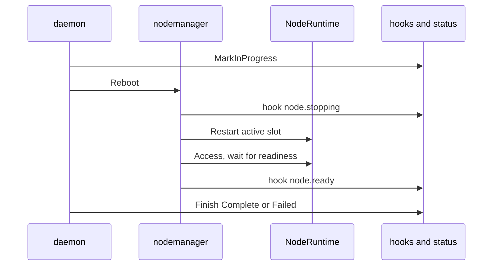

`Restart` per runtime:

- `nspawn-container`: `systemctl restart systemd-nspawn@<m>`, which runs the
  hooks again, matching v1
  (`pkg/agent/phases/nodestart/nspawn_lifecycle.go:36-40`).
- `host`: Quiesce and Release (section 10), the pre-start hook, the pre target
  and node target, then the post-start hook.

There is no host network reset on reboot, matching v1's `RestartNode`
(`cmd/agent/internal/daemon/nodeoperator.go:224-229`).

### 8.7 AgentUpgrade

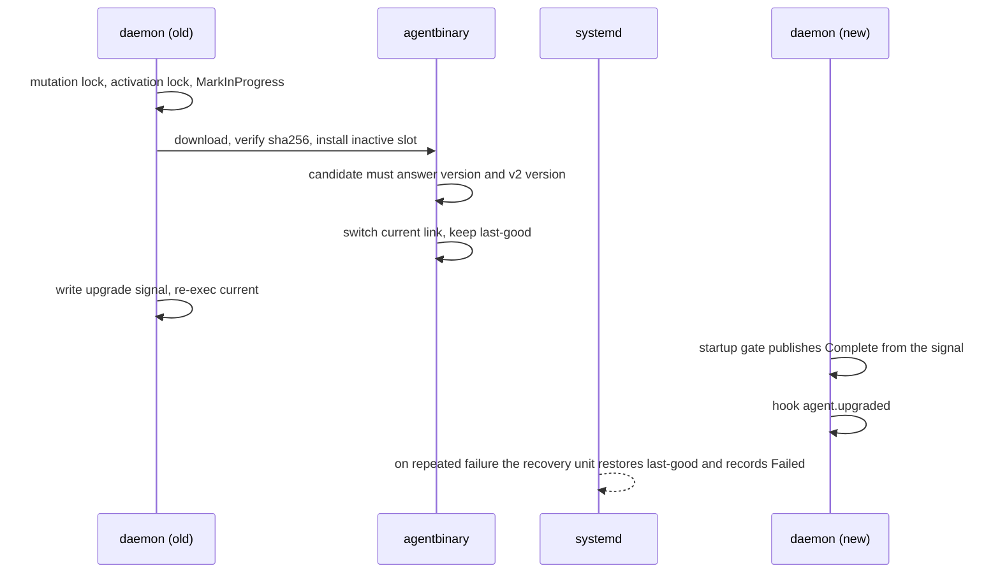

This is v1's mechanism
(`cmd/agent/internal/daemon/controller_machineoperation.go:79-165`,
`pkg/agent/agentbinary/upgrade.go:193-273`) with two additions:

- A candidate binary is checked with `v2 version` as well as `version`
  (`pkg/agent/agentbinary/agentbinary.go:125`), so a binary without the `v2`
  command is rejected before the switch.
- The daemon unit runs `<current> v2 daemon`.

### 8.8 Reset

Reset is triggered by `v2 reset`, an `AgentReset` MachineOperation, or a goal
with `disposition: Delete`.

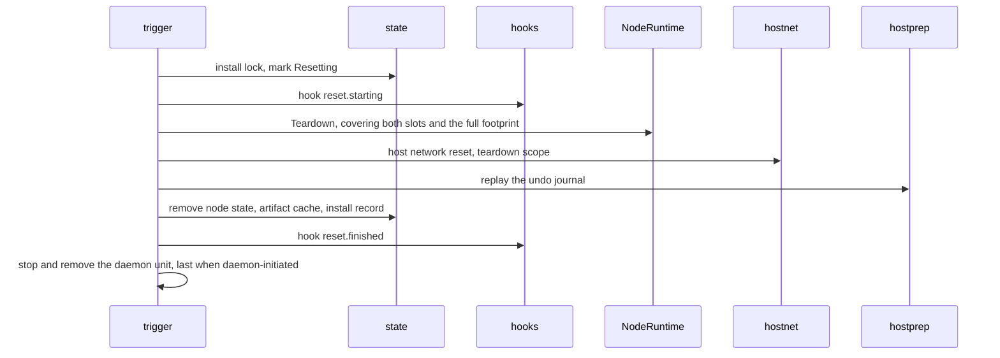

## 9. Runtimes

| | `nspawn-container` | `host` |
|---|---|---|
| Slot | `/var/lib/machines/kube1`, `kube2` | `/var/lib/unbounded/agent-v2/slots/{a,b}` |
| Provision | Unpack the OCI image; write the bundle, `.nspawn` file and unit override | Stage binaries and rendered files into the slot directory |
| Start | `machinectl start`, then boot steps through `systemd-run -M` | Install units and configuration from the slot, start the pre target and `unbounded-node.target` |
| Fresh state | A new rootfs | Wipe the claimed paths (section 10.8) |
| `NodeAccess` | `systemd-run -M` | Direct |
| NVIDIA | v1's bind mounts, library symlinks, driver root and CDI generation in the post-start hook | CDI generation with `nvidia-ctk cdi generate --driver-root /` in the pre-start hook, writing `/var/run/cdi/nvidia.yaml` |
| NVIDIA Container Toolkit | From the GPU OCI image (`images/agent-ubuntu2404-nvidia/Containerfile:21-31`) | Shipped as an agent artifact (section 9.2) |
| Devices and extra mounts | Bind mounts plus `DeviceAllow` | Nothing to do; already visible |
| Host exposures | Bind mounts | The paths themselves |
| Resolver | Writes the node's `/etc/resolv.conf` | Never touches the host's `/etc/resolv.conf`; kubelet uses `--resolv-conf` (`pkg/agent/goalstates/resolve.go:163-166`) |
| Host requirements | `systemd-container`; mask the host's containerd and kubelet | Own `containerd.service` and `kubelet.service`; mask docker; check for conflicting packages |

### 9.1 `nspawn-container`

This runtime is the parity reference. It wraps v1's nspawn code: OCI unpack,
`.nspawn` and override rendering, `machinectl` start and stop, NVIDIA wiring,
and machine removal. Slots map to v1's machine names (`a` is `kube1`, `b` is
`kube2`), which keeps existing tooling and v1's existing-deployment detection
working.

### 9.2 `host`

The node runs directly on the host:

- `containerd.service`, `kubelet.service` and `localdns.service` keep their
  standard names and run in `unboundednode.slice` (section 10.6).
- Binaries live in the active slot's directory; units point at them. A repave
  stages the new slot, then rewrites the units on activation.
- Preflight adds a `conflicting-packages` check for distro packages that ship
  kubelet, containerd or docker's containerd.

NVIDIA Container Toolkit, as an artifact:

- A new `nvidiaContainerToolkit` artifact with a pinned default version, a
  download override (`artifacts.downloads.nvidiaContainerToolkit`), a required
  SHA-256, and inclusion in offline artifacts built by
  `hack/cmd/agent-artifacts-builder`.
- It is fetched, and checked by preflight, only when NVIDIA GPUs are present.
- Upstream distributes OS packages, so the release pipeline repackages the
  binaries CDI mode needs into a tarball. The expected set is
  `nvidia-container-runtime`, `nvidia-ctk` and `nvidia-cdi-hook` *(inference;
  validation task V3)*.
- Binaries are staged in `<slot>/nvidia/bin`. containerd's `nvidia` runtime
  `BinaryName` points there. The toolkit's configuration lives in the slot
  directory, so the host's `/etc/nvidia-container-runtime/config.toml` is never
  edited.
- The NVIDIA driver stays a host prerequisite, checked by the existing
  `nvidia-driver` preflight.

The workloads on a `host` node see the real host rather than a container. For
example, racer's `/dev` hostPath is the host's whole `/dev`
(`internal/racer/workload/workload.go:269`), and unbounded-net's init container
reaches the real init with `nsenter -t 1` (`images/net/node-agent-init.sh:17`).
The `host` runtime documentation must say this.

## 10. Host runtime cleanup

### 10.1 Why the host runtime needs explicit cleanup

In `nspawn-container`, the container is the cleanup boundary. The `host`
runtime has no container, so it has to provide each guarantee itself.

| Resource | `nspawn-container` gets it for free because | `host` must |
|---|---|---|
| Node processes: kubelet, containerd, shims, pods | Stopping the machine kills its whole cgroup scope (`pkg/agent/phases/reset/machine.go:33-91`) | Contain them in one slice and kill it (10.6) |
| Pod mounts, overlay rootfs, `/run/netns/cni-*` | They live in the container's mount namespace and its `/run` *(inference)* | Unmount and remove them (10.7) |
| kubelet, containerd and CNI state | A repave unpacks a new rootfs | Wipe the claimed paths (10.8) |
| Pod hostPath data | hostPaths resolve inside the rootfs, e.g. `/etc/wireguard`, `/opt/cni/bin` (`deploy/net/node/03-daemonset.yaml.tmpl:135-155`) and `/var/lib/gantry/libp2p` (`deploy/gantry/chart/templates/daemonset.yaml:134-135`) | Wipe the known and declared paths, report the rest (10.8, 10.13) |
| Network: links, routes, rules, nftables and iptables | Nothing: the network namespace is already shared (`pkg/agent/phases/rootfs/assets/nspawn.conf:20-21`) | The same network reset as today (10.9) |
| eBPF pins | Each machine gets its own bpffs (`nspawn.conf:27-29`) | Pins land in the host's bpffs; only declared pins are cleaned (10.13) |

### 10.2 Principles

1. **Delete only what is provably owned.** A path is deleted only if it is in
   the claims record or the installed-files manifest.
2. **Never cross a mount or follow a symlink while deleting.** A mount found
   inside a tree being deleted aborts the deletion. Pod volumes are often bind
   mounts of host data, and deleting through one destroys that data.
3. **Contain processes in a slice** that can be killed as a unit.
4. **Every level is idempotent and restartable.** Intent is written durably
   before acting.
5. **Fail closed before start, best effort on teardown.** A failed check before
   starting a fresh node blocks the start. Teardown runs every step, then
   reports leftovers.
6. **Report what cannot be cleaned** rather than ignoring it.

### 10.3 Ownership and adoption

The claims record is
`/var/lib/unbounded/agent-v2/host-runtime/claims.json`, mode 0600, written
durably with a `.sha256` sidecar.

```json
{
  "schemaVersion": 1,
  "installID": "4f1c...",
  "paths": [
    { "path": "/var/lib/kubelet", "class": "persistent", "created": true, "baselineMount": false },
    {
      "path": "/opt/cni/bin", "class": "persistent", "created": false, "baselineMount": false,
      "adopted": "Preserve",
      "backup": "/var/lib/unbounded/agent-v2/host-runtime/adopted/9c1e...",
      "backupSHA256": "..."
    }
  ],
  "installedFiles": [ { "path": "/etc/systemd/system/kubelet.service", "sha256": "..." } ],
  "sysctlBaseline": { "net.ipv4.ip_forward": "0", "net.ipv4.conf.eth0.rp_filter": "2" },
  "rtTablesExisted": true,
  "observedHostPaths": [ "/var/lib/some-daemonset" ]
}
```

Claims are made on the first activation (10.8), before anything is created at
the path, and recorded first.

| State of the path at claim time | Result |
|---|---|
| Absent | Create it; record `created: true` |
| Exists and empty | Record `created: false` |
| Exists and is a mount point, such as a dedicated disk for `/var/lib/containerd` | Record `baselineMount: true`. The mount is never unmounted; only its contents are wiped. |
| Exists, non-empty, no adoption entry | Preflight error `existing-node-state`, listing the path |
| Exists, non-empty, adoption `Preserve` | Copy the contents into a backup, then claim with `adopted: "Preserve"`. Teardown restores the backup. |
| Exists, non-empty, adoption `Discard` | Claim with `adopted: "Discard"`. The contents are deleted at the first wipe. Teardown leaves the path empty. |

`Preserve` backups:

- live in `/var/lib/unbounded/agent-v2/host-runtime/adopted/<sha256-of-path>/`;
- keep mode, ownership, extended attributes and SELinux labels;
- are capped at `runtime.host.adoptPreserveMaxBytes`, 1 GiB by default; above
  the cap, preflight fails and suggests `Discard`;
- must stay within one filesystem; a mount inside the tree fails the adoption.

Preflight reports the adoption plan before anything changes: each path, its
mode, its size and file count, and the owning OS package if there is one
(`dpkg -S` or `rpm -qf`). An owned package gets a warning that a package
upgrade could write into a path the node now owns; removing the package is the
recommended alternative.

Without a claims record, Teardown is conservative (10.10).

### 10.4 Owned resources

Classes: **volatile** paths are cleared at Release, **persistent** paths at
Wipe, **installed** items at Remove, and **edits** (line-level changes to host
files) are reverted at Remove.

| Path or resource | Created by | Class | Notes |
|---|---|---|---|
| Processes in `unboundednode.slice` | runtime, kubelet, containerd | process | 10.6 |
| Mounts under `/var/lib/kubelet`, `/var/lib/containerd`, `/run/containerd` | kubelet, containerd | mount | 10.7 |
| `/run/netns/cni-*`, these entries only | containerd and CNI *(inference)* | netns | 10.7 |
| `/run/containerd` | containerd; gantry hostPath (`deploy/gantry/chart/values.yaml:26`) | volatile | |
| `/run/unbounded-net` | unbounded-net hostPath (`deploy/net/node/03-daemonset.yaml.tmpl:136-139`) | volatile | IPAM socket |
| `/run/racer` | racer hostPath (`internal/racer/workload/workload.go:292`) | volatile | |
| `/var/run/cdi/nvidia.yaml` | runtime pre-start hook | volatile | Regenerated on every start |
| `/var/lib/kubelet` | kubelet, bundle | persistent | Includes kubelet client certificates, so a wipe forces TLS bootstrapping again |
| `/var/lib/containerd` | containerd | persistent | Images and gantry's content cache; see `retainContainerImages` (10.8) |
| `/etc/kubernetes`, `/etc/containerd` including `certs.d` | bundle; gantry (`deploy/gantry/chart/values.yaml:34`) | persistent | Rewritten from the bundle on activation |
| `/opt/cni/bin` | bundle; unbounded-net init container (`images/net/node-agent-init.sh:55-65`) | persistent | Bundle plugins are installed again after the wipe |
| `/etc/cni/net.d` | unbounded-net (`cmd/unbounded-net-node/bootstrap_helpers.go:263`) | persistent | |
| `/var/lib/cni` | CNI IPAM *(inference)* | persistent | |
| `/var/log/pods`, `/var/log/containers` | kubelet *(inference)* | persistent | |
| `/etc/wireguard/server.priv` and `server.pub`, these files only | unbounded-net (`cmd/unbounded-net-node/bootstrap_helpers.go:372`) | persistent | The directory is left alone; the host may have its own WireGuard configuration |
| `/var/lib/gantry` | gantry (`deploy/gantry/chart/templates/daemonset.yaml:134-135`) | persistent | libp2p identity |
| `/var/lib/racer` | racer (`internal/racer/workload/workload.go:292`) | persistent | |
| `/etc/iproute2/rt_tables` lines `<id>\twg<id>` with id 51820 or higher | unbounded-net, only with policy routing (`internal/net/netlink/route_table_setup.go:28-105`) | edit | Lines removed at Remove. If the file did not exist at claim time and only default content remains, the file is removed. |
| Slot directories | runtime | staged | Removed by `Destroy` or Teardown |
| Units and drop-ins: `kubelet`, `containerd`, `localdns` and its slice, `unboundednode.slice`, the `unbounded-node*` targets, the LocalDNS network unit and helper, extension host units | runtime | installed | |
| Extension `cleanup.statePaths` | consumer | as declared | 10.14 |

### 10.5 Cleanup levels

Each level includes every level before it.

| Level | Removes | `nspawn-container` equivalent |
|---|---|---|
| Quiesce | All node processes | Stopping or terminating the machine |
| Release | Node mounts, pod network namespace handles, volatile paths | The machine's mount namespace and `/run` going away |
| Wipe | All persistent node state | A new rootfs |
| Remove | Everything the runtime installed: units, files, slots, edits, claims | `machinectl remove` and removal of the nspawn configuration |

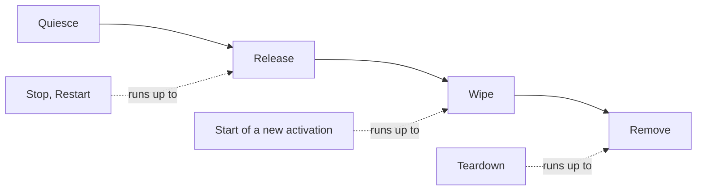

| Method | `host` runtime behavior |
|---|---|
| `Stop(slot)` | Quiesce, then Release |
| `Restart(slot)` | Quiesce, Release, the pre-start hook, start the pre target and node target, the post-start hook |
| `Start(slot)`, same activation | Start the pre target, then the node target. No wipe. |
| `Start(slot)`, new activation | Quiesce, Release, Wipe, verify, install the slot's content, write the activation record, start (10.8) |
| `Destroy(slot)` | Remove the slot directory only. Returns `ErrSlotActive` for the active slot. |
| `Teardown()` | Every level through Remove (10.10) |

The host network reset is not a runtime method. The node manager runs it for
both runtimes (10.9).

### 10.6 Quiesce

Containment:

- `containerd.service`, `kubelet.service` and `localdns.service` get
  `Slice=unboundednode.slice`.
- kubelet gets `cgroupDriver: systemd` and `cgroupRoot: /unboundednode`, so
  pods land under `unboundednode-kubepods.slice` *(inference: kubelet's
  systemd cgroup naming)*.
- Shims start in `containerd.service`'s cgroup, so they are in the slice even
  though `KillMode=process` keeps them alive when containerd stops
  (`pkg/agent/phases/nodestart/assets/containerd.service:10-11`).
- The slice name has no hyphen. systemd treats `-` as the slice hierarchy
  separator, and kubelet escapes `-` in `cgroupRoot` *(inference)*.

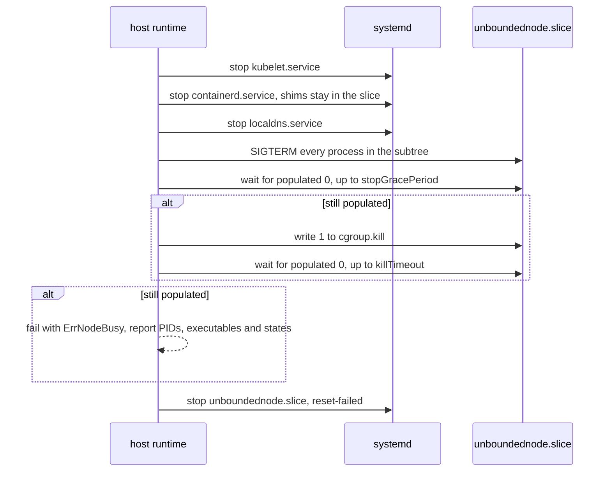

- `stopGracePeriod` defaults to 30 seconds and `killTimeout` to 15 seconds,
  matching v1's machine stop and terminate waits
  (`pkg/agent/phases/reset/machine.go:66,83`).
- Signals are sent to the whole cgroup, not per pod through the CRI. That
  matches v1, where pods get SIGTERM and then SIGKILL as the machine scope
  stops *(inference)*.
- A process stuck in uninterruptible sleep, for example on a dead NFS mount,
  leaves the cgroup populated. Quiesce then fails, and Wipe never runs over
  live state.

Preflight for the `host` runtime requires the unified cgroup v2 hierarchy and
`cgroup.kill` (Linux 5.14 or later). If `cgroup.kill` is missing, the runtime
falls back to repeated SIGKILL over `cgroup.procs` until the cgroup is empty.
v1 only checks that `/sys/fs/cgroup` exists
(`pkg/agent/phases/host/preflight_host.go:476-491`).

### 10.7 Release

Release runs only after Quiesce has verified that no node processes remain.

1. Read `/proc/self/mountinfo`. Select mount points under the owned mount roots
   and under `/run/netns/cni-*`, excluding `baselineMount` roots.
2. Unmount deepest first: `umount2(path, 0)`; on `EBUSY`, retry three times one
   second apart; then `umount2(path, MNT_DETACH)` and record a warning.
3. Repeat until no selected mounts remain, at most five passes, since shared
   propagation peers can expose mounts again *(inference)*. If mounts remain,
   fail with `ErrMountsRemain`.
4. For each `/run/netns/cni-*`, unmount if needed, then unlink. With no
   processes holding them, the kernel frees the namespaces and their veth
   peers disappear from the host *(inference)*.
5. Clear volatile paths with the safe remover (10.8).

### 10.8 Wipe and activation

The activation record,
`/var/lib/unbounded/agent-v2/host-runtime/activation.json`, holds
`{slot, bundleDigest, phase}`. It is how the `host` runtime keeps rule 4: the
first `Start` after `Provision` begins with fresh state.

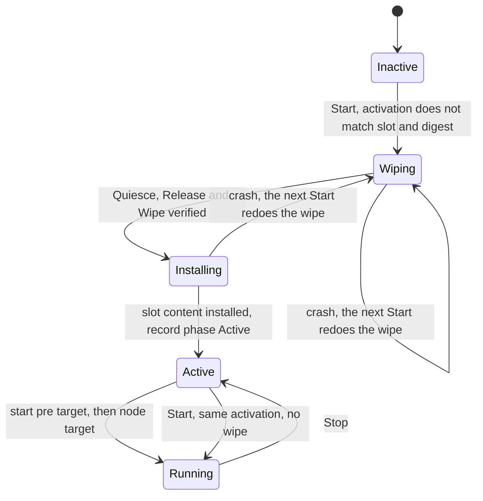

Wipe:

1. Write `phase: Wiping` durably.
2. Quiesce and Release, both verified.
3. Clear every persistent path in the claims record and every declared
   `cleanup.statePaths` entry. Directories keep their mode and SELinux label;
   only their contents are removed. The WireGuard and CDI entries are single
   files.
4. The safe remover opens with `O_NOFOLLOW`, compares `st_dev` with the root's
   device at every directory and aborts with `ErrMountInTree` on a mismatch,
   unlinks symlinks without following them, and refuses if the claimed root has
   become a symlink.
5. Delete declared eBPF pins (10.14).
6. Verify (10.11). Write `phase: Installing`, install the slot's units,
   configuration, binaries and CNI plugins, then write `phase: Active` with the
   slot and digest.

With `runtime.host.repave.retainContainerImages: true`, step 3 does not clear
`/var/lib/containerd`. Instead it performs an image-preserving reset:

1. Start a temporary maintenance containerd: the binary from the slot being
   activated, a private configuration and socket under
   `/run/unbounded-agent-v2/containerd-maint/`, the CRI plugin disabled (so no
   CNI work or sandbox recovery), running in `unboundednode.slice`.
2. Through the containerd Go client, which is already a dependency
   (`go.mod:39`), delete all tasks, containers and sandboxes in every
   namespace, delete all leases except image leases, and run garbage
   collection. Images, their content and their unpacked snapshots remain,
   including gantry's cache.
3. Stop the maintenance instance and Quiesce its slice again.
4. Delete the CRI plugin's state directory under `/var/lib/containerd`
   (`io.containerd.grpc.v1.cri`). Nothing else inside containerd's root is
   deleted file by file, so its metadata stays consistent.
5. If the maintenance instance did not report zero containers, tasks and
   sandboxes, fall back to a full clear and log why.

This option does not apply to `nspawn-container`, where a repave always
unpacks a new rootfs. The mechanism needs a prototype (validation task V2).

### 10.9 Host network reset

The node manager runs this after `Stop(old)` during a repave, and during
Teardown, for both runtimes. It hardens v1's `CleanupNetwork`
(`pkg/agent/phases/reset/network.go:48-54`).

| Step | v1 | v2 |
|---|---|---|
| LocalDNS: unit, `ip unbounded_localdns` table, `localdns` dummy link | Yes (`network.go:67-129`) | Same |
| WireGuard links | Names `wg51820` to `wg51899` only (`network.go:225-241`, `pkg/agent/phases/reset/routes.go:19-22`) | Name `wg<N>` with N of 51820 or higher, and link kind `wireguard`. Gateway port allocation has no upper bound (`internal/net/controller/gatewaypool_controller.go:411-415`). |
| `geneve0`, `vxlan0`, `ipip0`, `unbounded0`, `cbr0` | Name only (`network.go:25-31`) | Name and expected kind. A foreign link with the same name is reported, not deleted. |
| Policy routing tables and rules | Tables 51820 to 51899 | Tables of 51820 or higher that match removed WireGuard ports |
| Declared extension links, tables and chains | Not applicable | Yes (10.14) |
| `UNBOUNDED-*`, `KUBE-*` and `CNI-*` iptables chains | Not removed; v1 relies on the flush at the next start | Teardown only: delete rules that jump to them, then flush and delete the chains, for IPv4 and IPv6, on both the iptables-nft and iptables-legacy backends. The `UNBOUNDED-*` chains are defined in `internal/net/netlink/masquerade_manager.go:22`, `mss_clamp_manager.go:17`, `forward_manager.go:17`, `notrack_manager.go:19` and `gateway_policy_manager.go:76-77`. |

The whole-ruleset flush at node start is kept for both runtimes. v1's
`nftables-flush.service` runs `flush ruleset`
(`pkg/agent/phases/host/assets/nftables-clear.nft:6`) and is ordered before
every nspawn machine (`nftables-flush.service:20-21`). It deliberately also
clears a host firewall's default-drop policy, which would otherwise make the
kubelet unreachable (`nftables-flush.service:7-12`). In v2 it is a member of
`unbounded-node-pre.target`. Because it is a oneshot with
`RemainAfterExit=no` (`nftables-flush.service:16-18`), and starting an active
target does not run its members again, the runtime starts the pre target's
oneshot units explicitly on every `Start` and `Restart`. That matches
`nspawn-container`, where each start of `systemd-nspawn@<m>` pulls the flush in
again *(inference)*.

### 10.10 Teardown

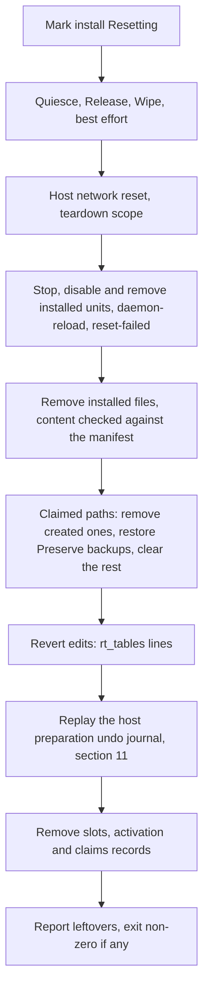

- A file whose content no longer matches the manifest is still removed, because
  the path is owned. The mismatch is logged.
- `Preserve` backups are deleted only after a verified restore.
- The claims record is removed last, so a crash anywhere earlier repeats the
  full Teardown.

Without a claims record, Teardown is conservative:

- It removes only paths and units unique to v2: slot directories,
  `unboundednode.slice`, the `unbounded-node*` targets, v2 state, the LocalDNS
  network unit and `nftables-flush.service`.
- Every non-empty standard path in 10.4 is reported as a leftover.
- `v2 reset --force-standard-paths` clears their contents, using the safe
  remover. It never removes the directories.
- The sysctl baseline cannot be restored without the record. That is reported
  with the list of keys.

### 10.11 Post-conditions

| After | Must be true | On violation |
|---|---|---|
| Quiesce | `unboundednode.slice` reports `populated 0`; no process runs an executable from a slot directory | `ErrNodeBusy`; Wipe and Start do not run |
| Release | No non-baseline mounts under the owned roots; no `/run/netns/cni-*` | `ErrMountsRemain`; Wipe does not run |
| Wipe | Every persistent owned path is empty; no declared pins remain | `ErrStateRemains`; the slot is not activated |
| Host network reset | No owned links, rules or tables; no `unbounded_localdns` table; on Teardown, no owned chains | Repave: error, retried by `Recover`. Teardown: leftover. |
| Teardown | Nothing in the footprint remains; no claims record | Leftovers reported; non-zero exit |

Leftovers are reported as `{kind, id, reason}` in `v2 reset` output, in
`v2 status`, and through the status sink.

### 10.12 Crash behavior

| Interrupted during | Next action |
|---|---|
| Quiesce or Release inside `Stop` | `Stop` is idempotent; `Recover` or the caller runs it again |
| `phase: Wiping` or `Installing` | The next `Start` wipes again, then installs |
| `phase: Active`, before the node target starts | `Start` with the same activation, no wipe |
| Teardown | Run again from the beginning; every step tolerates absent state |
| A repave | `nodemanager.Recover` (8.5) drives the runtime methods above |

### 10.13 Not cleaned

1. **Undeclared hostPath directories** outside the owned list. Before each
   Quiesce, the runtime lists the host sources of all container mounts through
   the CRI API and records them as `observedHostPaths`. Wipe and Teardown
   report them but never delete them, so the gap with `nspawn-container` stays
   visible.
2. **Mounts made in the host mount namespace by privileged pods**, for example
   through `nsenter -t 1` or bidirectional mount propagation outside the owned
   roots.
3. **eBPF pins** in the host's `/sys/fs/bpf` from other eBPF CNIs, unless
   declared. unbounded-net pins nothing; its program is attached only to
   `unbounded0` (`cmd/unbounded-net-node/tunnel_config.go:95-105`,
   `internal/net/ebpf/tunnel_map.go:182`) and goes away when that link is
   deleted *(inference)*.
4. **Kernel modules, conntrack entries, and sysctls outside the baseline
   list.** These last until the host reboots.
5. **journald logs and Kubernetes API objects** (Node, CSRs, Machine), as in
   v1.

### 10.14 Extension cleanup declarations

Consumers that install their own node networking, such as an unmanaged Cilium,
declare its state:

```json
"cleanup": {
  "statePaths": [
    { "path": "/var/lib/cilium", "class": "persistent" },
    { "path": "/run/cilium", "class": "volatile" }
  ],
  "links": [ { "name": "cilium_host", "kind": "veth" }, { "name": "cilium_vxlan", "kind": "vxlan" } ],
  "iptablesChainPrefixes": [ "CILIUM_" ],
  "nftTables": [ { "family": "inet", "name": "cilium" } ],
  "bpfPins": [ "/sys/fs/bpf/tc/globals", "/sys/fs/bpf/cilium" ]
}
```

- Declared paths are claimed under the same rules as built-in ones (10.3).
- `bpfPins` must be under `/sys/fs/bpf`.
- Declared links are deleted only when both name and kind match.

### 10.15 Internal interfaces

```go
package host // internal/agentv2/runtime/host

// Level is a cleanup depth. Each level includes all lower levels.
type Level int

const (
	LevelQuiesce Level = iota + 1 // no node processes
	LevelRelease                  // no node mounts, pod netns handles or volatile state
	LevelWipe                     // no persistent node state
	LevelRemove                   // nothing the runtime installed
)

type Leftover struct {
	Kind   string // process, mount, netns, path, unit, link, rule, chain, pin, sysctl
	ID     string
	Reason string
}

type cleaner struct {
	sys    SystemOps
	claims *ClaimStore
	limits Limits // StopGracePeriod, KillTimeout, UnmountRetries
	log    *slog.Logger
}

func (c *cleaner) To(ctx context.Context, lvl Level) error
func (c *cleaner) Verify(ctx context.Context, lvl Level) ([]Leftover, error)

// SystemOps is the seam to the operating system. Fakes drive unit tests for
// ordering and safety.
type SystemOps interface {
	Systemd() Systemd // Stop, Disable, DaemonReload, ResetFailed
	Cgroups() Cgroups // Signal, Kill, Populated, Procs
	Mounts() Mounts   // List, Unmount
	FS() SafeFS       // ClearContents, RemoveTree, WriteDurable; never crosses st_dev or follows symlinks
	Netns() Netns     // List with a prefix, Remove
	CRI() CRI         // container mount sources, for observedHostPaths
	Sysctl() Sysctl   // Read, Write
}
```

```go
package hostnet // internal/agentv2/hostnet, used by nodemanager for both runtimes

type Scope int

const (
	ScopeRepave   Scope = iota // links, routes, rules, LocalDNS
	ScopeTeardown              // ScopeRepave plus owned iptables chains and nftables tables
)

func Reset(ctx context.Context, log *slog.Logger, scope Scope, decl []extensions.Cleanup) ([]host.Leftover, error)
```

## 11. Host preparation and its reversal

Host preparation records an undo step in
`/var/lib/unbounded/agent-v2/hostprep.json` before each change. Reset replays
the steps in reverse order, for both runtimes. This makes v2's reset do what
v1's help text promises ("restore the host to its original state",
`cmd/agent/internal/cmd/reset.go:22-24`) but v1 does not do
(`cmd/agent/internal/daemon/reset.go:168-195`).

| Change (v1 source) | Undo step |
|---|---|
| `/etc/sysctl.d/99-kubernetes.conf` and `sysctl --system` (`pkg/agent/phases/host/os.go:310-335`) | Remove the file and restore the sysctl baseline |
| Node component sysctls: forwarding, `rp_filter` and `src_valid_mark` on all, default and each existing interface, conntrack settings (`images/net/node-agent-init.sh:17-45`, `internal/net/controller/kubeproxy_controller.go:858-862`) | Restore the baseline captured before the first node start |
| `nftables-flush.service` and `nftables-clear.nft` (`pkg/agent/phases/host/configure_nftables.go:65-128`) | Disable and remove them, then `systemctl try-restart nftables.service iptables.service ip6tables.service` so the host firewall returns |
| Mask docker and set `iptables: false` in `/etc/docker/daemon.json` (`pkg/agent/phases/host/configure_docker.go:30-66`) | Restore the backed-up `daemon.json`, or remove it if it did not exist, and unmask |
| Mask the host's containerd and kubelet (`nspawn-container` only) | Unmask |
| Disable swap: mask units, `swapoff`, comment out fstab entries (`pkg/agent/phases/host/disable_swap.go:39-53`) | Uncomment only the fstab lines the agent commented, which are tagged, and unmask the units. Swap returns at the next boot; `swapon` is not run. |
| apt hardening drop-ins (`pkg/agent/phases/host/apt.go:39-95`) | Remove them |
| Packages installed by host preparation | Left installed and listed in the reset report; removing them could break other software |

## 12. MachineOperation handling

`OperationKind` is a closed enum that mixes operations the agent handles with
operations other controllers handle
(`api/machina/v1alpha3/machineoperation_types.go:54`). `NodeReboot`,
`AgentUpgrade` and `AgentReset` belong to the agent. `HostReboot`,
`HostPowerOff`, `HostPowerOn` and `HostReplace` belong to the
machine-ops-controller and metalman.

v2 fails a matching operation with reason `UnsupportedOperation` only when its
kind is in the agent's domain and v2 has no handler for it. The agent's domain
is the three kinds above plus any future kind beginning with `Node` or
`Agent`, so a newer agent operation reaching an older agent fails instead of
staying pending. `Host*` kinds are always ignored, as
`designs/lifecycle-operations.md:12-15` describes.

This differs from v1, which ignores every operation without a handler
(`pkg/agent/daemon/machineoperation.go:114-118,139-141`). v2 implements it in
its own copy of the reconciler, so `pkg/agent/daemon` is unchanged for v1 and
Flex. The scoping is open for review (section 18).

## 13. Parity with v1

| v1 capability | v1 location | v2 location |
|---|---|---|
| Admission, locks and fingerprint | `cmd/agent/internal/installstate`, `cmd/agent/internal/bootstrap` | `state`, `bootstrap` |
| Preflight, including resume awareness | `cmd/agent/internal/cmd/preflight.go`, `pkg/agent/phases/*/preflight*` | `preflight`, plus runtime and plugin checks |
| Configuration file | `cmd/agent/internal/cmd/config.go` | `config`, v1alpha1 plus v1 JSON conversion |
| Host preparation | `pkg/agent/phases/host` | `hostprep`, now with an undo journal |
| Artifacts, offline sources, overrides, image archives | `pkg/agent/phases/rootfs/{kube,cri,cni,container_images}.go`, `pkg/agent/artifactsource`, `pkg/agent/bootstrapartifacts` | `artifacts` |
| containerd, kubelet and LocalDNS configuration | `pkg/agent/phases/nodestart` | `bundle` |
| Kubelet authentication modes | `pkg/agent/phases/nodestart/kubelet.go:282-379` | `credentials` and `bundle` |
| TPM attestation | `cmd/agent/internal/attest` | `credentials`, the `tpm` provider |
| Machine registration and status | `cmd/agent/internal/daemon/daemon.go:303-406`, `bootstrap_status.go` | `control`, the `machina` providers |
| NVIDIA, AMD and host devices | `pkg/agent/goalstates`, `pkg/agent/phases/nodestart/nvidia.go` | Discovery in `nodespec`, exposure in each runtime |
| nspawn lifecycle hooks | `pkg/agent/nspawnlifecycle` | `runtime.Hook` and `v2 runtime-hook` |
| Daemon CSR credentials | `pkg/agent/daemoncred` | `credentials`, the `csr` provider |
| Repave on Node delete with drift detection | `cmd/agent/internal/daemon/controller_node.go`, `nodeoperator.go` | `daemon`, `nodemanager` |
| NodeReboot, AgentUpgrade, AgentReset | `cmd/agent/internal/daemon/controller_machineoperation.go` | `daemon`, `agentupgrade`, `nodemanager` |
| Daemon recovery unit | `cmd/agent/internal/daemon/assets` | `daemon` |
| First-boot unit removal on reset | `cmd/agent/internal/daemon/reset.go:191` | Reset |
| Host-root move from `/usr/local` | `internal/hostroot` | Not carried over: v2 only installs fresh |
| Configuration from legacy environment variables | `cmd/agent/internal/cmd/config.go` | Dropped |

## 14. Export policy

1. Everything starts in `internal/agentv2`.
2. Moving a package to `pkg/agentv2/<area>/<version>` requires a decision
   record appended to this document stating: the consumer and why the binary
   hook points are not enough, the exact API surface, the stability level
   (alpha, beta or stable) and compatibility promise, and the owner.
3. Export types before behavior. The likely first candidates are the plugin
   protocol types (`plugin/v1alpha1`) and the configuration types
   (`config/v1alpha1`), so plugin authors and configuration generators get
   typed structs.
4. The node manager, the runtime implementations and the state store are never
   exported.
5. `pkg/agent` is frozen for v1 and its current consumers; no v2 features land
   there. It is deprecated once AKS Flex Node has moved to the binary.

## 15. Testing and validation

Unit and conformance tests:

- The runtime conformance suite, plus a fake runtime for `nodemanager` and
  `daemon` tests.
- One test per row of the `Decide` table, including crash-recovery states.
- Golden tests showing the `nspawn-container` runtime renders kubelet,
  containerd, `.nspawn` and unit-override files identical to v1's goldens
  (`pkg/agent/phases/rootfs/testdata`).
- Plugin protocol tests with a reference plugin: timeouts, errors, oversized
  output and permission checks.
- Host cleanup with a fake `SystemOps`: order of operations, `ErrNodeBusy` on a
  hung process, refusal to cross a bind mount inside `/var/lib/kubelet/pods`,
  symlink-swap refusal, keeping `baselineMount` roots mounted, crash replay at
  every activation phase, conservative Teardown without a claims record, and
  `--force-standard-paths`.
- Adoption: the `Preserve` round-trip including mode, extended attributes and
  SELinux labels; the size cap; rejection of a mount inside an adopted tree;
  `Discard` deleting contents at the first wipe only.

End-to-end tests, using the `hack/agent/e2e-kind` and `hack/agent/qemu`
harnesses with `runtime.type` as a test dimension:

- Bootstrap, reboot, repave and reset for both runtimes.
- A `host` workload set with tmpfs, projected and hostPath volumes, a CSI-style
  bind mount, hostPort pods and unbounded-net, followed by restart, repave and
  reset. Assert no leftovers and that host data mounted into pods survives.
- The same on a host with its own nftables firewall, to verify the firewall
  returns after reset.
- Repave with `retainContainerImages: true`: images present, no containers or
  sandboxes, kubelet starts cleanly.
- GPU coverage on `hack/agent/azure-gpu-vm`.
- A sample Flex-like plugin as a fixture.

Validation tasks that need prototypes before the `host` runtime leaves
experimental:

| ID | Task |
|---|---|
| V1 | Every DaemonSet and component we ship works with kubelet `cgroupRoot: /unboundednode`: unbounded-net, gantry, racer, kube-proxy, the NVIDIA device plugin and node-problem-detector. Nothing may assume `/kubepods.slice`. |
| V2 | The image-preserving containerd reset (10.8) against containerd 2.1.8 (`pkg/agent/goalstates/constants.go:121`), including the CRI plugin's state directory layout. |
| V3 | The minimal NVIDIA Container Toolkit binary set for CDI mode, and how the toolkit finds its configuration in the slot directory without editing the host's. |
| V4 | SELinux labels for binaries executed from the slot directories on Azure Linux 3. |

## 16. Risks

- **The `host` runtime has no containment boundary.** Repave and reset must
  stop pods, unmount volumes and remove state explicitly. Mistakes leave stuck
  mounts or orphaned processes. This area needs the most end-to-end coverage.
- **Workloads see the real host** on the `host` runtime (section 9.2).
- **Plugins run as root.** Path and ownership checks are the main defense.
- **Agent and plugin versions can skew.** Only protocol negotiation guards
  against it.
- **Experimental code ships in the production binary.** It is reachable only
  through `v2` commands.
- **Copied code drifts from v1.** The list in section 6.2 is the mitigation.

## 17. Decision log

These were settled in design discussion before this document was opened for
review. Comments are welcome, but changing them should be a deliberate
decision.

| ID | Question | Decision |
|---|---|---|
| D1 | How is v2 delivered? | A `v2` subcommand of the existing binary |
| D2 | How is it marked experimental? | A warning logged first by every `v2` command, and "(experimental)" in help |
| D3, O1 | How does v2 get code from `cmd/agent/internal`? | Copy it into `internal/agentv2` |
| D4 | How does content reach the node? | A declarative bundle, handed to the runtime at provision time |
| D5 | How do consumers extend the agent? | Configuration, declarative extensions and exec plugins |
| - | Which runtime kinds? | `host` and `nspawn-container` only |
| O2 | Can consumers rename on-host units and paths? | No. Only the cluster-facing CSR identity is configurable. |
| O3 | Should v1 detect a v2 install? | Yes, through an additive existing-deployment check |
| O4 | Plugin transport? | Exec per call, JSON on stdin and stdout |
| O6 | Unsupported MachineOperations? | Fail them; scoping in section 12 is open for review |
| O7 | `host` runtime unit names? | Standard `kubelet.service` and `containerd.service` |
| O8 | NVIDIA Container Toolkit source on `host`? | Shipped as an agent artifact |
| O9 | Should reset reverse host preparation? | Yes, for both runtimes, through the undo journal |
| O10 | Is `v2` visible in help? | Yes |
| O11 | Configuration from environment variables? | Dropped |
| H-D1 | Process containment on `host`? | A dedicated `unboundednode.slice` |
| H-D2 | Keep the whole-ruleset nftables flush at node start? | Yes |
| H-D3 | Restore sysctls and the host firewall on reset? | Yes |
| H-D4 | Wipe container images on repave? | Configurable, wiped by default |
| H-D5 | Existing content at owned paths? | Adoption as an explicit per-path configuration option |
| H-D6 | Teardown without a claims record? | Conservative, with `--force-standard-paths` for the CLI |
| - | Export policy | Internal by default; export by recorded decision only |

## 18. Questions for reviewers

1. **MachineOperation scoping (section 12).** Is "fail only agent-domain kinds,
   identified as the current three plus any `Node*` or `Agent*` kind" the
   right rule? It relies on a naming convention for future kinds that the API
   does not currently document.
2. **Separate v2 state (D6).** v2 uses its own state directories, units and
   locks, sharing only the binary layout. The alternative is to share v1's
   names. Separate names avoid any confusion between the two, but the `-v2`
   names would need renaming if v2 later replaces v1.
3. **Default runtime.** A configuration without `runtime.type` gets
   `nspawn-container`, which keeps machina provisioning unchanged. Should the
   field be required instead?
4. **Rendering templates (section 6.2).** v2 copies v1's templates and relies on
   golden tests for parity. The alternative is to add exported, render-only
   functions to `pkg/agent`, which avoids the copy but changes a public package.
5. **Hook binary stability (section 8.3).** v1 runs its systemd hooks through a
   separate binary copy so they survive an upgrade rollback. Is the `current`
   link enough for v2, given the recovery unit restores `last-good` into
   `current`?
6. **The `Decide` behavior change (section 8.4).** Moving from delete events to
   level-triggered observation means a Node deleted while the daemon was down
   now triggers a repave when the daemon returns. Is that the behavior we want?

## 19. Code and documentation disagreements

These were found while researching v1. This document follows the code unless
noted.

- `designs/agent-daemon-controller.md:232-242` says matching operations without
  a handler are failed. The code ignores them
  (`pkg/agent/daemon/machineoperation.go:114-118,139-141`). v2 adopts a scoped
  version of the documented behavior (section 12).
- `designs/lifecycle-operations.md:25` and the API comment
  (`api/machina/v1alpha3/machineoperation_types.go:58-61`) say NodeReboot stops
  kubelet and containerd first. The code restarts the nspawn unit only
  (`pkg/agent/phases/nodestart/nspawn_lifecycle.go:36-40`).
- `designs/lifecycle-operations.md:48-52` says deleting a Node always recreates
  it. The code skips the repave when there is no drift
  (`cmd/agent/internal/daemon/controller_node.go:54-62`).
- `cmd/agent/internal/cmd/reset.go:22-24` says reset restores the host to its
  original state. Host preparation is not reversed
  (`cmd/agent/internal/daemon/reset.go:168-195`). v2 fixes this (section 11).
- `pkg/agent/goalstates/resolve.go:315` logs a fallback to debootstrap, which
  no longer exists.

## 20. Alternatives considered

- **Add a runtime switch to v1.** Rejected. nspawn is assumed in every layer
  (section 1.2), so the change would touch nearly all of v1's production code.
- **A separate `unbounded-agent-v2` binary.** Rejected in favor of D1: a
  subcommand reuses the existing delivery, install script, upgrade path and
  release artifacts.
- **Keep library consumption for AKS Flex Node.** Rejected. Section 1.3 shows
  the cost: copied task lists, re-composed sequences, writes into internal
  paths and dependencies on unexported names.
- **In-process Go plugins** (the `plugin` package or a framework such as
  go-plugin). Rejected: version coupling, build constraints and a larger trust
  surface than exec plugins.
- **A gRPC plugin protocol.** Deferred. Exec per call is enough for the current
  methods; a streaming transport can come later as a new protocol version.
- **A distribution profile for renaming units and paths.** Rejected (O2). It
  multiplies the on-host footprint and the cleanup surface.
- **Move shared code to `internal/agent` instead of copying.** Rejected (O1).
  It is a large cross-package refactor of v1, and v2's versions will diverge.
- **Virtual machine runtime.** Out of scope; no current plans.
