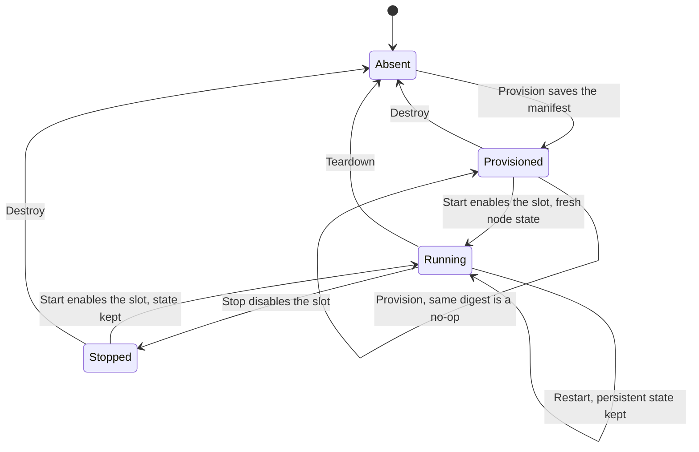
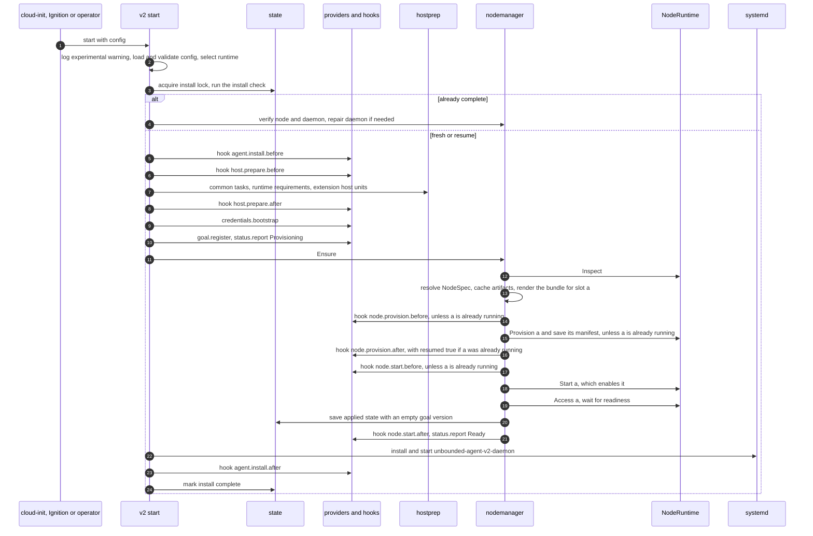
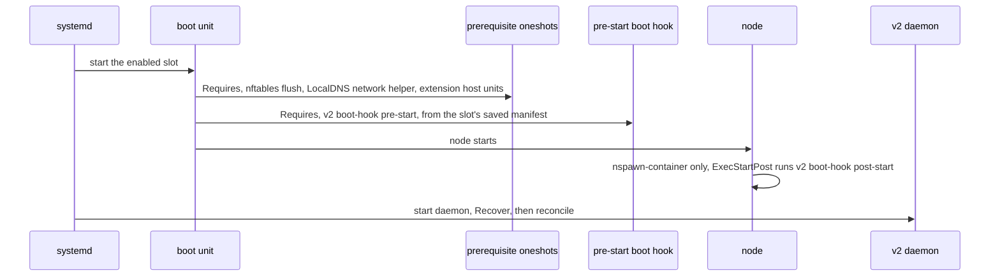
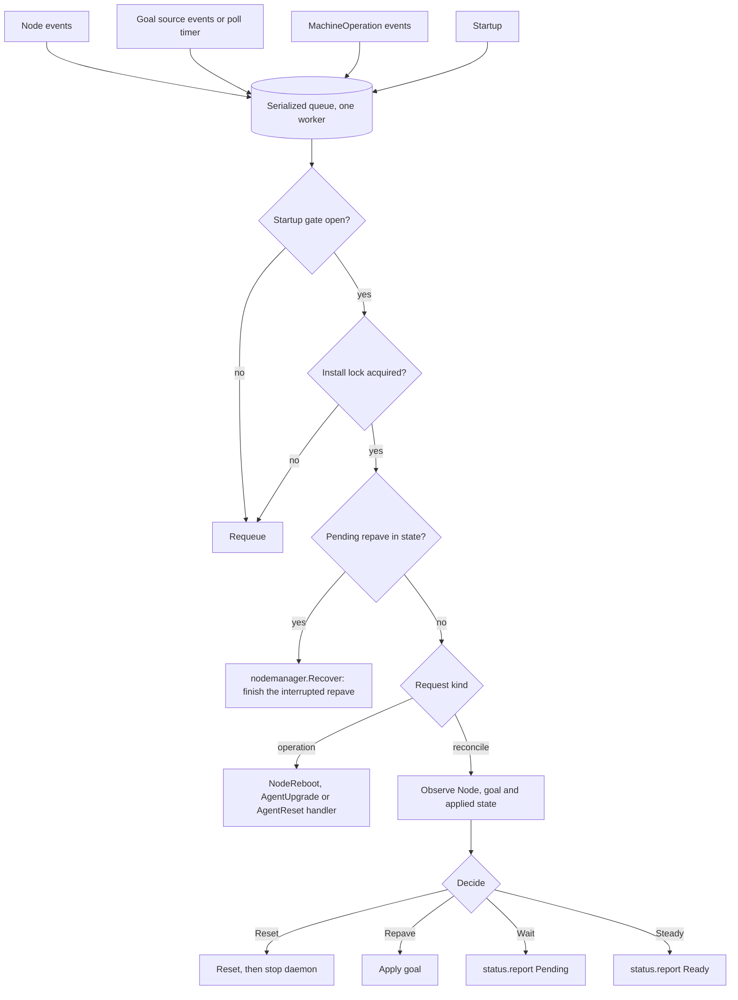
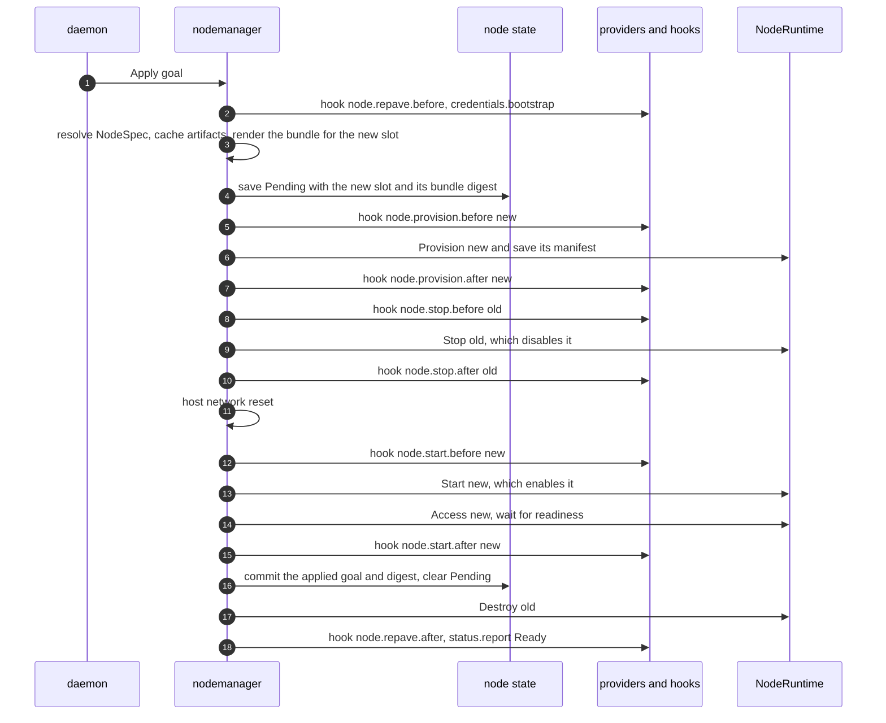
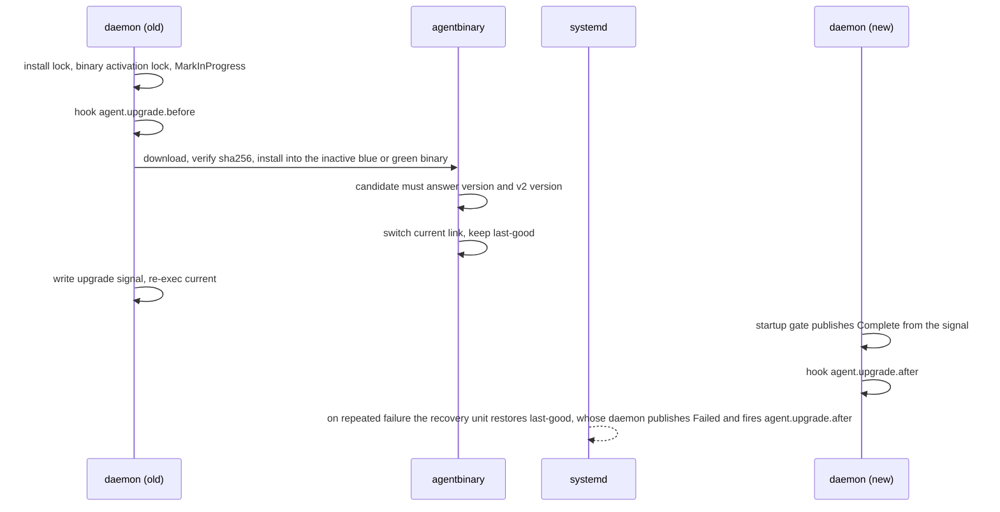
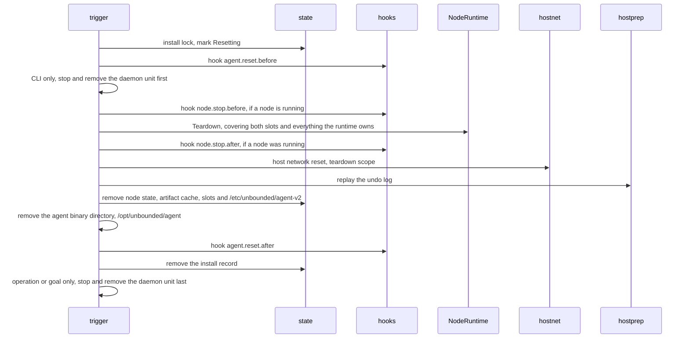

# Unbounded Agent v2: Pluggable Node Runtime

| Field | Value |
|---|---|
| Status | Draft for review |
| Scope | A new, experimental implementation of the unbounded agent with a defined interface for hosting kubelet, and a binary-level extension model for downstream consumers |
| Audience | Maintainers, AKS Flex Node maintainers, and reviewers of agent lifecycle changes |
| Repository baseline | `main` at `dca6c964d1d4d03614fe190fcd60ce49c380e914` |
| Date | 2026-10-29 |

## Review guide

- Sections 1 and 2 explain the problem and the goals. Section 1.4 defines the
  terms used throughout.
- Section 3 lists what is still open. Please focus review comments there, on
  sections 5 and 7, and on the host runtime doc.
- Section 4 is the architecture overview.
- Section 5 is the external contract that consumers such as AKS Flex Node would
  build against: the CLI, the configuration file, plugins, hooks and
  declarative extensions.
- Sections 6-8 are the internal code interfaces and the lifecycles, with
  diagrams.
- Section 9 describes the two runtimes. Section 10 summarizes how the `host`
  runtime cleans up after itself; the details are in the companion
  [`agent-v2-host-runtime.md`](agent-v2-host-runtime.md). Section 11 covers the
  host network reset and section 12 how host preparation is reversed.
- Sections 13-17 cover operations, parity with v1, the export policy, testing
  and risks.
- Appendix A maps v1 configuration fields to v2.

Code citations are `file:line` against the baseline above. Statements that rely
on upstream behavior (Kubernetes, containerd, CNI, systemd, the kernel) rather
than code in this repository are marked *(inference)*.

## 1. Purpose and context

The unbounded agent (`unbounded-agent`) bootstraps a host and runs a
Kubernetes worker node on it. Today that node always runs inside a
systemd-nspawn container. We want an agent with a clearly defined interface
for starting and managing kubelet, so the node can run either directly on the
host or in an nspawn container, without the rest of the agent caring which.

We also want to change how downstream projects consume the agent. AKS Flex
Node currently imports `pkg/agent` and builds its own agent from the pieces.
The goal is for consumers to use the agent *binary*, customizing it through
well-defined hook points.

This document proposes v2: a new implementation, shipped inside the existing
binary under a `v2` subcommand, marked experimental.

### 1.1 The v1 agent

v1 is organized in four layers:

- **Commands.** `start`, `preflight`, `daemon`, `reset` and `version`, plus
  hidden `agent-upgrade` (`cmd/agent/internal/cmd/agentupgrade.go:70`),
  `nspawn-lifecycle` and `record-agent-upgrade-failure-signal`
  (`cmd/agent/internal/cmd/cmd.go:30-39`).
- **Bootstrap coordinator.** Runs `PrepareHost`, `PrepareRootFS`,
  `EnsureNodeStarted` and `EnsureDaemonInstalled` under an install lock and an
  install record that classifies each run as fresh, resumed or complete
  (`cmd/agent/internal/bootstrap/coordinator.go`: the stages at `:29-38`, the
  lock at `:72`, the classification at `:83-115` and the stage loop at
  `:126-135`).
- **Goal state and phases.** Configuration resolves to
  `MachineGoalState{RootFS, NodeStart}` (`pkg/agent/goalstates/resolve.go:37-40`).
  Work is composed from `phases.Task` values (`pkg/agent/phases/phases.go:17-20`)
  with `Serial` (`:62`) and `Parallel` (`:87`).
- **Daemon.** A controller-runtime manager that repaves when its Node is
  deleted and handles the `NodeReboot`, `AgentUpgrade` and `AgentReset`
  MachineOperations (`cmd/agent/internal/daemon/controller.go:95-99`). Node
  work goes through an unexported `nodeOperator` interface
  (`cmd/agent/internal/daemon/nodeoperator.go:37-70`).

### 1.2 Where nspawn is built in

The nspawn assumption appears in every layer, which is why v2 is a new
implementation rather than a switch added to v1.

| Layer | Coupling | Citation |
|---|---|---|
| Goal state | `RootFS` carries nspawn file paths; the machine directory is `/var/lib/machines/<m>`; `NodeStart.MachineName` is the `systemd-run` target | `pkg/agent/goalstates/rootfs.go:11-58`, `resolve.go:86-97`, `nodestart.go:6-9` |
| Writing node files | Every node file is written from the host into the machine directory | e.g. `pkg/agent/phases/nodestart/kubelet.go:75` |
| Running commands in the node | Every command goes through `systemd-run --machine=<m> --pipe --wait` | `internal/executil/exec.go:258-267` |
| Bootstrap | Always targets `kube1`, and skips building the rootfs when `machinectl list` shows the machine is registered. The same check decides whether to save the applied config. | `cmd/agent/internal/cmd/bootstrap.go:92` (target), `:161` (rootfs), `:220` (applied config), `pkg/agent/phases/reset/machine.go:256` (`machinectl list`) |
| Host preparation | Masks the host `containerd` and `kubelet` units, which a host runtime needs | `bootstrap.go:111`, `pkg/agent/phases/host/disable_systemd_unit.go:36-43` |
| Daemon | Defaults to the nspawn operator, and hardcodes it in `RepairDaemon`; repave alternates `kube1` and `kube2` | `cmd/agent/internal/daemon/daemon.go:101`, `lifecycle.go:461`, `nodeoperator.go:248-296` |
| Reset | Hardcodes `kube1` and `kube2` and the nspawn teardown | `cmd/agent/internal/daemon/reset.go:168-195` |
| Lifecycle hooks | Around `systemd-nspawn@<m>`, systemd runs `nspawn-lifecycle pre-start` as a separate oneshot unit and `post-start` as `ExecStartPost` | Wiring: `pkg/agent/phases/rootfs/assets/service-override.conf:37-38,48`, `config-regeneration.service:11`. Code: `pkg/agent/nspawnlifecycle/lifecycle.go:67-129` |

### 1.3 How AKS Flex Node consumes v1 today

This summary is based on `github.com/Azure/AKSFlexNode` at `main`
(`2c149e991fee3ff59f4180b5c5a6a3b3108bc012`), which pins unbounded `v0.18.0`.

Flex translates its own configuration schema into `pkg/agent/config` types and
then composes its own agent from `pkg/agent` packages: its own task graphs for
host setup, start, reboot, repave and reset; its own daemon around
`daemon.SetupController`; and its own upgrade orchestration over
`pkg/agent/agentbinary`.

On top of that it adds:

- an ARM Machine backend for desired state and status, using the ARM ETag as a
  settings version;
- fresh bootstrap data fetched from ARM before a repave;
- an exec credential for kubelet and the daemon (`aks-flex-node token
  kubelogin`), which requires copying its binary into the nspawn rootfs;
- static host routes ordered before `systemd-nspawn@`;
- Node Problem Detector, downloaded into the rootfs and started with
  `systemd-run --machine`;
- extra `Requires=` dependencies on the nspawn unit;
- an AKS LocalDNS Corefile template that uses unbounded's template variables;
- Arc and NPD preflight checks;
- a taint-based reset trigger.

Several patterns in Flex point to missing extension points:

- It copies unbounded's list of host tasks so it can add its own
  (`pkg/daemon/start.go`), so new unbounded host tasks are silently missed.
- It re-composes the node start sequence in three places (`pkg/daemon/start.go`,
  `pkg/daemon/nodeoperator.go`).
- It writes content directly into the machine directory after provisioning
  (`pkg/daemon/install.go`, `pkg/npd/download.go`).
- Its `scripts/uninstall.sh` hardcodes unbounded unit and path names.
- It copies an unexported marker name from unbounded's `internal/hostroot`
  (`pkg/daemon/hostroot_move.go`).

Flex needs about a dozen customization points. It does not need the whole
library.

### 1.4 Terms

| Term | Meaning |
|---|---|
| Host | The machine the agent runs on: a virtual machine or a bare-metal server. |
| Node | The Kubernetes worker: kubelet, containerd, LocalDNS and the pods they run. In v1 it always runs in an nspawn container on the host. |
| Runtime | Where the node runs: directly on the host (`host`) or in an nspawn container (`nspawn-container`). Section 7.1 defines the interface. |
| Slot | One of two places, `a` and `b`, where a runtime keeps a node's content. One slot holds the running node; the other is used to build a replacement during a repave. For `nspawn-container`, a slot is a whole machine, v1's `kube1` or `kube2`, including the node's state. For `host`, a slot holds only staged binaries and rendered files; the node's state lives in shared host paths and is wiped on a slot change. |
| Repave | Replacing the node with a new one, built from the desired configuration in the other slot. The new node registers with Kubernetes as a fresh Node. A repave is triggered by deleting the Kubernetes Node object (section 8.4). |
| Goal | The desired configuration for this machine, from machina, a plugin or the configuration file. Its version is an opaque value that changes whenever the goal does. |
| Drift | A difference between the goal and the applied configuration that needs a repave to take effect, such as a new Kubernetes version. |
| Bundle | The rendered description of one node: files, binaries, units and start order (section 7.2). Not related to v1's offline artifact bundles. |
| Node manager | The runtime-independent component that drives bootstrap, repave, reboot and reset by calling the runtime (section 7.6). |
| Reset | Removing the node, the agent and everything they created from the host (section 8.8). The runtime's part of a reset is its `Teardown` method; the host runtime doc, section 9, describes it for the `host` runtime. |
| Slot change | For the `host` runtime, starting a slot whose content differs from what last ran. The runtime wipes node state first (host runtime doc, section 8). |

## 2. Goals and non-goals

### 2.1 Goals

- **G1.** One interface for hosting a Kubernetes node, with two
  implementations: `host` and `nspawn-container`.
- **G2.** Feature parity with v1 (section 14), except for the intended
  behavior changes listed in section 14.1.
- **G3.** Consumers customize the agent binary through hook points. They do
  not link against agent Go packages.
- **G4.** v1 behavior is unchanged, apart from the small changes listed in
  section 6.3. v2 is opt-in through `unbounded-agent v2 ...`.
- **G5.** Code is internal by default. Exporting any of it is an explicit,
  recorded decision (section 15).

### 2.2 Non-goals

- Other runtime kinds, including virtual machines. The runtime kind is an open
  set, but nothing in the interface is designed for a specific future kind.
- Machina API changes.
- In-place migration from v1 to v2. Switching a host requires a reset.
- Changing `pkg/agent` behavior for its existing consumers, apart from the
  additive v2 detection check (section 6.3).

## 3. Open questions

These are still open. Please focus review comments here. Everything else in
this document was settled in design discussion and an earlier review round.

1. **MachineOperation scoping (section 13).** Is "fail only kinds that belong
   to the agent, meaning the current three plus any `Node*` or `Agent*` kind"
   the right rule? It relies on a naming convention for future kinds that the
   API does not currently document. The `OperationKind` enum is closed
   (`api/machina/v1alpha3/machineoperation_types.go:54`), although its comment
   says custom operations may be supported by individual cloud controllers
   (`:51-53`).
2. **Separate v2 state (section 5.6).** v2 uses its own state directories,
   daemon units and locks, and shares the agent binary layout under
   `/opt/unbounded/agent/bin`. Some node-level names are the same as v1's:
   `kubelet.service`, `containerd.service`, `localdns.service`,
   `nftables-flush.service` and the `kube1`/`kube2` machines. That is one reason
   v1 and v2 cannot be installed on the same host, and each refuses to install
   over the other (section 6.3). The alternative is to share v1's state and
   daemon names too. Separate names avoid any confusion between the two, but the
   `-v2` names would need renaming if v2 later replaces v1.
3. **Default runtime (section 5.2).** A configuration without `runtime.type` gets
   `nspawn-container`, which keeps machina provisioning unchanged. Should the
   field be required instead?
4. **Rendering templates (section 6.2).** v2 copies v1's templates and relies on
   golden tests for parity. The alternative is to add exported, render-only
   functions to `pkg/agent`, which avoids the copy but changes a public package.
5. **Boot hook binary (section 8.3).** v1 runs its systemd hooks through a
   separate binary copy so they survive an upgrade rollback
   (`pkg/agent/phases/rootfs/lifecycle_helper.go:34-37`). Is the `current` link
   enough for v2's boot hooks, given the recovery unit restores `last-good` into
   `current`?
6. **The `Decide` behavior change (section 8.4).** v2 compares the observed
   Node on every reconcile instead of reacting only to delete events. A Node
   deleted while the daemon was down therefore triggers a repave when the
   daemon returns. Is that the behavior we want?

## 4. Architecture overview


Data flows in three steps:

1. The `AgentConfiguration` and bootstrap credentials resolve to a `NodeSpec`:
   *what* to run.
2. The `NodeSpec`, the runtime's `Layout(slot)` and the resolved extensions
   render to a `NodeBundle`.
3. The bundle is handed to `NodeRuntime.Provision(slot, bundle)`, which decides
   *where* it runs.

Why node content is a declarative bundle, even with only two runtimes:

- The `host` runtime needs an exact record of what it installed, for cleanup
  and for deciding when a node must start with fresh state.
- A bundle can be staged into the inactive slot while the active node keeps
  running.
- Rendering is a pure function, so it can be tested against v1's golden files.
- Extensions merge into the bundle, replacing Flex's pattern of writing into
  the machine directory after provisioning.
- The node manager never writes into a node after it starts; all content goes
  through `Provision`.

Both runtimes share the host kernel and the host network namespace with the
node. The node manager relies on this: it configures host sysctls for the node
and cleans host network state after stopping a node. A future runtime that
breaks this assumption would need to add a capability to the interface.

## 5. External contract

This section is what a consumer builds against. Everything here is versioned
and experimental until section 15 promotes it.

### 5.1 CLI

| Command | Purpose |
|---|---|
| `v2 start` | Bootstrap: install check, host preparation, provision, start the node, install the daemon |
| `v2 preflight [--output json] [--ignore-errors]` | Read-only checks: built-in, runtime, extension and plugin checks |
| `v2 daemon` | Long-running reconciler, run by `unbounded-agent-v2-daemon.service` |
| `v2 reset [--force-standard-paths]` | Remove the node, everything the runtime owns, extensions, host preparation and agent state |
| `v2 status [--output json]` | New. Runtime, slots, applied goal version, node readiness and any cleanup leftovers |
| `v2 agent-upgrade [--preflight]` | Activate a staged agent binary without a MachineOperation, for host delivery automation (section 8.7) |
| `v2 boot-hook <pre-start\|post-start> <slot>` (hidden) | Called by systemd around the node boot unit; runs the runtime's boot hook |
| `v2 record-agent-upgrade-failure-signal` (hidden) | Used by the daemon recovery script |
| `v2 version` | Prints the version; also used to verify an upgrade candidate supports v2 |

The `v2` group is listed in `unbounded-agent --help` as "Experimental v2 agent
(unstable)". Its `PersistentPreRunE` sets up logging and immediately logs:

> unbounded-agent v2 is experimental: configuration, plugin protocol and
> on-host layout may change without notice; not supported for production use.

v1 commands set up logging inside `RunE` (`cmd/agent/internal/cmd/start.go:31`).
v2 does it earlier so the warning is always the first line of output.

Configuration is read from `--config` or `UNBOUNDED_AGENT_CONFIG_FILE`, the
variable cloud-init and Ignition already set
(`cmd/kubectl-unbounded/app/ignition.go:187`). v2 does not read configuration
from other environment variables.

`--force-standard-paths` only has an effect when the host runtime's ownership
record is missing (host runtime doc, section 9). MachineOperations and goal-driven resets
never set it.

### 5.2 Configuration

The configuration file is versioned. A file without `apiVersion` is treated as
v1 `UnboundedAgentConfig` JSON and converted (appendix A), so existing machina
provisioning works unchanged.

```json
{
  "apiVersion": "agent.unbounded-cloud.io/v1alpha1",
  "kind": "AgentConfiguration",
  "machine": { "name": "m-01", "nodeName": "m-01", "provisioningFormat": "cloud-init" },
  "cluster": {
    "apiServer": "https://cluster.example:443",
    "caCertBase64": "...",
    "kubernetesVersion": "1.33.1",
    "clusterDNS": "10.0.0.10"
  },
  "kubelet": {
    "nodeIP": "",
    "labels": {},
    "registerWithTaints": [],
    "configuration": {},
    "imageCredentialProvider": null
  },
  "components": {
    "containerd": {},
    "runc": {},
    "cni": {},
    "gantry": {},
    "localDNS": { "corefileTemplate": "" }
  },
  "artifacts": { "downloads": {}, "offline": null },
  "runtime": {
    "type": "nspawn-container",
    "nspawnContainer": { "image": "", "additionalHostDevices": [], "additionalHostMounts": [] }
  },
  "credentials": {
    "bootstrap": { "type": "static", "static": { "token": "..." } },
    "kubelet": { "type": "bootstrap" },
    "daemon": { "type": "csr", "csr": { "group": "unbounded-agent-daemons" } }
  },
  "control": {
    "goal": { "type": "machina" },
    "status": { "type": "machina" },
    "operations": { "enabled": true }
  },
  "plugins": [
    {
      "name": "aks",
      "command": ["/opt/aks-flex-node/bin/aks-flex-node-plugin"],
      "timeouts": { "goal.get": "60s", "hook": "2m" }
    }
  ],
  "hooks": [
    { "event": "node.start.after", "plugin": "aks", "timeout": "2m", "failurePolicy": "Fail" },
    { "event": "agent.upgrade.*", "plugin": "aks", "timeout": "30s" }
  ],
  "extensions": []
}
```

For the `host` runtime, the `runtime` block looks like this instead:

```json
"runtime": {
  "type": "host",
  "host": {
    "stopGracePeriod": "30s",
    "killTimeout": "15s",
    "repave": { "retainContainerImages": false },
    "adoptExistingPaths": [ { "path": "/opt/cni/bin", "policy": "Discard" } ],
    "adoptPreserveMaxBytes": 1073741824
  }
}
```

Enumerated fields:

| Field | Values |
|---|---|
| `runtime.type` | `host`, `nspawn-container`. Defaults to `nspawn-container` *(open: section 3, question 3)*. |
| `credentials.bootstrap.type` | `static`, `tpm` (metalman attestation), `plugin` |
| `credentials.kubelet.type` | `bootstrap`, `kubeconfig`, `exec` |
| `credentials.daemon.type` | `csr`, `kubeconfig`, `plugin` |
| `control.goal.type` | `machina`, `static` (the goal settings in the configuration file are the goal), `plugin` |
| `control.status.type` | `machina`, `none`, `plugin` |
| `control.operations.enabled` | `true` (default): handle MachineOperations through machina. `false`: ignore them. |
| `hooks[].failurePolicy` | `Fail`, `Ignore`. If omitted, each event's default (section 5.3). |
| `runtime.host.adoptExistingPaths[].policy` | `Preserve`, `Discard` (host runtime doc, section 3). Required. |
| `runtime.host.adoptPreserveMaxBytes` | The largest `Preserve` backup allowed for any one path. Default 1 GiB. |

Credentials:

| Setting | Serves | Values |
|---|---|---|
| `credentials.bootstrap` | The token, API server and CA used for kubelet TLS bootstrapping and the daemon's first certificate request | `static` (from this file), `tpm` (metalman attestation), `plugin` (the `credentials.bootstrap` plugin method) |
| `credentials.kubelet` | How kubelet authenticates | `bootstrap` (TLS bootstrapping with the bootstrap token), `kubeconfig` (a supplied kubeconfig), `exec` (an exec credential plugin that kubelet runs itself) |
| `credentials.daemon` | How the daemon authenticates | `csr` (a CSR-issued client certificate, requested once with the bootstrap token), `kubeconfig`, `plugin` (the `credentials.cluster` plugin method) |

Kubelet's `exec` cannot use the plugin protocol: kubelet runs that executable
itself, through client-go's exec credential protocol. Its command must be an
absolute host path, and the runtime makes it visible inside the node at the
same path (section 9).

When the bootstrap credentials come from `tpm` or `plugin`, the non-empty
values they return override `cluster.apiServer` and `cluster.caCertBase64` for
that provision. They are never written back to the configuration or the
applied state. AKS Flex Node handles refreshed bootstrap data the same way.

`components.*` set component versions and settings. `artifacts.downloads` only
says where to download each artifact from, as a URL or base URL; it never sets
a version. A v1 download override's `Version` converts to the matching
`components` version (appendix A).

Validation rules:

- `runtime.nspawnContainer` settings are rejected when `runtime.type` is
  `host`, and `runtime.host` settings are rejected for `nspawn-container`.
- `runtime.host.adoptExistingPaths[].path` must be a built-in owned path
  (host runtime doc, section 4) or an extension-declared state path.
- For the `host` runtime, `cgroupRoot` and `cgroupDriver` are reserved and
  rejected in `kubelet.configuration`, in addition to the fields v1 already
  reserves, including `authorization.mode`
  (`pkg/agent/config/config.go:604-623`).
- Extensions follow the rules in section 5.4.

The LocalDNS Corefile template variables become a documented contract:
`NodeListenerIP`, `ClusterListenerIP`, `NodeUpstreamIPsJoined`,
`ClusterDNSServiceIP` and `MetricsAddress`
(`pkg/agent/goalstates/assets/default-localdns.Corefile.tmpl:2-33`). Flex's
LocalDNS rendering depends on these names.

#### Install-time settings and goal settings

The configuration has two kinds of settings:

| Kind | Fields | Where they come from | How they change |
|---|---|---|---|
| Install-time settings | `machine`, `runtime` (except `runtime.nspawnContainer.image`), `credentials`, `control`, `plugins`, `hooks`, `extensions` | The configuration file only | Reset, then `v2 start` with the new file. Running `v2 start` with different install-time settings on an installed host fails the install check. |
| Goal settings (`config.GoalSettings`) | `cluster`, `kubelet`, `components`, `artifacts`, `runtime.nspawnContainer.image` | The configuration file at bootstrap, then the goal source | A goal with different goal settings; drift decides whether a repave is needed (section 8.4) |

A goal source returns goal settings only. A plugin's `goal.get` response that
contains any other field fails validation. In particular, a goal cannot change
the runtime, the plugins, the hooks or the extensions. Removing or changing an
extension needs a reset and a new install.

A v1 configuration converts to the `nspawn-container` runtime. Machina
generates v1 configurations and machina API changes are a non-goal, so a
machina-provisioned host always gets `nspawn-container`. Using the `host`
runtime needs a configuration file written by hand, for example through
`kubectl unbounded` manual bootstrap or a custom first-boot configuration,
until machina adds a way to choose the runtime.

### 5.3 Extension mechanisms

| Mechanism | Use it for | Can it replace built-in behavior? |
|---|---|---|
| Configuration | Kubelet settings, labels, taints, versions, the LocalDNS template, credential modes | Not applicable |
| Declarative extensions (5.4) | Extra node binaries, files and units; extra host units; ordering before node boot; cleanup declarations | No, additive only |
| Providers, through exec plugins (5.5) | Goal source, status sink, bootstrap credentials, daemon credentials, extra preflight checks | Yes, a provider replaces one built-in implementation |
| Lifecycle hooks, through exec plugins (5.5) | Side effects at fixed points | No. Hooks observe, and can fail the operation. |

Use the first mechanism that fits, in this order. There are no in-process Go
plugins: consumers never link agent code.

#### Lifecycle hook events

Events are named `<subject>.<action>.<phase>`:

- The subject is `agent`, `host` or `node`.
- The action is a lowercase word, such as `install`, `start` or `repave`. Dots
  only separate segments, so a future action that needs more than one word
  would use hyphens.
- The phase is `before` or `after`. Every action has both.

`before` and `after` are used instead of `pre` and `post` so these events are
not confused with the runtime's internal pre-start and post-start boot hooks
(section 8.3).

When events fire:

- A `before` event fires immediately before its step. If a hook with failure
  policy `Fail` fails, the step does not run and the operation fails.
- An `after` event fires when its step completes, whether it succeeded or
  not. The payload carries `result` (`Succeeded` or `Failed`) and `message`. If
  the step succeeded and a hook with policy `Fail` then fails, the operation is
  reported as failed, but the step is not rolled back.
- Hooks fire every time the agent runs a step, including on a retried
  operation, so hooks must be idempotent.
- On a resumed bootstrap, a step that is already done, such as provisioning a
  slot that is already running, is skipped. Its `before` event does not fire,
  but its `after` event fires again with `resumed: true` in the payload. A hook
  that failed on the earlier attempt is therefore retried, and the bootstrap is
  not marked complete until it succeeds.
- No events fire when systemd starts the node at boot (section 7.1, rule 6).
- If a hook entry has no failure policy, each event uses its default from the
  table below, including when the entry matches through a wildcard. The
  default is `Fail` for steps that bring the node or agent up. It is `Ignore`
  for stopping and reset, and for the `after` events of repave and upgrade, so
  a broken hook can never block stopping or cleanup.

Every payload includes `event`, the concrete event name. The table lists the
fields specific to each event.

| Event | Fires | Payload | Default failure policy |
|---|---|---|---|
| `agent.install.before` | After the install check accepts a fresh or resumed install, before host preparation | runtime, install kind (`Fresh` or `Resume`) | `Fail` |
| `agent.install.after` | After the daemon is installed, before the install is marked complete | runtime, slot | `Fail` |
| `host.prepare.before` | Before host preparation | runtime | `Fail` |
| `host.prepare.after` | After host preparation | runtime | `Fail` |
| `node.provision.before` | Before `Provision(slot)` | slot, goal version | `Fail` |
| `node.provision.after` | After `Provision(slot)` | slot, goal version, bundle digest | `Fail` |
| `node.start.before` | Before `Start(slot)` | slot, goal version | `Fail` |
| `node.start.after` | After `Start(slot)` and the readiness wait. During a repave, before the commit. | slot, goal version, node name | `Fail` |
| `node.stop.before` | Before `Stop(slot)` | slot, reason (`Repave` or `Reset`) | `Ignore` |
| `node.stop.after` | After `Stop(slot)` | slot, reason | `Ignore` |
| `node.restart.before` | Before `Restart(slot)` for a NodeReboot | slot, operation name | `Fail` |
| `node.restart.after` | After `Restart(slot)` and the readiness wait | slot, operation name, node name | `Fail` |
| `node.repave.before` | Before a repave begins | old slot, new slot, applied and goal versions | `Fail` |
| `node.repave.after` | After the repave commits and the old slot is destroyed, or after an attempt fails | old slot, new slot, goal version | `Ignore` |
| `agent.upgrade.before` | Before the new binary is staged, in the daemon or the `v2 agent-upgrade` command | current version, operation name if any | `Fail` |
| `agent.upgrade.after` | In the daemon that publishes the upgrade result | old and new version, operation name if any | `Ignore` |
| `agent.reset.before` | Before reset begins | trigger (`CLI`, `Operation` or `Goal`) | `Ignore` |
| `agent.reset.after` | After reset, before the daemon unit is removed | trigger, leftovers | `Ignore` |

The order of events in each lifecycle:

| Lifecycle | Events, in order |
|---|---|
| Bootstrap (8.2) | `agent.install.before`, `host.prepare.before`, `host.prepare.after`, `node.provision.before`, `node.provision.after`, `node.start.before`, `node.start.after`, `agent.install.after` |
| Repave (8.5) | `node.repave.before`, `node.provision.before` (new), `node.provision.after` (new), `node.stop.before` (old), `node.stop.after` (old), `node.start.before` (new), `node.start.after` (new), `node.repave.after` |
| NodeReboot (8.6) | `node.restart.before`, `node.restart.after` |
| AgentUpgrade (8.7) | `agent.upgrade.before` in the old daemon or the CLI, `agent.upgrade.after` in the new daemon |
| Reset (8.8) | `agent.reset.before`, `node.stop.before` and `node.stop.after` if a node is running, `agent.reset.after` |

NodeReboot has its own `restart` pair rather than stop and start events,
because for `nspawn-container` a restart is a single unit restart.

During a repave, `node.start.after` for the new slot fires before the commit. A
hook that fails under `Fail` therefore leaves the repave pending, and it is
retried like any other failed attempt (section 8.5).

#### Subscribing to events

`hooks[].event` must have exactly three segments. Each segment is either a
known value or `*`, which matches any value for that whole segment. Examples:
`node.start.after`, `node.*.after`, `agent.upgrade.*`.

Validation rejects:

- partial wildcards such as `node.st*`, and unknown values, which catches
  typos;
- two entries for the same plugin that can match the same event, such as
  `node.start.after` and `node.*.after` for one plugin. Each plugin therefore
  receives each event at most once.

When entries for different plugins match one event, their hooks run one at a
time in the order they appear in the configuration.

### 5.4 Declarative extensions

An extension adds content to the node and the host. It cannot change what the
agent itself renders.

```json
{
  "name": "node-problem-detector",
  "artifacts": [
    {
      "name": "npd",
      "url": "https://example.invalid/npd.tar.gz",
      "sha256": "...",
      "extract": "bin/node-problem-detector",
      "nodePath": "/usr/local/bin/node-problem-detector",
      "mode": "0755"
    }
  ],
  "node": {
    "files": [ { "path": "/etc/npd/kernel-monitor.json", "mode": "0644", "content": "..." } ],
    "units": [ { "name": "node-problem-detector.service", "content": "...", "start": "AfterKubelet" } ]
  },
  "host": {
    "units": [ { "name": "static-routes.service", "content": "...", "orderBeforeNode": true } ],
    "files": [ { "path": "/etc/aks-flex-node/static-routes.sh", "mode": "0755", "content": "..." } ]
  },
  "sharedHostPaths": [ { "hostPath": "/opt/aks-flex-node/bin", "nodePath": "/opt/aks-flex-node/bin", "readOnly": true } ],
  "nodeDependencies": { "requires": ["systemd-udev-settle.service", "himdsd.service"] },
  "cleanup": {}
}
```

Rules:

- Extension artifacts go through the same artifact cache, offline sources and
  preflight reachability checks as built-in artifacts.
- `host.units` with `orderBeforeNode` run, and must succeed, before every start
  of the node. `nodeDependencies.requires` units must be active before the node
  starts. The runtime writes the systemd wiring for both (section 8.3);
  consumers never refer to runtime unit names.
- `sharedHostPaths` are host paths made visible inside the node: a bind mount
  for `nspawn-container`, the path itself for `host`. On `host`, `hostPath` must
  equal `nodePath`; validation rejects anything else.
- An extension's node files and units may not use a path or unit name that the
  agent renders itself or that a runtime owns, such as
  `/etc/containerd/config.toml` or `kubelet.service`. Validation rejects them.
- An extension host file or unit that already exists on the host, and that the
  agent did not create, fails preflight. The agent never overwrites host files
  it does not own.
- `cleanup` declares state the extension's workloads create (host runtime doc, section 13).
- Everything an extension creates is recorded in state and removed by reset.
- Extensions are install-time settings: changing or removing one needs a reset
  and a new install (section 5.2).

This replaces the hardcoded `systemd-nspawn@` dependencies in v1's assets and
in Flex, such as Flex's static routes with
`RequiredBy=systemd-nspawn@.service`.

### 5.5 Plugin protocol

A plugin is an executable owned by the consumer. The agent runs
`<command...> <method>` with a JSON request on stdin and reads a JSON response
from stdout. A non-zero exit or an `error` object means failure. stderr goes to
the agent log, size-bounded. Secrets travel only on stdin, never in arguments
or the environment.

```json
{
  "apiVersion": "plugin.agent.unbounded-cloud.io/v1alpha1",
  "kind": "Request",
  "method": "goal.get",
  "context": { "machine": "m-01", "node": "m-01", "runtime": "host", "agentVersion": "..." },
  "payload": {
    "node": { "exists": true, "uid": "...", "labels": {}, "taints": [] },
    "applied": { "goalVersion": "..." }
  }
}
```

| Method | Request payload | Response payload |
|---|---|---|
| `describe` | None | `{protocolVersions[], methods[]}` |
| `goal.register` | `{machineName, nodeName, runtime, agentVersion, kubernetesVersion, provisioningFormat}` | None |
| `goal.get` | Node observation, applied state | `{version, settings, delete}`. `settings` holds goal settings only (section 5.2). `delete` is `true` when the machine is being removed and the node must be reset. |
| `status.report` | `{phase, reason, message, appliedVersion, runtime, attempts, leftovers}` | None |
| `credentials.bootstrap` | None | `{apiServer, caCertBase64, token}` |
| `credentials.cluster` | None | A Kubernetes `ExecCredential` |
| `preflight.check` | Configuration summary | `[{name, severity, message}]` |
| `hook` | The event payload, including the event name (5.3) | None. A plugin that handles hooks lists `hook` once in `describe`, whatever events it subscribes to. |

`status.report` phases are `Provisioning`, `Ready`, `Pending` (a repave is
waiting for the Node to be deleted), `Reconciling` (a repave or reboot is in
progress), `Failed` and `Resetting`. `attempts` is set while a repave is being
retried, and `leftovers` lists anything reset could not remove, as
`{kind, id, reason}`.

Operational rules:

- **`describe`** is called when `v2 start`, `v2 daemon` or `v2 preflight` starts.
  If a plugin configured as a provider does not list a method the
  configuration uses, startup fails.
- **Timeouts** are set per method in `plugins[].timeouts`. The defaults are 10
  seconds for `describe`, 60 seconds for every other method, and
  `hooks[].timeout` for a hook. On a timeout or cancellation the plugin gets
  SIGTERM, then SIGKILL after 5 seconds.
- **Output limits:** a response larger than 1 MiB on stdout is a failure. Only
  the first 64 KiB of stderr is logged.
- **Ownership:** the plugin's executable path must be absolute. The file and
  every parent directory must be owned by root and not writable by group or
  others. Plugins run as root.
- **Reset never fails because of a plugin.** During `v2 reset` and other
  resets, `describe` failures, provider failures and hook failures are logged
  and reset continues. This is why the reset events default to `Ignore`.
- **Upgrades:** the agent never upgrades plugins. Compatibility is negotiated
  through `describe`.

The exec model follows the kubelet credential provider and CNI patterns:
there is no plugin process to supervise and each call is easy to test. Goal
changes are picked up by polling plus Node events. A streaming transport can be
added later as a new protocol version.

### 5.6 What v2 creates on the host

This is the complete list of what v2 creates or changes on a host, and what
`v2 reset` removes or reverses. It replaces scripts such as Flex's
`uninstall.sh` that hardcode agent paths.

**The agent:**

| Item | Location |
|---|---|
| Agent binary, shared with v1 | `/opt/unbounded/agent/bin/unbounded-agent{,-blue,-green,-current,-last-good}` |
| Binary activation lock, shared with v1 | `/run/unbounded-agent-upgrade.lock` |
| Install record and install lock | `/var/lib/unbounded/agent-v2/install.json`, `/run/unbounded-agent-v2-install.lock` |
| Node state | `/var/lib/unbounded/agent-v2/node-state.json` and `.sha256` |
| Artifact cache | `/var/lib/unbounded/agent-v2/artifacts/<sha256>` |
| Slots: saved bundle manifests, and on `host` the staged binaries and files | `/var/lib/unbounded/agent-v2/slots/{a,b}` |
| Configuration copy, daemon credentials, upgrade signal | `/etc/unbounded/agent-v2/` |
| Daemon units | `unbounded-agent-v2-daemon.service`, `unbounded-agent-v2-daemon-recovery.service` |
| First-boot unit, if a provisioning tool installed one | For example v1's Ignition unit, `unbounded-agent-bootstrap.service` (`internal/provision/script.go:13`) |
| Extension host units and files | As declared in each extension (section 5.4) |

**Host preparation (section 12), for both runtimes:**

| Item | Location |
|---|---|
| Undo log | `/var/lib/unbounded/agent-v2/hostprep.json` |
| Sysctls | `/etc/sysctl.d/99-kubernetes.conf`, plus values set at runtime by node components |
| nftables flush | `nftables-flush.service`, `/etc/unbounded/kube/nftables-clear.nft` |
| LocalDNS network | `unbounded-localdns-network.service`, `/opt/unbounded/agent/libexec/unbounded-localdns-network` |
| apt hardening | `/etc/apt/apt.conf.d/99-unbounded-no-restart-systemd`, `/etc/needrestart/conf.d/99-unbounded.conf` |
| Docker | `iptables: false` in `/etc/docker/daemon.json`, with a backup of the original; `docker.service` and `docker.socket` masked |
| Swap | Tagged comments on swap entries in `/etc/fstab`; swap units masked |
| `nspawn-container` only | The host's `containerd.service` and `kubelet.service` masked |

**Per runtime:**

| Runtime | Items |
|---|---|
| `nspawn-container` | `/var/lib/machines/kube{1,2}`, `/etc/systemd/nspawn/kube{1,2}.nspawn`, `systemd-nspawn@kube{1,2}.service.d/`, `unbounded-node-boot-hook@kube{1,2}.service`, `/run/bpffs/kube{1,2}` |
| `host` | `unboundednode.slice`, `unbounded-node.target`, `unbounded-node-prestart.service`, `containerd.service`, `kubelet.service`, `localdns.service` and its slice, `/run/cdi/nvidia.yaml`, the ownership and active-slot records and adoption backups under `/var/lib/unbounded/agent-v2/host-runtime/`, and the owned paths in the host runtime doc, section 4 |

**Temporary:**

| Item | Location |
|---|---|
| Maintenance containerd during an image-preserving wipe (`host` only) | `/run/unbounded-agent-v2/containerd-maint/` |

On-host names are fixed. Consumers cannot rename units or paths. Only the
identity the cluster sees is configurable: the daemon CSR group and name
(`credentials.daemon.csr`).

### 5.7 Mapping AKS Flex Node customizations

| Flex today | v2 mechanism |
|---|---|
| Own configuration schema, translated with `ToAgentConfig` | Flex's bootstrap script renders an `AgentConfiguration`; dynamic values come from providers |
| ARM Machine backend: create, get, ETag, status | `goal` and `status` plugin providers |
| Reset on a deleting taint plus a missing ARM Machine | `goal.get` sees the Node's taints and returns `delete: true` |
| Fresh bootstrap data before a repave | `credentials.bootstrap` provider, called before every provision |
| Kubelet exec credential, binary copied into the rootfs | `credentials.kubelet.type: exec`; the runtime makes the command visible inside the node |
| Daemon exec credential, host path rewritten | `credentials.daemon.type: plugin`; Flex's plugin implements `credentials.cluster` |
| CSR group `aks-flex-node-daemons` | `credentials.daemon.csr.group` |
| Static routes with `RequiredBy=systemd-nspawn@.service` | Host extension unit with `orderBeforeNode` |
| `additionalRequiredServices` and the udev-settle drop-in | `nodeDependencies.requires` |
| NPD written into the rootfs and started with `systemd-run` | Node extension: an artifact plus a unit with `start: AfterKubelet` |
| Arc and NPD preflight checks | `preflight.check`, plus automatic reachability checks for extension artifacts |
| `maxPods`, reserved resources, forced labels | `kubelet.configuration` and `kubelet.labels` |
| AKS LocalDNS template | `components.localDNS.corefileTemplate` plus the variable contract |
| `machineOperationMode: disable` | `control.operations.enabled: false` |
| Startup gate around its reconcilers | Built in (section 8.4) |
| Own blue/green upgrade, signal file, recovery unit and unit names | Built in (section 8.7) |
| Host-root move; `uninstall.sh` that hardcodes unbounded names | Not needed: `v2 reset` plus the documented list of what v2 creates (5.6) |

## 6. Code layout

### 6.1 Packages

```
cmd/agent/internal/cmd/v2.go     registers the "v2" group, delegates to internal/agentv2/cli
internal/agentv2/
  cli/            cobra commands and the experimental warning
  config/         AgentConfiguration v1alpha1, defaults, validation, v1 JSON conversion
  nodespec/       NodeSpec and Resolve
  bundle/         NodeBundle, Layout, Render (pure), templates
  runtime/        NodeRuntime interface, types, errors, registry
    runtimetest/  fake runtime and conformance suite
    host/         the host runtime, including cleanup (host runtime doc)
    nspawn/       the nspawn-container runtime
  hostprep/       host preparation tasks, requirement merging, the undo log
  hostnet/        host network reset, used for both runtimes
  artifacts/      cache, download, verification, offline sources
  state/          install record, node state, locks
  bootstrap/      install check and stages
  nodemanager/    Ensure, Apply, Reboot, Reset, Recover, Decide
  control/        goal sources, status sinks, operation source (machina, static, plugin)
  credentials/    bootstrap (static, tpm, plugin), kubelet, daemon (csr, kubeconfig, plugin)
  daemon/         controller wiring, startup gate, operation handlers, unit assets
  agentupgrade/   MachineOperation and CLI upgrade over pkg/agent/agentbinary
  plugin/         exec client, protocol types, describe negotiation
  hooks/          event runner
  extensions/     validation, resolution, merge into bundle and hostprep
  preflight/      check composition
```

### 6.2 Code copied from v1

Go's `internal` rule prevents `internal/agentv2` from importing
`cmd/agent/internal`. v2 copies what it needs rather than moving shared code,
so v1 stays untouched and the copies can diverge.

| Source | Destination | Expected divergence |
|---|---|---|
| `cmd/agent/internal/installstate` | `internal/agentv2/state` | The record gains the runtime kind |
| `cmd/agent/internal/bootstrap` | `internal/agentv2/bootstrap` | Stages renamed for runtime-neutral work |
| `cmd/agent/internal/attest` | `internal/agentv2/credentials` (the `tpm` provider) | Wrapped as a bootstrap credential provider |
| `cmd/agent/internal/daemon` unit and recovery assets, enable, stop and repair logic | `internal/agentv2/daemon` | Unit runs `<current> v2 daemon` |
| `cmd/agent/internal/daemon/bootstrap_status.go` and Machine registration (`daemon.go:303-406`) | `internal/agentv2/control` (the `machina` providers) | Behind the goal and status interfaces |
| `cmd/agent/internal/daemon/agentupgrade.go`, `hostupgrade.go` | `internal/agentv2/agentupgrade` | Verifies `v2` support in candidates |
| The MachineOperation reconciler in `pkg/agent/daemon/machineoperation.go` | `internal/agentv2/control` | Fails unsupported operations that belong to the agent (section 13) |
| Rendering templates from `pkg/agent/phases/nodestart/assets` and `pkg/agent/phases/rootfs/assets` | `internal/agentv2/bundle` and `runtime/nspawn` | None at first; parity is enforced by golden tests (section 16) |

Each copied file starts with a comment naming its source path and the commit it
was copied from. This list is kept current so v1 bug fixes can be checked
against the copies.

### 6.3 Existing packages used as libraries

v2 imports these unchanged: `pkg/agent/phases`, `pkg/agent/preflight`,
`pkg/agent/agentbinary`, `pkg/agent/daemoncred`, `pkg/agent/artifactsource`,
`pkg/agent/bootstrapartifacts`, the resolvers in `pkg/agent/goalstates`, the
OCI unpack in `pkg/agent/phases/rootfs/oci`, `pkg/agent/daemon` (controller
shell only), `internal/executil`, `internal/fsutil` and `internal/hostroot`.

Changes outside `internal/agentv2`:

| Change | Why | Effect on v1 and its consumers |
|---|---|---|
| Register the `v2` command group in `cmd/agent/internal/cmd/cmd.go:30-39` | Delivery: the `v2` command group (section 5.1) | None; v1 commands are unchanged |
| In `pkg/agent/phases/host/preflight_existing_deployment.go:130-139`, also detect v2's install record and daemon unit | Without it, v1 `start` on a v2 `host` runtime would mask v2's `kubelet` and `containerd` units | Additive; it only fires on hosts with v2 installed. AKS Flex Node calls `host.Preflight`, so it sees the check too. |
| Add the NVIDIA Container Toolkit artifact to `hack/cmd/agent-artifacts-builder` | The `host` runtime ships the toolkit as an artifact (section 9.2) | Offline artifact bundles gain an artifact that v1 ignores |

In the other direction, v2's preflight refuses a host where v1 is installed. It
looks for v1's install record (`/var/lib/unbounded/agent/install-state.json`,
`cmd/agent/internal/installstate/store.go:21,85`), v1's daemon unit
(`unbounded-agent-daemon.service`, `pkg/agent/goalstates/constants.go:24`) and
v1's applied-configuration files (`/etc/unbounded/agent/kube{1,2}-applied-config.json`,
`pkg/agent/goalstates/constants.go:97-101`). On `nspawn-container`, a v1
machine and a v2 machine look the same, so these v1-only files are what tell
them apart.

## 7. Internal interfaces

The Go below is a sketch of the intended shape. Names may change during
implementation; the contracts should not.

### 7.1 Node runtime

```go
package runtime

type Kind string

const (
	KindHost            Kind = "host"
	KindNSpawnContainer Kind = "nspawn-container"
)

// Slot names one of the two node instances a runtime can hold.
type Slot string

const (
	SlotA Slot = "a" // nspawn-container: kube1
	SlotB Slot = "b" // nspawn-container: kube2
)

// NodeRuntime hosts Kubernetes node instances. The agent reaches a node only
// through this interface.
//
// Every runtime shares the host kernel and the host network namespace with
// the node. The node manager relies on this: it configures host sysctls for
// the node and cleans host network state after Stop.
type NodeRuntime interface {
	Kind() Kind

	// HostRequirements reports what the host must provide or give up:
	// packages, commands, units to mask or own, kernel modules.
	HostRequirements(spec *nodespec.NodeSpec) HostRequirements
	// Preflight returns read-only runtime checks.
	Preflight(spec *nodespec.NodeSpec) []preflight.Checker
	// OwnedResources lists every unit, path and link the runtime may create.
	OwnedResources() OwnedResources
	// Layout tells the renderer where node content lives, from the node's view.
	Layout(slot Slot) bundle.Layout

	Inspect(ctx context.Context) (State, error)
	Provision(ctx context.Context, slot Slot, b *bundle.NodeBundle) error
	// Start enables the slot, so systemd starts it at boot, disables the
	// other slot, and starts the node.
	Start(ctx context.Context, slot Slot) error
	// Stop stops the node and disables the slot.
	Stop(ctx context.Context, slot Slot) error
	Restart(ctx context.Context, slot Slot) error
	Destroy(ctx context.Context, slot Slot) error
	// Teardown removes everything in OwnedResources, with or without state
	// records.
	Teardown(ctx context.Context) error

	// Access observes a started node: readiness and diagnostics.
	Access(slot Slot) NodeAccess
	// BootHook runs runtime-owned work that systemd triggers around node
	// boot. It reads the slot's saved bundle manifest (section 7.2) and never
	// renders a bundle, fetches credentials or uses the network.
	BootHook(ctx context.Context, phase BootPhase, slot Slot) error
}

// SlotPhase is one of Absent, Provisioned, Running or Stopped. Provisioned
// means the slot's content is in place and the slot has not started since that
// content was provisioned.
type SlotPhase string

type SlotState struct {
	Phase        SlotPhase
	Enabled      bool   // systemd starts this slot at boot
	BundleDigest string // digest of the saved bundle manifest
}

type State struct{ Slots map[Slot]SlotState }

type NodeAccess interface {
	UnitActive(ctx context.Context, unit string) (bool, error)
	FileNonEmpty(ctx context.Context, path string) (bool, error)
	Exec(ctx context.Context, argv ...string) ([]byte, error)
}

type BootPhase string

const (
	BootPreStart  BootPhase = "pre-start"
	BootPostStart BootPhase = "post-start"
)

var (
	ErrSlotBusy    = errors.New("another slot is running")
	ErrSlotEnabled = errors.New("slot is the enabled slot")
)

// Leftover is something a cleanup could not remove. Both runtimes and the
// host network reset report them.
type Leftover struct {
	Kind   string // process, mount, netns, path, unit, link, rule, chain, pin, sysctl
	ID     string
	Reason string
}
```

Rules every runtime must follow. A shared conformance suite,
`runtimetest.Conformance(t, factory)`, enforces them.

1. Every method is idempotent and safe to repeat after a crash.
2. `Provision` and `Destroy` on one slot never affect the other slot while it
   runs. `Destroy` returns `ErrSlotEnabled` for the enabled slot.
3. `Start(x)` returns `ErrSlotBusy` while another slot is running.
4. The first time a slot starts after its content was provisioned, it begins
   with empty kubelet and containerd state. Provisioning identical content
   again, with the same bundle digest, does not count as new content. The one
   exception to empty state is container image content, when the runtime is
   configured to keep it (`runtime.host.repave.retainContainerImages`).
5. `Restart` keeps persistent node state. Volatile state under `/run` is lost,
   as it would be on a host reboot.
6. At most one slot is enabled. `Start` enables its slot and disables the other;
   `Stop` disables its slot. After a host reboot, systemd starts the enabled
   slot on its own. No lifecycle hooks (section 5.3) fire for a node that
   systemd starts at boot.
7. The node manager puts content into a node only through `Provision`. Boot
   hooks may change the node, for example NVIDIA wiring in the
   `nspawn-container` post-start boot hook.
8. Runtimes do not download artifacts, call the Kubernetes API, or run plugins.

The runtime is the only authority on which slot is enabled and running. The
node manager does not record it separately; it records the bundle digests of
the applied and pending goals (section 7.7) and compares them with what
`Inspect` reports.

### 7.2 Node spec and bundle

```go
package nodespec

type NodeSpec struct {
	Identity     Identity     // machine name, node name, hostname
	Kubernetes   Kubernetes   // version, kubelet config, flags, labels, taints, node IP, auth
	Containerd   Containerd   // version, sandbox image, Gantry mirror, NVIDIA runtime
	CNI          CNI
	LocalDNS     *LocalDNS
	Accelerators Accelerators // NVIDIA and AMD discovery results
	Devices      HostDevices
	Mounts       []Mount
	Artifacts    []ArtifactRequest
	Images       []ImageArchiveRequest
}

// Resolve combines the install-time settings from the configuration file with
// the goal settings of the goal being applied.
func Resolve(ctx context.Context, install *config.InstallSettings, goal *config.GoalSettings, creds *credentials.Bootstrap, probe HostProbe) (*NodeSpec, error)
```

```go
package bundle

type Layout struct {
	BinDir             string // nspawn-container: /usr/local/bin; host: /var/lib/unbounded/agent-v2/slots/<slot>/bin
	CNIBinDir          string
	ImageArchiveDir    string
	OwnsSystemResolver bool // nspawn-container: true; host: false
}

type NodeBundle struct {
	Digest          string
	Artifacts       []Artifact       // verified files in the host artifact cache, with node paths
	Files           []File           // configs, kubeconfigs, CA, unit drop-ins
	Units           []Unit           // units that run inside the node
	SharedHostPaths []SharedHostPath // host paths made visible inside the node
	Devices         DeviceRequest    // GPUs, KVM, InfiniBand, block, additional devices
	Boot            []BootStep       // ordered: localdns, containerd, image import, kubelet, extensions
	Readiness       Readiness        // kubelet active, kubeconfig non-empty, LocalDNS ready URLs
}

type File struct {
	NodePath string
	Mode     fs.FileMode
	Content  []byte
	Secret   bool // never logged or included in diagnostics
}

// Render is pure. The same inputs produce the same bundle and digest.
func Render(spec *nodespec.NodeSpec, layout Layout, ext []extensions.Resolved) (*NodeBundle, error)
```

`Provision` saves the bundle in the slot, so it is rendered only once:

- The manifest is saved as `/var/lib/unbounded/agent-v2/slots/<slot>/bundle.json`
  for both runtimes, followed by a completion marker written last. A slot
  without the marker is not provisioned.
- The contents of `Secret` files, such as the bootstrap kubeconfig, are not in
  the manifest. They are written only to their place in the node (in the
  nspawn rootfs, or under the slot directory with mode 0600 on `host`).
- The digest covers every artifact, unit and non-secret file, but only the path
  and mode of secret files. A refreshed bootstrap token therefore does not
  change the digest.
- Boot hooks and `Recover` read the saved manifest. Nothing renders a bundle
  again after `Provision`, so nothing needs credentials or a host probe outside
  provisioning.

This "bundle" is unrelated to v1's offline artifact bundles
(`pkg/agent/bootstrapartifacts`). Those are archives of downloadable
artifacts; a `NodeBundle` is the rendered description of one node.

### 7.3 Control plane integration

```go
package control

type Goal struct {
	// Version is opaque: a MachineConfigurationVersion name, an ARM ETag or a
	// digest of the configuration file. It is compared for equality only.
	Version string
	// Settings holds only goal settings (section 5.2). Install-time settings
	// never come from a goal.
	Settings *config.GoalSettings
	// Delete is true when the machine is being removed and the node must be
	// reset.
	Delete bool
}

type Observation struct {
	Node    *NodeObservation // nil when the Node object does not exist
	Applied *state.Applied
}

type GoalSource interface {
	Register(ctx context.Context, r Registration) error
	Get(ctx context.Context, obs Observation) (*Goal, error)
	Trigger() Trigger // an event source, or a poll interval
}

type StatusSink interface {
	Report(ctx context.Context, s Status) error
}
```

Built-in providers:

- `machina`: registers the Machine, reads the goal settings from the Machine
  and its MachineConfigurationVersion as v1 does
  (`cmd/agent/internal/daemon/controller_node.go:75-105`), and writes Machine
  status.
- `static`: the goal settings in the configuration file are the goal; the
  version is their digest.
- `plugin`: delegates to a plugin (section 5.5).

Bootstrap does not ask the goal source for a goal. It builds the first node
from the configuration file and records an empty goal version. The daemon's
first reconcile settles it: if the goal's settings match what was applied, the
goal's version is recorded as applied; if they differ, the node waits for a
repave like any other drift. v1 behaves the same way, because it compares the
desired configuration with the applied one and never records a version at
bootstrap (`cmd/agent/internal/daemon/controller_node.go:43-62`).

### 7.4 Credentials

```go
package credentials

type Bootstrap struct {
	APIServer string
	CACert    []byte
	Token     string // empty when kubelet uses exec or kubeconfig auth
}

type BootstrapProvider interface {
	Bootstrap(ctx context.Context) (*Bootstrap, error)
}

type ClusterAuth interface {
	RESTConfig() *rest.Config
	Run(ctx context.Context) error // rotation
}
```

The `csr` daemon credential reuses `pkg/agent/daemoncred`. The kubelet's three
authentication modes (bootstrap token, kubeconfig, exec credential) are carried
over from v1 (`pkg/agent/phases/nodestart/kubelet.go:282-379`).

### 7.5 Hooks and plugins

```go
package hooks

type Event string

type Runner interface {
	Fire(ctx context.Context, e Event, payload any) error
}
```

```go
package plugin

type Client interface {
	Describe(ctx context.Context) (*Description, error)
	Call(ctx context.Context, method string, req, resp any) error
}
```

### 7.6 Node manager

```go
package nodemanager

type Manager interface {
	Ensure(ctx context.Context, cfg *config.AgentConfiguration) error // bootstrap on slot a
	Apply(ctx context.Context, g *control.Goal) error                 // repave into the other slot
	Reboot(ctx context.Context) error
	Reset(ctx context.Context, trigger ResetTrigger) error
	Recover(ctx context.Context) error // finish or clean up interrupted work
	Observe(ctx context.Context) (control.Observation, error)
}

type Action string // Steady, Wait, Repave, Reset

func Decide(obs control.Observation, g *control.Goal, drift func(applied, desired *config.GoalSettings) bool) Action
```

The drift function starts from v1's `hasDrift`
(`cmd/agent/internal/daemon/nodeoperator.go:134-187`). Fields that only matter
for one runtime, such as the nspawn OCI image, are contributed by that runtime.

### 7.7 State

```go
package state

type Applied struct {
	GoalVersion  string               // empty until the daemon's first reconcile settles it
	Settings     *config.GoalSettings // the goal settings the running node was built from
	BundleDigest string               // digest of that node's saved bundle manifest
	StartedAt    time.Time            // when that node started, for the registration timeout
	NodeUID      string               // UID of the Node it registered, once observed
	Pending      *Pending             // non-nil while a repave is in flight
}

type Pending struct {
	Slot         runtime.Slot
	GoalVersion  string
	Settings     *config.GoalSettings
	BundleDigest string
	Attempts     int
	LastError    string
}
```

A single `Applied` record replaces v1's per-slot applied-configuration files.
It removes an ambiguity in v1: `FindActiveMachine` returns `kube1` whenever
both slots have a configuration file
(`cmd/agent/internal/daemon/nodeoperator.go:77`), which can happen after a
crash during a repave.

The record does not say which slot is enabled or running; only the runtime
knows that (section 7.1). `Recover` compares the bundle digest of the enabled
slot, as reported by `Inspect`, with the digests in this record:

| Enabled slot's digest | Meaning | `Recover` does |
|---|---|---|
| Matches `Applied.BundleDigest` | No repave in progress, or one that never got as far as starting the new slot | Continues or retries the pending repave, if any |
| Matches `Pending.BundleDigest` | The new slot started, but the commit did not happen | Waits for readiness, then commits |
| No slot is enabled, and `Pending` is set | The old slot was stopped, but the new one was not started | Continues the pending repave from starting the new slot |
| Any other case | The record and the host disagree | Reports `StateMismatch` and changes nothing |

The runtime kind is an install-time setting, so it lives in the install
record, not here.

#### State files

The rules for every v2 state file: the install record, node state, the host
preparation undo log, the host runtime's ownership and active-slot records, and
saved bundle manifests.

- Each file has a `schemaVersion` and is written durably, with a `.sha256`
  sidecar.
- New fields are only ever added, never renamed or removed, and older readers
  ignore fields they don't know. An upgrade can roll back to the `last-good`
  binary (section 8.7), which must still be able to read what the newer binary
  wrote.
- If a file has an unknown `schemaVersion` or fails its checksum, the daemon
  makes no changes and reports `StateCorrupt`. `v2 reset` still runs, using the
  conservative paths described in the host runtime doc, section 9.
- Files under `/var/lib/unbounded/agent-v2/` and `/etc/unbounded/agent-v2/`
  have mode 0600. The configuration copy can hold a bootstrap token.

## 8. Lifecycles

### 8.1 Slot states



A host reboot does not change a slot's phase: systemd starts the enabled slot
again, and it stays Running.

### 8.2 Bootstrap (`v2 start`)



### 8.3 Host boot and boot units

Each runtime has a *boot unit*: the unit that must start before the node does.
Host-side prerequisites are oneshot units that the boot unit requires directly,
with no target in between:

| | `nspawn-container` | `host` |
|---|---|---|
| Started at boot through | The enabled machine (`machinectl enable`) | `unbounded-node.target`, enabled by `Start`, which wants `containerd.service`, `kubelet.service` and `localdns.service` |
| Boot unit | `systemd-nspawn@<m>.service` for the enabled slot | `unbounded-node-prestart.service`, a oneshot that the three node units each `Requires=` and are ordered after |
| How prerequisites attach | `RequiredBy=systemd-nspawn@.service` in the prerequisite, which covers both slots, plus `After=` in the machine's unit override, as v1 does (`pkg/agent/phases/host/assets/nftables-flush.service:20-21`, `pkg/agent/phases/rootfs/assets/service-override.conf:39`). A `Before=` on the template would not reach the instances (`nftables-flush.service:3-5`). | `RequiredBy=` and `Before=unbounded-node-prestart.service` in the prerequisite |
| Pre-start boot hook | A separate oneshot unit, `unbounded-node-boot-hook@<m>.service`, that the machine's override `Requires=` and is ordered after, as v1's config-regeneration unit is (`service-override.conf:37-38`) | Run by `unbounded-node-prestart.service` |
| Post-start boot hook | `ExecStartPost=` in the machine's override, as in v1 (`service-override.conf:48`) | None: the NVIDIA CDI spec is generated in the pre-start boot hook |

The prerequisites are the same for both runtimes: the nftables flush, the
LocalDNS network helper, extension host units with `orderBeforeNode`, and
`nodeDependencies.requires` units.

The prerequisite and pre-start units are oneshots with `RemainAfterExit=no`.
They are inactive once they finish, so every later start of a unit that
requires them runs them again *(inference)*. That covers a host boot, a
NodeReboot on `nspawn-container` (`systemctl restart systemd-nspawn@<m>`), and
starting the node units again on a `host` restart. It is how v1's nftables
flush already runs again on each machine start. Validation task V5 confirms it.



v1 runs its hooks through a separate copy of the binary that survives an
upgrade rollback (`pkg/agent/phases/rootfs/lifecycle_helper.go:34-37`). Whether
v2 can use the `current` link instead is open question 5 (section 3).

### 8.4 Daemon reconcile



The startup gate opens after a pending AgentUpgrade result is published,
`Recover` has finished, and the caches have synced.

`Decide`:

| Goal `delete` | Node object | Goal version vs applied | Drift | Action |
|---|---|---|---|---|
| `true` | Any | Any | Any | Reset |
| `false` | Never observed since the current node started | Any | Any | Wait: kubelet has not registered yet. After 10 minutes, also report `NodeNotRegistered`. |
| `false` | Present, with the recorded UID or on first sighting | Equal | Not applicable | Steady; record the Node UID |
| `false` | Present, with the recorded UID | Differs | No | Steady; record the goal version as applied |
| `false` | Present, with the recorded UID | Differs | Yes | Wait: repave pending until the Node is deleted |
| `false` | Present, with a different UID: deleted and recreated | Any | Yes | Repave |
| `false` | Present, with a different UID | Any | No | Steady; record the new UID and the goal version |
| `false` | Deleted: UID seen before, now absent | Any | Yes | Repave |
| `false` | Deleted | Any | No | Steady; record the goal version as applied, matching v1 (`cmd/agent/internal/daemon/controller_node.go:54-62`) |

v1 only reacts to Node delete events, so it misses a Node deleted while the
daemon is down. v2 instead compares what it observes on every reconcile, so
that deletion is still noticed when the daemon comes back. The recorded Node
UID keeps a node that has not registered yet from looking deleted, and catches
a Node that was deleted and recreated while the daemon was not watching.

"Record the goal version as applied" changes nothing on the running node. Goal
settings that the drift function ignores, such as artifact download sources,
are saved with the version and take effect at the next provision.

A node that never registers is reported but not repaved, because there is no
Node to delete. This matches v1, where such a node also stays as it is. The
`NodeNotRegistered` status, counted from `Applied.StartedAt`, makes the problem
visible. Recovery is manual, as in v1: an `AgentReset` operation or
`v2 reset`, then `v2 start`.

### 8.5 Repave



"Old" is the slot that was running before the repave, and "new" is the other
slot. After the first repave, the old slot is `b`.

`Recover` after a crash follows the table in section 7.7. In addition, a
provisioned slot that is neither enabled nor pending is destroyed.

When a repave fails, it is retried, matching v1:

- Retries never stop. They use controller-runtime's default per-item backoff,
  as v1 does: v1 configures no rate limiter of its own
  (`pkg/agent/daemon/setup.go:45-50`).
- Every attempt reads the goal again, as v1 does
  (`cmd/agent/internal/daemon/controller_node.go:43`). A goal change also
  queues an attempt at once, so a corrected goal does not wait out the backoff.
- Each failed attempt is reported as `Failed`, with the attempt count and the
  last error (`Pending.Attempts`, `Pending.LastError`).
- There is no rollback. The old slot stays stopped and intact until a later
  attempt succeeds, and is destroyed only then. Starting the old node again is
  not useful: the control plane deleted its Node to approve the repave, and its
  workloads are already gone.
- If stopping the old slot fails, for example with `ErrNodeBusy` or
  `ErrMountsRemain` on `host`, the attempt ends there and the new slot is not
  started. The node stays down until a retry succeeds, as in v1.

Differences from v1:

- v1 persists the new configuration before waiting for kubelet, then removes
  the old slot (`cmd/agent/internal/daemon/nodeoperator.go:275-285`). v2
  commits only once the node is ready.
- v1 skips unpacking the OCI image when the machine directory is not empty
  (`pkg/agent/phases/rootfs/oci/task.go:61-64`), so after a crash partway
  through an unpack, later attempts reuse a partial rootfs. v2 provisions a
  slot again unless its completion marker is present.

### 8.6 NodeReboot


`Restart` per runtime:

- `nspawn-container`: `systemctl restart systemd-nspawn@<m>`, which runs the
  hooks again, matching v1
  (`pkg/agent/phases/nodestart/nspawn_lifecycle.go:36-40`).
- `host`: Terminate and Unmount (host runtime doc, sections 6 and 7), then start
  the node units again. Starting them runs the prerequisites and the pre-start
  boot hook again first (section 8.3).

There is no host network reset on reboot, matching v1's `RestartNode`
(`cmd/agent/internal/daemon/nodeoperator.go:224-229`).

### 8.7 AgentUpgrade



This is v1's mechanism
(`cmd/agent/internal/daemon/controller_machineoperation.go:79-165`,
`pkg/agent/agentbinary/upgrade.go:193-273`) with two additions:

- A candidate binary is checked with `v2 version` as well as `version`
  (`pkg/agent/agentbinary/agentbinary.go:125`), so a binary without the `v2`
  command is rejected before the switch.
- The daemon unit runs `<current> v2 daemon`.

The `v2 agent-upgrade` command is the other way in. Host delivery automation
runs it on the host, from a separately staged candidate binary, without a
MachineOperation, as v1's hidden `agent-upgrade` command is run
(`cmd/agent/internal/cmd/agentupgrade.go:63-70`). It uses the same activation:
install into the inactive blue or green binary, switch the `current` link, restart the daemon
unit and wait until it is healthy, rolling back if it is not
(`pkg/agent/agentbinary/activation.go:86-246`). The `agent.upgrade.before` and
`agent.upgrade.after` events fire on this path too.

### 8.8 Reset

Reset is triggered by `v2 reset`, an `AgentReset` MachineOperation, or a goal
with `delete: true`.



The order of stopping the daemon matches v1. `v2 reset` stops the daemon first,
so it cannot act during the reset (`cmd/agent/internal/daemon/reset.go:29-31`).
When the daemon itself runs the reset, for an `AgentReset` operation or a goal
with `delete: true`, it stops its own unit last, after it has reported the
result.

The agent binary directory is removed because v1 cannot be installed alongside
v2 (section 6.3), so nothing else uses it. v1's reset removes it the same way
(`cmd/agent/internal/daemon/lifecycle.go:343-351`).

## 9. Runtimes

| | `nspawn-container` | `host` |
|---|---|---|
| Slot | `/var/lib/machines/kube1`, `kube2` | `/var/lib/unbounded/agent-v2/slots/{a,b}` |
| Provision | Unpack the OCI image; write the bundle, `.nspawn` file and unit override | Stage binaries and rendered files into the slot directory |
| Start | `machinectl start`, then boot steps through `systemd-run -M` | Install units and configuration from the slot, then start `unbounded-node.target` (section 8.3) |
| Enabled at boot | `machinectl enable` on `Start`, as v1 does (`pkg/agent/phases/nodestart/nspawn.go:99`), and `machinectl disable` on `Stop` (`pkg/agent/phases/reset/machine.go:39`) | The node units are enabled on `Start` and disabled on `Stop` |
| Fresh state | A new rootfs | Wipe the owned paths (host runtime doc, section 8) |
| `NodeAccess` | `systemd-run -M` | Direct |
| NVIDIA | v1's bind mounts, library symlinks, driver root and CDI generation in the post-start boot hook | CDI generation with `nvidia-ctk cdi generate --driver-root /` in the pre-start boot hook, writing `/run/cdi/nvidia.yaml`, which containerd also reads as `/var/run/cdi` *(inference: containerd's default CDI directories)* |
| NVIDIA Container Toolkit | From the GPU OCI image (`images/agent-ubuntu2404-nvidia/Containerfile:22-32`) | Shipped as an agent artifact (section 9.2) |
| Devices and extra mounts | Bind mounts plus `DeviceAllow` | Nothing to do; already visible |
| Shared host paths | Bind mounts | The paths themselves; `hostPath` must equal `nodePath` |
| Kubelet exec credential command | Bind-mounted read-only at the same path | The path itself |
| Resolver | Writes the node's `/etc/resolv.conf` | Never touches the host's `/etc/resolv.conf`. When LocalDNS is enabled, kubelet's `resolvConf` setting points at the LocalDNS resolver file (`pkg/agent/goalstates/resolve.go:163-166`, `pkg/agent/phases/nodestart/kubelet.go:129-130`); otherwise kubelet uses the host's resolver. |
| Host requirements | `systemd-container`; mask the host's containerd and kubelet | Own `containerd.service` and `kubelet.service`; mask docker; check for conflicting packages |

### 9.1 `nspawn-container`

This runtime is the parity reference. It wraps v1's nspawn code: OCI unpack,
`.nspawn` and override rendering, `machinectl` start and stop, NVIDIA wiring,
and machine removal. Slots map to v1's machine names (`a` is `kube1`, `b` is
`kube2`), which keeps existing tooling and v1's existing-deployment detection
working.

### 9.2 `host`

The node runs directly on the host:

- `containerd.service`, `kubelet.service` and `localdns.service` keep their
  standard names and run in `unboundednode.slice` (host runtime doc, section 6).
- Binaries live in the enabled slot's directory; units point at them. A repave
  stages the new slot, then rewrites the units when it switches to that slot.
- Preflight adds a `conflicting-packages` check for distro packages that ship
  kubelet, containerd or docker's containerd.

NVIDIA Container Toolkit, as an artifact:

- A new `nvidiaContainerToolkit` artifact with a pinned default version, a
  download override (`artifacts.downloads.nvidiaContainerToolkit`), a required
  SHA-256, and inclusion in offline artifacts built by
  `hack/cmd/agent-artifacts-builder`.
- It is fetched, and checked by preflight, only when NVIDIA GPUs are present.
- Upstream distributes OS packages, so the release pipeline repackages the
  binaries CDI mode needs into a tarball. The expected set is
  `nvidia-container-runtime`, `nvidia-ctk` and `nvidia-cdi-hook` *(inference;
  validation task V3)*.
- Binaries are staged in `<slot>/nvidia/bin`. containerd's `nvidia` runtime
  `BinaryName` points there. The toolkit's configuration lives in the slot
  directory, so the host's `/etc/nvidia-container-runtime/config.toml` is never
  edited.
- The NVIDIA driver stays a host prerequisite, checked by the existing
  `nvidia-driver` preflight.

The workloads on a `host` node see the real host rather than a container. For
example, racer's `/dev` hostPath is the host's whole `/dev`
(`internal/racer/workload/workload.go:269`), and unbounded-net's init container
reaches the real init with `nsenter -t 1` (`images/net/node-agent-init.sh:17`).
The `host` runtime documentation must say this.

## 10. Host runtime cleanup

The `host` runtime has no container to throw away, so it must stop processes,
unmount volumes and remove state itself. That is specified in a companion
document, [`agent-v2-host-runtime.md`](agent-v2-host-runtime.md), referred to
here as the host runtime doc:

| Section | Covers |
|---|---|
| 1-2 | Why explicit cleanup is needed, and its principles |
| 3-4 | Ownership of host paths, adopting existing content, and the list of owned resources |
| 5-8 | The cleanup levels (Terminate, Unmount, Wipe, Uninstall) and slot changes |
| 9-11 | Teardown, post-conditions and crash behavior |
| 12-14 | What is not cleaned, extension cleanup declarations, and internal interfaces |

## 11. Host network reset

The node manager runs this after `Stop(old)` during a repave, and during
Teardown, for both runtimes. It hardens v1's `CleanupNetwork`
(`pkg/agent/phases/reset/network.go:48-54`).

| Step | v1 | v2 |
|---|---|---|
| LocalDNS: unit, `ip unbounded_localdns` table, `localdns` dummy link | Yes (`network.go:67-129`) | Same |
| WireGuard links | Names `wg51820` to `wg51899` only (`network.go:225-241`, `pkg/agent/phases/reset/routes.go:19-22`) | Name `wg<N>` with N of 51820 or higher, and link kind `wireguard`. Gateway port allocation has no upper bound (`internal/net/controller/gatewaypool_controller.go:411-415`). |
| `geneve0`, `vxlan0`, `ipip0`, `unbounded0`, `cbr0` | Name only (`network.go:25-31`) | Name and expected kind. A foreign link with the same name is reported, not deleted. |
| Policy routing tables and rules | Tables 51820 to 51899 | Tables of 51820 or higher that match removed WireGuard ports |
| Declared extension links, tables and chains | Not applicable | Yes (host runtime doc, section 13) |
| `UNBOUNDED-*`, `KUBE-*` and `CNI-*` iptables chains | Not removed; v1 relies on the flush at the next start | Teardown only: delete rules that jump to them, then flush and delete the chains, for IPv4 and IPv6, on both the iptables-nft and iptables-legacy backends. The `UNBOUNDED-*` chains are defined in `internal/net/netlink/masquerade_manager.go:22`, `mss_clamp_manager.go:17`, `forward_manager.go:17`, `notrack_manager.go:19` and `gateway_policy_manager.go:76-77`. |

The whole-ruleset flush at node start is kept for both runtimes. v1's
`nftables-flush.service` runs `flush ruleset`
(`pkg/agent/phases/host/assets/nftables-clear.nft:6`). Every nspawn machine
pulls it in (`RequiredBy=systemd-nspawn@.service`, `nftables-flush.service:20-21`)
and is ordered after it
(`pkg/agent/phases/rootfs/assets/service-override.conf:39`). The flush
deliberately also clears a host firewall's default-drop policy, which would
otherwise make the kubelet unreachable (`nftables-flush.service:7-12`).

In v2 the flush stays a direct prerequisite of each runtime's boot unit
(section 8.3). It is a oneshot with `RemainAfterExit=no`
(`nftables-flush.service:16-18`), so every start of the node runs it again
*(inference; validation task V5)*.

The shared package that implements it:

```go
package hostnet // internal/agentv2/hostnet, used by nodemanager for both runtimes

type Scope int

const (
	ScopeRepave   Scope = iota // links, routes, rules, LocalDNS
	ScopeTeardown              // ScopeRepave plus owned iptables chains and nftables tables
)

func Reset(ctx context.Context, log *slog.Logger, scope Scope, decl []extensions.Cleanup) ([]runtime.Leftover, error)
```

## 12. Host preparation and its reversal

Host preparation records an undo step in its undo log,
`/var/lib/unbounded/agent-v2/hostprep.json`, before each change. Reset replays
the steps in reverse order, for both runtimes. This makes v2's reset do what
v1's help text promises ("restore the host to its original state",
`cmd/agent/internal/cmd/reset.go:22-24`) but v1 does not do
(`cmd/agent/internal/daemon/reset.go:168-195`). v1 does have a legacy uninstall
script that reverses host preparation
(`internal/provision/assets/unbounded-agent-uninstall.sh`), but only tests call
it (`internal/provision/script.go:35`).

| Change (v1 source) | Undo step |
|---|---|
| `/etc/sysctl.d/99-kubernetes.conf` and `sysctl --system` (`pkg/agent/phases/host/os.go:310-335`) | Remove the file and restore the original sysctl values |
| Node component sysctls: forwarding, `rp_filter` and `src_valid_mark` on all, default and each existing interface, conntrack settings (`images/net/node-agent-init.sh:17-45`, `internal/net/controller/kubeproxy_controller.go:858-862`) | Restore the original values, recorded before the first node start |
| `nftables-flush.service` and `nftables-clear.nft` (`pkg/agent/phases/host/configure_nftables.go:65-128`) | Disable and remove them, then `systemctl try-restart nftables.service iptables.service ip6tables.service` so the host firewall returns |
| Mask docker (`pkg/agent/phases/host/disable_systemd_unit.go:30-33,59-75`) and set `iptables: false` in `/etc/docker/daemon.json` (`pkg/agent/phases/host/configure_docker.go:30-66`) | Restore the backed-up `daemon.json`, or remove it if it did not exist, and unmask |
| Mask the host's containerd and kubelet (`nspawn-container` only) | Unmask |
| Disable swap: mask units, `swapoff`, comment out fstab entries (`pkg/agent/phases/host/disable_swap.go:39-53`) | Uncomment only the fstab lines the agent commented, which are tagged, and unmask the units. Swap returns at the next boot; `swapon` is not run. |
| apt hardening drop-ins (`pkg/agent/phases/host/apt.go:39-95`) | Remove them |
| Packages installed by host preparation | Left installed and listed in the reset report; removing them could break other software |

## 13. MachineOperation handling

`OperationKind` is a closed enum that mixes operations the agent handles with
operations other controllers handle
(`api/machina/v1alpha3/machineoperation_types.go:54`). `NodeReboot`,
`AgentUpgrade` and `AgentReset` belong to the agent. `HostReboot`,
`HostPowerOff`, `HostPowerOn` and `HostReplace` belong to the
machine-ops-controller and metalman.

v2 fails a matching operation with reason `UnsupportedOperation` only when its
kind belongs to the agent and v2 has no handler for it. The kinds that belong
to the agent are the three above plus any future kind beginning with `Node` or
`Agent`, so a newer agent operation reaching an older agent fails instead of
staying pending. `Host*` kinds are always ignored, as
`designs/lifecycle-operations.md:12-15` describes.

This differs from v1, which ignores every operation without a handler
(`pkg/agent/daemon/machineoperation.go:114-118,139-141`). v2 implements it in
its own copy of the reconciler, so `pkg/agent/daemon` is unchanged for v1 and
Flex. The scoping is open question 1 (section 3).

## 14. Parity with v1

| v1 capability | v1 location | v2 location |
|---|---|---|
| Install check, locks and fingerprint | `cmd/agent/internal/installstate`, `cmd/agent/internal/bootstrap` | `state`, `bootstrap` |
| Preflight, including resume awareness | `cmd/agent/internal/cmd/preflight.go`, `pkg/agent/phases/*/preflight*` | `preflight`, plus runtime and plugin checks |
| Configuration file | `cmd/agent/internal/cmd/config.go` | `config`, v1alpha1 plus v1 JSON conversion |
| Host preparation | `pkg/agent/phases/host` | `hostprep`, now with an undo log |
| Artifacts, offline sources, overrides, image archives | `pkg/agent/phases/rootfs/{kube,cri,cni,container_images}.go`, `pkg/agent/artifactsource`, `pkg/agent/bootstrapartifacts` | `artifacts` |
| containerd, kubelet and LocalDNS configuration | `pkg/agent/phases/nodestart` | `bundle` |
| Kubelet authentication modes | `pkg/agent/phases/nodestart/kubelet.go:282-379` | `credentials` and `bundle` |
| TPM attestation | `cmd/agent/internal/attest` | `credentials`, the `tpm` provider |
| Machine registration and status | `cmd/agent/internal/daemon/daemon.go:303-406`, `bootstrap_status.go` | `control`, the `machina` providers |
| NVIDIA, AMD and host devices | `pkg/agent/goalstates`, `pkg/agent/phases/nodestart/nvidia.go` | Discovery in `nodespec`; each runtime makes the devices available to the node |
| nspawn lifecycle hooks | `pkg/agent/nspawnlifecycle` | `runtime.BootHook` and `v2 boot-hook` |
| Daemon CSR credentials | `pkg/agent/daemoncred` | `credentials`, the `csr` provider |
| Repave on Node delete with drift detection | `cmd/agent/internal/daemon/controller_node.go`, `nodeoperator.go` | `daemon`, `nodemanager` |
| NodeReboot, AgentUpgrade, AgentReset | `cmd/agent/internal/daemon/controller_machineoperation.go` | `daemon`, `agentupgrade`, `nodemanager` |
| Daemon recovery unit | `cmd/agent/internal/daemon/assets` | `daemon` |
| First-boot unit removal on reset | `cmd/agent/internal/daemon/reset.go:191` | Reset |
| Host-root move from `/usr/local` | `internal/hostroot` | Not carried over: v2 only installs fresh |
| Configuration from legacy environment variables | `cmd/agent/internal/cmd/config.go` | Dropped |

### 14.1 Behavior changes from v1

Where v2 intentionally behaves differently from v1. Everything not listed
here should match v1.

| Area | v1 | v2 | Section |
|---|---|---|---|
| Noticing a deleted Node | Reacts only to delete events, so it misses one deleted while the daemon is down | Compares the observed Node on every reconcile, and records its UID | 8.4 (open: question 6) |
| A Node deleted and recreated | Not handled | Treated as a deletion; repaves if there is drift | 8.4 |
| A node that never registers | Stays as it is, with no report | Stays as it is, and reports `NodeNotRegistered` after 10 minutes | 8.4 |
| Repave commit | Saves the new configuration before kubelet is confirmed running | Commits only once the new node is ready | 8.5 |
| A crash during a repave unpack | Later attempts reuse a partial rootfs | A slot is provisioned again unless its completion marker is present | 8.5 |
| Active slot after a crash | `kube1` wins if both slots have a configuration file | The runtime reports the enabled slot; `Recover` reconciles by bundle digest | 7.7 |
| Boot hooks | Regenerate configuration from the applied config | Read the bundle manifest saved at provision time | 7.2 |
| Host network reset | Fixed names and a fixed WireGuard range | Names plus link kinds, any WireGuard port, and owned iptables chains removed on reset | 11 |
| Reset | Leaves host preparation in place | Reverses it from the undo log | 12 |
| MachineOperations without a handler | Ignored | Failed, if the kind belongs to the agent | 13 |
| Configuration | v1 JSON or environment variables | Versioned v2 file, or v1 JSON converted; environment variables dropped | 5.2, appendix A |
| Agent upgrade | Checks the candidate answers `version` | Also checks it answers `v2 version` | 8.7 |
| Extension points | `pkg/agent` as a library | Plugins, hooks and declarative extensions | 5 |

## 15. Export policy

1. Everything starts in `internal/agentv2`.
2. Moving a package to `pkg/agentv2/<area>/<version>` requires a decision
   record appended to this document stating: the consumer and why the binary
   hook points are not enough, the exact API surface, the stability level
   (alpha, beta or stable) and compatibility promise, and the owner.
3. Export types before behavior. The likely first candidates are the plugin
   protocol types (`plugin/v1alpha1`) and the configuration types
   (`config/v1alpha1`), so plugin authors and configuration generators get
   typed structs.
4. The node manager, the runtime implementations and the state store are never
   exported.
5. `pkg/agent` is frozen for v1 and its current consumers; no v2 features land
   there. The one exception is the additive v2 detection check in section 6.3.
   `pkg/agent` is deprecated once AKS Flex Node has moved to the binary.

## 16. Testing and validation

Unit and conformance tests:

- The runtime conformance suite, plus a fake runtime for `nodemanager` and
  `daemon` tests.
- One test per row of the `Decide` table, including crash-recovery states.
- Golden tests showing the `nspawn-container` runtime renders kubelet,
  containerd, `.nspawn` and unit-override files identical to v1's goldens
  (`pkg/agent/phases/rootfs/testdata`).
- Plugin protocol tests with a reference plugin: timeouts, errors, oversized
  output and permission checks.
- Host cleanup with a fake `SystemOps`: order of operations, `ErrNodeBusy` on a
  hung process, refusal to cross a bind mount inside `/var/lib/kubelet/pods`,
  refusal when an owned path is replaced by a symlink, keeping
  `preexistingMount` paths mounted, crash replay at every phase of a slot
  change, conservative Teardown without an ownership record, and
  `--force-standard-paths`.
- Adoption: the `Preserve` round-trip including mode, extended attributes and
  SELinux labels; the size cap; rejection of a mount inside an adopted tree;
  `Discard` deleting contents at the first wipe only.

End-to-end tests, using the `hack/agent/e2e-kind` and `hack/agent/qemu`
harnesses with `runtime.type` as a test dimension:

- Bootstrap, reboot, repave and reset for both runtimes.
- A `host` workload set with tmpfs, projected and hostPath volumes, a CSI-style
  bind mount, hostPort pods and unbounded-net, followed by restart, repave and
  reset. Assert no leftovers and that host data mounted into pods survives.
- The same on a host with its own nftables firewall, to verify the firewall
  returns after reset.
- Repave with `retainContainerImages: true`: images present, no containers or
  sandboxes, kubelet starts cleanly.
- GPU coverage on `hack/agent/azure-gpu-vm`.
- A sample Flex-like plugin as a fixture.

Validation tasks. Each needs a prototype before the feature it covers is
built:

| ID | Task |
|---|---|
| V1 | Every DaemonSet and component we ship works with kubelet `cgroupRoot: /unboundednode`: unbounded-net, gantry, racer, kube-proxy, the NVIDIA device plugin and node-problem-detector. Nothing may assume `/kubepods.slice`. |
| V2 | The image-preserving containerd reset (host runtime doc, section 8) against containerd 2.1.8 (`pkg/agent/goalstates/constants.go:121`), including the CRI plugin's state directory layout. |
| V3 | The minimal NVIDIA Container Toolkit binary set for CDI mode, and how the toolkit finds its configuration in the slot directory without editing the host's. |
| V4 | SELinux labels for binaries executed from the slot directories on Azure Linux 3. |
| V5 | The oneshot prerequisites and pre-start boot hook run again on every start of the boot unit: after a host reboot, on `systemctl restart systemd-nspawn@<m>`, and when the `host` node units start again after a restart (section 8.3). |

## 17. Risks

- **The `host` runtime has no containment boundary.** Repave and reset must
  stop pods, unmount volumes and remove state explicitly. Mistakes leave stuck
  mounts or orphaned processes. This area needs the most end-to-end coverage.
- **Workloads see the real host** on the `host` runtime (section 9.2).
- **Plugins run as root.** Path and ownership checks are the main defense.
- **Agent and plugin versions can skew.** Only protocol negotiation guards
  against it.
- **Experimental code ships in the production binary.** It is reachable only
  through `v2` commands.
- **Copied code drifts from v1.** The list in section 6.2 is the mitigation.

## Appendix A. Converting a v1 configuration

A configuration file without `apiVersion` is read as v1 `UnboundedAgentConfig`
JSON (`internal/provision/agent_config.go:34-81`, `pkg/agent/config/config.go`)
and converted field by field:

| v1 field | v2 field |
|---|---|
| `MachineName`, `NodeName` | `machine.name`, `machine.nodeName` |
| `ProvisioningFormat` | `machine.provisioningFormat` |
| `Cluster.Version`, `Cluster.CaCertBase64`, `Cluster.ClusterDNS` | `cluster.kubernetesVersion`, `cluster.caCertBase64`, `cluster.clusterDNS` |
| `Kubelet.ApiServer` | `cluster.apiServer` |
| `Kubelet.Auth.BootstrapToken` | `credentials.bootstrap` with type `static`; `credentials.kubelet` with type `bootstrap`; `credentials.daemon` with type `csr` |
| `Kubelet.Auth.ExecCredential` | `credentials.kubelet` with type `exec` |
| `Kubelet.KubeconfigData` | `credentials.kubelet` with type `kubeconfig` |
| `Kubelet.NodeIP`, `Labels`, `RegisterWithTaints`, `Configuration`, `ImageCredentialProvider` | The matching `kubelet.*` fields |
| `CRI.Containerd.Version`, `CRI.Containerd.SandboxImage`, `CRI.Runc.Version` | `components.containerd.version`, `components.containerd.sandboxImage`, `components.runc.version` |
| `CNI.PluginVersion` | `components.cni.version` |
| `Gantry`, `LocalDNS` | `components.gantry`, `components.localDNS` |
| `OCIImage`, `AdditionalHostDevices`, `AdditionalHostMounts` | `runtime.nspawnContainer.image`, `.additionalHostDevices`, `.additionalHostMounts` |
| `OfflineArtifacts` | `artifacts.offline` |
| `Attest.URL` | `credentials.bootstrap` with type `tpm` and that URL |
| `Downloads.<artifact>.BaseURL`, `.URL` | `artifacts.downloads.<artifact>.baseURL`, `.url` |
| `Downloads.<artifact>.Version` | The matching `components` version. For `Kubernetes`, it must equal `Cluster.Version`; a configuration where they differ is rejected. |
| `NSpawnLifecycle` | Not converted. v2 always runs its own boot hooks, so a v1 configuration that sets it is rejected with an explanation. |

A converted configuration gets the v1 defaults for everything v1 did not
configure: `runtime.type` is `nspawn-container`, the goal source, status sink
and MachineOperations are `machina`, and there are no plugins, hooks or
extensions.
