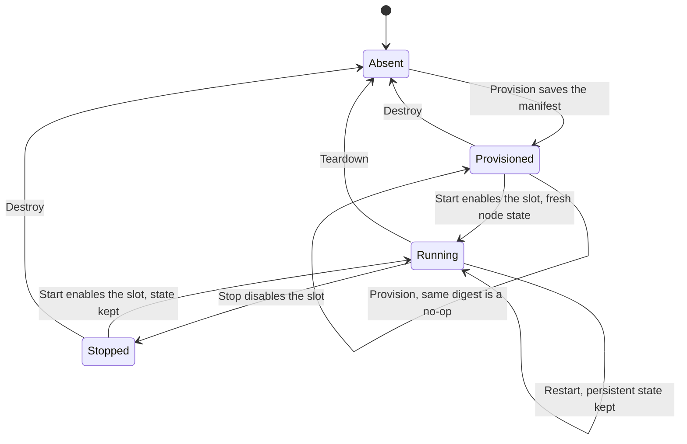
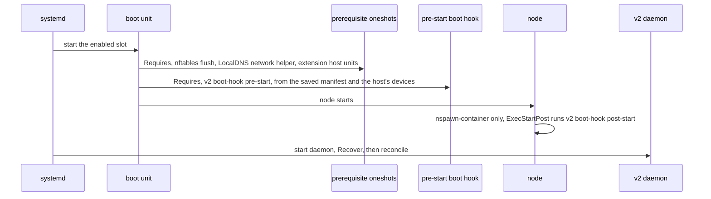

# Unbounded Agent v2: Node Runtime

Part of the [Unbounded Agent v2 design](README.md). The README has the status,
repository baseline, citation conventions and terms.

## 1. Node runtime

```go
package runtime

type Kind string

const (
	KindHost            Kind = "host"
	KindNSpawnContainer Kind = "nspawn-container"
)

// Slot names one of the two node instances a runtime can hold.
type Slot string

const (
	SlotA Slot = "a" // nspawn-container: kube1
	SlotB Slot = "b" // nspawn-container: kube2
)

// NodeRuntime hosts Kubernetes node instances. The agent reaches a node only
// through this interface.
//
// Every runtime shares the host kernel and the host network namespace with
// the node. The node manager relies on this: it configures host sysctls for
// the node and cleans host network state after Stop.
type NodeRuntime interface {
	Kind() Kind

	// HostRequirements reports what the host must provide or give up:
	// packages, commands, units to mask or own, kernel modules.
	HostRequirements(spec *nodespec.NodeSpec) HostRequirements
	// Preflight returns read-only runtime checks.
	Preflight(spec *nodespec.NodeSpec) []preflight.Checker
	// OwnedResources lists every unit, path and link the runtime may create.
	OwnedResources() OwnedResources
	// Layout tells the renderer where node content lives, from the node's view.
	Layout(slot Slot) bundle.Layout

	Inspect(ctx context.Context) (State, error)
	Provision(ctx context.Context, slot Slot, b *bundle.NodeBundle) error
	// Start enables the slot, so systemd starts it at boot, disables the
	// other slot, and starts the node.
	Start(ctx context.Context, slot Slot) error
	// Stop stops the node and disables the slot.
	Stop(ctx context.Context, slot Slot) error
	Restart(ctx context.Context, slot Slot) error
	Destroy(ctx context.Context, slot Slot) error
	// Teardown removes everything in OwnedResources, with or without state
	// records.
	Teardown(ctx context.Context) error

	// Access observes a started node: readiness and diagnostics.
	Access(slot Slot) NodeAccess
	// BootHook runs runtime-owned work that systemd triggers around node
	// boot. It reads the slot's saved bundle manifest (section 2) and looks up
	// the host's devices again (section 4). It never renders node content,
	// fetches credentials or uses the network.
	BootHook(ctx context.Context, phase BootPhase, slot Slot) error
}

// SlotPhase is one of Absent, Provisioned, Running or Stopped. Provisioned
// means the slot's content is in place and the slot has not started since that
// content was provisioned.
type SlotPhase string

type SlotState struct {
	Phase        SlotPhase
	Enabled      bool   // systemd starts this slot at boot
	BundleDigest string // digest of the saved bundle manifest
}

type State struct{ Slots map[Slot]SlotState }

type NodeAccess interface {
	UnitActive(ctx context.Context, unit string) (bool, error)
	FileNonEmpty(ctx context.Context, path string) (bool, error)
	Exec(ctx context.Context, argv ...string) ([]byte, error)
}

type BootPhase string

const (
	BootPreStart  BootPhase = "pre-start"
	BootPostStart BootPhase = "post-start"
)

var (
	ErrSlotBusy    = errors.New("another slot is running")
	ErrSlotEnabled = errors.New("slot is the enabled slot")
)

// Leftover is something a cleanup could not remove. Both runtimes and the
// host network reset report them.
type Leftover struct {
	Kind   string // process, mount, netns, path, unit, link, rule, chain, pin, sysctl
	ID     string
	Reason string
}
```

Rules every runtime must follow. A shared conformance suite,
`runtimetest.Conformance(t, factory)`, enforces them.

1. Every method is idempotent and safe to repeat after a crash.
2. `Provision` and `Destroy` on one slot never affect the other slot while it
   runs. `Destroy` returns `ErrSlotEnabled` for the enabled slot.
3. `Start(x)` returns `ErrSlotBusy` while another slot is running.
4. The first time a slot starts after its content was provisioned, it begins
   with empty kubelet and containerd state. Provisioning identical content
   again, with the same bundle digest, does not count as new content. The one
   exception to empty state is container image content, when the runtime is
   configured to keep it (`runtime.host.repave.retainContainerImages`).
5. `Restart` keeps persistent node state. Volatile state under `/run` is lost,
   as it would be on a host reboot.
6. At most one slot is enabled. `Start` enables its slot and disables the other;
   `Stop` disables its slot. After a host reboot, systemd starts the enabled
   slot on its own. No lifecycle hooks ([extensions, section 1](02-extensions.md#1-extension-mechanisms)) fire for a node that
   systemd starts at boot.
7. The node manager puts content into a node only through `Provision`. Boot
   hooks may change the node, for example NVIDIA wiring in the
   `nspawn-container` post-start boot hook.
8. Runtimes do not download artifacts, call the Kubernetes API, or run plugins.

The runtime is the only authority on which slot is enabled and running. The
node manager does not record it separately; it records the bundle digests of
the applied and pending goals ([control and state, section 4](04-control-and-state.md#4-state)) and compares them with what
`Inspect` reports.

## 2. Node spec and bundle

```go
package nodespec

type NodeSpec struct {
	Identity     Identity     // machine name, node name, hostname
	Kubernetes   Kubernetes   // version, kubelet config, flags, labels, taints, node IP, auth
	Containerd   Containerd   // version, sandbox image, Gantry mirror, NVIDIA runtime
	CNI          CNI
	LocalDNS     *LocalDNS
	Accelerators Accelerators // NVIDIA and AMD discovery results
	Devices      HostDevices
	Mounts       []Mount
	Artifacts    []ArtifactRequest
	Images       []ImageArchiveRequest
}

// Resolve combines the install-time settings from the configuration file with
// the goal settings of the goal being applied.
func Resolve(ctx context.Context, install *config.InstallSettings, goal *config.GoalSettings, creds *credentials.Bootstrap, probe HostProbe) (*NodeSpec, error)
```

```go
package bundle

type Layout struct {
	BinDir             string // nspawn-container: /usr/local/bin; host: /var/lib/unbounded/agent-v2/slots/<slot>/bin
	CNIBinDir          string
	ImageArchiveDir    string
	OwnsSystemResolver bool // nspawn-container: true; host: false
}

type NodeBundle struct {
	Digest          string
	Artifacts       []Artifact       // verified files in the host artifact cache, with node paths
	Files           []File           // configs, kubeconfigs, CA, unit drop-ins
	Units           []Unit           // units that run inside the node
	SharedHostPaths []SharedHostPath // host paths made visible inside the node
	Devices         DeviceRequest    // device kinds and extra devices the node asks for, not host paths
	HostUnits       []Unit           // host units the node needs: the LocalDNS network unit
	Boot            []BootStep       // ordered: localdns, containerd, image import, kubelet, extensions
	Readiness       Readiness        // kubelet active, kubeconfig non-empty, LocalDNS ready URLs
}

type File struct {
	NodePath string
	Mode     fs.FileMode
	Content  []byte
	Secret   bool // never logged or included in diagnostics
}

// Render is pure. The same inputs produce the same bundle and digest.
func Render(spec *nodespec.NodeSpec, layout Layout, ext []extensions.Resolved) (*NodeBundle, error)
```

`Provision` saves the bundle in the slot, so it is rendered only once:

- The manifest is saved as `/var/lib/unbounded/agent-v2/slots/<slot>/bundle.json`
  for both runtimes, followed by a completion marker written last. A slot
  without the marker is not provisioned.
- The contents of `Secret` files, such as the bootstrap kubeconfig, are not in
  the manifest. They are written only to their place in the node (in the
  nspawn rootfs, or under the slot directory with mode 0600 on `host`).
- The digest covers every artifact, unit and non-secret file, but only the path
  and mode of secret files. A refreshed bootstrap token therefore does not
  change the digest.
- The manifest also records the goal settings it was rendered from. A resumed
  bootstrap uses them to record what an already running node was actually
  built from ([CLI and configuration, section 2](01-cli-and-configuration.md#2-configuration)).
- Boot hooks and `Recover` read the saved manifest. Nothing renders node
  content again after `Provision`, so nothing needs credentials outside
  provisioning. The one thing looked up again at every node start is the
  host's devices (section 4).

After `Start` or `Restart`, the node manager waits for `Readiness` with v1's
timeouts. A timeout fails the step like any other error.

| Wait | When | Timeout |
|---|---|---|
| kubelet's kubeconfig is non-empty, after TLS bootstrapping | Bootstrap | 2 minutes (`pkg/agent/phases/nodestart/wait_kubelet.go:74`) |
| `kubelet.service` is active | Repave and NodeReboot | 60 seconds (`wait_kubelet.go:48`) |
| LocalDNS readiness endpoints respond, when LocalDNS is enabled | Every start | 1 minute (`pkg/agent/phases/nodestart/localdns.go:195`) |

## 3. Slot states



A host reboot does not change a slot's phase: systemd starts the enabled slot
again, and it stays Running.

## 4. Host boot and boot units

Each runtime has a *boot unit*: the unit that must start before the node does.
Host-side prerequisites are oneshot units that the boot unit requires directly,
with no target in between:

| | `nspawn-container` | `host` |
|---|---|---|
| Started at boot through | The enabled machine (`machinectl enable`) | `unbounded-node.target`, enabled by `Start`, which wants `containerd.service`, `kubelet.service` and `localdns.service` |
| Boot unit | `systemd-nspawn@<m>.service` for the enabled slot | `unbounded-node-prestart.service`, a oneshot that the three node units each `Requires=` and are ordered after |
| How prerequisites attach | `RequiredBy=systemd-nspawn@.service` in the prerequisite, which covers both slots, plus `After=` in the machine's unit override, as v1 does (`pkg/agent/phases/host/assets/nftables-flush.service:20-21`, `pkg/agent/phases/rootfs/assets/service-override.conf:39`). A `Before=` on the template would not reach the instances (`nftables-flush.service:3-5`). | `RequiredBy=` and `Before=unbounded-node-prestart.service` in the prerequisite |
| Pre-start boot hook | A separate oneshot unit, `unbounded-node-boot-hook@<m>.service`, that the machine's override `Requires=` and is ordered after, as v1's config-regeneration unit is (`service-override.conf:37-38`) | Run by `unbounded-node-prestart.service` |
| Post-start boot hook | `ExecStartPost=` in the machine's override, as in v1 (`service-override.conf:48`) | None: the NVIDIA CDI spec is generated in the pre-start boot hook |

The prerequisites are the same for both runtimes: the nftables flush, the
LocalDNS network helper, extension host units with `orderBeforeNode`, and
`nodeDependencies.requires` units.

The LocalDNS network unit is not host preparation. Its settings come from the
goal, and the host network reset removes it during a repave. The node manager
writes it, with its helper, from the bundle's `HostUnits` before every
`Start`, as v1 does at every node start
(`pkg/agent/phases/nodestart/localdns.go:104-176`).

On `nspawn-container`, the pre-start boot hook also finds the host's devices
again and rewrites the machine's `.nspawn` file and unit override from the
saved manifest and the devices it finds, using the current agent binary. v1's
pre-start hook does the same (`pkg/agent/nspawnlifecycle/lifecycle.go:67-93`).
A device that appears while the host boots, such as an InfiniBand device, is
therefore visible inside the node without a repave. These are the runtime's
host-side files, not node content, so they are not in the bundle digest and
never cause a repave. On `host`, the node sees the host's devices directly.

The prerequisite and pre-start units are oneshots with `RemainAfterExit=no`.
They are inactive once they finish, so every later start of a unit that
requires them runs them again *(inference)*. That covers a host boot, a
NodeReboot on `nspawn-container` (`systemctl restart systemd-nspawn@<m>`), and
starting the node units again on a `host` restart. It is how v1's nftables
flush already runs again on each machine start. Validation task V5 ([testing, section 7](11-testing.md#7-validation-tasks)) confirms it.



v1 runs its hooks through a separate copy of the binary that survives an
upgrade rollback (`pkg/agent/phases/rootfs/lifecycle_helper.go:34-37`). Whether
v2 can use the `current` link instead is open question 5 ([overview, section 3](README.md#3-open-questions)).

## 5. Runtimes

| | `nspawn-container` | `host` |
|---|---|---|
| Slot | `/var/lib/machines/kube1`, `kube2` | `/var/lib/unbounded/agent-v2/slots/{a,b}` |
| Provision | Unpack the OCI image; write the bundle, `.nspawn` file and unit override | Stage binaries and rendered files into the slot directory |
| Start | `machinectl start`, then boot steps through `systemd-run -M` | Install units and configuration from the slot, then start `unbounded-node.target` (section 4) |
| Enabled at boot | `machinectl enable` on `Start`, as v1 does (`pkg/agent/phases/nodestart/nspawn.go:99`), and `machinectl disable` on `Stop` (`pkg/agent/phases/reset/machine.go:39`) | The node units are enabled on `Start` and disabled on `Stop` |
| Fresh state | A new rootfs | Wipe the owned paths ([host runtime cleanup, section 8](07-host-runtime-cleanup.md#8-wipe-and-slot-changes)) |
| `NodeAccess` | `systemd-run -M` | Direct |
| NVIDIA | v1's bind mounts, library symlinks, driver root and CDI generation in the post-start boot hook | CDI generation with `nvidia-ctk cdi generate --driver-root /` in the pre-start boot hook, writing `/run/cdi/nvidia.yaml`, which containerd also reads as `/var/run/cdi` *(inference: containerd's default CDI directories)* |
| NVIDIA Container Toolkit | From the GPU OCI image (`images/agent-ubuntu2404-nvidia/Containerfile:22-32`) | Shipped as an agent artifact (section 5.2) |
| Devices and extra mounts | Bind mounts plus `DeviceAllow`, found again at every machine start (section 4) | Nothing to do; already visible |
| Boot ID that kubelet reports | A new one at every machine start *(inference: systemd-nspawn gives each container boot its own boot ID)* | A new one at every node start (section 5.2) |
| Shared host paths | Bind mounts | The paths themselves; `hostPath` must equal `nodePath` |
| Kubelet exec credential command | Bind-mounted read-only at the same path | The path itself |
| Resolver | Writes the node's `/etc/resolv.conf` | Never touches the host's `/etc/resolv.conf`. When LocalDNS is enabled, kubelet's `resolvConf` setting points at the LocalDNS resolver file (`pkg/agent/goalstates/resolve.go:163-166`, `pkg/agent/phases/nodestart/kubelet.go:129-130`); otherwise kubelet uses the host's resolver. |
| Host requirements | `systemd-container`; mask the host's containerd and kubelet | Own `containerd.service` and `kubelet.service`; mask docker; check for conflicting packages |

### 5.1 `nspawn-container`

This runtime is the parity reference. It wraps v1's nspawn code: OCI unpack,
`.nspawn` and override rendering, `machinectl` start and stop, NVIDIA wiring,
and machine removal. Slots map to v1's machine names (`a` is `kube1`, `b` is
`kube2`), which keeps existing tooling and v1's existing-deployment detection
working.

### 5.2 `host`

The node runs directly on the host:

- `containerd.service`, `kubelet.service` and `localdns.service` keep their
  standard names and run in `unboundednode.slice` ([host runtime cleanup, section 6](07-host-runtime-cleanup.md#6-terminate)).
- Binaries live in the enabled slot's directory; units point at them. A repave
  stages the new slot, then rewrites the units when it switches to that slot.
- Preflight adds a `conflicting-packages` check for distro packages that ship
  kubelet, containerd or docker's containerd.
- kubelet gets a boot ID of its own that changes at every node start, as it
  does in an nspawn container. The pre-start boot hook writes a random ID to
  `/run/unbounded-node/boot_id`, and `kubelet.service` mounts it over
  `/proc/sys/kernel/random/boot_id` with `BindReadOnlyPaths=`. A NodeReboot
  therefore shows a new boot ID and a `Rebooted` event on the Node, as in v1,
  even though the host's kernel did not restart *(inference: kubelet reports
  the boot ID it reads from that file; validation task V6
  ([testing, section 7](11-testing.md#7-validation-tasks)))*.

NVIDIA Container Toolkit, as an artifact:

- A new `nvidiaContainerToolkit` artifact with a pinned default version, a
  download override (`artifacts.downloads.nvidiaContainerToolkit`), a required
  SHA-256, and inclusion in offline artifacts built by
  `hack/cmd/agent-artifacts-builder`.
- It is fetched, and checked by preflight, only when NVIDIA GPUs are present.
- Upstream distributes OS packages, so the release pipeline repackages the
  binaries CDI mode needs into a tarball. The expected set is
  `nvidia-container-runtime`, `nvidia-ctk` and `nvidia-cdi-hook` *(inference;
  validation task V3 ([testing, section 7](11-testing.md#7-validation-tasks)))*.
- Binaries are staged in `<slot>/nvidia/bin`. containerd's `nvidia` runtime
  `BinaryName` points there. The toolkit's configuration lives in the slot
  directory, so the host's `/etc/nvidia-container-runtime/config.toml` is never
  edited.
- The NVIDIA driver stays a host prerequisite, checked by the existing
  `nvidia-driver` preflight.

The workloads on a `host` node see the real host rather than a container. For
example, racer's `/dev` hostPath is the host's whole `/dev`
(`internal/racer/workload/workload.go:269`), and unbounded-net's init container
reaches the real init with `nsenter -t 1` (`images/net/node-agent-init.sh:17`).
