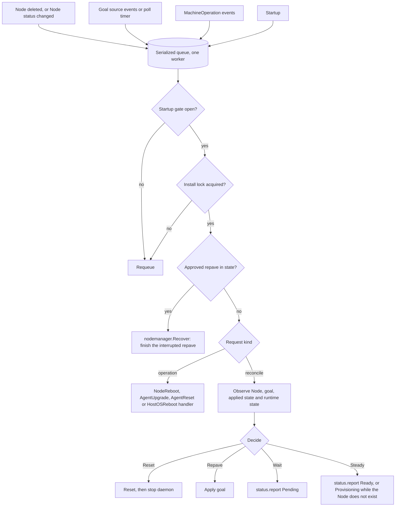

# Unbounded Agent v2: Control and State

Part of the [Unbounded Agent v2 design](README.md). The README has the status,
repository baseline, citation conventions and terms.

## 1. Control plane integration

```go
package control

type Goal struct {
	// Version is opaque: a MachineConfigurationVersion name, an ARM ETag or a
	// digest of the configuration file. It is compared for equality only.
	Version string
	// Settings holds only goal settings (CLI and configuration doc,
	// section 2). Install-time settings never come from a goal.
	Settings *config.GoalSettings
	// Delete is true when the machine is being removed and the node must be
	// reset.
	Delete bool
}

type Observation struct {
	Node    *NodeObservation // nil when the Node object does not exist
	Applied *state.Applied
}

type GoalSource interface {
	Register(ctx context.Context, r Registration) error
	Get(ctx context.Context, obs Observation) (*Goal, error)
	Trigger() Trigger // an event source, or a poll interval
}

type StatusReporter interface {
	Report(ctx context.Context, s Status) error
}
```

Built-in providers:

- `machina`: registers the Machine, builds the goal settings as v1 does, and
  writes Machine status. v1 starts from the running node's applied
  configuration and overlays the template of the MachineConfigurationVersion
  that the Machine's `spec.configurationRef` names: the Kubernetes version,
  node labels, taints, agent image and LocalDNS settings
  (`cmd/agent/internal/daemon/controller_node.go:75-105,143-167`). Without a
  `configurationRef`, the goal settings are the applied ones. Other edits to
  the Machine's spec never change the goal. On the `host` runtime, the
  template's agent image is ignored with a logged warning and left out of
  drift: it is an nspawn root filesystem image, which means nothing without
  nspawn, and the API requires one in every version
  (`api/machina/v1alpha3/machineconfiguration_types.go:137-140`). Counting it
  as drift would repave, and wipe, a `host` node for nothing. The template's
  LocalDNS settings still apply.
- `static`: the goal settings in the agent's copy of the configuration file,
  `/etc/unbounded/agent-v2/config.json`, are the goal; the version is their
  digest. The daemon watches the file. An operator changes the goal by editing
  its goal settings. Edits to install-time settings are ignored and logged as a
  warning ([CLI and configuration, section 2](01-cli-and-configuration.md#2-configuration)).
- `plugin`: delegates to a plugin ([extensions, section 3](02-extensions.md#3-plugin-protocol)). The daemon calls `goal.get` on
  every Node event and every `control.goal.pollInterval`, which defaults to 10
  minutes with up to 10% random jitter. The interval applies only to this
  source.

Bootstrap does not ask the goal source for a goal. It builds the first node
from the configuration file and records an empty goal version. The goal
version is recorded only when the daemon handles a Node deletion (section 5),
as in v1, which never records a version at bootstrap
(`cmd/agent/internal/daemon/controller_node.go:43-68`).

The `machina` status reporter writes what v1 writes, at the same moments, and
adds two conditions and one status field. It never writes `status.phase`:
machina owns that field and branches on it, and a Machine in `Pending`,
`Failed`, `Ready` or no phase can go down machina's provisioning path
(`cmd/machina/machina/controller/machine_controller.go:276-303`).

| Machine field | Written | As in v1 |
|---|---|---|
| `AgentBootstrapped` condition | During bootstrap: `Running`, then `Succeeded`, or a failure reason. v2 adds two reasons: `NodeStartFailed` when the `host` runtime cannot start the node, where v1's `NSpawnFailed` would be misleading, and `RuntimeUnsupported` when the host fails a capability probe for the requested runtime ([node runtime, section 5.3](03-node-runtime.md#53-host-capabilities)). | Yes, plus the two reasons (`cmd/agent/internal/cmd/bootstrap.go:260-272`, `cmd/agent/internal/daemon/bootstrap_status.go:85-112`) |
| `RepavePending` condition and `status.configuration` | Only when the daemon handles a Node deletion | Yes (`controller_node.go:54-68,116-133`) |
| `status.observedProvisioningFormat` | When the daemon starts and registers the Machine | Yes (`cmd/agent/internal/daemon/daemon.go:327,340,350`) |
| `AgentHealthy` condition | `True` with reason `Healthy` while the daemon works normally; `False` with reason `NodeNotRegistered`, `RepaveFailed`, `StateMismatch` or `StateCorrupt`, with the attempt count and last error in the message where they apply | New |
| `RuntimeChangePending` condition | `True` when `spec.agent.runtime` differs from the runtime installed on the host, until a reinstall applies it ([CLI and configuration, section 2](01-cli-and-configuration.md#2-configuration)) | New |
| `status.agent.runtime` | The runtime installed on the host, when the daemon starts | New |

A requested runtime change is not a health problem, which is why it has its own
condition rather than a reason on `AgentHealthy`. The daemon can already update
Machine status (`deploy/machina/07-bootstrapper-rbac.yaml.tmpl:17-19`), so none
of this needs new permissions. The phases the status reporter receives
([extensions, section 3](02-extensions.md#3-plugin-protocol)), such as `Pending`, are not written to the Machine: the
Machine's `RepavePending` condition keeps v1's meaning and timing. Provisioning
does not apply `configurationRef` yet (issue #1039), so a Machine whose
referenced version differs from what its node was built from would otherwise
show a pending repave right after bootstrap.

## 2. Credentials

```go
package credentials

type Bootstrap struct {
	APIServer string
	CACert    []byte
	Token     string // empty when kubelet uses exec or kubeconfig auth
}

type BootstrapProvider interface {
	Bootstrap(ctx context.Context) (*Bootstrap, error)
}

type ClusterAuth interface {
	RESTConfig() *rest.Config
	Run(ctx context.Context) error // rotation
}
```

The `csr` daemon credential reuses `pkg/agent/daemoncred`. The kubelet's three
authentication modes (bootstrap token, kubeconfig, exec credential) are carried
over from v1 (`pkg/agent/phases/nodestart/kubelet.go:282-379`).

## 3. Node manager

```go
package nodemanager

type Manager interface {
	Ensure(ctx context.Context, cfg *config.AgentConfiguration) error // bootstrap on slot a
	Apply(ctx context.Context, g *control.Goal) error                 // repave into the other slot
	Reboot(ctx context.Context) error
	Reset(ctx context.Context, trigger ResetTrigger) error
	Recover(ctx context.Context) error // finish or clean up interrupted work
	// Observe reads the Node and the applied state, and calls the runtime's
	// Inspect. The daemon calls it on every reconcile.
	Observe(ctx context.Context) (control.Observation, error)
}

// Trigger is why the daemon is reconciling: NodeDeleted when it saw this
// node's Node object being deleted, NodeChanged when the Node's status
// changed, otherwise GoalChanged, Poll or Startup.
type Trigger string

type Action string // Steady, Wait, Repave, Reset

func Decide(t Trigger, obs control.Observation, g *control.Goal, drift func(applied, desired *config.GoalSettings) bool) Action
```

The drift function starts from v1's `hasDrift`
(`cmd/agent/internal/daemon/nodeoperator.go:140-193`). Fields that only matter
for one runtime, such as the nspawn OCI image, are contributed by that runtime.

## 4. State

```go
package state

type Applied struct {
	GoalVersion  string               // empty until the daemon first handles a Node deletion
	Settings     *config.GoalSettings // the goal settings the running node was built from
	BundleDigest string               // digest of that node's saved bundle manifest
	StartedAt    time.Time            // when that node started, for the registration timeout
	Repave       *Repave              // non-nil from the moment a repave is approved
}

type Repave struct {
	ApprovedAt   time.Time    // when the daemon saw the Node deleted
	Slot         runtime.Slot // empty until the new slot's bundle is rendered
	GoalVersion  string
	Settings     *config.GoalSettings
	BundleDigest string // empty until the new slot's bundle is rendered
	Attempts     int
	LastError    string
}
```

The daemon saves `Repave` as soon as it handles a Node deletion that needs a
repave, before it resolves the node spec or downloads anything. Once saved, a
repave survives any restart of the daemon or the host: `Recover` continues it,
and an operator never has to approve it again. v1 keeps the approval only in
memory, so a daemon restart before the repave finishes loses it
([v1 compatibility, section 2](08-v1-compatibility.md#2-behavior-changes-from-v1)).

A single `Applied` record replaces v1's per-slot applied-configuration files
([v1 compatibility, section 2](08-v1-compatibility.md#2-behavior-changes-from-v1)).

The record does not say which slot is enabled or running; only the runtime
knows that ([node runtime, section 1](03-node-runtime.md#1-node-runtime)). `Recover` compares the enabled slot, and its bundle
digest as reported by `Inspect`, with this record. It checks both the slot and
the digest, so a repave whose new bundle happens to match the old one is never
mistaken for no repave:

| Enabled slot | Meaning | `Recover` does |
|---|---|---|
| Not `Repave.Slot`, digest matches `Applied.BundleDigest` | No repave in progress, or one that never got as far as starting the new slot, including one approved but not yet rendered (`Repave.Slot` empty) | Continues or retries the approved repave, if any, from the beginning of its first unfinished step |
| `Repave.Slot`, digest matches `Repave.BundleDigest` | The new slot started, but the commit did not happen | Waits for readiness, then commits |
| None, and `Repave` is set | The old slot was stopped, but the new one was not started | Continues the approved repave from starting the new slot |
| Any other case | The record and the host disagree | Reports `StateMismatch`, changes nothing, and keeps the daemon from reporting ready (section 5) |

The runtime kind is an install-time setting, so it lives in the install
record, not here.

### State files

The rules for every v2 state file: the install record, node state, the host
preparation undo log, the host runtime's ownership and active-slot records,
saved bundle manifests, and the migration record on a host migrated from v1.

- Each file has a `schemaVersion`, is written and synced to disk before it is
  used, and has a `.sha256` sidecar.
- New fields are only ever added, never renamed or removed, and older readers
  ignore fields they don't know. An upgrade can roll back to the `last-good`
  binary ([lifecycles, section 5](05-lifecycles.md#5-agentupgrade)), which must still be able to read what the newer binary
  wrote.
- If a file has an unknown `schemaVersion` or fails its checksum, the daemon
  makes no changes and reports `StateCorrupt`. `v2 reset` still runs, using the
  conservative paths described in [host runtime cleanup, section 9](07-host-runtime-cleanup.md#9-teardown).
- The state files listed above, the configuration copy and daemon credentials
  under `/etc/unbounded/agent-v2/`, and every file the bundle marks as secret
  have mode 0600. The configuration copy can hold a bootstrap token. Slot
  binaries and the artifact cache keep the modes they need to run.

## 5. Daemon reconcile



The startup gate opens when the Machine is registered, `Recover` has found the
host consistent with the state (section 4), and the caches have synced. The
daemon then tells systemd it is ready: the daemon unit is `Type=notify`, and the
daemon sends `READY=1` ([lifecycles, section 5](05-lifecycles.md#5-agentupgrade)). It then publishes pending AgentUpgrade and
HostOSReboot results, as v1 publishes them when its daemon starts
(`cmd/agent/internal/daemon/daemon.go:170-176`), and starts taking requests from
the queue. An approved repave that `Recover` found is finished from the queue,
after the gate opens, so a long repave never delays readiness.

A daemon whose `Recover` finds the state inconsistent or corrupt
(`StateMismatch`, `StateCorrupt`) reports it on the Machine and exits with a
failure code instead of reporting ready, as v1's daemon exits when it cannot
make sense of the host's machines (`daemon.go:137-140`). After an AgentUpgrade,
this rolls the binary back. When the state itself is at fault, the `last-good`
binary that the recovery unit starts fails the same way, and the host needs
`v2 reset` on the host or a HostReplace.

`Decide` repaves only when the daemon itself sees this node's Node object
being deleted, as v1 does: v1 watches only Node delete events
(`cmd/agent/internal/daemon/controller.go:151-156`).

| Trigger | Goal `delete` | Drift | Action |
|---|---|---|---|
| Any | `true` | Any | Reset |
| `NodeDeleted` | `false` | Yes | Repave: save `Repave`, then `Apply` |
| `NodeDeleted` | `false` | No | Steady; record the goal version as applied, as v1 does (`cmd/agent/internal/daemon/controller_node.go:54-62`) |
| Any other | `false` | Yes | Wait: a repave is pending until the Node is deleted |
| Any other | `false` | No | Steady |

A Node deleted while the daemon is not running is never acted on, as in v1.
Stopping the daemon is therefore a safe way to keep a node as it is, for
example while debugging. To repave after such a deletion, start the daemon and
delete the Node again. kubelet registers the Node again when it restarts
*(inference: kubelet registers once at startup)*, for example after a
NodeReboot operation or a host reboot.

The reported phase is `Pending` while a repave waits for the Node to be
deleted. Otherwise it follows the Node: `Ready` while the Node exists, and
`Provisioning` while it does not.

"Record the goal version as applied" changes nothing on the running node. Goal
settings that the drift function ignores, such as artifact download sources,
are saved with the version and take effect at the next provision.

A node that never registers is reported but not repaved, because there is no
Node to delete. This matches v1, where such a node also stays as it is. The
`NodeNotRegistered` status, counted from `Applied.StartedAt`, makes the problem
visible, including on the Machine as `AgentHealthy=False` (section 1). Recovery
is manual, as in v1: an `AgentReset` operation or `v2 reset`, then `v2 start`.

## 6. MachineOperation handling

`OperationKind` is a closed enum (`api/machina/v1alpha3/machineoperation_types.go:54`).
There are no custom kinds: consumers customize the agent through plugins,
hooks and declarative extensions ([extensions](02-extensions.md)) instead. Each kind is
executed by one component:

- The agent executes `NodeReboot`, `AgentUpgrade`, `AgentReset` and
  `HostOSReboot` (`cmd/agent/internal/daemon/controller_machineoperation.go:45-51`;
  [lifecycles, section 4](05-lifecycles.md#4-hostosreboot)).
- machine-ops-controller and metalman execute the other `Host*` kinds, and do
  not execute `HostOSReboot` (`internal/machineops/controller.go:382-391`,
  `internal/metalman/machineops/controller.go:1238-1245`).

v2 ignores an operation whose kind it has no handler for, as v1 does
(`pkg/agent/daemon/machineoperation.go:114-118,139-141`). Failing such
operations instead was considered and rejected:

- The kind list is closed by the CRD, so an agent only meets a kind it does not
  know when the CRD is newer than the agent.
- No naming rule identifies the agent's kinds: the agent executes
  `HostOSReboot`, a `Host*` kind.
- A selector operation has one status shared by every matching agent, and
  agents skip it once it is terminal
  (`pkg/agent/daemon/machineoperation.go:105-107`). One out-of-date agent
  failing it would fail it for every agent (issue #1040).

v2 also deletes expired operations, which v1 never does. When an operation
aimed at this Machine with `machineRef`, and run by this agent, has
`ttlSecondsAfterFinished` set, the daemon deletes it that many seconds after it
completes or fails, as metalman does
(`internal/metalman/machineops/controller.go:1128-1145`). Without it, a cluster
that runs neither machine-ops-controller nor metalman keeps agent operations
forever (issue #1043), and the daemon lists every operation each time it starts
to report `HostOSReboot` results (`cmd/agent/internal/daemon/hostosreboot.go:207-210`).
Selector operations are left to the controllers, so agents never race to delete
a shared operation. The daemon's role already allows deleting operations
(`deploy/machina/07-bootstrapper-rbac.yaml.tmpl:23-25`).

v2 implements both in its own copy of the reconciler, so `pkg/agent/daemon` is
unchanged for v1 and Flex.
