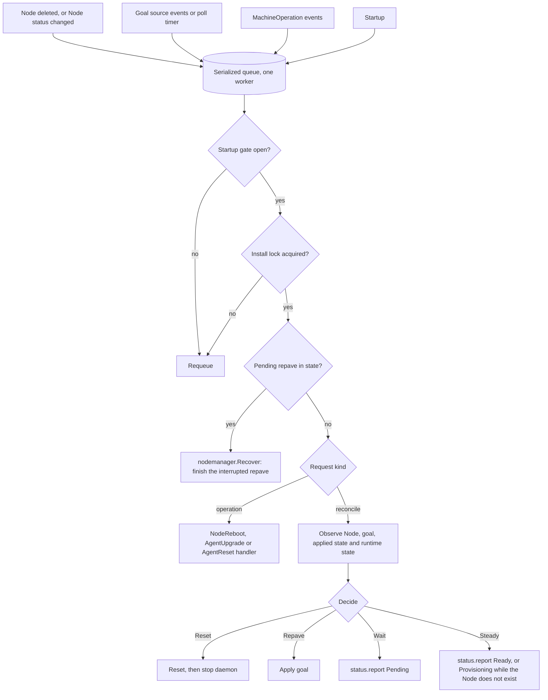

# Unbounded Agent v2: Control and State

Part of the [Unbounded Agent v2 design](README.md). The README has the status,
repository baseline, citation conventions and terms.

## 1. Control plane integration

```go
package control

type Goal struct {
	// Version is opaque: a MachineConfigurationVersion name, an ARM ETag or a
	// digest of the configuration file. It is compared for equality only.
	Version string
	// Settings holds only goal settings (CLI and configuration doc,
	// section 2). Install-time settings never come from a goal.
	Settings *config.GoalSettings
	// Delete is true when the machine is being removed and the node must be
	// reset.
	Delete bool
}

type Observation struct {
	Node    *NodeObservation // nil when the Node object does not exist
	Applied *state.Applied
}

type GoalSource interface {
	Register(ctx context.Context, r Registration) error
	Get(ctx context.Context, obs Observation) (*Goal, error)
	Trigger() Trigger // an event source, or a poll interval
}

type StatusReporter interface {
	Report(ctx context.Context, s Status) error
}
```

Built-in providers:

- `machina`: registers the Machine, reads the goal settings from the Machine
  and its MachineConfigurationVersion as v1 does
  (`cmd/agent/internal/daemon/controller_node.go:75-105`), and writes Machine
  status.
- `static`: the goal settings in the agent's copy of the configuration file,
  `/etc/unbounded/agent-v2/config.json`, are the goal; the version is their
  digest. The daemon watches the file. An operator changes the goal by editing
  its goal settings. Edits to install-time settings are ignored and logged as a
  warning ([CLI and configuration, section 2](01-cli-and-configuration.md#2-configuration)).
- `plugin`: delegates to a plugin ([extensions, section 3](02-extensions.md#3-plugin-protocol)). The daemon calls `goal.get` on
  every Node event and every `control.goal.pollInterval`, which defaults to 10
  minutes with up to 10% random jitter. The interval applies only to this
  source.

Bootstrap does not ask the goal source for a goal. It builds the first node
from the configuration file and records an empty goal version. The goal
version is recorded only when the daemon handles a Node deletion (section 5),
as in v1, which never records a version at bootstrap
(`cmd/agent/internal/daemon/controller_node.go:43-68`).

The `machina` status reporter writes `Machine.status.configuration` and the
Machine's `RepavePending` condition at the same moments v1 does: only when the
daemon handles a Node deletion (`controller_node.go:54-68,116-133`).

## 2. Credentials

```go
package credentials

type Bootstrap struct {
	APIServer string
	CACert    []byte
	Token     string // empty when kubelet uses exec or kubeconfig auth
}

type BootstrapProvider interface {
	Bootstrap(ctx context.Context) (*Bootstrap, error)
}

type ClusterAuth interface {
	RESTConfig() *rest.Config
	Run(ctx context.Context) error // rotation
}
```

The `csr` daemon credential reuses `pkg/agent/daemoncred`. The kubelet's three
authentication modes (bootstrap token, kubeconfig, exec credential) are carried
over from v1 (`pkg/agent/phases/nodestart/kubelet.go:282-379`).

## 3. Node manager

```go
package nodemanager

type Manager interface {
	Ensure(ctx context.Context, cfg *config.AgentConfiguration) error // bootstrap on slot a
	Apply(ctx context.Context, g *control.Goal) error                 // repave into the other slot
	Reboot(ctx context.Context) error
	Reset(ctx context.Context, trigger ResetTrigger) error
	Recover(ctx context.Context) error // finish or clean up interrupted work
	// Observe reads the Node and the applied state, and calls the runtime's
	// Inspect. The daemon calls it on every reconcile.
	Observe(ctx context.Context) (control.Observation, error)
}

// Trigger is why the daemon is reconciling: NodeDeleted when it saw this
// node's Node object being deleted, otherwise GoalChanged, Poll or Startup.
type Trigger string

type Action string // Steady, Wait, Repave, Reset

func Decide(t Trigger, obs control.Observation, g *control.Goal, drift func(applied, desired *config.GoalSettings) bool) Action
```

The drift function starts from v1's `hasDrift`
(`cmd/agent/internal/daemon/nodeoperator.go:134-187`). Fields that only matter
for one runtime, such as the nspawn OCI image, are contributed by that runtime.

## 4. State

```go
package state

type Applied struct {
	GoalVersion  string               // empty until the daemon first handles a Node deletion
	Settings     *config.GoalSettings // the goal settings the running node was built from
	BundleDigest string               // digest of that node's saved bundle manifest
	StartedAt    time.Time            // when that node started, for the registration timeout
	Pending      *Pending             // non-nil from the moment a repave is approved
}

type Pending struct {
	ApprovedAt   time.Time    // when the daemon saw the Node deleted
	Slot         runtime.Slot // empty until the new slot's bundle is rendered
	GoalVersion  string
	Settings     *config.GoalSettings
	BundleDigest string // empty until the new slot's bundle is rendered
	Attempts     int
	LastError    string
}
```

The daemon saves `Pending` as soon as it handles a Node deletion that needs a
repave, before it resolves the node spec or downloads anything. Once saved, a
repave survives any restart of the daemon or the host: `Recover` continues it,
and an operator never has to approve it again. v1 keeps the approval only in
memory, so a daemon restart before the repave finishes loses it
([v1 compatibility, section 2](08-v1-compatibility.md#2-behavior-changes-from-v1)).

A single `Applied` record replaces v1's per-slot applied-configuration files
([v1 compatibility, section 2](08-v1-compatibility.md#2-behavior-changes-from-v1)).

The record does not say which slot is enabled or running; only the runtime
knows that ([node runtime, section 1](03-node-runtime.md#1-node-runtime)). `Recover` compares the bundle digest of the enabled
slot, as reported by `Inspect`, with the digests in this record:

| Enabled slot's digest | Meaning | `Recover` does |
|---|---|---|
| Matches `Applied.BundleDigest` | No repave in progress, or one that never got as far as starting the new slot, including one approved but not yet rendered (`Pending.Slot` empty) | Continues or retries the pending repave, if any, from the beginning of its first unfinished step |
| Matches `Pending.BundleDigest` | The new slot started, but the commit did not happen | Waits for readiness, then commits |
| No slot is enabled, and `Pending` is set | The old slot was stopped, but the new one was not started | Continues the pending repave from starting the new slot |
| Any other case | The record and the host disagree | Reports `StateMismatch` and changes nothing |

The runtime kind is an install-time setting, so it lives in the install
record, not here.

### State files

The rules for every v2 state file: the install record, node state, the host
preparation undo log, the host runtime's ownership and active-slot records, and
saved bundle manifests.

- Each file has a `schemaVersion`, is written and synced to disk before it is
  used, and has a `.sha256` sidecar.
- New fields are only ever added, never renamed or removed, and older readers
  ignore fields they don't know. An upgrade can roll back to the `last-good`
  binary ([lifecycles, section 4](05-lifecycles.md#4-agentupgrade)), which must still be able to read what the newer binary
  wrote.
- If a file has an unknown `schemaVersion` or fails its checksum, the daemon
  makes no changes and reports `StateCorrupt`. `v2 reset` still runs, using the
  conservative paths described in [host runtime cleanup, section 9](07-host-runtime-cleanup.md#9-teardown).
- Files under `/var/lib/unbounded/agent-v2/` and `/etc/unbounded/agent-v2/`
  have mode 0600. The configuration copy can hold a bootstrap token.

## 5. Daemon reconcile



The startup gate opens after a pending AgentUpgrade result is published,
`Recover` has finished, and the caches have synced.

`Decide` repaves only when the daemon itself sees this node's Node object
being deleted, as v1 does: v1 watches only Node delete events
(`cmd/agent/internal/daemon/controller.go:155-160`).

| Trigger | Goal `delete` | Drift | Action |
|---|---|---|---|
| Any | `true` | Any | Reset |
| `NodeDeleted` | `false` | Yes | Repave: save `Pending`, then `Apply` |
| `NodeDeleted` | `false` | No | Steady; record the goal version as applied, as v1 does (`cmd/agent/internal/daemon/controller_node.go:54-62`) |
| Any other | `false` | Yes | Wait: a repave is pending until the Node is deleted |
| Any other | `false` | No | Steady |

A Node deleted while the daemon is not running is never acted on, as in v1.
Stopping the daemon is therefore a safe way to keep a node as it is, for
example while debugging. To repave after such a deletion, start the daemon and
delete the Node again. kubelet registers the Node again when it restarts
*(inference: kubelet registers once at startup)*, for example after a
NodeReboot operation or a host reboot.

The reported phase is `Pending` while a repave waits for the Node to be
deleted. Otherwise it follows the Node: `Ready` while the Node exists, and
`Provisioning` while it does not.

"Record the goal version as applied" changes nothing on the running node. Goal
settings that the drift function ignores, such as artifact download sources,
are saved with the version and take effect at the next provision.

A node that never registers is reported but not repaved, because there is no
Node to delete. This matches v1, where such a node also stays as it is. The
`NodeNotRegistered` status, counted from `Applied.StartedAt`, makes the problem
visible. Recovery is manual, as in v1: an `AgentReset` operation or
`v2 reset`, then `v2 start`.

## 6. MachineOperation handling

`OperationKind` is a closed enum that mixes operations the agent handles with
operations other controllers handle
(`api/machina/v1alpha3/machineoperation_types.go:54`). `NodeReboot`,
`AgentUpgrade` and `AgentReset` belong to the agent. `HostReboot`,
`HostPowerOff`, `HostPowerOn` and `HostReplace` belong to the
machine-ops-controller and metalman.

v2 fails a matching operation with reason `UnsupportedOperation` only when its
kind belongs to the agent and v2 has no handler for it. The kinds that belong
to the agent are the three above plus any future kind beginning with `Node` or
`Agent`, so a newer agent operation reaching an older agent fails instead of
staying pending. `Host*` kinds are always ignored, as
`designs/lifecycle-operations.md:12-15` describes.

This differs from v1, which ignores every operation without a handler
(`pkg/agent/daemon/machineoperation.go:114-118,139-141`). v2 implements it in
its own copy of the reconciler, so `pkg/agent/daemon` is unchanged for v1 and
Flex. The scoping is open question 1 ([overview, section 3](README.md#3-open-questions)).
