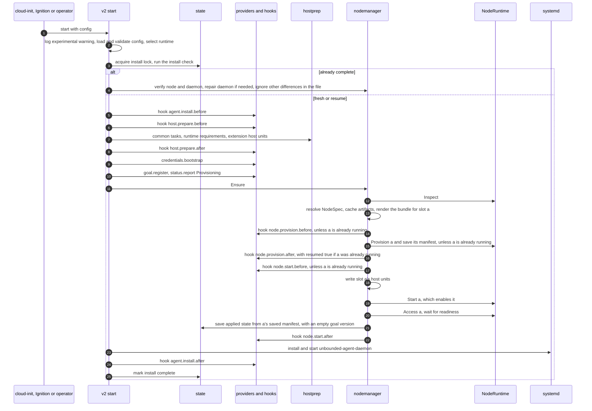
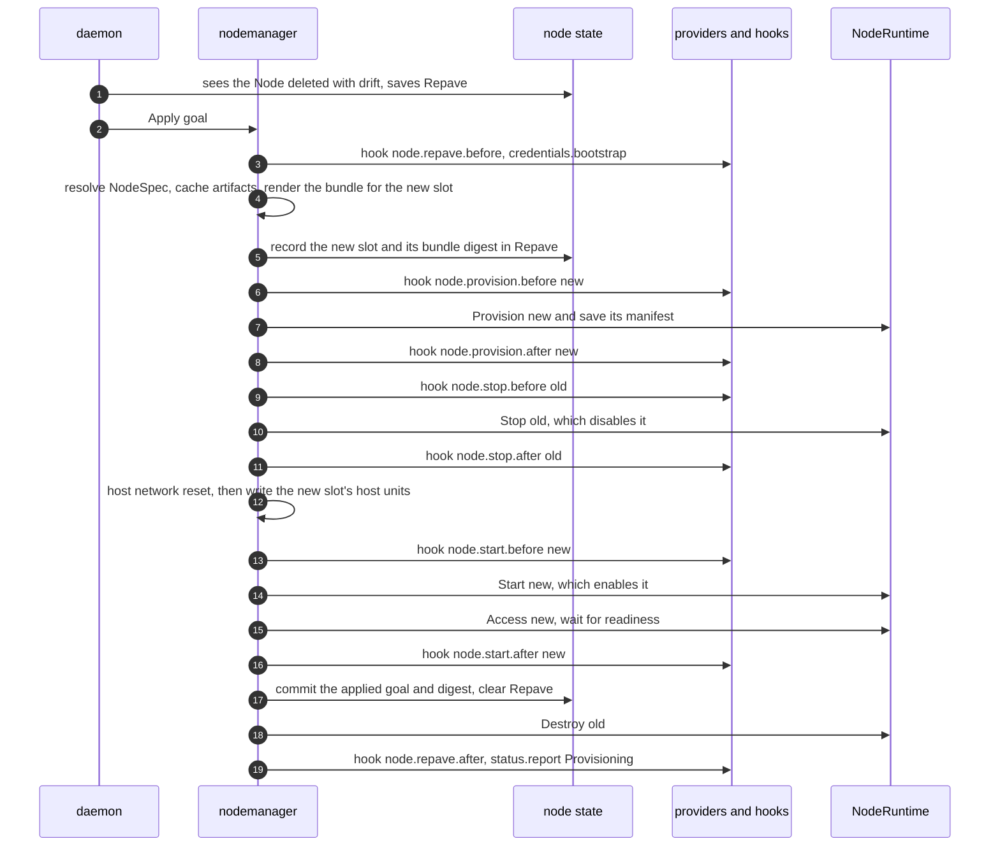
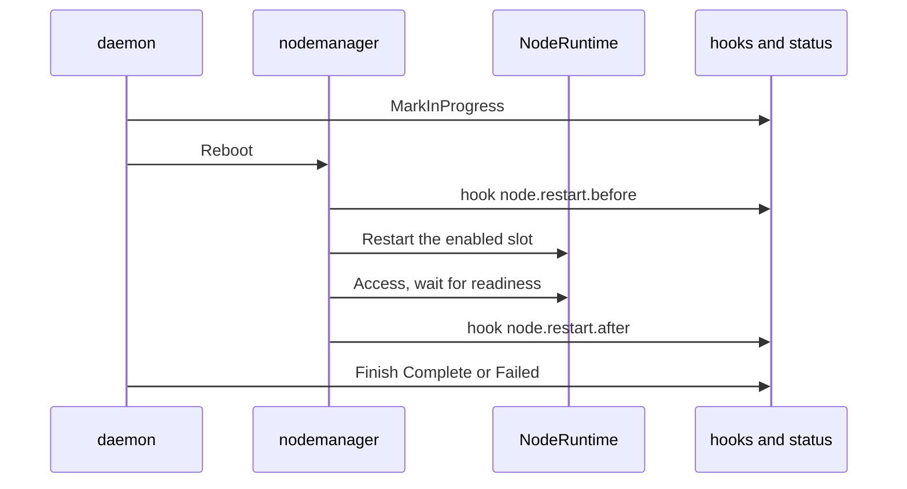
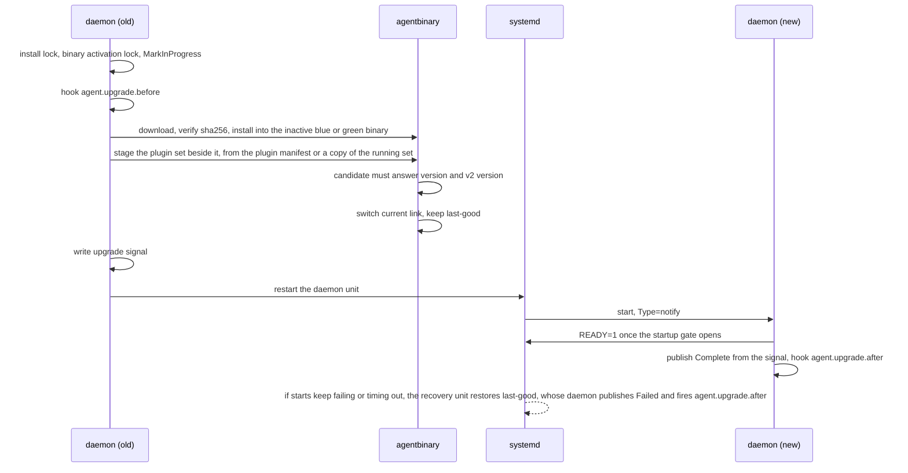
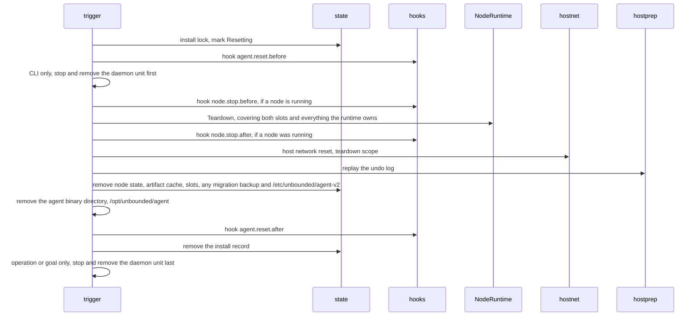

# Unbounded Agent v2: Lifecycles

Part of the [Unbounded Agent v2 design](README.md). The README has the status,
repository baseline, citation conventions and terms.

## 1. Bootstrap (`v2 start`)



## 2. Repave



"Old" is the slot that was running before the repave, and "new" is the other
slot. After the first repave, the old slot is `b`.

`Recover` after a crash follows the table in [control and state, section 4](04-control-and-state.md#4-state). In addition, a
provisioned slot that is neither enabled nor pending is destroyed.

When a repave fails, it is retried, matching v1:

- Retries never stop. They use controller-runtime's default per-item backoff,
  as v1 does: v1 configures no rate limiter of its own
  (`pkg/agent/daemon/setup.go:45-50`). Unlike v1, they also continue after a
  daemon or host restart, because `Repave` was saved when the deletion was
  seen.
- Every attempt reads the goal again, as v1 does
  (`cmd/agent/internal/daemon/controller_node.go:43`). A goal change also
  queues an attempt at once, so a corrected goal does not wait out the backoff.
- Each failed attempt is reported as `Failed` with reason `RepaveFailed`, the
  attempt count and the last error (`Repave.Attempts`, `Repave.LastError`).
  The `machina` status reporter shows it on the Machine as `AgentHealthy=False`
  with reason `RepaveFailed` ([control and state, section 1](04-control-and-state.md#1-control-plane-integration)). v1 reports nothing on the
  Machine; the only sign is machina showing the Machine as `Joining` while its
  Node is missing (`cmd/machina/machina/controller/machine_controller.go:819-823,851-855`).
- There is no rollback. The old slot stays stopped and intact until a later
  attempt succeeds, and is destroyed only then. Starting the old node again is
  not useful: the control plane deleted its Node to approve the repave, and its
  workloads are already gone.
- If stopping the old slot returns any error, such as the `host` runtime's
  `ErrNodeBusy` or `ErrMountsRemain` ([host runtime cleanup, section 10](07-host-runtime-cleanup.md#10-post-conditions)), the attempt ends there and the new slot is not
  started. The node stays down until a retry succeeds, as in v1.

If the goal changes while a repave is in progress:

- Before the new slot has been started, the next attempt replaces `Repave`
  and provisions the new slot again from the new goal. If the new goal no
  longer has drift, the attempt clears `Repave` and records the goal version
  as applied, as for a deletion with no drift.
- Once the new slot has been started, the repave finishes and commits the goal
  it started with. The newer goal is then ordinary drift and needs another Node
  deletion ([control and state, section 5](04-control-and-state.md#5-daemon-reconcile)).

## 3. NodeReboot



`Restart` per runtime:

- `nspawn-container`: `systemctl restart systemd-nspawn@<m>`, which runs the
  boot hooks again, matching v1
  (`pkg/agent/phases/nodestart/nspawn_lifecycle.go:36-40`).
- `host`: Terminate and Unmount ([host runtime cleanup](07-host-runtime-cleanup.md), sections 6 and 7), then restart
  `unbounded-node-prestart.service`, which runs the prerequisites and the
  pre-start boot hook again, then start the node units
  ([node runtime, section 4](03-node-runtime.md#4-host-boot-and-boot-units)). The pre-start boot hook gives
  kubelet a new boot ID, so the Node shows the same reboot signals as on
  `nspawn-container` ([node runtime, section 5.2](03-node-runtime.md#52-host)).

There is no host network reset on reboot, matching v1's `RestartNode`
(`cmd/agent/internal/daemon/nodeoperator.go:230-235`).

## 4. HostOSReboot

v1 has two host reboot kinds: `HostOutOfBandReboot`, which machine-ops-controller
and metalman execute, and `HostOSReboot`, which the agent executes. v2 handles
`HostOSReboot` as v1 does (`cmd/agent/internal/daemon/hostosreboot.go:43-154`):

1. The daemon records the host's boot ID in its target entry in the
   operation's status, and marks the operation `InProgress`.
2. It runs `systemctl reboot`. If it cannot read the boot ID or start the
   reboot, it fails the operation without rebooting.
3. After the reboot, systemd starts the enabled slot, as after any host reboot
   ([node runtime, section 1](03-node-runtime.md#1-node-runtime), rule 6), and then the daemon.
4. The daemon compares the current boot ID with the recorded one when it starts
   and reports the operation `Complete` or `Failed`
   (`cmd/agent/internal/daemon/daemon.go:174`).

No lifecycle hooks fire, because systemd starts the node at boot.

As in v1, the agent does not wait for out-of-band host operations, such as a
`HostOutOfBandReboot` or `HostReplace`, running on the same Machine:
machine-ops-controller and metalman leave `HostOSReboot` out of their conflict
checks (`internal/machineops/controller.go:141-146`,
`internal/metalman/machineops/controller.go:151-155`), and the agent checks
nothing (`hostosreboot.go:43-106`). Where that should be fixed is open in
issue #1044; v2 follows whatever it decides.

## 5. AgentUpgrade



This is v1's mechanism
(`cmd/agent/internal/daemon/controller_machineoperation.go:110-196`,
`pkg/agent/agentbinary/upgrade.go:193-273`) with these additions:

- **The operation completes only when the new daemon is ready.** The daemon
  unit is `Type=notify`, and the daemon sends `READY=1` only when its startup
  gate opens ([control and state, section 5](04-control-and-state.md#5-daemon-reconcile)). The old daemon therefore restarts the
  unit through systemd, so that the new daemon's start is held to the start
  timeout, rather than running the new binary in the same process as v1 does
  (`cmd/agent/internal/cmd/daemon.go:50-59`). v1 has no such check on this
  path: the new daemon reports the operation `Complete` as soon as it has
  registered the Machine (`cmd/agent/internal/daemon/daemon.go:166-172`). Only
  v1's host-driven activation waits, for a process that stays up for 3 seconds
  (`cmd/agent/internal/daemon/hostupgrade.go:23-26,110-146`).
- **A daemon that never becomes ready is rolled back like one that crashes.**
  The unit sets `TimeoutStartSec=60s`, `RestartSec=10s`, `StartLimitBurst=3` and
  `StartLimitIntervalSec=5min`. Three starts that time out take at most 200
  seconds, inside the interval, so the start limit trips and the recovery unit
  runs. v1's unit allows three starts in 60 seconds
  (`cmd/agent/internal/daemon/assets/unbounded-agent-daemon.service:9-10,16`),
  which three 60-second timeouts would never reach. Five minutes is the
  longest interval v1's recovery script accepts
  (`unbounded-agent-daemon-recovery.sh:61-64`), and v2's keeps that limit.
- A candidate binary is checked with `v2 version` as well as `version`
  (`pkg/agent/agentbinary/agentbinary.go:125`), so a binary without the `v2`
  command is rejected before the switch. The daemon unit's `ExecStartPre=`
  repeats the check at every start, so the recovery unit cannot start such a
  binary either ([host changes, section 1](06-host-changes.md#1-what-v2-creates-on-the-host)).
- **Plugins move with the binary.** The optional parameters
  `pluginManifestURL` and `pluginManifestSHA256` name a plugin manifest:

  ```json
  {
    "apiVersion": "plugin.agent.unbounded-cloud.io/v1alpha1",
    "kind": "PluginManifest",
    "plugins": [
      { "name": "aks", "url": "https://example.com/aks-flex-node-plugin", "sha256": "4b1e...07" }
    ]
  }
  ```

  The old daemon downloads the manifest and every plugin in it, verifies each
  against its SHA-256, and stages them in the plugin set beside the inactive
  binary ([extensions, section 3](02-extensions.md#3-plugin-protocol)). Without a manifest, it copies the running set
  there. The manifest must name exactly the plugins the configuration declares;
  one that adds or drops a plugin is rejected before the switch, because which
  plugins exist, and what they may do, are install-time settings. Switching
  `current` then activates binary and plugins together, and the recovery unit
  restoring `last-good` rolls both back. The new daemon checks every plugin
  with `describe` before its startup gate opens, so a plugin that does not fit
  the new binary is rolled back with it.
- On a host migrated from v1, a candidate whose daemon would be v1's, or an
  operation with `agentMode: v1`, is a downgrade while the rollback window is
  open: v2 puts v1 back from its backup, then switches to the candidate. After
  the window, it is rejected before the switch
  ([migrating from v1, section 8](10-migration-from-v1.md#8-rollback-and-downgrade)).
- The daemon unit runs `<current> v2 daemon` in the experimental releases, and
  `<current> daemon` from the first official v2 release, which rewrites the
  unit when its daemon first starts.

The `v2 agent-upgrade` command is the other way in. Host delivery automation
runs it on the host, from a separately staged candidate binary, without a
MachineOperation, as v1's hidden `agent-upgrade` command is run
(`cmd/agent/internal/cmd/agentupgrade.go:63-70`). It uses the same activation:
install into the inactive blue or green binary, switch the `current` link,
restart the daemon unit and wait for it to report ready, rolling back if it does
not (`pkg/agent/agentbinary/activation.go:83-246`). The `agent.upgrade.before`
and `agent.upgrade.after` events fire on this path too, and
`--plugin-manifest` with `--plugin-manifest-sha256` stage a new plugin set as
the parameters do. It never downgrades to v1; on the host, that is
`v2 migrate --rollback --binary <path>`
([migrating from v1, section 8](10-migration-from-v1.md#8-rollback-and-downgrade)).

## 6. Reset

Reset is triggered by `v2 reset`, an `AgentReset` MachineOperation, or a goal
with `delete: true`.



The order of stopping the daemon matches v1. `v2 reset` stops the daemon first,
so it cannot act during the reset (`cmd/agent/internal/daemon/reset.go:29-31`).
When the daemon itself runs the reset, for an `AgentReset` operation or a goal
with `delete: true`, it stops its own unit last, after it has reported the
result.

The agent binary directory is removed because v1 cannot be installed alongside
v2 ([v1 compatibility, section 4](08-v1-compatibility.md#4-existing-packages-used-as-libraries)), so nothing else uses it. v1's reset removes it the same way
(`cmd/agent/internal/daemon/lifecycle.go:343-351`).

## 7. Migration from v1

A v1 host becomes a v2 host without replacing its node: v2 takes over the
running nspawn machine as its slot and replaces only the agent around it. The
lifecycle, its crash behavior and rollback are in
[migrating from v1](10-migration-from-v1.md).
