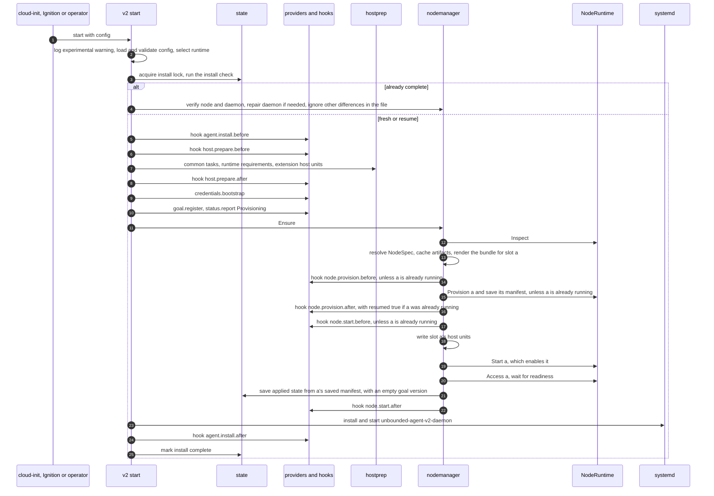
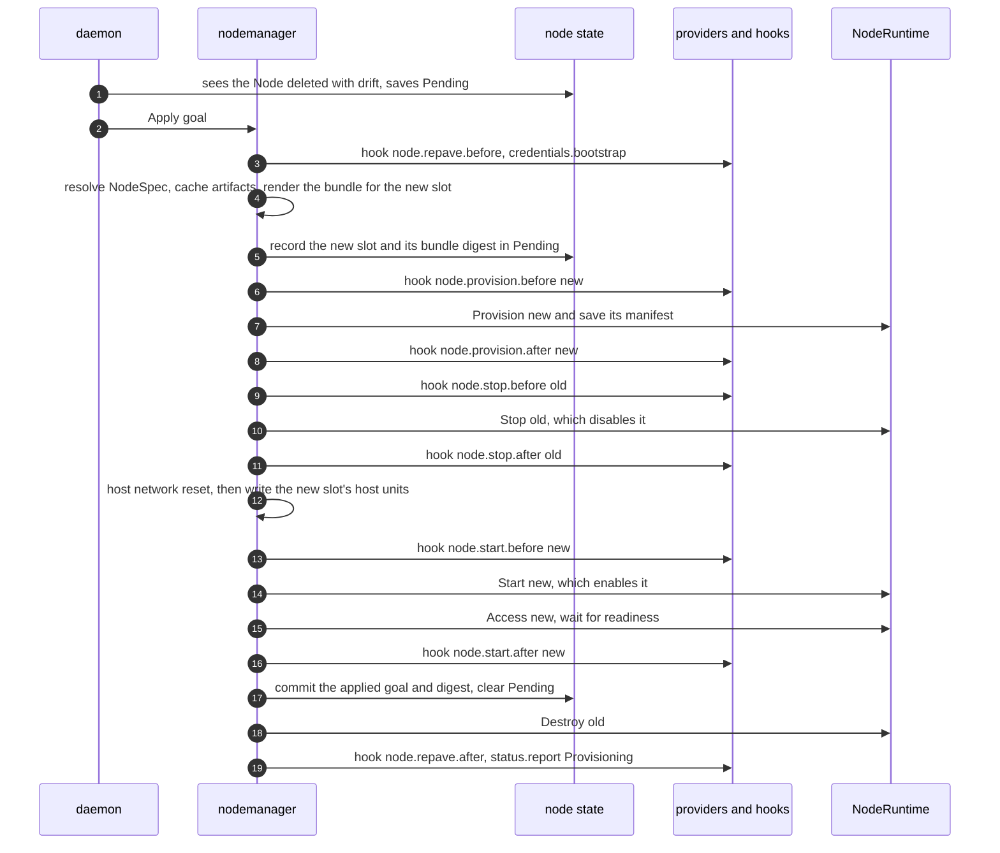
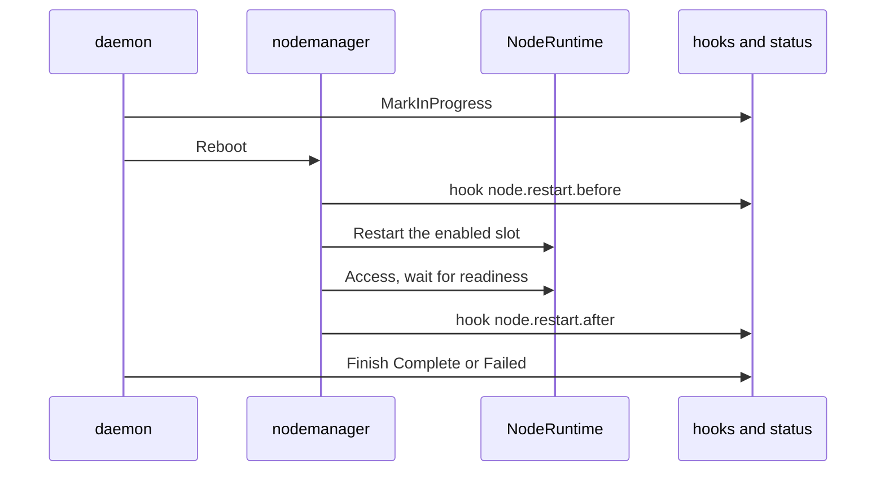
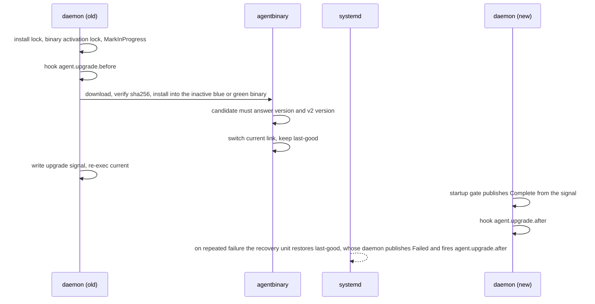
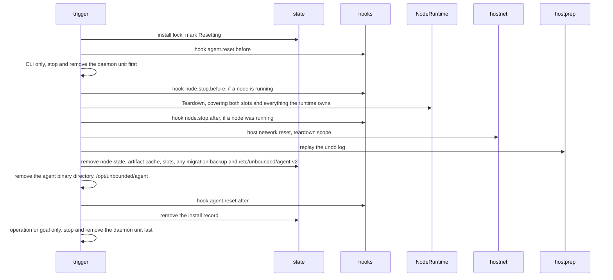

# Unbounded Agent v2: Lifecycles

Part of the [Unbounded Agent v2 design](README.md). The README has the status,
repository baseline, citation conventions and terms.

## 1. Bootstrap (`v2 start`)

## 2. Repave

"Old" is the slot that was running before the repave, and "new" is the other
slot. After the first repave, the old slot is `b`.

`Recover` after a crash follows the table in [control and state, section 4](04-control-and-state.md#4-state). In addition, a
provisioned slot that is neither enabled nor pending is destroyed.

When a repave fails, it is retried, matching v1:

- Retries never stop. They use controller-runtime's default per-item backoff,
  as v1 does: v1 configures no rate limiter of its own
  (`pkg/agent/daemon/setup.go:45-50`). Unlike v1, they also continue after a
  daemon or host restart, because `Pending` was saved when the deletion was
  seen.
- Every attempt reads the goal again, as v1 does
  (`cmd/agent/internal/daemon/controller_node.go:43`). A goal change also
  queues an attempt at once, so a corrected goal does not wait out the backoff.
- Each failed attempt is reported as `Failed` with reason `RepaveFailed`, the
  attempt count and the last error (`Pending.Attempts`, `Pending.LastError`).
- There is no rollback. The old slot stays stopped and intact until a later
  attempt succeeds, and is destroyed only then. Starting the old node again is
  not useful: the control plane deleted its Node to approve the repave, and its
  workloads are already gone.
- If stopping the old slot fails, for example with `ErrNodeBusy` or
  `ErrMountsRemain` on `host`, the attempt ends there and the new slot is not
  started. The node stays down until a retry succeeds, as in v1.

If the goal changes while a repave is in progress:

- Before the new slot has been started, the next attempt replaces `Pending`
  and provisions the new slot again from the new goal. If the new goal no
  longer has drift, the attempt clears `Pending` and records the goal version
  as applied, as for a deletion with no drift.
- Once the new slot has been started, the repave finishes and commits the goal
  it started with. The newer goal is then ordinary drift and needs another Node
  deletion ([control and state, section 5](04-control-and-state.md#5-daemon-reconcile)).

## 3. NodeReboot

`Restart` per runtime:

- `nspawn-container`: `systemctl restart systemd-nspawn@<m>`, which runs the
  hooks again, matching v1
  (`pkg/agent/phases/nodestart/nspawn_lifecycle.go:36-40`).
- `host`: Terminate and Unmount ([host runtime cleanup](07-host-runtime-cleanup.md), sections 6 and 7), then start
  the node units again. Starting them runs the prerequisites and the pre-start
  boot hook again first ([node runtime, section 4](03-node-runtime.md#4-host-boot-and-boot-units)). The pre-start boot hook gives
  kubelet a new boot ID, so the Node shows the same reboot signals as on
  `nspawn-container` ([node runtime, section 5.2](03-node-runtime.md#52-host)).

There is no host network reset on reboot, matching v1's `RestartNode`
(`cmd/agent/internal/daemon/nodeoperator.go:224-229`).

## 4. AgentUpgrade

This is v1's mechanism
(`cmd/agent/internal/daemon/controller_machineoperation.go:79-165`,
`pkg/agent/agentbinary/upgrade.go:193-273`) with two additions:

- A candidate binary is checked with `v2 version` as well as `version`
  (`pkg/agent/agentbinary/agentbinary.go:125`), so a binary without the `v2`
  command is rejected before the switch.
- The daemon unit runs `<current> v2 daemon`.

The `v2 agent-upgrade` command is the other way in. Host delivery automation
runs it on the host, from a separately staged candidate binary, without a
MachineOperation, as v1's hidden `agent-upgrade` command is run
(`cmd/agent/internal/cmd/agentupgrade.go:63-70`). It uses the same activation:
install into the inactive blue or green binary, switch the `current` link, restart the daemon
unit and wait until it is healthy, rolling back if it is not
(`pkg/agent/agentbinary/activation.go:86-246`). The `agent.upgrade.before` and
`agent.upgrade.after` events fire on this path too.

## 5. Reset

Reset is triggered by `v2 reset`, an `AgentReset` MachineOperation, or a goal
with `delete: true`.

The order of stopping the daemon matches v1. `v2 reset` stops the daemon first,
so it cannot act during the reset (`cmd/agent/internal/daemon/reset.go:29-31`).
When the daemon itself runs the reset, for an `AgentReset` operation or a goal
with `delete: true`, it stops its own unit last, after it has reported the
result.

The agent binary directory is removed because v1 cannot be installed alongside
v2 ([v1 compatibility, section 4](08-v1-compatibility.md#4-existing-packages-used-as-libraries)), so nothing else uses it. v1's reset removes it the same way
(`cmd/agent/internal/daemon/lifecycle.go:343-351`).

## 6. Migration from v1

A v1 host becomes a v2 host without replacing its node: v2 takes over the
running nspawn machine as its slot and replaces only the agent around it. The
lifecycle, its crash behavior and rollback are in
[migrating from v1](10-migration-from-v1.md).
