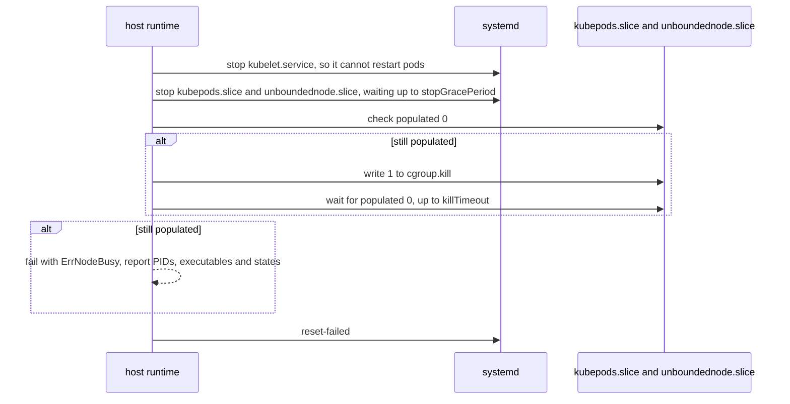
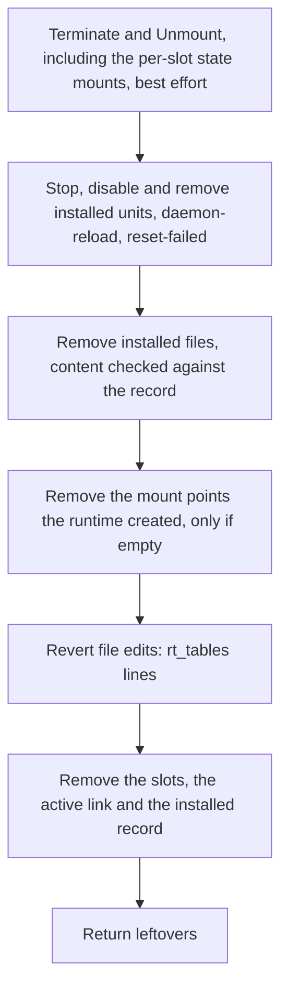

# Unbounded Agent v2: Host Runtime Cleanup

Part of the [Unbounded Agent v2 design](README.md). The README has the status,
repository baseline, citation conventions and terms.

This document specifies how the `host` runtime keeps, stops, cleans up and
removes a node that runs directly on the host. It has no container to throw
away, so it must stop processes, unmount volumes and keep node state apart
itself.

## 1. Why the host runtime needs explicit cleanup

In `nspawn-container`, the container is the cleanup boundary. The `host`
runtime has no container, so it has to provide each guarantee itself.

| Resource | `nspawn-container` gets it for free because | `host` must |
|---|---|---|
| Node processes: kubelet, containerd, shims, pods | Stopping the machine kills its whole cgroup scope (`pkg/agent/phases/reset/machine.go:33-91`) | Contain them in slices and stop them (section 6) |
| Pod mounts, overlay rootfs, `/run/netns/cni-*` | They live in the container's mount namespace and its `/run` *(inference)* | Unmount and remove them (section 7) |
| kubelet, containerd and CNI state | A repave unpacks a new rootfs | Keep each slot's state in a directory of its own and bind it onto the standard paths (section 3) |
| Pod hostPath data | hostPaths resolve inside the rootfs, e.g. `/etc/wireguard`, `/opt/cni/bin` (`deploy/net/node/03-daemonset.yaml.tmpl:135-155`) and `/var/lib/gantry/libp2p` (`deploy/gantry/chart/templates/daemonset.yaml:134-135`) | Keep known and declared paths in the slot's state, report the rest (sections 4 and 12) |
| Network: links, routes, rules, nftables and iptables | Nothing: the network namespace is already shared (`pkg/agent/phases/rootfs/assets/nspawn.conf:20-21`) | The same network reset as today ([host changes, section 2](06-host-changes.md#2-host-network-reset)) |
| eBPF pins | Each machine gets its own bpffs (`nspawn.conf:27-29`) | Pins land in the host's bpffs; only declared pins are cleaned (sections 12 and 13) |

## 2. Principles

1. **Delete only what is provably owned.** Node state lives in slot
   directories under v2's own tree, so removing it never touches a path v2 did
   not create. The standard paths, such as `/var/lib/kubelet`, are only mount
   points: whatever the host had there is never changed or deleted. Network
   objects are the one exception, because the host network namespace keeps no
   record of who created what. They are deleted when they match names that
   only node components create, such as the `UNBOUNDED-*`, `KUBE-*` and `CNI-*`
   iptables chains and unbounded-net's links, or when an extension declares
   them ([host changes, section 2](06-host-changes.md#2-host-network-reset)).
2. **Never cross a mount or follow a symlink while deleting.** A mount found
   inside a tree being deleted aborts the deletion. Pod volumes are often bind
   mounts of host data, and deleting through one destroys that data.
3. **Contain processes in slices** that can be stopped as a unit.
4. **Every level is idempotent and restartable.** Intent is written and
   synced to disk before acting.
5. **Refuse to start on unclean state; clean up as much as possible on
   teardown.** A failed check before starting a node blocks the start.
   Teardown runs every step even if some fail, then reports leftovers.
6. **Report what cannot be cleaned** rather than ignoring it.

## 3. Node state per slot

Each slot keeps the node's persistent state in its own directories, and host
mount units bind the active slot's directories onto the standard paths:

- Each persistent node path (section 4) has a directory in each slot,
  `/var/lib/unbounded/agent-v2/slots/<slot>/state/<name>`, where the name is
  the path escaped with `systemd-escape -p`, such as `var-lib-kubelet`.
- The link `/var/lib/unbounded/agent-v2/slots/active` names the slot whose
  state is in use. It is changed by writing a new link and renaming it over the
  old one, so it always names one slot or the other.
- For each path, a mount unit named for it, such as `var-lib-kubelet.mount`,
  binds `slots/active/state/<name>` onto the path. `unbounded-node.target`
  wants every mount unit, and the node units have `RequiresMountsFor=` on the
  paths they use. The link is resolved when the mount is made, so a mount
  never changes slot while it is mounted.
- `Provision` creates the slot's state directories and writes the bundle's
  content into them, such as `/etc/containerd/config.toml`, kubelet's
  configuration and the CNI plugins. A slot provisioned with new content gets
  new, empty state directories, which is how rule 4 of the
  [node runtime, section 1](03-node-runtime.md#1-node-runtime) holds: the first start after new content
  begins with empty kubelet and containerd state. The inactive slot's
  directories are not mounted, so `Provision` can fill them while the active
  slot runs.

Validation task V10 ([testing, section 7](11-testing.md#7-validation-tasks)) ran kubelet 1.33 and containerd
2.1.8 this way on Ubuntu 24.04. `/var/lib/kubelet` was a shared mount;
in-memory `emptyDir` and downward API volumes reached their containers; a
pod's Bidirectional mount under `/var/lib/kubelet/plugins` reached the host;
kubelet reported node and image file system statistics; a slot change gave
kubelet empty state; and a reboot right after the link changed brought the
node back from the slot the link named.

What the host had at a standard path stays where it was, hidden by the mount
while the node runs and visible again after teardown. In V10, existing content
in `/opt/cni/bin` and `/etc/cni/net.d` was byte-identical after teardown, and
`dpkg --verify` was unchanged. There is therefore nothing to adopt: no
adoption policies, no backups and no limit on their size.

The runtime keeps an installed record,
`/var/lib/unbounded/agent-v2/host-runtime/installed.json`, under the rules for
state files in [control and state, section 4](04-control-and-state.md#4-state):

```json
{
  "schemaVersion": 1,
  "installID": "4f1c...",
  "installedFiles": [ { "path": "/etc/systemd/system/kubelet.service", "sha256": "..." } ],
  "createdMountPoints": [ "/var/lib/kubelet", "/etc/kubernetes" ],
  "rtTablesExisted": true,
  "observedHostPaths": [ "/var/lib/some-daemonset" ]
}
```

It is written before the runtime creates anything it lists.

### 3.1 Packages that use the node's paths or unit names

v2 does not control the OS images it runs on. A package can ship files in a
path the node uses, such as CNI plugins in `/opt/cni/bin`, or ship units with
the node's names, such as a distribution's `containerd.service`.

- **Files under a node path** are hidden while the node runs and are never
  deleted. A package upgrade while the node runs writes into the active
  slot's state instead, so the next slot change discards it, and the
  package's files underneath are older than its database says.
- **Units with the node's names** collide with the `host` runtime's units,
  which keep the standard names ([node runtime, section 5.2](03-node-runtime.md#52-host)) and take
  precedence from `/etc/systemd/system`. The package's maintainer scripts then
  act on the node's units: in V10, reinstalling Ubuntu's `containerd` package
  restarted the node's containerd. A containerd restart keeps running
  containers, because the shims outlive it
  (`pkg/agent/phases/nodestart/assets/containerd.service:10-11`), but the
  restart is not the node's to make.

Neither deletes anything, so neither refuses the host. Preflight lists both as
warnings, naming the packages and paths, and `status` shows them. Removing such
a package, or using `nspawn-container`, avoids them.

## 4. Node paths

**Per-slot** paths are bound from the active slot (section 3). **Volatile**
paths are cleared by Unmount. The last column says which cleanup level
removes each resource.

| Path or resource | Created by | Kept or cleared | Notes |
|---|---|---|---|
| Processes in `unboundednode.slice` and `kubepods.slice` | runtime, kubelet, containerd | Terminate | Section 6 |
| Mounts under `/var/lib/kubelet`, `/var/lib/containerd`, `/run/containerd` | kubelet, containerd | Unmount | Section 7 |
| `/run/netns/cni-*`, these entries only | containerd and CNI *(inference)* | Unmount | Section 7 |
| `/run/containerd` | containerd; gantry hostPath (`deploy/gantry/chart/values.yaml:26`) | Unmount (volatile) | |
| `/run/unbounded-net` | unbounded-net hostPath (`deploy/net/node/03-daemonset.yaml.tmpl:136-139`) | Unmount (volatile) | IPAM socket |
| `/run/racer` | racer hostPath (`internal/racer/workload/workload.go:292`) | Unmount (volatile) | |
| `/run/cdi/nvidia.yaml` | runtime pre-start boot hook | Unmount (volatile) | Regenerated on every start. containerd also reads it as `/var/run/cdi` *(inference: containerd's default CDI directories)*. |
| `/run/unbounded-node/boot_id` | runtime pre-start boot hook | Unmount (volatile) | The boot ID kubelet sees; a new one on every start ([node runtime, section 5.2](03-node-runtime.md#52-host)) |
| `/var/lib/kubelet` | kubelet, bundle | Per slot | Includes kubelet's client certificates *(inference: kubelet's default certificate directory)*, so a new slot bootstraps TLS again |
| `/var/lib/containerd` | containerd | Per slot | Images and gantry's content cache; see `retainContainerImages` (section 8) |
| `/etc/kubernetes`, `/etc/containerd` including `certs.d` | bundle; gantry (`deploy/gantry/chart/values.yaml:34`) | Per slot | |
| `/opt/cni/bin` | bundle; unbounded-net init container (`images/net/node-agent-init.sh:55-65`) | Per slot | |
| `/etc/cni/net.d` | unbounded-net (`cmd/unbounded-net-node/bootstrap_helpers.go:314-319`) | Per slot | |
| `/var/lib/cni` | CNI IPAM *(inference)* | Per slot | |
| `/var/log/pods`, `/var/log/containers` | kubelet *(inference)* | Per slot | |
| `/var/lib/gantry` | gantry (`deploy/gantry/chart/templates/daemonset.yaml:134-135`) | Per slot | libp2p identity |
| `/var/lib/racer` | racer (`internal/racer/workload/workload.go:292`) | Per slot | |
| `/etc/wireguard/server.priv` and `server.pub`, these files only | unbounded-net (`cmd/unbounded-net-node/bootstrap_helpers.go:372`) | Deleted at a slot change | The directory may hold the host's own WireGuard configuration, so it is not bound; the two files are deleted by name |
| `/etc/iproute2/rt_tables` lines `<id>\twg<id>` with id 51820 or higher | unbounded-net, only with policy routing (`internal/net/netlink/route_table_setup.go:28-105`) | Uninstall | A line-level edit. If the file did not exist at install, and only default content remains, the file is removed. |
| Slot directories and the `active` link | runtime | `Destroy`, or Uninstall | |
| Units and drop-ins: `kubelet`, `containerd`, `localdns` and its slice, `unboundednode.slice`, `unbounded-node.target`, `unbounded-node-prestart.service`, one mount unit for each per-slot path, extension host units | runtime | Uninstall | The node manager writes the LocalDNS network unit and helper before every node start, and the host network reset removes them ([node runtime, section 4](03-node-runtime.md#4-host-boot-and-boot-units) and [host changes, section 2](06-host-changes.md#2-host-network-reset)) |
| Extension `cleanup.statePaths` | consumer | Per slot, or Unmount, by the declared class | Section 13 |

## 5. Cleanup levels

Each level includes every level before it.

| Level | Removes | `nspawn-container` equivalent |
|---|---|---|
| Terminate | All node processes | `machinectl terminate`, or stopping the machine |
| Unmount | Node mounts, pod network namespace files under `/run/netns`, the runtime directories under `/run`, and the per-slot state mounts | The machine's mount namespace and `/run` going away |
| Uninstall | Everything the runtime installed: units, files, slots, file edits, the mount points it created, the installed record | `machinectl remove` and removal of the nspawn configuration |

There is no wipe. A slot change binds another slot's state, and a slot's old
state is removed with the slot.

| Method | `host` runtime behavior |
|---|---|
| `Provision(slot)` | Create the slot's state directories, removing an earlier tree with the safe remover after checking no mount is inside it, then write the bundle's binaries and content into the slot. Same digest as the slot holds: rewrite only the secret files ([node runtime, section 2](03-node-runtime.md#2-node-spec-and-bundle)). |
| `Stop(slot)` | Terminate, then Unmount, then disable `unbounded-node.target` |
| `Restart(slot)` | Terminate, Unmount everything but the per-slot state mounts, then restart `unbounded-node-prestart.service`, which runs the prerequisites and the pre-start boot hook again, then start the node units ([node runtime, section 4](03-node-runtime.md#4-host-boot-and-boot-units)) |
| `Start(slot)`, the slot `active` names | Enable `unbounded-node.target`, restart `unbounded-node-prestart.service`, and start the target, which mounts the slot's state |
| `Start(slot)`, another slot | Terminate, Unmount, verify, delete the WireGuard key files, point `active` at the slot, install the slot's units and host files, then enable `unbounded-node.target`, restart `unbounded-node-prestart.service` and start the target (section 8) |
| `Destroy(slot)` | Remove the slot directory, its state included. Returns `ErrSlotEnabled` for the slot `active` names. |
| `Teardown()` | Every level through Uninstall (section 9) |

The host network reset is not a runtime method. The node manager runs it for
both runtimes ([host changes, section 2](06-host-changes.md#2-host-network-reset)).

## 6. Terminate

Containment:

- `containerd.service`, `kubelet.service` and `localdns.service` get
  `Slice=unboundednode.slice`.
- kubelet gets `cgroupDriver: systemd` and keeps its default cgroup root, so
  pods land under `kubepods.slice`, as on any kubeadm-style node. Putting them
  under the node's slice with `cgroupRoot: /unboundednode` was tried and
  rejected: kubelet 1.33 refused to start with `cgroup ["unboundednode"] has
  some missing controllers: hugetlb`, because systemd does not enable the
  `hugetlb` controller for slices (V10). Writing `+hugetlb` into
  `cgroup.subtree_control` by hand made it start, but that controller is
  outside what systemd manages. Keeping the default also means no DaemonSet
  can be surprised by an unusual pod cgroup path.
- Shims start in `containerd.service`'s cgroup, so they are in the node's slice
  and stop with it, even though `KillMode=process` keeps them alive when only
  containerd stops (`pkg/agent/phases/nodestart/assets/containerd.service:10-11`).
- The slice name has no hyphen. systemd treats `-` as the slice hierarchy
  separator *(inference)*.

systemd does the stopping. Stopping a slice stops every unit in it: SIGTERM,
then SIGKILL after each unit's stop timeout *(inference: systemd slice and
scope semantics)*. The runtime bounds the wait itself and uses `cgroup.kill`
only as a backstop:



- `stopGracePeriod` defaults to 30 seconds and `killTimeout` to 15 seconds,
  matching v1's machine stop and terminate waits
  (`pkg/agent/phases/reset/machine.go:66,83`).
- Signals go to the whole slices, not to each pod through the CRI. That
  matches v1, where pods get SIGTERM and then SIGKILL as the machine scope
  stops *(inference)*.
- A process stuck in uninterruptible sleep, for example on a dead NFS mount,
  leaves a cgroup populated. Terminate then fails, and no slot change runs
  over live state.
- `kubepods.slice` belongs to the node because the `host` runtime owns
  `kubelet.service`; no other kubelet may run on the host
  ([node runtime, section 5.3](03-node-runtime.md#53-host-capabilities)).

The `host` runtime's capability probes require the unified cgroup v2
hierarchy and `cgroup.kill`, which needs Linux 5.14 or later *(inference:
kernel cgroup v2 interface)*. The probe checks for the file itself
([node runtime, section 5.3](03-node-runtime.md#53-host-capabilities)). v1 only checks that `/sys/fs/cgroup` exists
(`pkg/agent/phases/host/preflight_host.go:476-491`).

## 7. Unmount

Unmount runs only after Terminate has verified that no node processes remain.

1. Read `/proc/self/mountinfo`. Select mount points under `/run/containerd`
   and `/run/netns/cni-*`, and under the per-slot paths when the state mounts
   are to go too.
2. Unmount `/run` mounts deepest first: `umount2(path, 0)`; on `EBUSY`, retry
   three times one second apart; then `umount2(path, MNT_DETACH)` and record a
   warning.
3. Stop the per-slot state mount units. systemd stops the mount units for
   mounts nested under them first, so pod volumes under `/var/lib/kubelet`
   go with it; in V10 no mount was left under any per-slot path. A mount unit
   is never detached lazily: if a process outside the node holds a per-slot
   path, its mount stays (V10), and Unmount fails with `ErrMountsRemain`,
   naming the process. A unit started with `WorkingDirectory=` under a
   per-slot path gets `RequiresMountsFor=` on it from systemd, so systemd
   stops that unit instead *(inference from V10: such a unit was stopped with
   the mount)*.
4. Repeat until no selected mounts remain, at most five passes, since mounts
   shared with other mount namespaces can reappear *(inference)*. If mounts
   remain, fail with `ErrMountsRemain`.
5. For each pod network namespace file `/run/netns/cni-*`, unmount it if
   needed, then delete it. With no processes using them, the kernel frees the
   namespaces and their veth peers disappear from the host *(inference)*.
6. Clear volatile paths with the safe remover (section 8).

## 8. Slot changes

When `Start` is called for a slot other than the one `active` names, the
runtime is making a *slot change*:

1. Terminate and Unmount, both verified, including the per-slot state mounts.
2. Delete `/etc/wireguard/server.priv` and `server.pub`.
3. Point `active` at the new slot, by renaming a new link over it, and sync
   the directory.
4. Install the slot's units and host files, and reload systemd.
5. Enable and start `unbounded-node.target`, which mounts the new slot's
   state.

`Inspect` reports from the link and systemd:

| Host state | `Inspect` reports for the slot |
|---|---|
| No slot directory, or no completion marker | Absent |
| Complete slot directory, not the slot `active` names | Provisioned |
| The slot `active` names, node units running | Running |
| The slot `active` names, node units stopped | Stopped |

`Enabled` is true for the slot `active` names while `unbounded-node.target` is
enabled.

A crash at any step leaves `active` naming the old slot or the new one, and
whichever it names is what the next `Start`, or the next boot, mounts. V10
checked a reboot between steps 3 and 5. A slot change never deletes anything
under the standard paths; the old slot's state is removed by `Destroy` once
the repave has committed ([lifecycles, section 2](05-lifecycles.md#2-repave)).

The safe remover, used by `Provision`, `Destroy` and Uninstall, opens with
`O_NOFOLLOW`, compares `st_dev` with the root's device at every directory and
aborts with `ErrMountInTree` on a mismatch, and unlinks symlinks without
following them.

A Kubernetes upgrade repaves every host at once, so with an empty
`/var/lib/containerd` in each new slot, every host pulls every image again at
the same time. That strains registries with rate limits and slow links to edge
sites, makes repaves of large GPU and machine learning images slow, and throws
away gantry's peer-to-peer cache, which lives in `/var/lib/containerd`.

With `nodeRuntime.host.repave.retainContainerImages: true`, `/var/lib/containerd`
is not per slot: one directory,
`/var/lib/unbounded/agent-v2/host-runtime/shared/var-lib-containerd`, is bound
for every slot, and a slot change runs an image-preserving reset of it before
step 3:

1. Start a temporary maintenance containerd: the binary from the slot being
   switched to, a private configuration and socket under
   `/run/unbounded-agent-v2/containerd-maint/`, the CRI plugin disabled (so no
   CNI work or sandbox recovery), running in `unboundednode.slice`.
2. Through the containerd Go client, which is already a dependency
   (`go.mod:39`), delete all tasks, containers and sandboxes in every
   namespace, delete all leases except image leases, and run garbage
   collection. Images, their content and their unpacked snapshots remain,
   including gantry's cache.
3. Stop the maintenance instance and run Terminate on its slice again.
4. Delete the CRI plugin's state directory under `/var/lib/containerd`
   (`io.containerd.grpc.v1.cri`). Nothing else inside containerd's root is
   deleted file by file, so its metadata stays consistent.
5. If the maintenance instance did not report zero containers, tasks and
   sandboxes, fall back to emptying the directory and log why.

This option does not apply to `nspawn-container`, where a repave always
unpacks a new rootfs. The mechanism needs a prototype (validation task V2 in
[testing, section 7](11-testing.md#7-validation-tasks)).

## 9. Teardown



Teardown covers only what the runtime owns. The node manager marks the install
as resetting before it calls Teardown, and runs the host network reset and
replays the host preparation undo log after it
([lifecycles, section 6](05-lifecycles.md#6-reset)).

- A file whose content no longer matches the record is still removed, because
  the runtime installed it. The mismatch is logged.
- The installed record is removed last, so a crash anywhere earlier repeats
  the full Teardown.
- Nothing under a standard path is deleted, so whatever the host had there
  before the install is there again afterwards (V10).

Without an installed record, Teardown still finds what it needs: the unit
names and the slot directory are fixed. It removes those, and reports any
standard path it cannot tell it created as a leftover instead of removing the
empty mount point. The node manager still reverses host preparation,
including the original sysctl values, from its own undo log
([host changes, section 3](06-host-changes.md#3-host-preparation-and-its-reversal)). If that log is missing too, the sysctl keys
that could not be restored are reported.

## 10. Post-conditions

| After | Must be true | On violation |
|---|---|---|
| Terminate | `kubepods.slice` and `unboundednode.slice` report `populated 0`; no process runs an executable from a slot directory | `ErrNodeBusy`; the slot change does not run |
| Unmount | No mounts under `/run/containerd` and no `/run/netns/cni-*` files; when the state mounts are to go, no mount under any per-slot path | `ErrMountsRemain`; the slot change does not run |
| Slot change | `active` names the new slot and every per-slot path is mounted from it | Error, retried by `Recover` |
| Host network reset | No owned links, rules or tables; no `unbounded_localdns` table; on Teardown, no owned chains | Repave: error, retried by `Recover`. Teardown: leftover. |
| Teardown | None of the runtime's units, files, slots or created mount points remain; no installed record | Leftovers reported; non-zero exit |

Leftovers are reported as `{kind, id, reason}` in `reset` output, in
`status`, and through the status reporter.

## 11. Crash behavior

| Interrupted during | Next action |
|---|---|
| Terminate or Unmount inside `Stop` | `Stop` is idempotent; `Recover` or the caller runs it again |
| A slot change, before `active` changed | The next `Start` runs the slot change again |
| A slot change, after `active` changed | The next `Start`, or the next boot, mounts the new slot's state and starts it |
| `Provision` of the inactive slot | Its completion marker is missing, so it is Absent, and the next `Provision` recreates it |
| Teardown | Run again from the beginning; every step tolerates absent state |
| A repave | `nodemanager.Recover` ([lifecycles, section 2](05-lifecycles.md#2-repave)) drives the runtime methods above |

## 12. Not cleaned

1. **Undeclared hostPath directories** outside the node paths. Whenever
   `Inspect` runs while containerd is running, the runtime lists the host
   sources of all container mounts through the CRI API and records them as
   `observedHostPaths`. The daemon calls `Inspect` on every reconcile, so the
   list stays current, and Terminate uses the last recorded list even when
   containerd has already stopped. Slot changes and Teardown report these
   paths but never delete them, so the gap with `nspawn-container` stays
   visible.
2. **Mounts made in the host mount namespace by privileged pods**, for example
   through `nsenter -t 1` or bidirectional mount propagation, outside the node
   paths.
3. **eBPF pins** in the host's `/sys/fs/bpf` from other eBPF CNIs, unless
   declared. unbounded-net pins nothing; its program is attached only to
   `unbounded0` (`cmd/unbounded-net-node/tunnel_config.go:95-105`,
   `internal/net/ebpf/tunnel_map.go:182`) and goes away when that link is
   deleted *(inference)*.
4. **Kernel modules, conntrack entries, and sysctls whose original values were
   not recorded.** These last until the host reboots.
5. **journald logs and Kubernetes API objects** (Node, CSRs, Machine), as in
   v1.

## 13. Extension cleanup declarations

Consumers that install their own node networking, such as an unmanaged Cilium,
declare its state:

```json
"cleanup": {
  "statePaths": [
    { "path": "/var/lib/cilium", "class": "persistent" },
    { "path": "/run/cilium", "class": "volatile" }
  ],
  "links": [ { "name": "cilium_host", "kind": "veth" }, { "name": "cilium_vxlan", "kind": "vxlan" } ],
  "iptablesChainPrefixes": [ "CILIUM_" ],
  "nftTables": [ { "family": "inet", "name": "cilium" } ],
  "bpfPins": [ "/sys/fs/bpf/tc/globals", "/sys/fs/bpf/cilium" ]
}
```

- A `persistent` state path is per slot, bound like the built-in ones
  (section 3). A `volatile` one is cleared by Unmount.
- `bpfPins` must be under `/sys/fs/bpf`. They are deleted at every slot change
  and by Teardown.
- Declared links are deleted only when both name and kind match.

## 14. Internal interfaces

```go
package host // internal/agentv2/runtime/host

// Level is a cleanup depth. Each level includes all lower levels.
type Level int

const (
	LevelTerminate Level = iota + 1 // no node processes
	LevelUnmount                    // no node mounts, pod network namespace files, volatile state or state mounts
	LevelUninstall                  // nothing the runtime installed
)

type cleaner struct {
	sys    SystemOps
	record *InstalledStore
	limits Limits // StopGracePeriod, KillTimeout, UnmountRetries
	log    *slog.Logger
}

func (c *cleaner) To(ctx context.Context, lvl Level) error
func (c *cleaner) Verify(ctx context.Context, lvl Level) ([]runtime.Leftover, error)

// SystemOps is the boundary between the cleaner and the operating system.
// Fakes drive unit tests for ordering and safety.
type SystemOps interface {
	Systemd() Systemd // Start, Stop, Disable, DaemonReload, ResetFailed, including mount units
	Cgroups() Cgroups // Kill, Populated, Procs
	Mounts() Mounts   // List, Unmount
	FS() SafeFS       // RemoveTree, WriteDurable, ReplaceLink; never crosses st_dev or follows symlinks
	Netns() Netns     // List with a prefix, Remove
	CRI() CRI         // container mount sources, for observedHostPaths
}
```
