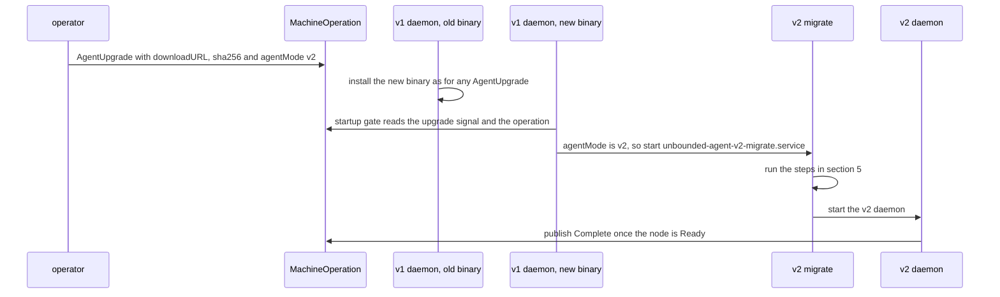
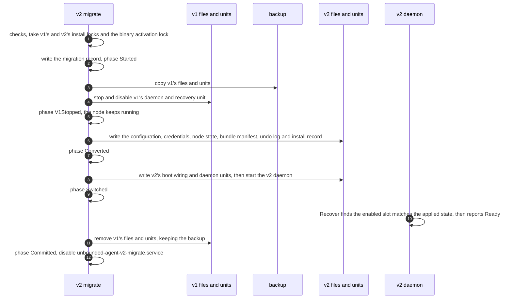

# Unbounded Agent v2: Migrating from v1

Part of the [Unbounded Agent v2 design](README.md). The README has the status,
repository baseline, citation conventions and terms.

This document specifies how a host running the v1 agent moves to v2 without
replacing its node. It covers hosts installed by the unbounded v1 agent and,
through the same mechanism, hosts built by other consumers of `pkg/agent`, such
as AKS Flex Node.

A v1 node already runs as an nspawn machine, `kube1` or `kube2`, in the layout
v2's `nspawn-container` runtime uses ([node runtime, section 5](03-node-runtime.md#5-runtimes)). A migration
therefore leaves the machine alone and replaces only the agent around it:
v2 takes over the running machine as its slot.

## 1. Requirements

1. **The node keeps running.** No pod restarts, the same Node object and the
   same Machine.
2. **No new bootstrap token is needed.** Bootstrap tokens expire, so v2 takes
   over v1's daemon client certificate.
3. **A migration can be started from the cluster**, without SSH, for fleets,
   and from the host, for automation and for other `pkg/agent` consumers.
4. **A migration resumes after a crash or reboot at any step**, and the host
   always ends up with a working agent: v2 if the migration finishes, v1 if it
   does not.
5. **A migration can be rolled back to v1** until v2 first changes the node,
   which is its first repave.
6. **A finished migration leaves no v1 state**, so v1's preflight treats the
   host as a v2 host ([v1 compatibility, section 4](08-v1-compatibility.md#4-existing-packages-used-as-libraries)).
7. **Moving to the `host` runtime is a separate step** (section 9). It replaces
   the node, so it is not part of a migration.

## 2. What changes on the host

| Item | v1 | After the migration |
|---|---|---|
| The running node | The `kube1` or `kube2` machine, its rootfs and its state | Unchanged. `kube1` becomes slot `a`, `kube2` slot `b`. |
| Machine and Node objects | | Unchanged |
| Agent binary | `/opt/unbounded/agent/bin/unbounded-agent*` | Unchanged; the layout is shared ([host changes, section 1](06-host-changes.md#1-what-v2-creates-on-the-host)) |
| Daemon | `unbounded-agent-daemon.service` and `unbounded-agent-daemon-recovery.service` (`pkg/agent/goalstates/constants.go:24,27`) | `unbounded-agent-v2-daemon.service` and `unbounded-agent-v2-daemon-recovery.service` |
| Install record | `/var/lib/unbounded/agent/install-state.json` (`cmd/agent/internal/installstate/store.go:21,85`) | `/var/lib/unbounded/agent-v2/install.json` |
| Configuration | `/etc/unbounded/agent/`, including `kube{1,2}-applied-config.json` (`pkg/agent/goalstates/constants.go:17,97-101`) | `/etc/unbounded/agent-v2/config.json`, node state and the slot's saved bundle manifest |
| Daemon credentials | `/etc/unbounded/agent/daemon-controller` (`cmd/agent/internal/daemon/daemon.go:108-110`) | Copied to `/etc/unbounded/agent-v2/`, then rotated as usual |
| Boot wiring | `systemd-nspawn@<m>.service.d/override.conf`, `unbounded-agent-regenerate-config@<m>.service` (`pkg/agent/goalstates/constants.go:93-95`) and the lifecycle helper `unbounded-agent-nspawn-lifecycle` (`internal/hostroot/layout.go:15`) | v2's machine override and `unbounded-node-boot-hook@<m>.service` ([node runtime, section 4](03-node-runtime.md#4-host-boot-and-boot-units)) |
| Host preparation | As v1 left it, with no record of the original state | Unchanged. v2's undo log records what v1 is known to change (section 6). |

## 3. Starting a migration

### 3.1 From the host

`unbounded-agent v2 migrate` runs the migration on the host, from a binary that
includes v2. `v2 migrate --rollback` rolls it back (section 7). Host automation
uses these, as it uses the hidden `agent-upgrade` command today
(`cmd/agent/internal/cmd/agentupgrade.go:63-70`).

### 3.2 From the cluster

An AgentUpgrade MachineOperation with the parameter `agentMode: v2` upgrades
the binary and then migrates the host. A `machineSelector` creates one
operation per matching Machine
(`api/machina/v1alpha3/machineoperation_types.go:216-221`), so one operation can
migrate a fleet.

- The old daemon installs the binary as usual. Older daemons read only
  `downloadURL` and `sha256` and ignore other parameters
  (`cmd/agent/internal/daemon/agentupgrade.go:52-55`), so this works from any
  v1 release that supports AgentUpgrade.
- If the host already runs the new binary, the install is skipped and the
  migration starts straight away.
- The new binary's v1 daemon publishes AgentUpgrade results from the upgrade
  signal when it starts (`cmd/agent/internal/daemon/daemon.go:170`,
  `controller_machineoperation.go:215-270`).
  When the operation has `agentMode: v2`, it starts the migration instead.
  This is the one change to v1's code that migration needs (section 10).
- If the migration fails and rolls back (section 5), v1's daemon publishes
  `Failed` with the reason.

## 4. Checks before migrating

`v2 migrate` refuses, and changes nothing, unless all of these hold:

| Check | Why |
|---|---|
| v1's install record has phase `complete` | An unfinished v1 install has to finish or be reset first |
| Exactly one machine is running and enabled, and it is the only one with an applied config | A second applied config means a v1 repave was interrupted ([v1 compatibility, section 2](08-v1-compatibility.md#2-behavior-changes-from-v1)) |
| No v1 MachineOperation is in progress other than the AgentUpgrade that started the migration | The migration stops v1's daemon |
| v1's own move of the agent's files into `/opt/unbounded/agent` has finished (`cmd/agent/internal/daemon/daemon.go:120-122`) | Migration expects the current v1 layout |
| The machine's applied config converts to a v2 configuration ([v1 compatibility, section 5](08-v1-compatibility.md#5-converting-a-v1-configuration)) | v2 has to be able to manage the node |
| The host is not already a v2 host, and no other migration is in progress | |

## 5. Steps

The migration runs as `unbounded-agent-v2-migrate.service`, which stays enabled
while a migration is in progress. A crash or host reboot at any step therefore
runs it again, and it continues from the phase in its migration record,
`/var/lib/unbounded/agent-v2/migration.json`. Every step can be repeated.

| Phase in the record | What has happened | After a crash or reboot |
|---|---|---|
| `Started` | v1 is untouched; its files are being copied to the backup | Copy them again and continue |
| `V1Stopped` | v1's daemon is stopped; v2 is not installed | Continue from writing v2's files |
| `Converted` | v2's state is written; v1's boot wiring is still in place | Continue from switching the boot wiring |
| `Switched` | v2's daemon runs; v1's files are still present | Wait for the v2 daemon, then remove v1's files |
| `Committed` | Done | Nothing |

Failures:

- **Any failure before `Committed` rolls back to v1 automatically**
  (section 7). This includes a v2 daemon that does not report Ready within 5
  minutes of starting. The node is untouched at every phase, so rolling back
  only swaps the agent back.
- The machine stays enabled throughout. If the host reboots while the
  migration is in progress, the node starts with whichever boot wiring is in
  place, v1's before `Switched` and v2's from then on, and both start the same
  machine.
- v2's daemon and v1's preflight check for a migration record. While one exists
  in a phase before `Committed`, the v2 daemon only runs if the phase is
  `Switched`, and v1's tools treat the host as being migrated.

## 6. Converting v1's state

| v2 state | Comes from |
|---|---|
| Configuration | The running machine's applied config, `/etc/unbounded/agent/<m>-applied-config.json`, converted as in [v1 compatibility, section 5](08-v1-compatibility.md#5-converting-a-v1-configuration). This is what configured the node, so a host whose v1 install was configured through environment variables migrates the same way. Bootstrap credentials stay as they are in the applied config, which is what a v1 repave would use (`cmd/agent/internal/daemon/controller_node.go:86`). |
| Daemon credentials | v1's daemon client certificate and key, copied. The `csr` credential rotates them from then on, so no bootstrap token is needed to migrate. |
| Install record | Phase `complete`, runtime `nspawn-container`, and the fingerprint of the converted configuration ([CLI and configuration, section 2](01-cli-and-configuration.md#2-configuration)) |
| Node state | `Applied.Settings` from the converted configuration, `Applied.BundleDigest` from the saved manifest, and `Applied.GoalVersion` from `Machine.status.configuration` if v1 has recorded one (`cmd/agent/internal/daemon/controller_node.go:131`). No `Pending`. |
| Slot | `kube1` becomes slot `a`, `kube2` slot `b`. The runtime reports the enabled machine as the enabled slot. |
| Bundle manifest | Rendered from the converted configuration and saved in the slot, as `Provision` would save it ([node runtime, section 2](03-node-runtime.md#2-node-spec-and-bundle)). Nothing is written into the machine. The rendered files are compared with the machine's. Differences, for example from an older v1 release's templates, are reported as a warning in the migration result; the next repave removes them. |
| Host preparation undo log | See below |

v1 keeps no record of the host's state before its host preparation. The undo
log v2 writes for a migrated host therefore reverses only what is certain:

| Change v1 made | At reset |
|---|---|
| `/etc/sysctl.d/99-kubernetes.conf`, `nftables-flush.service` and `nftables-clear.nft`, the apt drop-ins | Removed, as for a v2 install. Only the agent uses these files. |
| Sysctl values, `iptables: false` in `/etc/docker/daemon.json`, swap entries commented out in `/etc/fstab`, masked docker, swap, host containerd and host kubelet units | Left as they are and listed in the reset report. v1 changed them without a backup, and comments swap entries without a tag (`pkg/agent/phases/host/disable_swap.go`, `pkg/agent/phases/host/configure_docker.go:30-66`), so v2 cannot tell what the host had before. This is the same outcome as a v1 reset. |

## 7. Finishing and rollback

When the migration commits, v1's files and units move to
`/var/lib/unbounded/agent-v2/migration/v1-backup/`. The backup is what makes
rollback possible.

`v2 migrate --rollback`, and the automatic rollback after a failure:

1. Stop and disable v2's daemon and recovery unit.
2. Restore v1's files, units and boot wiring from the backup.
3. Enable and start v1's daemon.
4. Remove v2's state: the install record, node state, slot manifest,
   configuration copy, copied credentials and undo log. The agent binary stays.
5. Record phase `RolledBack`, and disable `unbounded-agent-v2-migrate.service`.

Rollback is possible until v2's first repave commits. That repave replaces the
machine with one v1 never configured, so it deletes the backup, and
`v2 migrate --rollback` then refuses. From that point, the way back to v1 is
`v2 reset` and a v1 install.

## 8. Hosts built by other `pkg/agent` consumers

Other consumers, such as AKS Flex Node, build the same nspawn machines from
`pkg/agent`, but with their own daemon, paths and configuration
([overview, section 1.3](README.md#13-how-aks-flex-node-consumes-v1-today)). They migrate with
`v2 migrate --adopt-machine --config <file>`:

- The caller supplies the v2 configuration, including its plugins, hooks and
  extensions, and its daemon credentials.
- The caller stops and removes its own agent before running the command, and
  restores it if the command rolls back.
- The checks are reduced to the machine: exactly one `kube1` or `kube2` machine
  is running and enabled, and no v1 or v2 install is present.
- The machine-level steps are the same as for v1: the bundle manifest, node
  state, boot wiring and daemon. v2's undo log records only what v2 changes
  from then on.
- The goal version starts empty, as after a bootstrap
  ([control and state, section 1](04-control-and-state.md#1-control-plane-integration)).

The v1 path is implemented first. `--adopt-machine` follows, once a consumer
needs it.

## 9. Moving to the `host` runtime

The runtime is an install-time setting ([CLI and configuration, section 2](01-cli-and-configuration.md#2-configuration)). A
migrated host moves to the `host` runtime with `v2 reset` and then `v2 start`
with `runtime.type: host`. The Node registers again under the same name, and
its pods are rescheduled, as in a repave. Changing the runtime through a
repave, without a reset, is a possible later improvement.

## 10. Changes outside `internal/agentv2`

The v1 daemon learns to start a migration. When its startup gate finds a
pending AgentUpgrade whose operation has `agentMode: v2`, it starts
`unbounded-agent-v2-migrate.service` instead of publishing the result
(`cmd/agent/internal/daemon/controller_machineoperation.go:215-270`). It changes
nothing for an operation without the parameter. This is listed with the other
changes in [v1 compatibility, section 4](08-v1-compatibility.md#4-existing-packages-used-as-libraries).

## 11. Testing

The migration suite in [testing, section 4](11-testing.md#4-migration-suite) covers both ways of starting a
migration, an interruption and a failure in every phase, rollback, the checks
that refuse, and the move to the `host` runtime afterwards.
