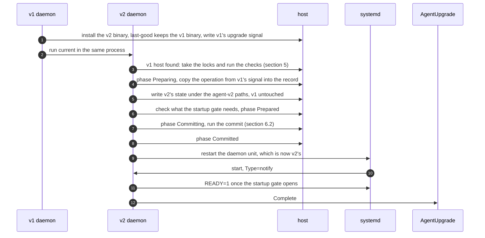
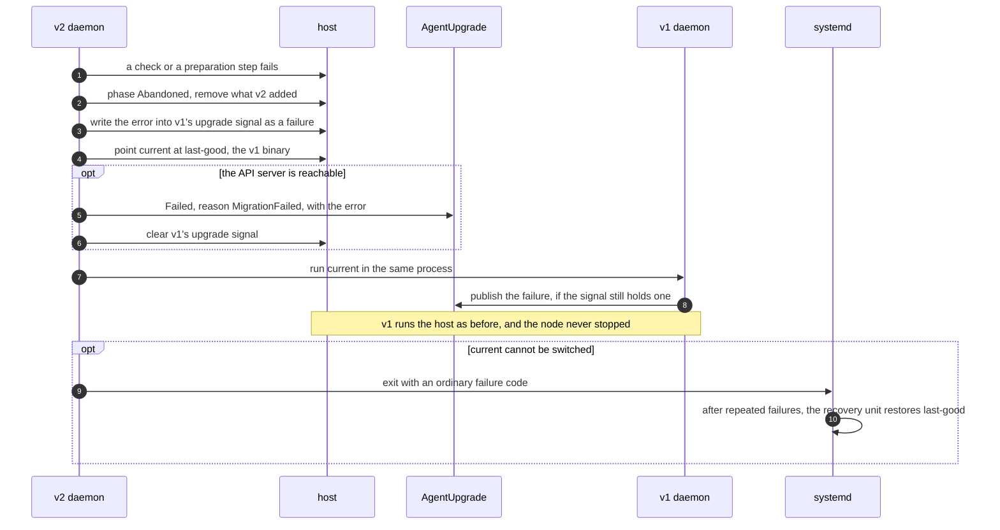
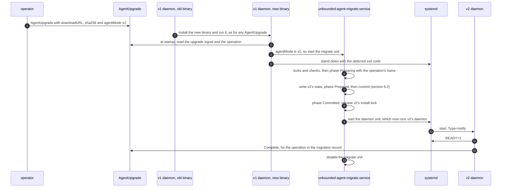
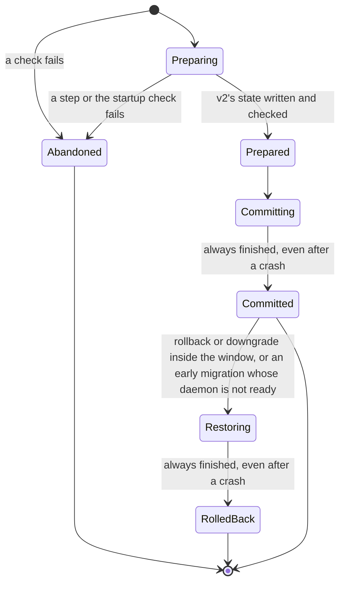
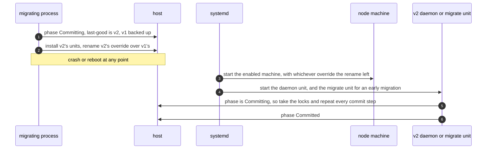
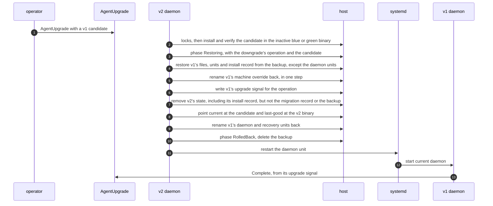

# Unbounded Agent v2: Migrating from v1

Part of the [Unbounded Agent v2 design](README.md). The README has the status,
repository baseline, citation conventions and terms.

This document specifies how a host running the v1 agent moves to v2 without
replacing its node. It covers hosts installed by the unbounded v1 agent and,
through the same mechanism, hosts built by other consumers of `pkg/agent`, such
as AKS Flex Node.

A v1 node already runs as an nspawn machine, `kube1` or `kube2`, in the layout
v2's `nspawn-container` runtime uses ([node runtime, section 5](03-node-runtime.md#5-runtimes)). A migration
therefore leaves the machine alone and replaces only the agent around it:
v2 takes over the running machine as its slot.

## 1. Requirements

1. **The node keeps running.** No pod restarts, the same Node object and the
   same Machine.
2. **No new bootstrap token is needed.** Bootstrap tokens expire, so v2 takes
   over v1's daemon client certificate.
3. **A migration can be started from the cluster**, without SSH, for fleets,
   and from the host, for automation and for other `pkg/agent` consumers.
4. **A migration resumes after a crash or reboot at any step**, and the host
   always ends up with a working agent: v2 if the migration commits, v1 if it
   does not.
5. **No v1 release has to know about v2.** Until the migration commits, any v1
   binary can run the host, because nothing of v1's has changed. After the
   commit, only v2 runs it, and v2 itself puts v1 back if asked (section 8).
6. **A migration can be rolled back to v1** until v2 first changes the node,
   which is its first repave.
7. **A finished migration leaves no v1 state**, so v1's tools treat the host as
   a v2 host ([v1 compatibility, section 4](08-v1-compatibility.md#4-existing-packages-used-as-libraries)).
8. **Every v1 host moves at the first official v2 release**, from any release
   since the oldest supported v1 release, because v1 is not supported after it
   (section 2).
9. **Moving to the `host` runtime is a separate step** (section 10). It
   replaces the node, so it is not part of a migration.

## 2. Release plan and cutover

| Release | Top-level commands | What happens to a v1 host |
|---|---|---|
| Experimental releases | v1's; v2's are under `v2` | Nothing, unless an operator migrates it early (section 4) |
| The first official v2 release, and every later one | v2's. v1's commands are removed, and `v2 <command>` stays as a hidden alias so units and scripts written during the experimental releases keep working. | Migrated when the release's daemon first starts on it (section 2.1) |

The cutover needs no change in any v1 release. Until the migration commits,
v2 only adds files under its own `agent-v2` paths and leaves v1's files, units,
boot wiring and install record as they were, so whichever v1 binary ran the
host before can run it again. The commit starts by pointing the binary
rollback slot, `last-good`, at the v2 binary. From then on systemd's recovery
unit can only start v2, so a v1 binary never runs on a host that v2 has
changed. Going back to v1 after the commit is done by v2 (section 8).

**The oldest supported v1 release** is the oldest release the migration test
matrix installs and migrates ([testing, section 4](11-testing.md#4-migration-suite)). The release notes name it.
v2 reads v1's state in the formats those releases write, starting with v1's
install record, which v1 has written since v0.9.0
(`cmd/agent/internal/installstate/store.go:20-24`, added in commit
`2afc58b59`). A host on an older release fails the checks (section 5) before
anything changes, with a message naming the oldest supported release. An
ordinary v1 AgentUpgrade to a supported release comes first.

### 2.1 The cutover

At the first official v2 release, a v1 host migrates through an ordinary
AgentUpgrade, with no parameter. v1's daemon installs the new binary as it does
for any AgentUpgrade: `last-good` keeps the binary it was running, `current`
names the new one, and the daemon records the operation in its upgrade signal
and runs `current` in its place, in the same process
(`pkg/agent/agentbinary/upgrade.go:256-264`,
`cmd/agent/internal/daemon/controller_machineoperation.go:175-193`,
`cmd/agent/internal/cmd/daemon.go:50-95`). v1's daemon unit runs
`<current> daemon`
(`cmd/agent/internal/daemon/assets/unbounded-agent-daemon.service:14`), and in
this release `daemon` is v2's daemon. When it starts on a v1 host, it runs the
migration (section 6) before anything else, as v1's daemon moves the agent's
files on its first start after an upgrade
(`cmd/agent/internal/daemon/daemon.go:119-123`).

The AgentUpgrade completes only once the v2 daemon is ready, as for any v2
AgentUpgrade ([lifecycles, section 5](05-lifecycles.md#5-agentupgrade)). After the commit, the daemon restarts
through systemd rather than in the same process, so that it runs under v2's
unit and is held to its readiness timeout.

A failure before the commit returns the host to v1:

- The order makes every crash end the same way. v1's daemon publishes a
  failure it finds in its signal when it starts
  (`controller_machineoperation.go:260-276`), so once the signal holds the
  failure, the operation ends `Failed` whichever binary runs next. Before
  that, `current` still names v2, and a v2 daemon that finds the record
  `Abandoned` while v1's signal names the operation that started the migration
  finishes these steps instead of migrating again (section 6.3).
- The exit code is never the deferred exit code, which the unit treats as
  success and so never escalates to the recovery unit
  (`unbounded-agent-daemon.service:17-22`). The recovery unit restores
  `last-good` after any repeated failure (`:8-10`,
  `unbounded-agent-daemon-recovery.sh:11,26`).

After the commit, the host is a v2 host. A v2 daemon that keeps failing is
handled like any other: the recovery unit restores `last-good`, which is now
v2. Until the rollback window closes, the way back to v1 is section 8. If v2's
daemon cannot start at all, `v2 migrate --rollback` still works from the host,
because it does not need the daemon.

## 3. What changes on the host

Names that operators and other tools rely on, such as unit names and commands,
are the final names and are the same as v1's. v2's internal state keeps `-v2`
names ([host changes, section 1](06-host-changes.md#1-what-v2-creates-on-the-host)). Nothing in this table changes before the commit
(section 6.2).

| Item | v1 | After the migration |
|---|---|---|
| The running node | The `kube1` or `kube2` machine, its rootfs and its state | Unchanged. `kube1` becomes slot `a`, `kube2` slot `b`. |
| Machine and Node objects | | Unchanged |
| Agent binary | `/opt/unbounded/agent/bin/unbounded-agent*` | The layout is shared. `last-good` names a v2 binary from the commit on. |
| Daemon units | `unbounded-agent-daemon.service` and `unbounded-agent-daemon-recovery.service` (`pkg/agent/goalstates/constants.go:24,27`) | Same names, replaced by v2's at the commit. v2's daemon unit is `Type=notify` and only starts a binary that includes v2 ([host changes, section 1](06-host-changes.md#1-what-v2-creates-on-the-host)). In an experimental release it runs `<current> v2 daemon`; from the first official v2 release, `<current> daemon`, as v1's does. |
| Install record | `/var/lib/unbounded/agent/install-state.json` (`cmd/agent/internal/installstate/store.go:21,85`) | `/var/lib/unbounded/agent-v2/install.json` |
| Configuration | `/etc/unbounded/agent/`, including `kube{1,2}-applied-config.json` (`pkg/agent/goalstates/constants.go:17,97-101`) | `/etc/unbounded/agent-v2/config.json`, node state and the slot's saved bundle manifest |
| Daemon credentials | `/etc/unbounded/agent/daemon-controller` (`cmd/agent/internal/daemon/daemon.go:108-110`) | Copied to `/etc/unbounded/agent-v2/`, then rotated as usual |
| AgentUpgrade signal | `/etc/unbounded/agent/agent-upgrade-signal` (`pkg/agent/goalstates/constants.go:48`) | Its operation is copied into the migration record, and the file is not kept |
| Boot wiring | `systemd-nspawn@<m>.service.d/override.conf`, `unbounded-agent-regenerate-config@<m>.service` (`pkg/agent/goalstates/constants.go:93-95`) and the lifecycle helper `unbounded-agent-nspawn-lifecycle` (`internal/hostroot/layout.go:15`) | v2's machine override, at the same path as v1's, `unbounded-node-boot-hook@<m>.service` and the boot hook binary `unbounded-agent-boot-hook` ([node runtime, section 4](03-node-runtime.md#4-host-boot-and-boot-units)) |
| Host preparation | As v1 left it, with no record of the original state | Unchanged. v2's undo log records what v1 is known to change (section 7). |

## 4. Migrating early

Before the first official v2 release, an operator can migrate a host early,
using a release that includes v2. The steps are the ones in section 6, run by
`unbounded-agent-migrate.service`, a oneshot unit that stays enabled until the
migration ends, so a crash or reboot continues it. v1's daemon does not run
while it does.

### 4.1 From the host

`v2 migrate` starts the migrate unit, waits for it and prints the result, so a
lost SSH session does not stop the migration. It runs from the binary that
`current` names; host automation installs that binary first with the hidden
`agent-upgrade` command (`cmd/agent/internal/cmd/agentupgrade.go:63-70`).
After the checks, the migration stops v1's daemon. `v2 migrate --rollback`
goes back (section 8).

### 4.2 From the cluster

An AgentUpgrade MachineOperation with the parameter `agentMode: v2` upgrades
the binary and then migrates the host.

- The old daemon installs the binary as usual. Older daemons read only
  `downloadURL` and `sha256` and ignore other parameters
  (`cmd/agent/internal/daemon/agentupgrade.go:51-61`), so this works from any
  supported v1 release.
- The new binary's v1 daemon reads the upgrade signal when it starts, as v1
  does (`cmd/agent/internal/daemon/daemon.go:170`). When the operation has
  `agentMode: v2`, it starts the migrate unit and stands down with the
  deferred exit code (`daemon.go:49`), which the unit treats as success and
  does not restart (`unbounded-agent-daemon.service:17-22`).
- Migrate keeps the operation's name in the migration record. It releases v2's
  install lock before it starts the v2 daemon, whose startup takes that lock,
  and then waits for the daemon to report ready. The v2 daemon publishes
  `Complete` for the operation in the record.
- To migrate a fleet, create one AgentUpgrade per Machine. A `machineSelector`
  operation is shared by every matching agent and reports one combined result
  (issue #1040), so it cannot track a fleet migration.

| What fails | Migrate does | The operation |
|---|---|---|
| A check, or a step before the commit | Records `Abandoned` with the error, removes what v2 added and starts v1's daemon again | v1's daemon finds its pending signal and the record `Abandoned` for that operation. It publishes `Failed` with the record's error and does not start the migration again. |
| The v2 daemon does not report ready after the commit | Stops the daemon unit and restores v1 (section 8), putting the operation back in v1's signal, then records `RolledBack` with the error and starts v1's daemon | As above, for `RolledBack` |
| Migrate crashes, or the host reboots | Continues from the phase in the record when the unit starts again (section 6.3) | Reported when the migration ends |

## 5. Checks before migrating

`v2 migrate`, and v2's daemon at the cutover, refuse and change nothing of
v1's unless all of these hold. When an operation started the migration, the
refusal is recorded as `Abandoned`, so that the operation is reported `Failed`
(sections 2.1 and 4.2).

| Check | Why |
|---|---|
| v1's install record has phase `complete`, in a format this release reads | An unfinished v1 install has to finish or be reset first. A host from before the oldest supported v1 release has no such record (section 2). |
| Exactly one machine is running and enabled, and it is the only one with an applied config | A second applied config means a v1 repave was interrupted ([v1 compatibility, section 2](08-v1-compatibility.md#2-behavior-changes-from-v1)) |
| No v1 MachineOperation is in progress on this host, other than the AgentUpgrade that started the migration | The migration replaces v1's daemon. The check uses only what can be tied to this host: v1's install lock, which every v1 handler holds while it works (`cmd/agent/internal/daemon/controller_machineoperation.go:73,127,199`, `hostosreboot.go:52`) and which the migration takes first and keeps until it ends; v1's AgentUpgrade signal; this Machine's `machineRef` operations; and this Machine's target entry in `HostOSReboot` operations (`hostosreboot.go:143-154`). It does not read the status of other selector operations, which every matching agent shares (issue #1040). |
| v1's own move of the agent's files into `/opt/unbounded/agent` has finished (`cmd/agent/internal/daemon/daemon.go:120-122`) | Migration expects the current v1 layout |
| The machine's applied config converts to a v2 configuration ([v1 compatibility, section 5](08-v1-compatibility.md#5-converting-a-v1-configuration)) | v2 has to be able to manage the node |
| For an early migration, the running binary is the one `current` names | v1's daemon unit runs `current`, which has to include v2 so that its v1 daemon stands down while the migration runs (section 6.3) |
| The host is not already a v2 host, and no other migration is in progress | |

## 6. Steps

### 6.1 Phases

The migration keeps its phase in its record,
`/var/lib/unbounded/agent-v2/migration.json`, written and synced to disk before
the step it names, and under the same rules as v2's other state files
([control and state, section 4](04-control-and-state.md#4-state)).

| Phase | v1 | v2 |
|---|---|---|
| `Preparing` | Untouched, and in charge of the host | Writing its state under its own paths |
| `Prepared` | Untouched | Its state is written and checked |
| `Committing` | Moving into the backup | Being installed. Always finished. |
| `Committed` | In the backup until v2's first repave | In charge |
| `Abandoned` | Untouched, and in charge again | What it added is removed |
| `Restoring` | Coming back from the backup | Being removed. Always finished. |
| `RolledBack` | Restored, and in charge again | Removed |

### 6.2 Preparing and committing

The migrating process is v2's daemon at the cutover, or the migrate unit for an
early migration. It holds v1's install lock, v2's install lock and the binary
activation lock from the checks until the commit or the abandonment is done,
so no v1 handler, v2 handler or binary activation runs at the same time.

Preparing:

1. Record `Preparing`, with whether this is an early migration or the
   cutover, and the operation that started the migration and its Machine
   generation, from v1's upgrade signal, if there is one
   (`cmd/agent/internal/daemon/agentupgrade.go:31-36`).
2. Write v2's configuration, daemon credentials, node state, the slot's bundle
   manifest and the host preparation undo log (section 7). Stage v2's units,
   machine override and boot hook binary under
   `/var/lib/unbounded/agent-v2/migration/staged/`. Nothing outside v2's own
   paths changes.
3. Check what v2's daemon will need at its startup gate
   ([control and state, section 5](04-control-and-state.md#5-daemon-reconcile)): `Recover` finds the running machine
   consistent with the new node state, and the copied daemon credentials can
   read the Machine.
4. Record `Prepared`.

The commit:

1. Record `Committing`.
2. Point `last-good` at the v2 binary.
3. Copy v1's files and units into
   `/var/lib/unbounded/agent-v2/migration/v1-backup/`. v1's upgrade signal is
   not copied, because its operation is already in the record.
4. Install v2's units and the boot hook binary, replacing v1's daemon and
   recovery units, which have the same names, and reload systemd.
5. Rename v2's staged machine override over v1's, in one step. The machine
   stays enabled throughout, and a boot at any moment starts it with one
   complete override or the other.
6. Remove v1's files and units, which the backup now holds, including the
   upgrade signal, and reload systemd.
7. Write v2's install record. From here on, v1's and v2's tools see a v2 host.
8. Record `Committed`.

Every step can be repeated, and a commit never goes back: whichever process
finds the record in `Committing` repeats the steps until it reaches
`Committed`. Then, at the cutover, the daemon restarts through systemd
(section 2.1); in an early migration, migrate starts the daemon unit
(section 4.2).

### 6.3 After a crash or reboot

Every daemon from a release that includes v2 reads the migration record before
it does anything else, whether its unit runs v1's daemon or v2's:

- **`Committing` or `Restoring`:** it finishes the commit or the restore.
- **`Preparing` or `Prepared`, in an early migration:** it stands down with
  the deferred exit code and starts the migrate unit, which continues.
- **`Preparing` or `Prepared`, at the cutover:** v2's daemon continues the
  migration.
- **`Abandoned` or `RolledBack`, while v1's upgrade signal still names the
  operation that started the migration:** it does not migrate again. It
  publishes `Failed` with the record's error, and at the cutover it then
  returns to `last-good` as in section 2.1. A signal that names another
  operation, such as a downgrade's, is handled as v1 handles it
  (`controller_machineoperation.go:257-297`), by v2's daemon too.

What a host reboot does in each phase:

| Phase at the reboot | The node boots with | Then |
|---|---|---|
| `Preparing`, `Prepared` | v1's boot wiring, untouched | At the cutover, the daemon unit starts v2's daemon, which continues from the start of the phase. In an early migration, the migrate unit continues, and v1's daemon stands down for it. |
| `Committing` | v1's or v2's machine override, whichever the rename left | The first of v2's daemon and the migrate unit to take the locks finishes the commit |
| `Committed` | v2's | v2's daemon starts. In an early migration that has not yet seen the daemon ready, migrate waits for it again. |
| `Abandoned` | v1's | v1's daemon starts and publishes the failure, if that has not happened yet |
| `Restoring` | v1's or v2's machine override, whichever the rename left | The first v2 process to start finishes the restore (section 8) |
| `RolledBack` | v1's | v1's daemon starts |

No step stops or restarts the machine, so the node keeps running in every
phase.

## 7. Converting v1's state

| v2 state | Comes from |
|---|---|
| Configuration | The running machine's applied config, `/etc/unbounded/agent/<m>-applied-config.json`, converted as in [v1 compatibility, section 5](08-v1-compatibility.md#5-converting-a-v1-configuration). This is what configured the node, so a host whose v1 install was configured through environment variables migrates the same way. Bootstrap credentials stay as they are in the applied config, which is what a v1 repave would use (`cmd/agent/internal/daemon/controller_node.go:86`). |
| Daemon credentials | v1's daemon client certificate and key, copied. The `csr` credential rotates them from then on, so no bootstrap token is needed to migrate. |
| Install record | Phase `complete`, runtime `nspawn-container`, and the fingerprint of the converted configuration ([CLI and configuration, section 2](01-cli-and-configuration.md#2-configuration)). Written last, by the commit. |
| Node state | `Applied.Settings` from the converted configuration, `Applied.BundleDigest` from the saved manifest, and `Applied.GoalVersion` from `Machine.status.configuration` if v1 has recorded one (`cmd/agent/internal/daemon/controller_node.go:131`). No `Repave`. |
| Slot | `kube1` becomes slot `a`, `kube2` slot `b`. The runtime reports the enabled machine as the enabled slot. |
| Bundle manifest | Rendered from the converted configuration and saved in the slot, as `Provision` would save it ([node runtime, section 2](03-node-runtime.md#2-node-spec-and-bundle)). Nothing is written into the machine. The rendered files are compared with the machine's. Differences, for example from an older v1 release's templates, are reported as a warning in the migration result; the next repave removes them. |
| Host preparation undo log | See below |

v1 keeps no record of the host's state before its host preparation. The undo
log v2 writes for a migrated host therefore reverses only what is certain:

| Change v1 made | At reset |
|---|---|
| `/etc/sysctl.d/99-kubernetes.conf`, `nftables-flush.service` and `nftables-clear.nft`, the apt drop-ins | Removed, as for a v2 install. Only the agent uses these files. |
| Sysctl values, `iptables: false` in `/etc/docker/daemon.json`, swap entries commented out in `/etc/fstab`, masked docker, swap, host containerd and host kubelet units | Left as they are and listed in the reset report. v1 changed them without a backup, and comments swap entries without a tag (`pkg/agent/phases/host/disable_swap.go`, `pkg/agent/phases/host/configure_docker.go:30-66`), so v2 cannot tell what the host had before. This is the same outcome as a v1 reset. |

## 8. Rollback and downgrade

v1's files stay in the backup until v2's first repave commits. Until then, the
*rollback window*, v2 can put v1 back:

| Started by | Binary afterward |
|---|---|
| An AgentUpgrade with a v1 candidate, or with `agentMode: v1` | The candidate, which must be a release before the first official v2 release |
| `v2 migrate --rollback [--binary <path>]` on the host | The given binary, installed as for an AgentUpgrade. Without `--binary`, the running binary, which works only if it still has v1's commands, as after an early migration. |
| The migrate unit, when an early migration's v2 daemon does not report ready after the commit (section 4.2) | Unchanged |

A *v1 candidate* is one whose daemon would be v1's: it has no `v2` command, or
the daemon unit runs `<current> daemon` and the candidate is older than the
first official v2 release. After the window, v2 rejects a v1 candidate, and
`agentMode: v1`, before it switches anything ([lifecycles, section 5](05-lifecycles.md#5-agentupgrade)).

Every way in runs these steps. The host-side rollback and the migrate unit
first stop v2's daemon, and skip the binary steps when the binary does not
change. v1's signal is written only when there is an operation to report: the
downgrade's, which v1's daemon then reports `Complete`, or, after an early
migration whose daemon was not ready, the operation that started the
migration, which v1's daemon reports `Failed` (section 6.3). The order is what
keeps a crash safe:

- **Until the daemon units are renamed back, only v2 can run as the daemon.**
  v2's daemon unit does not start a binary without v2
  ([host changes, section 1](06-host-changes.md#1-what-v2-creates-on-the-host)). After a crash or reboot, a v1 candidate without v2 fails
  to start, and the recovery unit restores `last-good`, the v2 binary, which
  finishes the restore. A candidate that includes v2 finishes it itself
  (section 6.3).
- **Renaming v1's daemon unit back hands the host to v1.** A v2 process that
  finds the record in `Restoring` with v1's daemon unit in place, which it
  tells from v2's by the missing `ExecStartPre=` check, records `RolledBack`
  and changes nothing else, because v1 may already have run.
- **A v1 daemon that keeps failing afterward** is handled as for any failed
  AgentUpgrade. v1's recovery unit restores `last-good`, the v2 binary, after
  asking it to record the failure in the upgrade signal
  (`unbounded-agent-daemon-recovery.sh:19-26`). On a host without a v2 install
  record, v2's `record-agent-upgrade-failure-signal` writes v1's signal, so
  the v2 daemon publishes the downgrade as `Failed`. A first official v2
  release, or a later one, then migrates the host again, as at the cutover.

Rollback is possible until v2's first repave commits. That repave replaces the
machine with one v1 never configured, so it deletes the backup, and a rollback
then refuses. From that point, the way back to v1 is `v2 reset` and a v1
install. `last-good` has named a v2 binary since the commit, so after the
window the recovery unit still only ever starts v2.

## 9. Hosts built by other `pkg/agent` consumers

Other consumers, such as AKS Flex Node, build the same nspawn machines from
`pkg/agent`, but with their own daemon, paths and configuration
([overview, section 1.3](README.md#13-how-aks-flex-node-consumes-v1-today)). They migrate with
`v2 migrate --adopt-machine --config <file>`. Converting AKS Flex Node hosts to
the v2 binary needs it, so it is part of the first implementation:

- The caller supplies the v2 configuration, including its plugins, hooks and
  extensions, and its daemon credentials.
- The caller stops and removes its own agent before running the command, and
  restores it if the command rolls back.
- The checks are reduced to the machine: exactly one `kube1` or `kube2` machine
  is running and enabled, and no v1 or v2 install is present.
- The phases and machine-level steps are the same as for v1: the bundle
  manifest, node state, boot wiring and daemon. The backup holds only the
  machine's override, which the commit replaces. v2's undo log records only
  what v2 changes from then on.
- The goal version starts empty, as after a bootstrap
  ([control and state, section 1](04-control-and-state.md#1-control-plane-integration)).

## 10. Moving to the `host` runtime

The runtime is an install-time setting, chosen by the Machine's
`spec.agent.runtime` ([CLI and configuration, section 2](01-cli-and-configuration.md#choosing-the-runtime)). A migrated host moves
to the `host` runtime the same way any host changes runtime: set the field to
`host`, then reinstall the host, either with a HostReplace or with `v2 reset`
followed by `v2 start` with the configuration provisioning generates. Until
then the Machine shows `RuntimeChangePending=True`. The Node registers again
under the same name, and its pods are rescheduled, as in a repave.

## 11. Changes outside `internal/agentv2`

These are listed with the other changes in [v1 compatibility, section 4](08-v1-compatibility.md#4-existing-packages-used-as-libraries).
They are all in the experimental releases, which include v2. No release before
them changes, and none has to: before the commit any v1 release can run the
host, and after it no v1 release does (section 2).

- **Starting an early migration from the cluster.** When v1's daemon starts
  with a pending AgentUpgrade whose operation has `agentMode: v2`, it starts
  `unbounded-agent-migrate.service` and stands down with the deferred exit
  code, instead of publishing the result
  (`cmd/agent/internal/daemon/controller_machineoperation.go:246-300`). If the
  migration record shows that operation `Abandoned` or `RolledBack`, it
  publishes `Failed` with the record's error instead, and does not start the
  migration again. It changes nothing for an operation without the parameter.
- **Following the migration record.** v1's daemon reads the record at startup
  and acts on it as in section 6.3: it finishes a commit or restore, and stands
  down while an early migration has not committed.
- **Refusing to act on a v2 host.** v1's `start`, `daemon` and `reset` refuse
  on a host with a v2 install record. v1 and v2 share the daemon unit names,
  so v1's `reset` would otherwise remove v2's daemon unit.
- **Documenting `agentMode`.** The AgentUpgrade parameter and its values, `v2`
  and `v1`, are added wherever the AgentUpgrade parameters are documented: the
  `MachineOperationSpec.parameters` API comment, and so the generated CRD
  description, and the MachineOperation reference page
  (`docs/content/reference/machina-crd.md`). Older daemons read only
  `downloadURL` and `sha256` (`cmd/agent/internal/daemon/agentupgrade.go:51-61`)
  and ignore it.

## 12. Testing

The migration suite in [testing, section 4](11-testing.md#4-migration-suite) covers both ways of starting an
early migration, the cutover from each v1 release in the matrix, a crash, a
reboot and a failure in every phase, rollback and downgrade, the checks that
refuse, a daemon crash loop after the rollback window, and the move to the
`host` runtime afterward.
