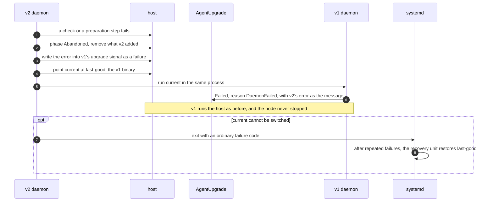
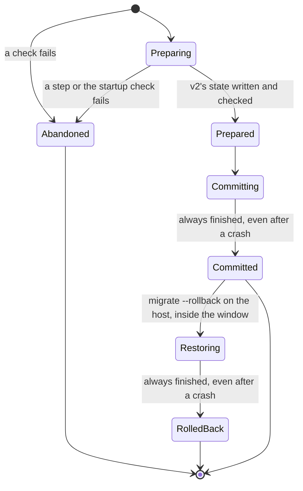
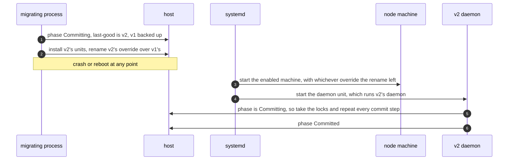
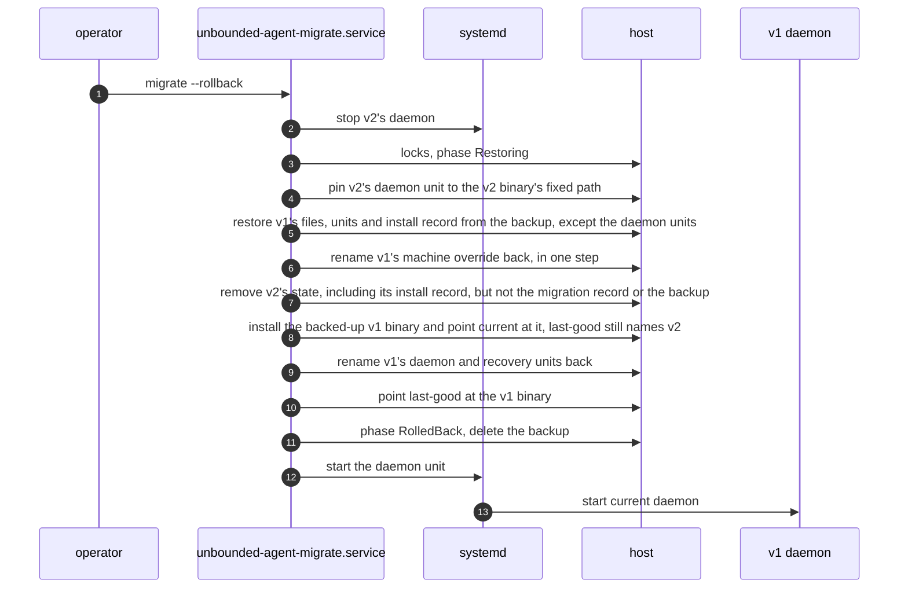

# Unbounded Agent v2: Migrating from v1

Part of the [Unbounded Agent v2 design](README.md). The README has the status,
repository baseline, citation conventions and terms.

This document specifies how a host running the v1 agent moves to v2 without
replacing its node. It covers hosts installed by the unbounded v1 agent and,
through the same mechanism, hosts built by other consumers of `pkg/agent`, such
as AKS Flex Node.

A v1 node already runs as an nspawn machine, `kube1` or `kube2`, in the layout
v2's `nspawn-container` runtime uses ([node runtime, section 5](03-node-runtime.md#5-runtimes)). A migration
therefore leaves the machine alone and replaces only the agent around it:
v2 takes over the running machine as its slot.

## 1. Requirements

1. **The node keeps running.** No pod restarts, the same Node object and the
   same Machine.
2. **No new bootstrap token is needed.** Bootstrap tokens expire, so v2 takes
   over v1's daemon client certificate.
3. **A migration can be started from the cluster**, without SSH, for fleets,
   and from the host, for automation and for other `pkg/agent` consumers. It is
   always the same step: install the v2 build as the host's agent.
4. **A migration resumes after a crash or reboot at any step**, and the host
   always ends up with a working agent: v2 if the migration commits, v1 if it
   does not.
5. **No v1 release has to know about v2.** Until the migration commits, any v1
   binary can run the host, because nothing of v1's has changed. After the
   commit, only v2 runs it.
6. **A migration can be rolled back to v1 on the host** until v2 first changes
   the node, which is its first repave (section 8).
7. **A finished migration leaves no v1 state**, so v1's tools treat the host as
   a v2 host ([v1 compatibility, section 4](08-v1-compatibility.md#4-existing-packages-used-as-libraries)).
8. **Every v1 host moves at the first official v2 release**, from any release
   since the oldest supported v1 release, because v1 is not supported after it
   (section 2).
9. **Moving to the `host` runtime is a separate step** (section 10). It
   replaces the node, so it is not part of a migration.

## 2. Release plan and cutover

Each experimental release ships two builds of the agent from the same source
and version. Each build is one agent, chosen at build time
([v1 compatibility, section 4](08-v1-compatibility.md#4-existing-packages-used-as-libraries)):

- The **v1 build** has only v1's commands. It is the v1 agent, with the few
  changes this design makes to v1.
- The **v2 build** has only v2's commands, at the top level: `start`,
  `daemon`, `reset`, `migrate` and the rest
  ([CLI and configuration, section 1](01-cli-and-configuration.md#1-cli)). It behaves exactly as the first official v2
  release will.

| Release | Artifacts | What happens to a v1 host |
|---|---|---|
| Experimental releases | `unbounded-agent-linux-<arch>`: the v1 build. `unbounded-agent-v2-linux-<arch>`: the v2 build. | Nothing, unless it is upgraded to the v2 build early (section 4) |
| The first official v2 release, and every later one | `unbounded-agent-linux-<arch>`: the v2 build. `unbounded-agent-v2-linux-<arch>`: the same bytes, kept for a deprecation period so automation that used the name keeps working. The v1 build is no longer published. | Migrated by an ordinary AgentUpgrade (section 2.1) |

Inside the v2 build's archive the binary is still named `unbounded-agent`,
because a v1 daemon accepts only an archive whose single member has exactly
that name (`cmd/agent/internal/daemon/agentupgrade.go:76-82`,
`pkg/agent/goalstates/agentupgrade.go:14`). Any v1 release can therefore
install the v2 build.

Migrating needs no change in any v1 release. Until the migration commits,
v2 only adds files under its own `agent-v2` paths and leaves v1's files, units,
boot wiring and install record as they were, so whichever v1 binary ran the
host before can run it again. The commit starts by pointing the binary
rollback slot, `last-good`, at the v2 binary. From then on systemd's recovery
unit can only start v2, so a v1 binary never runs on a host that v2 has
changed. After the commit, the way back to v1 is `migrate --rollback` on the
host (section 8).

**The oldest supported v1 release** is the oldest release the migration test
matrix installs and migrates ([testing, section 4](11-testing.md#4-migration-suite)). The release notes name it.
v2 reads v1's state in the formats those releases write, so the floor is the
newest of the releases that introduced a piece of that state. By the release
tags:

| v1 state the migration reads | First release |
|---|---|
| The AgentUpgrade failure signal (`cmd/agent/internal/daemon/agentupgrade.go:31-36`) | v0.1.4 |
| The daemon client certificate (`pkg/agent/daemoncred`) | v0.1.9 |
| The install record (`cmd/agent/internal/installstate/store.go:20-24`) | v0.9.0 |
| The agent's files under `/opt/unbounded` (`internal/hostroot/layout.go`, #815) | v0.13.0 |

The oldest supported v1 release is therefore v0.13.0 or later. v1 moves its
files into `/opt/unbounded` the first time a v0.13.0 or newer daemon starts
(`cmd/agent/internal/daemon/daemon.go:119-123`). A host upgraded from an older
release straight to the v2 build never runs that move, because v2's daemon is
the first to start, and the checks in section 5 refuse it before anything
changes, with a message naming the oldest supported release. An ordinary v1
AgentUpgrade to a supported release comes first.

### 2.1 How a host migrates

A v1 host migrates when the v2 build becomes its agent binary. From the
cluster, that is an ordinary AgentUpgrade to the v2 build, with no parameter.
From the host, it is the hidden `agent-upgrade` command
(`cmd/agent/internal/cmd/agentupgrade.go:63-70`) with the v2 build. Before the
first official v2 release this is an early migration (section 4); at that
release it is the cutover, when every remaining v1 host moves. The steps are
the same in every case. For an AgentUpgrade, v1's daemon installs the new
binary as it does for any other: `last-good` keeps the binary it was running, `current`
names the new one, and the daemon records the operation in its upgrade signal
and runs `current` in its place, in the same process
(`pkg/agent/agentbinary/upgrade.go:256-264`,
`cmd/agent/internal/daemon/controller_machineoperation.go:175-193`,
`cmd/agent/internal/cmd/daemon.go:50-95`). v1's daemon unit runs
`<current> daemon`
(`cmd/agent/internal/daemon/assets/unbounded-agent-daemon.service:14`), and in
the v2 build `daemon` is v2's daemon. When it starts on a v1 host, it runs the
migration (section 6) before anything else, as v1's daemon moves the agent's
files on its first start after an upgrade
(`cmd/agent/internal/daemon/daemon.go:119-123`). `agent-upgrade` installs the
binary the same way and restarts the daemon unit, which starts v2's daemon. It
then waits until the migration has committed and the daemon is ready, or has
been abandoned, and prints the result from the migration record.

```mermaid
sequenceDiagram
  autonumber
  participant D1 as v1 daemon
  participant D2 as v2 daemon
  participant H as host
  participant SD as systemd
  participant MO as AgentUpgrade
  D1->>H: install the v2 binary, last-good keeps the v1 binary, write v1's upgrade signal
  D1->>D2: run current in the same process
  D2->>H: v1 host found: take the locks and run the checks (section 5)
  D2->>H: phase Preparing, copy the operation from v1's signal into the record
  D2->>H: write v2's state under the agent-v2 paths, v1 untouched
  D2->>H: check what the daemon needs to be ready, phase Prepared
  D2->>H: phase Committing, run the commit (section 6.2)
  D2->>H: phase Committed
  D2->>SD: restart the daemon unit, which is now v2's
  SD->>D2: start; the unit waits for the readiness file
  D2->>SD: readiness file, once its local checks pass and its Machine is reachable
  D2->>MO: Complete
```

The AgentUpgrade completes only once the v2 daemon is ready, as for any v2
AgentUpgrade ([lifecycles, section 5](05-lifecycles.md#5-agentupgrade)). After the commit, the daemon restarts
through systemd rather than in the same process, so that it runs under v2's
unit and is held to its readiness timeout.

A failure before the commit returns the host to v1. When `agent-upgrade`
started the migration, there is no operation, so the steps that report one are
skipped:



- The order makes every crash end the same way. v1's daemon publishes a
  failure it finds in its signal when it starts
  (`controller_machineoperation.go:260-276`), so once the signal holds the
  failure, the operation ends `Failed` whichever binary runs next. Before
  that, `current` still names v2, and a v2 daemon that finds the record
  `Abandoned` while v1's signal names the operation that started the migration
  finishes these steps instead of migrating again (section 6.3).
- v2 never reports the failure itself. v1 overwrites the result of an
  operation that has already finished (`pkg/agent/daemon/machineoperation.go:217-227`),
  so a v2 report followed by a crash would be replaced by v1's anyway, and
  reporting before switching back would let a restarted v2 migrate again. The
  reason is therefore always v1's `DaemonFailed`, and the message is v2's
  error, which says what failed. Every supported v1 release has this signal
  (section 2), and no API server is needed to return to v1.
- The exit code is never the deferred exit code, which the unit treats as
  success and so never escalates to the recovery unit
  (`unbounded-agent-daemon.service:17-22`). The recovery unit restores
  `last-good` after any repeated failure (`:8-10`,
  `unbounded-agent-daemon-recovery.sh:11,26`).

After the commit, the host is a v2 host. A v2 daemon that keeps failing is
handled like any other: the recovery unit restores `last-good`, which is now
v2. Until the rollback window closes, the way back to v1 is
`migrate --rollback` on the host (section 8), which works even when v2's
daemon cannot start, because it does not need the daemon.

## 3. What changes on the host

Names that operators and other tools rely on, such as unit names and commands,
are the final names and are the same as v1's. v2's internal state keeps `-v2`
names ([host changes, section 1](06-host-changes.md#1-what-v2-creates-on-the-host)). Nothing in this table changes before the commit
(section 6.2).

| Item | v1 | After the migration |
|---|---|---|
| The running node | The `kube1` or `kube2` machine, its rootfs and its state | Unchanged. `kube1` becomes slot `a`, `kube2` slot `b`. The root file system stays as v1 unpacked it. v2's unpack, which differs from v1's ([v1 compatibility, section 2](08-v1-compatibility.md#2-behavior-changes-from-v1)), first runs at v2's first repave, which also closes the rollback window (section 8), so v1 never runs a machine that v2 unpacked. |
| Machine and Node objects | | Unchanged |
| Agent binary | `/opt/unbounded/agent/bin/unbounded-agent*` | The layout is shared. `last-good` names a v2 binary from the commit on, and the v1 binary that ran before the migration is kept in the backup. |
| Daemon units | `unbounded-agent-daemon.service` and `unbounded-agent-daemon-recovery.service` (`pkg/agent/goalstates/constants.go:24,27`) | Same names, replaced by v2's at the commit. v2's daemon unit runs `<current> daemon`, as v1's does, and waits for the readiness file ([host changes, section 1](06-host-changes.md#1-what-v2-creates-on-the-host)). |
| Install record | `/var/lib/unbounded/agent/install-state.json` (`cmd/agent/internal/installstate/store.go:21,85`) | `/var/lib/unbounded/agent-v2/install.json` |
| Configuration | `/etc/unbounded/agent/`, including `kube{1,2}-applied-config.json` (`pkg/agent/goalstates/constants.go:17,97-101`) | `/etc/unbounded/agent-v2/config.json`, node state and the slot's saved bundle manifest |
| Daemon credentials | `/etc/unbounded/agent/daemon-controller` (`cmd/agent/internal/daemon/daemon.go:108-110`) | Copied to `/etc/unbounded/agent-v2/`, then rotated as usual |
| AgentUpgrade signal | `/etc/unbounded/agent/agent-upgrade-signal` (`pkg/agent/goalstates/constants.go:48`) | Its operation is copied into the migration record, and the file is not kept |
| Boot wiring | `systemd-nspawn@<m>.service.d/override.conf`, `unbounded-agent-regenerate-config@<m>.service` (`pkg/agent/goalstates/constants.go:93-95`) and the lifecycle helper `unbounded-agent-nspawn-lifecycle` (`internal/hostroot/layout.go:15`) | v2's machine override, at the same path as v1's, `unbounded-node-boot-hook@<m>.service` and the boot hook binary `unbounded-agent-boot-hook` ([node runtime, section 4](03-node-runtime.md#4-host-boot-and-boot-units)) |
| Host preparation | As v1 left it, with no record of the original state | Unchanged. v2's undo log records what v1 is known to change (section 7). |

## 4. Migrating early

Before the first official v2 release, an operator can migrate a host early by
upgrading it to the v2 build of an experimental release, from the cluster or on
the host (section 2.1). It is exactly what the cutover does, so every early
migration also exercises the cutover's code.

- Upgrading a v1 host to the v1 build of a newer release keeps it on v1, as
  today. Only the v2 build migrates.
- Once a host has migrated, later AgentUpgrades must use v2 builds. v2 rejects
  a v1 build before it switches anything ([lifecycles, section 5](05-lifecycles.md#5-agentupgrade)).
- To migrate a fleet, create one AgentUpgrade per Machine. A `machineSelector`
  operation is shared by every matching agent and reports one combined result
  (issue #1040), so it cannot track a fleet migration.

## 5. Checks before migrating

v2's daemon refuses to migrate, and changes nothing of v1's, unless all of
these hold. A refusal is recorded as `Abandoned` and handled as any failure
before the commit, so the host returns to v1 and an AgentUpgrade is reported
`Failed` (section 2.1).

| Check | Why |
|---|---|
| v1's install record has phase `complete`, in a format this release reads | An unfinished v1 install has to finish or be reset first. A host from before the oldest supported v1 release has no such record (section 2). |
| Exactly one machine is running and enabled, and it is the only one with an applied config | A second applied config means a v1 repave was interrupted ([v1 compatibility, section 2](08-v1-compatibility.md#2-behavior-changes-from-v1)) |
| No v1 MachineOperation is in progress on this host, other than the AgentUpgrade that started the migration | The migration replaces v1's daemon. The check uses only what can be tied to this host: v1's install lock, which every v1 handler holds while it works (`cmd/agent/internal/daemon/controller_machineoperation.go:73,127,199`, `hostosreboot.go:52`) and which the migration takes first and keeps until it ends; v1's AgentUpgrade signal; this Machine's `machineRef` operations; and this Machine's target entry in `HostOSReboot` operations (`hostosreboot.go:143-154`). It does not read the status of other selector operations, which every matching agent shares (issue #1040). |
| v1's own move of the agent's files into `/opt/unbounded/agent` has finished (`cmd/agent/internal/daemon/daemon.go:120-122`) | Migration expects the current v1 layout |
| The machine's applied config converts to a v2 configuration ([v1 compatibility, section 5](08-v1-compatibility.md#5-converting-a-v1-configuration)) | v2 has to be able to manage the node |
| The host is not already a v2 host, and no other migration is in progress | |

## 6. Steps

### 6.1 Phases

The migration keeps its phase in its record,
`/var/lib/unbounded/agent-v2/migration.json`, written and synced to disk before
the step it names, and under the same rules as v2's other state files
([control and state, section 4](04-control-and-state.md#4-state)).



| Phase | v1 | v2 |
|---|---|---|
| `Preparing` | Untouched, and in charge of the host | Writing its state under its own paths |
| `Prepared` | Untouched | Its state is written and checked |
| `Committing` | Moving into the backup | Being installed. Always finished. |
| `Committed` | In the backup until v2's first repave | In charge |
| `Abandoned` | Untouched, and in charge again | What it added is removed |
| `Restoring` | Coming back from the backup | Being removed. Always finished. |
| `RolledBack` | Restored, and in charge again | Removed |

### 6.2 Preparing and committing

The migrating process is v2's daemon, or `unbounded-agent-migrate.service` for
a machine another `pkg/agent` consumer built (section 9). It holds v1's install lock, v2's install lock and the binary
activation lock from the checks until the commit or the abandonment is done,
so no v1 handler, v2 handler or binary activation runs at the same time.

Preparing:

1. Record `Preparing`, with the operation that started the migration and its
   Machine generation, from v1's upgrade signal, if there is one
   (`cmd/agent/internal/daemon/agentupgrade.go:31-36`).
2. Write v2's configuration, daemon credentials, node state, the slot's bundle
   manifest and the host preparation undo log (section 7). Stage v2's units,
   machine override and boot hook binary under
   `/var/lib/unbounded/agent-v2/migration/staged/`. Nothing outside v2's own
   paths changes.
3. Check what v2's daemon will need to report ready after the commit
   ([control and state, section 5](04-control-and-state.md#5-daemon-reconcile)): `Recover` finds the running machine
   consistent with the new node state, the copied daemon credentials can read
   the Machine, and, for a machine another consumer built, every configured
   plugin answers `describe` with the methods the configuration uses
   (section 9). After the commit there is no v1 to fall back to, so a
   migration attempted while the API server cannot be reached is abandoned
   rather than committed.
4. Record `Prepared`.

The commit:

1. Record `Committing`.
2. Point `last-good` at the v2 binary.
3. Copy v1's files and units into
   `/var/lib/unbounded/agent-v2/migration/v1-backup/`, together with the v1
   binary that ran before the migration, which `last-good` named before step
   2, and its SHA-256. v1's upgrade signal is not copied, because its operation
   is already in the record.
4. Install v2's units and the boot hook binary, replacing v1's daemon and
   recovery units, which have the same names, and reload systemd.
5. Rename v2's staged machine override over v1's, in one step. The machine
   stays enabled throughout, and a boot at any moment starts it with one
   complete override or the other.
6. Remove v1's files and units, which the backup now holds, including the
   upgrade signal, and reload systemd.
7. Write v2's install record. From here on, v1's and v2's tools see a v2 host.
8. Record `Committed`.

Every step can be repeated, and a commit never goes back: whichever process
finds the record in `Committing` repeats the steps until it reaches
`Committed`. The daemon then restarts through systemd (section 2.1).



### 6.3 After a crash or reboot

Only v2's code reads the migration record: its daemon, and the migrate unit
when it rolls back or adopts a machine. v1 never needs to, because v1 never
runs on a host that v2 has changed (section 2). v2 reads the record before it
does anything else:

- **`Committing`:** the daemon continues the commit, or, for a machine another
  consumer built, the migrate unit does. A commit never goes back.
- **`Preparing` or `Prepared`:** the record is continued only if it still
  describes the host. It records what it was prepared from: the operation
  that started it, v1's install ID, the running machine and the digest of that
  machine's applied config. If the record names an operation and v1's upgrade
  signal names another one or none, or any of the others differ, the daemon
  removes v2's staged files and the record and starts again from the checks
  (section 5). This happens when
  v2's daemon crash-loops before the commit: v1's recovery unit then restores
  `last-good`, which is still the v1 binary, and records the failure in v1's
  signal (`unbounded-agent-daemon-recovery.sh:19-26`), so v1 runs again
  without anything writing `Abandoned`. v1 may repave before the next attempt,
  after which a record prepared from `kube1` would describe the wrong machine.
- **`Restoring`:** the migrate unit finishes the rollback. v2's daemon, if it
  starts first, starts the migrate unit and stands down with the deferred exit
  code, so only one process changes the host (section 8).
- **`Abandoned`, while v1's upgrade signal still names the operation that
  started the migration:** the daemon does not migrate again. It finishes
  returning to v1 as in section 2.1. A signal that names another operation is
  handled as v1 handles it (`controller_machineoperation.go:257-297`).

v1's recovery script calls `record-agent-upgrade-failure-signal` through
`last-good`, which names the v2 binary from commit step 2, while v1's recovery
unit is still installed until step 4. In the v2 build that command therefore
writes the failure into the migration record while the record is in
`Committing` or `Committed` and its operation has not been published, so v2's
daemon reports it once the commit finishes; at any other time it writes v2's
own upgrade signal.

What a host reboot does in each phase:

| Phase at the reboot | The node boots with | Then |
|---|---|---|
| `Preparing`, `Prepared` | v1's boot wiring, untouched | The daemon unit starts v2's daemon, which continues from the start of the phase |
| `Committing` | v1's or v2's machine override, whichever the rename left | v2's daemon finishes the commit |
| `Committed` | v2's | v2's daemon starts |
| `Abandoned` | v1's | v1's daemon starts and publishes the failure, if that has not happened yet. If `current` was not yet switched back, v2's daemon starts instead and finishes returning to v1. |
| `Restoring` | v1's or v2's machine override, whichever the rename left | The migrate unit finishes the rollback (section 8) |
| `RolledBack` | v1's | v1's daemon starts |

No step stops or restarts the machine, so the node keeps running in every
phase.

## 7. Converting v1's state

| v2 state | Comes from |
|---|---|
| Configuration | The running machine's applied config, `/etc/unbounded/agent/<m>-applied-config.json`, converted as in [v1 compatibility, section 5](08-v1-compatibility.md#5-converting-a-v1-configuration). This is what configured the node, so a host whose v1 install was configured through environment variables migrates the same way. Bootstrap credentials stay as they are in the applied config, which is what a v1 repave would use (`cmd/agent/internal/daemon/controller_node.go:86`). |
| Daemon credentials | v1's daemon client certificate and key, copied. The `csr` credential rotates them from then on, so no bootstrap token is needed to migrate. |
| Install record | Phase `complete`, runtime `nspawn-container`, and the fingerprint of the converted configuration ([CLI and configuration, section 2](01-cli-and-configuration.md#2-configuration)). Written last, by the commit. |
| Node state | `Applied.Settings` from the converted configuration, `Applied.BundleDigest` from the saved manifest, and `Applied.GoalVersion` from `Machine.status.configuration` if v1 has recorded one (`cmd/agent/internal/daemon/controller_node.go:131`). No `Repave`. |
| Slot | `kube1` becomes slot `a`, `kube2` slot `b`. The runtime reports the enabled machine as the enabled slot. |
| Bundle manifest | Rendered from the converted configuration and saved in the slot, as `Provision` would save it ([node runtime, section 2](03-node-runtime.md#2-node-spec-and-bundle)). Nothing is written into the machine. The rendered files are compared with the machine's. Differences, for example from an older v1 release's templates, are reported as a warning in the migration result; the next repave removes them. |
| Host preparation undo log | See below |

v1 keeps no record of the host's state before its host preparation. The undo
log v2 writes for a migrated host therefore reverses only what is certain:

| Change v1 made | At reset |
|---|---|
| `/etc/sysctl.d/99-kubernetes.conf`, `nftables-flush.service` and `nftables-clear.nft`, the apt drop-ins | Removed, as for a v2 install. Only the agent uses these files. |
| Sysctl values, `iptables: false` in `/etc/docker/daemon.json`, swap entries commented out in `/etc/fstab`, masked docker, swap, host containerd and host kubelet units | Left as they are and listed in the reset report. v1 changed them without a backup, and comments swap entries without a tag (`pkg/agent/phases/host/disable_swap.go`, `pkg/agent/phases/host/configure_docker.go:30-66`), so v2 cannot tell what the host had before. This is the same outcome as a v1 reset. |

## 8. Rollback

v1's files, and the v1 binary that ran before the migration, stay in the backup
until v2's first repave commits. Until then, the *rollback window*,
`migrate --rollback` on the host puts v1 back. It runs in
`unbounded-agent-migrate.service`, a oneshot unit that stays enabled until the
rollback ends, so a crash or reboot continues it. The unit runs the v2 binary
by its fixed blue or green path, recorded when the rollback starts, not through
`current`, so it keeps working after `current` names v1. The command waits for
the unit and prints the result, so a lost SSH session does not stop it.

There is no rollback from the cluster. v2 rejects an AgentUpgrade to any binary
whose `version` does not say `agent: v2`, such as a v1 build or an older v1
release, inside the
window or after it, before it switches anything ([lifecycles, section 5](05-lifecycles.md#5-agentupgrade)). A
rollback returns the host to exactly the state it had before the migration, so
it never needs a binary from anywhere else.

Starting `migrate --rollback` from the cluster was considered in two forms and
rejected:

- **An AgentUpgrade parameter** that has v2's daemon start the migrate unit.
  v1 would publish the result from its upgrade signal, as it does for any
  pending upgrade (`controller_machineoperation.go:277-285`).
- **A new `AgentDowngrade` operation kind.** `OperationKind` is a closed enum
  in the CRD (`api/machina/v1alpha3/machineoperation_types.go:54`), so this is
  an API change. Agents and controllers that do not know it ignore it
  (`pkg/agent/daemon/machineoperation.go:116`), so it would stay `Pending` on
  every host that cannot run it. Between v2 releases it adds nothing, because
  an AgentUpgrade to an earlier v2 release already goes back.

Rolling forward covers the cases a cluster-started rollback would: a v2 daemon
that runs but misbehaves takes an AgentUpgrade to a fixed v2 build, even in
limited mode ([control and state, section 5](04-control-and-state.md#5-daemon-reconcile)). A v2 daemon that cannot run
could not receive an operation anyway, and is recovered on the host with
`agent-upgrade` to a fixed build or `migrate --rollback`. What is left is a v2
problem with no fixed build yet, during the experimental releases, where early
migration is opt-in, or after the cutover, when v1 is no longer supported.

`status --output json` shows whether the rollback window is still open, so an
operator can see it before an unrelated repave closes it.



The order is what keeps a crash safe:

- **Until v1's daemon unit is back, the daemon unit starts v2.** Before it
  switches `current`, the rollback rewrites v2's daemon unit to run the v2
  binary by its fixed path rather than `<current>`, so pointing `current` at
  v1 changes nothing that starts at boot. Renaming v1's unit file back
  replaces the whole file, pin included, in one step. The rollback holds the
  binary activation lock throughout, so nothing replaces the pinned binary.
- **Only the migrate unit changes the host.** If v2's daemon starts while the
  record is in `Restoring`, it starts the migrate unit and stands down with
  the deferred exit code (section 6.3).
- **Renaming v1's daemon unit back hands the host to v1.** A migrate unit that
  starts again and finds v1's daemon unit in place, which it tells by
  comparing the installed file with v1's backed-up copy, only finishes. It
  points `last-good` at the backed-up v1 binary if `current` still names that
  binary, which means nothing has upgraded v1 since, records `RolledBack` and
  deletes the backup. It changes nothing else, because v1 may already have
  run, and changing that link is safe either way.
- **`last-good` names the v1 binary afterward,** as it did before the
  migration. If v1's daemon then keeps failing, the recovery unit restarts v1,
  never v2, so v2 never migrates the host again on its own.

Rollback is possible until v2's first repave commits. That repave replaces the
machine with one v1 never configured, so v1's backed-up files no longer
describe it: the repave deletes the backup, and a rollback then refuses. From
that point, the way back to v1 is `reset` and a v1 install.

v2 does not try to rebuild v1's files from its own state to keep rollback
possible after a repave. It could, because the `nspawn-container` runtime
builds the machine as v1 does, but v2 would have to write v1's formats and
units exactly as each supported v1 release expects, and that conversion would
only ever run during an incident. The window has no timer: it closes only when
a Node is deleted with drift and v2 repaves, so an operator who wants to keep
the way back open holds off on repaves.

## 9. Hosts built by other `pkg/agent` consumers

Other consumers, such as AKS Flex Node, build the same nspawn machines from
`pkg/agent`, but with their own daemon, paths and configuration
([overview, section 1.3](README.md#13-how-aks-flex-node-consumes-v1-today)). They migrate with the v2 build's
`migrate --adopt-machine --config <file> --previous-agent <file>`, which runs
in `unbounded-agent-migrate.service`. Converting AKS Flex Node hosts to v2
needs it, so it is part of the first implementation.

### 9.1 The previous-agent descriptor

v2 cannot know another consumer's units and files, so the consumer describes
its agent, and v2 carries out the whole handoff, as it does for v1:

```json
{
  "apiVersion": "agent.unbounded-cloud.io/v1alpha1",
  "kind": "PreviousAgent",
  "name": "aks-flex-node",
  "units": ["aks-flex-node-agent.service", "aks-flex-node-agent-recovery.service"],
  "replacedUnits": ["static-routes.service", "check-route-overlap.service"],
  "files": ["/etc/systemd/system/systemd-nspawn@kube1.service.d/aks-flex-node-dependencies.conf"],
  "operation": { "name": "upgrade-to-v2-m-01" },
  "handBack": ["/opt/unbounded/agent/lib/aks-flex-node/aks-flex-node-last-good", "recover-agent-upgrade"]
}
```

- `units` are stopped, disabled and backed up at the commit, and restored and
  started again by an abandonment or a rollback.
- `replacedUnits` are the previous agent's host units that one of the
  configuration's extensions replaces under the same name, such as Flex's
  static routes. They are backed up and removed at the commit, and the
  extension check that refuses a host unit the agent did not create
  ([extensions, section 2](02-extensions.md#2-declarative-extensions)) does not apply to them.
- `files` are backed up and removed at the commit, and restored by a rollback.
- `operation` is the previous agent's upgrade operation that installed the
  bridge, if any. v2's daemon reports it once the commit finishes.
- `handBack` is a command of the previous agent that an abandonment or a
  rollback runs last, after restoring its units, so the previous agent can
  return to its own last-good version and report the operation itself, as AKS
  Flex Node's recovery does (`pkg/daemon/agent_upgrade.go:411-436` at Flex
  `2c149e991`).

### 9.2 Starting it: a bridge

A consumer starts the migration through its own upgrade mechanism, so it can
be started from the cluster, as requirement 3 asks. Its release installs a
*bridge*: its own program, run by its own daemon unit in place of its agent,
that writes the v2 configuration and the descriptor, installs the v2 agent,
and starts `unbounded-agent-migrate.service`. v2 is the same in every case;
only the bridge is the consumer's. For AKS Flex Node:

| Flex install | How the bridge is delivered | What its unit runs |
|---|---|---|
| On the host, `main` | A Flex AgentUpgrade to an archive whose single member is `aks-flex-node-linux-<arch>` (`pkg/config/artifacts.go:10-20` at Flex `2c149e991`) | `aks-flex-node agent --config /etc/aks-flex-node/config.json` (`pkg/daemon/assets/aks-flex-node-agent.service`) |
| In containers on ACL, Azure/AKSFlexNode#370 | A Flex AgentUpgrade to Flex's v2 image, built from the agent image, which also carries `aks-flex-node` and the `flex-agent-entrypoint` its old unit starts | `aks-flex-node flex-agent-entrypoint aks-flex-node agent --config ...` in the new image (`pkg/daemon/assets/aks-flex-node-agent-container.service:51-63` at #370 `c039f55`); the host keeps the `containerd` agent runtime |

AKS Flex Node's plugin binary can serve as the bridge, the plugin and kubelet's
exec credential, as `aks-flex-node` serves several roles today.

On Azure Container Linux the bridge should configure the `containerd` agent
runtime, even for a Flex host install: under the `host` agent runtime, ACL's
SELinux policy keeps the agent from clearing its daemon unit's start limit
after a failed upgrade, and under `containerd` it does not (validation task V12,
[agent runtime, section 10](12-agent-runtime.md#10-host-requirements)).

### 9.3 What the adoption checks and does

- **The checks are reduced to the machine:** exactly one `kube1` or `kube2`
  machine is running and enabled, and no v1 or v2 install is present. Before
  the commit, every configured plugin must also answer `describe` (section
  6.2).
- **The configuration must describe the running node.** Its goal settings
  become the applied settings, so they must be what the machine was built
  from, not what the consumer was first configured with. AKS Flex Node records
  only the applied Kubernetes version (`pkg/daemon/state.go:28-34` at Flex
  `2c149e991`), and a repave changes the version in memory only
  (`pkg/daemon/nodeoperator.go:147-155`), so its bridge takes the version from
  `daemon-state.json`, not from `config.json`. Before the commit, the adoption
  runs the machine's `kubelet --version` and refuses a version other than the
  configuration's. Other differences between the rendered bundle and the
  machine's files are reported as warnings, as for v1 (section 7).
- **The phases and machine-level steps are the same as for v1:** the bundle
  manifest, node state, boot wiring and daemon. The backup holds the machine's
  override, which the commit replaces, and what the descriptor names. A
  rollback restores those and runs `handBack`. v2's undo log records only what
  v2 changes from then on.
- **Host preparation is brought up to v2's,** which is the same for every
  consumer. AKS Flex Node's copy of unbounded's host steps leaves some of them
  out (Azure/AKSFlexNode#423), so an adopted Flex host gains Docker's
  `iptables: false` and has the host's kubelet masked. The host's containerd is
  left running, as on every v2 host
  ([host changes, section 3](06-host-changes.md#3-host-preparation-and-its-reversal)), which matters on ACL, where it holds Arc's
  agent image and, for a container install, runs the agent. The checks before the commit
  list each host service that will be masked, as warnings that name any that
  are running. The commit applies the steps and records them in the undo log,
  so `reset` reverses them.
- **The goal version starts empty,** as after a bootstrap, and is recorded on
  the daemon's first check whose settings match
  ([control and state, section 1](04-control-and-state.md#1-control-plane-integration)).

## 10. Changing the node runtime or the agent runtime

The node runtime and the agent runtime are install-time settings, chosen by
the Machine's `spec.agent.nodeRuntime` and `spec.agent.agentRuntime`
([CLI and configuration, section 2](01-cli-and-configuration.md#choosing-the-node-runtime)). A migrated host moves to the `host` node
runtime, or to an image agent runtime, the same way any host changes them: set the field, then
reinstall the host, either with a HostReplace or with `reset` followed by
`start` with the configuration provisioning generates. Until then the Machine
shows `ReinstallPending=True`. The Node registers again under the same name,
and its pods are rescheduled, as in a repave.

The `host` runtime is not supported on Azure Container Linux
([node runtime, section 5.3](03-node-runtime.md#53-host-capabilities)), so an ACL host stays on `nspawn-container`.
Moving it to the `containerd` agent runtime works as above.

## 11. Changes outside `internal/agentv2`

These are listed with the other changes in [v1 compatibility, section 4](08-v1-compatibility.md#4-existing-packages-used-as-libraries).
The migration needs no change in any v1 release: before the commit any v1
release can run the host, and after it no v1 release does (section 2). The
only v1 change it relies on is in the v1 build of the experimental releases:

- **Refusing to act on a v2 host.** v1's `start`, `daemon` and `reset` refuse
  on a host with a v2 install record. v1 and v2 share the daemon unit names,
  so v1's `reset` would otherwise remove v2's daemon unit. This only guards
  against someone installing a v1 binary by hand; v2 itself never starts one
  on a v2 host.

## 12. Testing

The migration suite in [testing, section 4](11-testing.md#4-migration-suite) covers migrating from the cluster and
from the host, from each v1 release in the matrix, a crash, a reboot and a
failure in every phase, rollback, the checks that refuse, a daemon crash loop
after the rollback window, and the move to the `host` runtime afterward.
