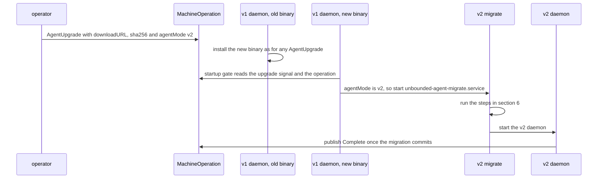
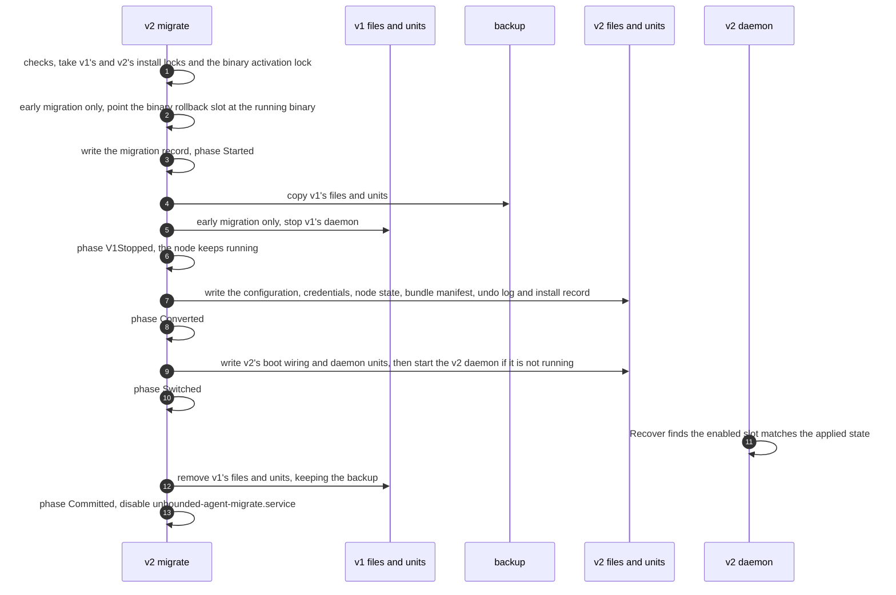

# Unbounded Agent v2: Migrating from v1

Part of the [Unbounded Agent v2 design](README.md). The README has the status,
repository baseline, citation conventions and terms.

This document specifies how a host running the v1 agent moves to v2 without
replacing its node. It covers hosts installed by the unbounded v1 agent and,
through the same mechanism, hosts built by other consumers of `pkg/agent`, such
as AKS Flex Node.

A v1 node already runs as an nspawn machine, `kube1` or `kube2`, in the layout
v2's `nspawn-container` runtime uses ([node runtime, section 5](03-node-runtime.md#5-runtimes)). A migration
therefore leaves the machine alone and replaces only the agent around it:
v2 takes over the running machine as its slot.

## 1. Requirements

1. **The node keeps running.** No pod restarts, the same Node object and the
   same Machine.
2. **No new bootstrap token is needed.** Bootstrap tokens expire, so v2 takes
   over v1's daemon client certificate.
3. **A migration can be started from the cluster**, without SSH, for fleets,
   and from the host, for automation and for other `pkg/agent` consumers.
4. **A migration resumes after a crash or reboot at any step**, and the host
   always ends up with a working agent: v2 if the migration finishes, v1 if it
   does not.
5. **A migration can be rolled back to v1** until v2 first changes the node,
   which is its first repave.
6. **A finished migration leaves no v1 state**, so v1's tools treat the host as
   a v2 host ([v1 compatibility, section 4](08-v1-compatibility.md#4-existing-packages-used-as-libraries)).
7. **Every v1 host moves at the first official v2 release**, because v1 is not
   supported after it (section 2).
8. **Moving to the `host` runtime is a separate step** (section 10). It
   replaces the node, so it is not part of a migration.

## 2. Release plan and cutover

| Release | Top-level commands | What happens to a v1 host |
|---|---|---|
| Experimental releases | v1's; v2's are under `v2` | Nothing, unless an operator migrates it early (section 4) |
| **N**, the last v1 release | v1's; v2's are under `v2` | Nothing. N adds what a safe rollback needs: its daemon can undo a migration that N+1 started or finished (section 8). |
| **N+1**, the first official v2 release | v2's. v1's commands are removed, and `v2 <command>` stays as a hidden alias so units and scripts written during the experimental releases keep working. | Migrated by an ordinary AgentUpgrade to N+1 (below) |

At N+1, a v1 host migrates through an ordinary AgentUpgrade, with no parameter.
v1's daemon unit runs `<current> daemon`, and in N+1 `daemon` is v2's daemon.
When it first starts on a v1 host, it runs the migration (section 6) before
anything else, as v1's daemon already moves the agent's files on its first
start after an upgrade (`cmd/agent/internal/daemon/daemon.go:118-122`). The
AgentUpgrade completes when the migration commits.

Rollback:

- **Automatic.** If the migration fails, N+1's daemon exits with an ordinary
  failure code. It never rolls the migration back itself: N+1 has no v1
  commands, so starting v1's daemon would only start N+1 again. After repeated
  failures, systemd's start limit triggers the recovery unit
  (`cmd/agent/internal/daemon/assets/unbounded-agent-daemon.service:8-10`),
  which restores the previous binary, N, as for any failed AgentUpgrade
  ([lifecycles, section 5](05-lifecycles.md#5-agentupgrade)). N's daemon finds the unfinished migration, restores
  v1 from the backup (section 8) and reports the AgentUpgrade as `Failed`. The
  exit code must not be the deferred exit code, which the unit treats as
  success and so never escalates to the recovery unit (`:21-22`).
- **On request.** While the rollback window is open, until v2's first repave,
  an AgentUpgrade back to N restores v1 the same way.
- **After the window,** v2's daemon refuses an AgentUpgrade to any release
  older than N+1, as it refuses any candidate that cannot run the host
  ([lifecycles, section 5](05-lifecycles.md#5-agentupgrade)), and the binary rollback slot holds a v2 binary
  (section 8).
- **Upgrades go through N.** A rollback has to land on a binary that can undo
  the migration. N+1 therefore refuses to migrate a host whose previous binary
  is older than N: its daemon fails, the recovery unit restores the previous
  binary, and the AgentUpgrade fails with a message to upgrade to N first.

## 3. What changes on the host

Names that operators and other tools rely on, such as unit names and commands,
are the final names and are the same as v1's. v2's internal state keeps `-v2`
names ([host changes, section 1](06-host-changes.md#1-what-v2-creates-on-the-host)).

| Item | v1 | After the migration |
|---|---|---|
| The running node | The `kube1` or `kube2` machine, its rootfs and its state | Unchanged. `kube1` becomes slot `a`, `kube2` slot `b`. |
| Machine and Node objects | | Unchanged |
| Agent binary | `/opt/unbounded/agent/bin/unbounded-agent*` | Unchanged; the layout is shared |
| Daemon units | `unbounded-agent-daemon.service` and `unbounded-agent-daemon-recovery.service` (`pkg/agent/goalstates/constants.go:24,27`) | Same names. In an experimental release the daemon unit runs `<current> v2 daemon`; from N+1 it runs `<current> daemon`, unchanged from v1. |
| Install record | `/var/lib/unbounded/agent/install-state.json` (`cmd/agent/internal/installstate/store.go:21,85`) | `/var/lib/unbounded/agent-v2/install.json` |
| Configuration | `/etc/unbounded/agent/`, including `kube{1,2}-applied-config.json` (`pkg/agent/goalstates/constants.go:17,97-101`) | `/etc/unbounded/agent-v2/config.json`, node state and the slot's saved bundle manifest |
| Daemon credentials | `/etc/unbounded/agent/daemon-controller` (`cmd/agent/internal/daemon/daemon.go:108-110`) | Copied to `/etc/unbounded/agent-v2/`, then rotated as usual |
| Boot wiring | `systemd-nspawn@<m>.service.d/override.conf`, `unbounded-agent-regenerate-config@<m>.service` (`pkg/agent/goalstates/constants.go:93-95`) and the lifecycle helper `unbounded-agent-nspawn-lifecycle` (`internal/hostroot/layout.go:15`) | v2's machine override, `unbounded-node-boot-hook@<m>.service` and the boot hook binary `unbounded-agent-boot-hook` ([node runtime, section 4](03-node-runtime.md#4-host-boot-and-boot-units)) |
| Host preparation | As v1 left it, with no record of the original state | Unchanged. v2's undo log records what v1 is known to change (section 7). |

## 4. Migrating early

Before N+1, an operator can migrate a host early. N+1 migrates every remaining
host (section 2).

### 4.1 From the host

`unbounded-agent v2 migrate` runs the migration on the host, from a binary that
includes v2. `v2 migrate --rollback` rolls it back (section 8). Host automation
uses these, as it uses the hidden `agent-upgrade` command today
(`cmd/agent/internal/cmd/agentupgrade.go:63-70`).

### 4.2 From the cluster

An AgentUpgrade MachineOperation with the parameter `agentMode: v2` upgrades
the binary and then migrates the host.

- The old daemon installs the binary as usual. Older daemons read only
  `downloadURL` and `sha256` and ignore other parameters
  (`cmd/agent/internal/daemon/agentupgrade.go:52-55`), so this works from any
  v1 release that supports AgentUpgrade.
- If the host already runs the new binary, the install is skipped and the
  migration starts straight away.
- The new binary's v1 daemon publishes AgentUpgrade results from the upgrade
  signal when it starts (`cmd/agent/internal/daemon/daemon.go:170`,
  `controller_machineoperation.go:246-300`). When the operation has
  `agentMode: v2`, it starts the migration instead (section 11).
- If the migration fails and rolls back (section 6), v1's daemon publishes
  `Failed` with the reason.
- To migrate a fleet, create one AgentUpgrade per Machine. A `machineSelector`
  operation is shared by every matching agent and reports one combined result
  (issue #1040), so it cannot track a fleet migration.

## 5. Checks before migrating

`v2 migrate` refuses, and changes nothing, unless all of these hold:

| Check | Why |
|---|---|
| v1's install record has phase `complete` | An unfinished v1 install has to finish or be reset first |
| Exactly one machine is running and enabled, and it is the only one with an applied config | A second applied config means a v1 repave was interrupted ([v1 compatibility, section 2](08-v1-compatibility.md#2-behavior-changes-from-v1)) |
| No v1 MachineOperation is in progress on this host, other than the AgentUpgrade that started the migration | The migration stops v1's daemon. The check uses only what can be tied to this host: v1's install lock, which every v1 handler holds while it works (`cmd/agent/internal/daemon/controller_machineoperation.go:73,127,199`, `hostosreboot.go:52`) and which the migration takes first; v1's AgentUpgrade signal file; this Machine's `machineRef` operations; and this Machine's target entry in `HostOSReboot` operations (`hostosreboot.go:143-154`). It does not read the status of other selector operations, which every matching agent shares (issue #1040). |
| v1's own move of the agent's files into `/opt/unbounded/agent` has finished (`cmd/agent/internal/daemon/daemon.go:120-122`) | Migration expects the current v1 layout |
| The machine's applied config converts to a v2 configuration ([v1 compatibility, section 5](08-v1-compatibility.md#5-converting-a-v1-configuration)) | v2 has to be able to manage the node |
| At N+1: the previous binary is N or later | A rollback must land on a binary that can undo the migration (section 2) |
| The host is not already a v2 host, and no other migration is in progress | |

## 6. Steps

An early migration runs as `unbounded-agent-migrate.service`, which stays
enabled while the migration is in progress. At N+1, the v2 daemon runs the same
steps itself, without stopping or replacing the daemon, because it is already
the process the daemon unit runs. Either way, a crash or host reboot at any
step runs the migration again, and it continues from the phase in its
migration record, `/var/lib/unbounded/agent-v2/migration.json`. Every step can
be repeated.

The binary rollback slot (`last-good`) must hold a binary that can undo the
migration until the rollback window closes (section 8). For an early
migration, that is the running binary, so the migration points the slot at it
before changing anything. At N+1, it is N, which the AgentUpgrade left there.

| Phase in the record | What has happened | After a crash or reboot |
|---|---|---|
| `Started` | v1 is untouched; its files are being copied to the backup | Copy them again and continue |
| `V1Stopped` | v1's daemon is stopped; v2 is not installed | Continue from writing v2's files |
| `Converted` | v2's state is written; v1's boot wiring is still in place | Continue from switching the boot wiring |
| `Switched` | v2's daemon runs; v1's files are still present | Wait for the v2 daemon, then remove v1's files |
| `Committed` | Done | Nothing |

Failures:

- **The v2 daemon must pass v1's daemon health check** before the migration
  commits: its unit is active and runs the expected binary, stable for 3
  seconds, within 30 seconds (`cmd/agent/internal/daemon/hostupgrade.go:23-26,110-145`).
  Its startup `Recover` must also find the enabled slot consistent with the
  applied state.
- **Any failure before `Committed` rolls back to v1.** An early migration
  rolls back automatically (section 8). At N+1, the daemon only exits, and N's
  daemon rolls back after the recovery unit restores N (section 2). The node is
  untouched at every phase, so rolling back only swaps the agent back.
- The machine stays enabled throughout. If the host reboots while the
  migration is in progress, the node starts with whichever boot wiring is in
  place, v1's before `Switched` and v2's from then on, and both start the same
  machine.
- v2's daemon and v1's tools check for a migration record. While one exists in
  a phase before `Committed`, the v2 daemon only runs if the phase is
  `Switched`, and v1's tools treat the host as being migrated.

## 7. Converting v1's state

| v2 state | Comes from |
|---|---|
| Configuration | The running machine's applied config, `/etc/unbounded/agent/<m>-applied-config.json`, converted as in [v1 compatibility, section 5](08-v1-compatibility.md#5-converting-a-v1-configuration). This is what configured the node, so a host whose v1 install was configured through environment variables migrates the same way. Bootstrap credentials stay as they are in the applied config, which is what a v1 repave would use (`cmd/agent/internal/daemon/controller_node.go:86`). |
| Daemon credentials | v1's daemon client certificate and key, copied. The `csr` credential rotates them from then on, so no bootstrap token is needed to migrate. |
| Install record | Phase `complete`, runtime `nspawn-container`, and the fingerprint of the converted configuration ([CLI and configuration, section 2](01-cli-and-configuration.md#2-configuration)) |
| Node state | `Applied.Settings` from the converted configuration, `Applied.BundleDigest` from the saved manifest, and `Applied.GoalVersion` from `Machine.status.configuration` if v1 has recorded one (`cmd/agent/internal/daemon/controller_node.go:131`). No `Repave`. |
| Slot | `kube1` becomes slot `a`, `kube2` slot `b`. The runtime reports the enabled machine as the enabled slot. |
| Bundle manifest | Rendered from the converted configuration and saved in the slot, as `Provision` would save it ([node runtime, section 2](03-node-runtime.md#2-node-spec-and-bundle)). Nothing is written into the machine. The rendered files are compared with the machine's. Differences, for example from an older v1 release's templates, are reported as a warning in the migration result; the next repave removes them. |
| Host preparation undo log | See below |

v1 keeps no record of the host's state before its host preparation. The undo
log v2 writes for a migrated host therefore reverses only what is certain:

| Change v1 made | At reset |
|---|---|
| `/etc/sysctl.d/99-kubernetes.conf`, `nftables-flush.service` and `nftables-clear.nft`, the apt drop-ins | Removed, as for a v2 install. Only the agent uses these files. |
| Sysctl values, `iptables: false` in `/etc/docker/daemon.json`, swap entries commented out in `/etc/fstab`, masked docker, swap, host containerd and host kubelet units | Left as they are and listed in the reset report. v1 changed them without a backup, and comments swap entries without a tag (`pkg/agent/phases/host/disable_swap.go`, `pkg/agent/phases/host/configure_docker.go:30-66`), so v2 cannot tell what the host had before. This is the same outcome as a v1 reset. |

## 8. Finishing and rollback

When the migration commits, v1's files and units move to
`/var/lib/unbounded/agent-v2/migration/v1-backup/`. The backup is what makes
rollback possible.

A rollback, whether from `v2 migrate --rollback`, after an early migration
fails, or by N's daemon after a binary rollback from N+1:

1. Stop v2's daemon.
2. Restore v1's files, unit files and boot wiring from the backup. v1's daemon
   units have the same names as v2's, so this replaces v2's unit files.
3. Start v1's daemon.
4. Remove v2's state: the install record, node state, slot manifest,
   configuration copy, copied credentials and undo log. The agent binary stays.
5. Record phase `RolledBack`, and disable `unbounded-agent-migrate.service`.

Rollback is possible until v2's first repave commits. That repave replaces the
machine with one v1 never configured, so it deletes the backup, and a rollback
then refuses. From that point, the way back to v1 is `v2 reset` and a v1
install.

When it deletes the backup, the repave also points the binary rollback slot
(`last-good`) at the running v2 binary. The recovery unit restores `last-good`
after any repeated daemon failure, not only during an upgrade
(`cmd/agent/internal/daemon/assets/unbounded-agent-daemon.service:8`,
`unbounded-agent-daemon-recovery.sh:11,26`). After a cutover, `last-good` is N,
and N's `daemon` command is v1's daemon, which refuses a v2 host (section 11).
Without this step, a daemon crash loop after the window would leave the host
with no working agent; with it, the recovery unit restarts a v2 binary that
can recover from a temporary fault.

## 9. Hosts built by other `pkg/agent` consumers

Other consumers, such as AKS Flex Node, build the same nspawn machines from
`pkg/agent`, but with their own daemon, paths and configuration
([overview, section 1.3](README.md#13-how-aks-flex-node-consumes-v1-today)). They migrate with
`v2 migrate --adopt-machine --config <file>`. Converting AKS Flex Node hosts to
the v2 binary needs it, so it is part of the first implementation:

- The caller supplies the v2 configuration, including its plugins, hooks and
  extensions, and its daemon credentials.
- The caller stops and removes its own agent before running the command, and
  restores it if the command rolls back.
- The checks are reduced to the machine: exactly one `kube1` or `kube2` machine
  is running and enabled, and no v1 or v2 install is present.
- The machine-level steps are the same as for v1: the bundle manifest, node
  state, boot wiring and daemon. v2's undo log records only what v2 changes
  from then on.
- The goal version starts empty, as after a bootstrap
  ([control and state, section 1](04-control-and-state.md#1-control-plane-integration)).

## 10. Moving to the `host` runtime

The runtime is an install-time setting ([CLI and configuration, section 2](01-cli-and-configuration.md#2-configuration)). A
migrated host moves to the `host` runtime with `v2 reset` and then `v2 start`
with `runtime.type: host`. The Node registers again under the same name, and
its pods are rescheduled, as in a repave. Changing the runtime through a
repave, without a reset, is a possible later improvement.

## 11. Changes outside `internal/agentv2`

These are listed with the other changes in [v1 compatibility, section 4](08-v1-compatibility.md#4-existing-packages-used-as-libraries):

- **Starting an early migration from the cluster.** When the v1 daemon's
  startup gate finds a pending AgentUpgrade whose operation has
  `agentMode: v2`, it starts `unbounded-agent-migrate.service` instead of
  publishing the result
  (`cmd/agent/internal/daemon/controller_machineoperation.go:246-300`). It
  changes nothing for an operation without the parameter.
- **Undoing a migration, in release N.** When N's daemon starts and finds a
  migration record with a backup, it rolls the migration back (section 8)
  before doing anything else.
- **Refusing to act on a v2 host.** v1's `start`, `daemon` and `reset` refuse
  on a host with a v2 install record. v1 and v2 share the daemon unit names,
  so v1's `reset` would otherwise remove v2's daemon unit.
- **Documenting `agentMode`.** The AgentUpgrade parameter is added wherever the
  AgentUpgrade parameters are documented: the `MachineOperationSpec.parameters`
  API comment, and so the generated CRD description, and the MachineOperation
  reference page (`docs/content/reference/machina-crd.md`). Older daemons read
  only `downloadURL` and `sha256` (`cmd/agent/internal/daemon/agentupgrade.go:51-61`)
  and ignore it.

## 12. Testing

The migration suite in [testing, section 4](11-testing.md#4-migration-suite) covers both ways of starting an
early migration, the cutover at N+1, an interruption and a failure in every
phase, rollback, the checks that refuse, a daemon crash loop after the
rollback window, and the move to the `host` runtime afterwards.
