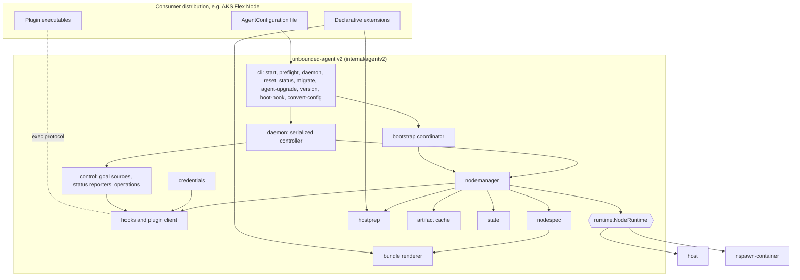

# Unbounded Agent v2: Pluggable Node Runtime

| Field | Value |
|---|---|
| Status | Draft for review |
| Scope | A new, experimental implementation of the unbounded agent with a defined interface for hosting kubelet, and a binary-level extension model for downstream consumers |
| Audience | Maintainers, AKS Flex Node maintainers, and reviewers of agent lifecycle changes |
| Repository baseline | `main` at `e132dfada0f40270a93abbd11ed4d70717e30010` |
| Date | 2026-11-02 |

## Documents

The design is split into the documents below. Read this README first.

| Document | Covers | Who should read it |
|---|---|---|
| This README | Purpose, how v1 and AKS Flex Node work today, goals, open questions, architecture overview, terms | Everyone |
| [01. CLI and configuration](01-cli-and-configuration.md) | The `v2` commands, the configuration file, install-time and goal settings, credentials | Consumers such as AKS Flex Node |
| [02. Extensions](02-extensions.md) | Lifecycle hooks, declarative extensions, the plugin protocol, and how each AKS Flex Node customization maps onto them | Consumers |
| [03. Node runtime](03-node-runtime.md) | The `NodeRuntime` interface and its rules, the node bundle, slot states, boot units, the two runtimes | Reviewers of the runtime interface |
| [04. Control and state](04-control-and-state.md) | Goal sources, status, credentials, the node manager, state files, the daemon's reconcile, MachineOperations | Reviewers of agent lifecycle changes |
| [05. Lifecycles](05-lifecycles.md) | Bootstrap, repave, NodeReboot, AgentUpgrade and reset, step by step | Reviewers of agent lifecycle changes |
| [06. Host changes](06-host-changes.md) | Everything v2 creates on a host, the host network reset, host preparation and how reset reverses it | Consumers, and host and OS reviewers |
| [07. Host runtime cleanup](07-host-runtime-cleanup.md) | How the `host` runtime stops, cleans up and removes a node | Host and OS reviewers |
| [08. v1 compatibility](08-v1-compatibility.md) | Parity with v1, intended behavior changes, copied code, changes outside `internal/agentv2`, converting a v1 configuration | v1 maintainers |
| [09. Implementation](09-implementation.md) | Package layout, export policy, risks | Implementers |
| [10. Migrating from v1](10-migration-from-v1.md) | How a v1 host, or a host built by another `pkg/agent` consumer, moves to v2 without replacing its node, and the cutover at the first official v2 release | v1 maintainers, AKS Flex Node maintainers, operators |
| [11. Testing](11-testing.md) | Unit and golden tests, running the v1 end-to-end suites on v2, the migration suite, checking reset with a host snapshot, CI and validation tasks | Everyone |

Please focus review comments on the external contract in documents 01 and 02,
the interfaces in documents 03 and 04, document 07, the migration path in
document 10, and the testing plan in document 11.

Documents 01 and 02, and section 1 of document 06, are what a consumer builds
against. Everything in them is versioned and experimental until the
[export policy](09-implementation.md#2-export-policy) promotes it.

Code citations are `file:line` against the baseline above. Statements that rely
on upstream behavior (Kubernetes, containerd, CNI, systemd, the kernel) rather
than code in this repository are marked *(inference)*. The Go in these
documents is a sketch of the intended shape. Names may change during
implementation; the contracts should not.

## 1. Purpose and context

The unbounded agent (`unbounded-agent`) bootstraps a host and runs a
Kubernetes worker node on it. Today that node always runs inside a
systemd-nspawn container. We want an agent with a clearly defined interface
for starting and managing kubelet, so the node can run either directly on the
host or in an nspawn container, without the rest of the agent caring which.

We also want to change how downstream projects consume the agent. AKS Flex
Node currently imports `pkg/agent` and builds its own agent from the pieces.
The goal is for consumers to use the agent *binary*, customizing it through
well-defined hook points.

This design proposes v2: a new implementation, shipped inside the existing
binary under a `v2` subcommand, marked experimental.

### 1.1 The v1 agent

v1 is organized in four layers:

- **Commands.** `start`, `preflight`, `daemon`, `reset` and `version`, plus
  hidden `agent-upgrade` (`cmd/agent/internal/cmd/agentupgrade.go:70`),
  `nspawn-lifecycle` and `record-agent-upgrade-failure-signal`
  (`cmd/agent/internal/cmd/cmd.go:30-39`).
- **Bootstrap coordinator.** Runs `PrepareHost`, `PrepareRootFS`,
  `EnsureNodeStarted` and `EnsureDaemonInstalled` under an install lock and an
  install record that classifies each run as fresh, resumed or complete
  (`cmd/agent/internal/bootstrap/coordinator.go`: the stages at `:29-38`, the
  lock at `:72`, the classification at `:83-115` and the stage loop at
  `:126-135`).
- **Goal state and phases.** Configuration resolves to
  `MachineGoalState{RootFS, NodeStart}` (`pkg/agent/goalstates/resolve.go:37-40`).
  Work is composed from `phases.Task` values (`pkg/agent/phases/phases.go:17-20`)
  with `Serial` (`:62`) and `Parallel` (`:87`).
- **Daemon.** A controller-runtime manager that repaves when its Node is
  deleted and handles the `NodeReboot`, `AgentUpgrade`, `AgentReset` and
  `HostOSReboot` MachineOperations (`cmd/agent/internal/daemon/controller.go:95`,
  `controller_machineoperation.go:45-51`). Node work goes through an
  unexported `nodeOperator` interface
  (`cmd/agent/internal/daemon/nodeoperator.go:38-76`).

### 1.2 Where nspawn is built in

The nspawn assumption appears in every layer, which is why v2 is a new
implementation rather than a switch added to v1.

| Layer | Coupling | Citation |
|---|---|---|
| Goal state | `RootFS` carries nspawn file paths; the machine directory is `/var/lib/machines/<m>`; `NodeStart.MachineName` is the `systemd-run` target | `pkg/agent/goalstates/rootfs.go:11-58`, `resolve.go:86-97`, `nodestart.go:6-9` |
| Writing node files | Every node file is written from the host into the machine directory | e.g. `pkg/agent/phases/nodestart/kubelet.go:75` |
| Running commands in the node | Every command goes through `systemd-run --machine=<m> --pipe --wait` | `internal/executil/exec.go:258-267` |
| Bootstrap | Always targets `kube1`, and skips building the rootfs when `machinectl list` shows the machine is registered. The same check decides whether to save the applied config. | `cmd/agent/internal/cmd/bootstrap.go:92` (target), `:161` (rootfs), `:220` (applied config), `pkg/agent/phases/reset/machine.go:256` (`machinectl list`) |
| Host preparation | Masks the host `containerd` and `kubelet` units, which a host runtime needs | `bootstrap.go:111`, `pkg/agent/phases/host/disable_systemd_unit.go:36-43` |
| Daemon | Defaults to the nspawn operator, and hardcodes it in `RepairDaemon`; repave alternates `kube1` and `kube2` | `cmd/agent/internal/daemon/daemon.go:101`, `lifecycle.go:461`, `nodeoperator.go:262-310` |
| Reset | Hardcodes `kube1` and `kube2` and the nspawn teardown | `cmd/agent/internal/daemon/reset.go:168-195` |
| Boot hooks | Around `systemd-nspawn@<m>`, systemd runs `nspawn-lifecycle pre-start` as a separate oneshot unit and `post-start` as `ExecStartPost` | Wiring: `pkg/agent/phases/rootfs/assets/service-override.conf:37-38,48`, `config-regeneration.service:11`. Code: `pkg/agent/nspawnlifecycle/lifecycle.go:67-129` |

### 1.3 How AKS Flex Node consumes v1 today

This summary is based on `github.com/Azure/AKSFlexNode` at `main`
(`2c149e991fee3ff59f4180b5c5a6a3b3108bc012`), which pins unbounded `v0.18.0`.

Flex translates its own configuration schema into `pkg/agent/config` types and
then composes its own agent from `pkg/agent` packages: its own task graphs for
host setup, start, reboot, repave and reset; its own daemon around
`daemon.SetupController`; and its own upgrade orchestration over
`pkg/agent/agentbinary`. Its own additions, such as an ARM Machine backend,
exec credentials, static routes and Node Problem Detector, are listed with
their v2 equivalents in [extensions, section 5](02-extensions.md#5-mapping-aks-flex-node-customizations).

Several patterns in Flex point to missing extension points:

- It copies unbounded's list of host tasks so it can add its own
  (`pkg/daemon/start.go`), so new unbounded host tasks are silently missed.
- It re-composes the node start sequence in three places (`pkg/daemon/start.go`,
  `pkg/daemon/nodeoperator.go`).
- It writes content directly into the machine directory after provisioning
  (`pkg/daemon/install.go`, `pkg/npd/download.go`).
- Its `scripts/uninstall.sh` hardcodes unbounded unit and path names.
- It copies an unexported marker name from unbounded's `internal/hostroot`
  (`pkg/daemon/hostroot_move.go`).

Flex needs about a dozen customization points. It does not need the whole
library.

### 1.4 Terms

| Term | Meaning |
|---|---|
| Host | The machine the agent runs on: a virtual machine or a bare-metal server. |
| Node | The Kubernetes worker: kubelet, containerd, LocalDNS and the pods they run. In v1 it always runs in an nspawn container on the host. |
| Runtime | Where the node runs: directly on the host (`host`) or in an nspawn container (`nspawn-container`). [Node runtime, section 1](03-node-runtime.md#1-node-runtime) defines the interface. |
| Slot | One of two places, `a` and `b`, where a runtime keeps a node's content. One slot holds the running node; the other is used to build a replacement during a repave. For `nspawn-container`, a slot is a whole machine, v1's `kube1` or `kube2`, including the node's state. For `host`, a slot holds only staged binaries and rendered files; the node's state lives in shared host paths and is wiped on a slot change. |
| Repave | Replacing the node with a new one, built from the desired configuration in the other slot. The new node registers with Kubernetes as a fresh Node. A repave is triggered by deleting the Kubernetes Node object ([control and state, section 5](04-control-and-state.md#5-daemon-reconcile)). Not to be confused with `kubectl unbounded machine repave`, which creates a `HostReplace` MachineOperation (`cmd/kubectl-unbounded/app/machine_repave.go:24-25,47`). |
| Goal | The desired configuration for this machine, from machina, a plugin or the configuration file. It carries only goal settings, not install-time settings ([CLI and configuration, section 2](01-cli-and-configuration.md#install-time-settings-and-goal-settings)). Its version is an opaque label from the goal source, compared for equality only. Whether to repave depends on the settings, not the version: a machina version can be edited in place (issue #1038). |
| Drift | A difference between the goal and the applied configuration that needs a repave to take effect, such as a new Kubernetes version. |
| Bundle | The rendered description of one node: files, binaries, units and start order ([node runtime, section 2](03-node-runtime.md#2-node-spec-and-bundle)). Not related to v1's offline artifact bundles. |
| Node manager | The runtime-independent component that drives bootstrap, repave, reboot and reset by calling the runtime ([control and state, section 3](04-control-and-state.md#3-node-manager)). |
| Reset | Removing the node, the agent and everything they created from the host ([lifecycles, section 6](05-lifecycles.md#6-reset)). The runtime's part of a reset is its `Teardown` method; [host runtime cleanup, section 9](07-host-runtime-cleanup.md#9-teardown) describes it for the `host` runtime. |
| Slot change | For the `host` runtime, starting a slot whose content differs from what last ran. The runtime wipes node state first ([host runtime cleanup, section 8](07-host-runtime-cleanup.md#8-wipe-and-slot-changes)). |
| Enabled slot | The slot systemd starts at boot. `Start` enables a slot and `Stop` disables it ([node runtime, section 1](03-node-runtime.md#1-node-runtime)). |
| Old and new slot | During a repave, the slot the running node is in and the slot its replacement is built in ([lifecycles, section 2](05-lifecycles.md#2-repave)). |
| Bundle manifest | The record of a provisioned bundle, saved in its slot by `Provision`, from which boot hooks and `Recover` work without rendering again ([node runtime, section 2](03-node-runtime.md#2-node-spec-and-bundle)). |
| Boot unit | The unit that must start before a runtime's node does, and that host-side prerequisites attach to ([node runtime, section 4](03-node-runtime.md#4-host-boot-and-boot-units)). |
| Boot hook | Runtime-owned work that systemd runs around the boot unit, through `v2 boot-hook`. Not a lifecycle hook ([node runtime, section 4](03-node-runtime.md#4-host-boot-and-boot-units)). |
| Lifecycle hook | A plugin call at a fixed point in a lifecycle, such as `node.start.after` ([extensions, section 1](02-extensions.md#lifecycle-hook-events)). |
| Install-time and goal settings | The two parts of the configuration. Install-time settings, such as the runtime and plugins, change only through a reset; goal settings can come from a goal source ([CLI and configuration, section 2](01-cli-and-configuration.md#install-time-settings-and-goal-settings)). |
| Applied state | `state.Applied`: the goal version, settings and bundle digest of the running node, and any approved repave ([control and state, section 4](04-control-and-state.md#4-state)). |
| Approved repave | A repave the daemon has approved by seeing the Node deleted with drift, saved as `state.Applied.Repave` until it commits ([control and state, section 4](04-control-and-state.md#4-state)). |
| Install record | v2's record of its installation, `/var/lib/unbounded/agent-v2/install.json`, which also tells v1 and v2 apart on a host ([host changes, section 1](06-host-changes.md#1-what-v2-creates-on-the-host)). |
| Undo log | The host preparation undo log, replayed by reset ([host changes, section 3](06-host-changes.md#3-host-preparation-and-its-reversal)). |
| Host network reset | The node manager's cleanup of links, routes, rules and firewall state after a node stops ([host changes, section 2](06-host-changes.md#2-host-network-reset)). |
| Ownership record and active-slot record | The `host` runtime's records of the host paths it owns and of the slot installed into them ([host runtime cleanup, sections 3 and 8](07-host-runtime-cleanup.md#3-ownership-and-adoption)). |
| Leftover | Something a cleanup could not remove, reported rather than ignored ([host runtime cleanup, section 10](07-host-runtime-cleanup.md#10-post-conditions)). |
| Release N and the first official v2 release | The last v1 release, and the release after it, which replaces v1 with v2 ([migrating from v1, section 2](10-migration-from-v1.md#2-release-plan-and-cutover)). |

## 2. Goals and non-goals

### 2.1 Goals

- **G1.** One interface for hosting a Kubernetes node, with two
  implementations: `host` and `nspawn-container`.
- **G2.** The same features and outcomes as v1 ([v1 compatibility, section 1](08-v1-compatibility.md#1-parity-with-v1)), except for the
  behavior changes listed, each with its reason, in [v1 compatibility, section 2](08-v1-compatibility.md#2-behavior-changes-from-v1).
- **G3.** Consumers customize the agent binary through hook points. They do
  not link against agent Go packages.
- **G4.** v1 behavior is unchanged, apart from the small changes listed in
  [v1 compatibility, section 4](08-v1-compatibility.md#4-existing-packages-used-as-libraries). v2 is opt-in through `unbounded-agent v2 ...` until
  the first official v2 release, which replaces v1.
- **G5.** Code is internal by default. Exporting any of it is an explicit,
  recorded decision ([implementation, section 2](09-implementation.md#2-export-policy)).
- **G6.** Existing v1 hosts move to v2 without replacing their node, with a
  safe rollback: early, started from the cluster or the host, or at the first
  official v2 release, when every remaining v1 host moves
  ([migrating from v1](10-migration-from-v1.md)).

### 2.2 Non-goals

- Other runtime kinds, including virtual machines. The runtime kind is an open
  set, but nothing in the interface is designed for a specific future kind.
- Machina API changes.
- Changing `pkg/agent` behavior for its existing consumers, apart from the
  additive v2 detection check ([v1 compatibility, section 4](08-v1-compatibility.md#4-existing-packages-used-as-libraries)).

## 3. Open questions

No questions are open at the moment.

## 4. Architecture overview

Data flows in three steps:

1. The `AgentConfiguration` and bootstrap credentials resolve to a `NodeSpec`:
   *what* to run.
2. The `NodeSpec`, the runtime's `Layout(slot)` and the resolved extensions
   render to a `NodeBundle`.
3. The bundle is handed to `NodeRuntime.Provision(slot, bundle)`, which decides
   *where* it runs.

Why node content is a declarative bundle, even with only two runtimes:

- The `host` runtime needs an exact record of what it installed, for cleanup
  and for deciding when a node must start with fresh state.
- A bundle can be staged into the inactive slot while the active node keeps
  running.
- Rendering is a pure function, so it can be tested against v1's golden files.
- Extensions merge into the bundle, replacing Flex's pattern of writing into
  the machine directory after provisioning.

Both runtimes share the host kernel and the host network namespace with the
node. The node manager relies on this: it configures host sysctls for the node
and cleans host network state after stopping a node. A future runtime that
breaks this assumption would need to add a capability to the interface.
