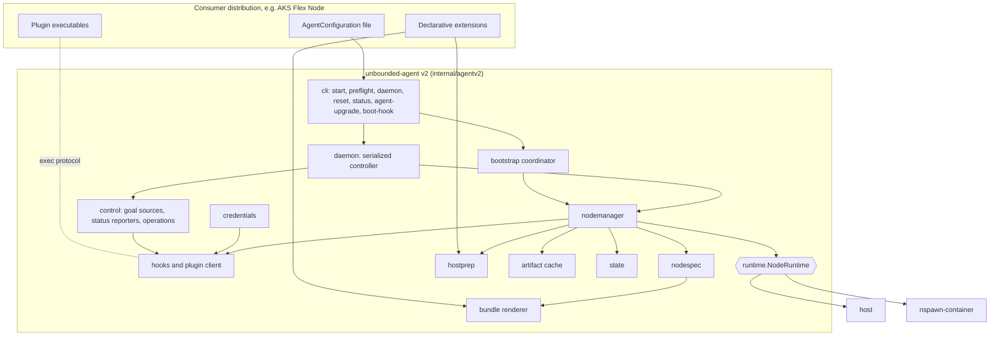

# Unbounded Agent v2: Pluggable Node Runtime

| Field | Value |
|---|---|
| Status | Draft for review |
| Scope | A new, experimental implementation of the unbounded agent with a defined interface for hosting kubelet, and a binary-level extension model for downstream consumers |
| Audience | Maintainers, AKS Flex Node maintainers, and reviewers of agent lifecycle changes |
| Repository baseline | `main` at `dca6c964d1d4d03614fe190fcd60ce49c380e914` |
| Date | 2026-10-29 |

## Documents

The design is split into the documents below. Read this README first.

| Document | Covers | Who should read it |
|---|---|---|
| This README | Purpose, how v1 and AKS Flex Node work today, goals, open questions, architecture overview, terms | Everyone |
| [01. CLI and configuration](01-cli-and-configuration.md) | The `v2` commands, the configuration file, install-time and goal settings, credentials | Consumers such as AKS Flex Node |
| [02. Extensions](02-extensions.md) | Lifecycle hooks, declarative extensions, the plugin protocol, and how each AKS Flex Node customization maps onto them | Consumers |
| [03. Node runtime](03-node-runtime.md) | The `NodeRuntime` interface and its rules, the node bundle, slot states, boot units, the two runtimes | Reviewers of the runtime interface |
| [04. Control and state](04-control-and-state.md) | Goal sources, status, credentials, the node manager, state files, the daemon's reconcile, MachineOperations | Reviewers of agent lifecycle changes |
| [05. Lifecycles](05-lifecycles.md) | Bootstrap, repave, NodeReboot, AgentUpgrade and reset, step by step | Reviewers of agent lifecycle changes |
| [06. Host changes](06-host-changes.md) | Everything v2 creates on a host, the host network reset, host preparation and how reset reverses it | Consumers, and host and OS reviewers |
| [07. Host runtime cleanup](07-host-runtime-cleanup.md) | How the `host` runtime stops, cleans up and removes a node | Host and OS reviewers |
| [08. v1 compatibility](08-v1-compatibility.md) | Parity with v1, intended behavior changes, copied code, changes outside `internal/agentv2`, converting a v1 configuration | v1 maintainers |
| [09. Implementation](09-implementation.md) | Package layout, export policy, testing and validation, risks | Implementers |

Please focus review comments on the open questions (section 3), the external
contract in documents 01 and 02, the interfaces in documents 03 and 04, and
document 07.

Documents 01 and 02, and section 1 of document 06, are what a consumer builds
against. Everything in them is versioned and experimental until the
[export policy](09-implementation.md#2-export-policy) promotes it.

Code citations are `file:line` against the baseline above. Statements that rely
on upstream behavior (Kubernetes, containerd, CNI, systemd, the kernel) rather
than code in this repository are marked *(inference)*. The Go in these
documents is a sketch of the intended shape. Names may change during
implementation; the contracts should not.

## 1. Purpose and context

The unbounded agent (`unbounded-agent`) bootstraps a host and runs a
Kubernetes worker node on it. Today that node always runs inside a
systemd-nspawn container. We want an agent with a clearly defined interface
for starting and managing kubelet, so the node can run either directly on the
host or in an nspawn container, without the rest of the agent caring which.

We also want to change how downstream projects consume the agent. AKS Flex
Node currently imports `pkg/agent` and builds its own agent from the pieces.
The goal is for consumers to use the agent *binary*, customizing it through
well-defined hook points.

This design proposes v2: a new implementation, shipped inside the existing
binary under a `v2` subcommand, marked experimental.

### 1.1 The v1 agent

v1 is organized in four layers:

- **Commands.** `start`, `preflight`, `daemon`, `reset` and `version`, plus
  hidden `agent-upgrade` (`cmd/agent/internal/cmd/agentupgrade.go:70`),
  `nspawn-lifecycle` and `record-agent-upgrade-failure-signal`
  (`cmd/agent/internal/cmd/cmd.go:30-39`).
- **Bootstrap coordinator.** Runs `PrepareHost`, `PrepareRootFS`,
  `EnsureNodeStarted` and `EnsureDaemonInstalled` under an install lock and an
  install record that classifies each run as fresh, resumed or complete
  (`cmd/agent/internal/bootstrap/coordinator.go`: the stages at `:29-38`, the
  lock at `:72`, the classification at `:83-115` and the stage loop at
  `:126-135`).
- **Goal state and phases.** Configuration resolves to
  `MachineGoalState{RootFS, NodeStart}` (`pkg/agent/goalstates/resolve.go:37-40`).
  Work is composed from `phases.Task` values (`pkg/agent/phases/phases.go:17-20`)
  with `Serial` (`:62`) and `Parallel` (`:87`).
- **Daemon.** A controller-runtime manager that repaves when its Node is
  deleted and handles the `NodeReboot`, `AgentUpgrade` and `AgentReset`
  MachineOperations (`cmd/agent/internal/daemon/controller.go:95-99`). Node
  work goes through an unexported `nodeOperator` interface
  (`cmd/agent/internal/daemon/nodeoperator.go:37-70`).

### 1.2 Where nspawn is built in

The nspawn assumption appears in every layer, which is why v2 is a new
implementation rather than a switch added to v1.

| Layer | Coupling | Citation |
|---|---|---|
| Goal state | `RootFS` carries nspawn file paths; the machine directory is `/var/lib/machines/<m>`; `NodeStart.MachineName` is the `systemd-run` target | `pkg/agent/goalstates/rootfs.go:11-58`, `resolve.go:86-97`, `nodestart.go:6-9` |
| Writing node files | Every node file is written from the host into the machine directory | e.g. `pkg/agent/phases/nodestart/kubelet.go:75` |
| Running commands in the node | Every command goes through `systemd-run --machine=<m> --pipe --wait` | `internal/executil/exec.go:258-267` |
| Bootstrap | Always targets `kube1`, and skips building the rootfs when `machinectl list` shows the machine is registered. The same check decides whether to save the applied config. | `cmd/agent/internal/cmd/bootstrap.go:92` (target), `:161` (rootfs), `:220` (applied config), `pkg/agent/phases/reset/machine.go:256` (`machinectl list`) |
| Host preparation | Masks the host `containerd` and `kubelet` units, which a host runtime needs | `bootstrap.go:111`, `pkg/agent/phases/host/disable_systemd_unit.go:36-43` |
| Daemon | Defaults to the nspawn operator, and hardcodes it in `RepairDaemon`; repave alternates `kube1` and `kube2` | `cmd/agent/internal/daemon/daemon.go:101`, `lifecycle.go:461`, `nodeoperator.go:248-296` |
| Reset | Hardcodes `kube1` and `kube2` and the nspawn teardown | `cmd/agent/internal/daemon/reset.go:168-195` |
| Lifecycle hooks | Around `systemd-nspawn@<m>`, systemd runs `nspawn-lifecycle pre-start` as a separate oneshot unit and `post-start` as `ExecStartPost` | Wiring: `pkg/agent/phases/rootfs/assets/service-override.conf:37-38,48`, `config-regeneration.service:11`. Code: `pkg/agent/nspawnlifecycle/lifecycle.go:67-129` |

### 1.3 How AKS Flex Node consumes v1 today

This summary is based on `github.com/Azure/AKSFlexNode` at `main`
(`2c149e991fee3ff59f4180b5c5a6a3b3108bc012`), which pins unbounded `v0.18.0`.

Flex translates its own configuration schema into `pkg/agent/config` types and
then composes its own agent from `pkg/agent` packages: its own task graphs for
host setup, start, reboot, repave and reset; its own daemon around
`daemon.SetupController`; and its own upgrade orchestration over
`pkg/agent/agentbinary`. Its own additions, such as an ARM Machine backend,
exec credentials, static routes and Node Problem Detector, are listed with
their v2 equivalents in [extensions, section 5](02-extensions.md#5-mapping-aks-flex-node-customizations).

Several patterns in Flex point to missing extension points:

- It copies unbounded's list of host tasks so it can add its own
  (`pkg/daemon/start.go`), so new unbounded host tasks are silently missed.
- It re-composes the node start sequence in three places (`pkg/daemon/start.go`,
  `pkg/daemon/nodeoperator.go`).
- It writes content directly into the machine directory after provisioning
  (`pkg/daemon/install.go`, `pkg/npd/download.go`).
- Its `scripts/uninstall.sh` hardcodes unbounded unit and path names.
- It copies an unexported marker name from unbounded's `internal/hostroot`
  (`pkg/daemon/hostroot_move.go`).

Flex needs about a dozen customization points. It does not need the whole
library.

### 1.4 Terms

| Term | Meaning |
|---|---|
| Host | The machine the agent runs on: a virtual machine or a bare-metal server. |
| Node | The Kubernetes worker: kubelet, containerd, LocalDNS and the pods they run. In v1 it always runs in an nspawn container on the host. |
| Runtime | Where the node runs: directly on the host (`host`) or in an nspawn container (`nspawn-container`). [Node runtime, section 1](03-node-runtime.md#1-node-runtime) defines the interface. |
| Slot | One of two places, `a` and `b`, where a runtime keeps a node's content. One slot holds the running node; the other is used to build a replacement during a repave. For `nspawn-container`, a slot is a whole machine, v1's `kube1` or `kube2`, including the node's state. For `host`, a slot holds only staged binaries and rendered files; the node's state lives in shared host paths and is wiped on a slot change. |
| Repave | Replacing the node with a new one, built from the desired configuration in the other slot. The new node registers with Kubernetes as a fresh Node. A repave is triggered by deleting the Kubernetes Node object ([control and state, section 5](04-control-and-state.md#5-daemon-reconcile)). |
| Goal | The desired configuration for this machine, from machina, a plugin or the configuration file. Its version is an opaque value that changes whenever the goal does. |
| Drift | A difference between the goal and the applied configuration that needs a repave to take effect, such as a new Kubernetes version. |
| Bundle | The rendered description of one node: files, binaries, units and start order ([node runtime, section 2](03-node-runtime.md#2-node-spec-and-bundle)). Not related to v1's offline artifact bundles. |
| Node manager | The runtime-independent component that drives bootstrap, repave, reboot and reset by calling the runtime ([control and state, section 3](04-control-and-state.md#3-node-manager)). |
| Reset | Removing the node, the agent and everything they created from the host ([lifecycles, section 5](05-lifecycles.md#5-reset)). The runtime's part of a reset is its `Teardown` method; [host runtime cleanup, section 9](07-host-runtime-cleanup.md#9-teardown) describes it for the `host` runtime. |
| Slot change | For the `host` runtime, starting a slot whose content differs from what last ran. The runtime wipes node state first ([host runtime cleanup, section 8](07-host-runtime-cleanup.md#8-wipe-and-slot-changes)). |

## 2. Goals and non-goals

### 2.1 Goals

- **G1.** One interface for hosting a Kubernetes node, with two
  implementations: `host` and `nspawn-container`.
- **G2.** Feature parity with v1 ([v1 compatibility, section 1](08-v1-compatibility.md#1-parity-with-v1)), except for the intended
  behavior changes listed in [v1 compatibility, section 2](08-v1-compatibility.md#2-behavior-changes-from-v1).
- **G3.** Consumers customize the agent binary through hook points. They do
  not link against agent Go packages.
- **G4.** v1 behavior is unchanged, apart from the small changes listed in
  [v1 compatibility, section 4](08-v1-compatibility.md#4-existing-packages-used-as-libraries). v2 is opt-in through `unbounded-agent v2 ...`.
- **G5.** Code is internal by default. Exporting any of it is an explicit,
  recorded decision ([implementation, section 2](09-implementation.md#2-export-policy)).

### 2.2 Non-goals

- Other runtime kinds, including virtual machines. The runtime kind is an open
  set, but nothing in the interface is designed for a specific future kind.
- Machina API changes.
- In-place migration from v1 to v2. Switching a host requires a reset.
- Changing `pkg/agent` behavior for its existing consumers, apart from the
  additive v2 detection check ([v1 compatibility, section 4](08-v1-compatibility.md#4-existing-packages-used-as-libraries)).

## 3. Open questions

These are still open. Please focus review comments here. Everything else in
this design was settled in design discussion and an earlier review round.

1. **MachineOperation scoping ([control and state, section 6](04-control-and-state.md#6-machineoperation-handling)).** Is "fail only kinds that belong
   to the agent, meaning the current three plus any `Node*` or `Agent*` kind"
   the right rule? It relies on a naming convention for future kinds that the
   API does not currently document. The `OperationKind` enum is closed
   (`api/machina/v1alpha3/machineoperation_types.go:54`), although its comment
   says custom operations may be supported by individual cloud controllers
   (`:51-53`).
2. **Separate v2 state ([host changes, section 1](06-host-changes.md#1-what-v2-creates-on-the-host)).** v2 uses its own state directories,
   daemon units and locks, and shares the agent binary layout under
   `/opt/unbounded/agent/bin`. Some node-level names are the same as v1's:
   `kubelet.service`, `containerd.service`, `localdns.service`,
   `nftables-flush.service` and the `kube1`/`kube2` machines. That is one reason
   v1 and v2 cannot be installed on the same host, and each refuses to install
   over the other ([v1 compatibility, section 4](08-v1-compatibility.md#4-existing-packages-used-as-libraries)). The alternative is to share v1's state and
   daemon names too. Separate names avoid any confusion between the two, but the
   `-v2` names would need renaming if v2 later replaces v1.
3. **Default runtime ([CLI and configuration, section 2](01-cli-and-configuration.md#2-configuration)).** A configuration without `runtime.type` gets
   `nspawn-container`, which keeps machina provisioning unchanged. Should the
   field be required instead?
4. **Rendering templates ([v1 compatibility, section 3](08-v1-compatibility.md#3-code-copied-from-v1)).** v2 copies v1's templates and relies on
   golden tests for parity. The alternative is to add exported, render-only
   functions to `pkg/agent`, which avoids the copy but changes a public package.
5. **Boot hook binary ([node runtime, section 4](03-node-runtime.md#4-host-boot-and-boot-units)).** v1 runs its systemd hooks through a
   separate binary copy so they survive an upgrade rollback
   (`pkg/agent/phases/rootfs/lifecycle_helper.go:34-37`). Is the `current` link
   enough for v2's boot hooks, given the recovery unit restores `last-good` into
   `current`?
6. **The `Decide` behavior change ([control and state, section 5](04-control-and-state.md#5-daemon-reconcile)).** v2 compares the observed
   Node on every reconcile instead of reacting only to delete events. A Node
   deleted while the daemon was down therefore triggers a repave when the
   daemon returns. Is that the behavior we want?

## 4. Architecture overview

Data flows in three steps:

1. The `AgentConfiguration` and bootstrap credentials resolve to a `NodeSpec`:
   *what* to run.
2. The `NodeSpec`, the runtime's `Layout(slot)` and the resolved extensions
   render to a `NodeBundle`.
3. The bundle is handed to `NodeRuntime.Provision(slot, bundle)`, which decides
   *where* it runs.

Why node content is a declarative bundle, even with only two runtimes:

- The `host` runtime needs an exact record of what it installed, for cleanup
  and for deciding when a node must start with fresh state.
- A bundle can be staged into the inactive slot while the active node keeps
  running.
- Rendering is a pure function, so it can be tested against v1's golden files.
- Extensions merge into the bundle, replacing Flex's pattern of writing into
  the machine directory after provisioning.

Both runtimes share the host kernel and the host network namespace with the
node. The node manager relies on this: it configures host sysctls for the node
and cleans host network state after stopping a node. A future runtime that
breaks this assumption would need to add a capability to the interface.
