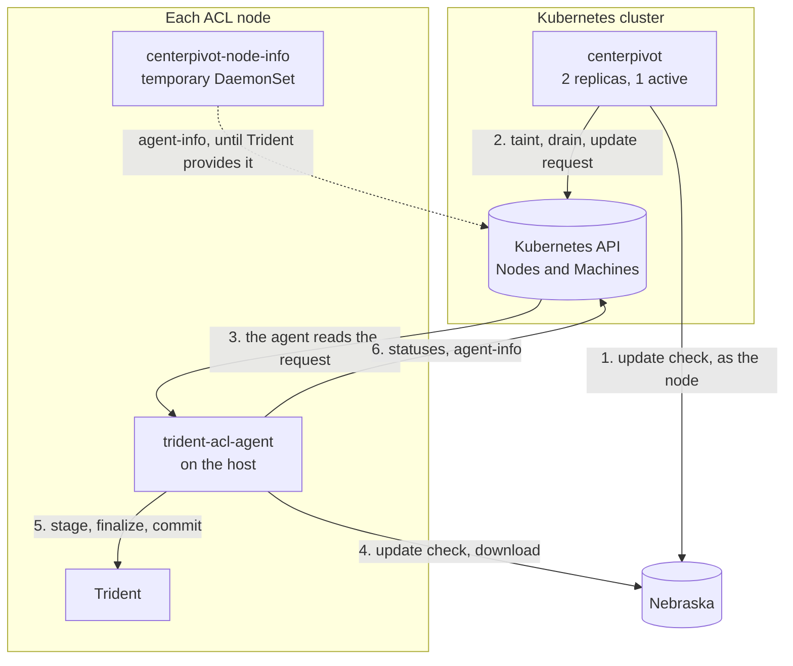
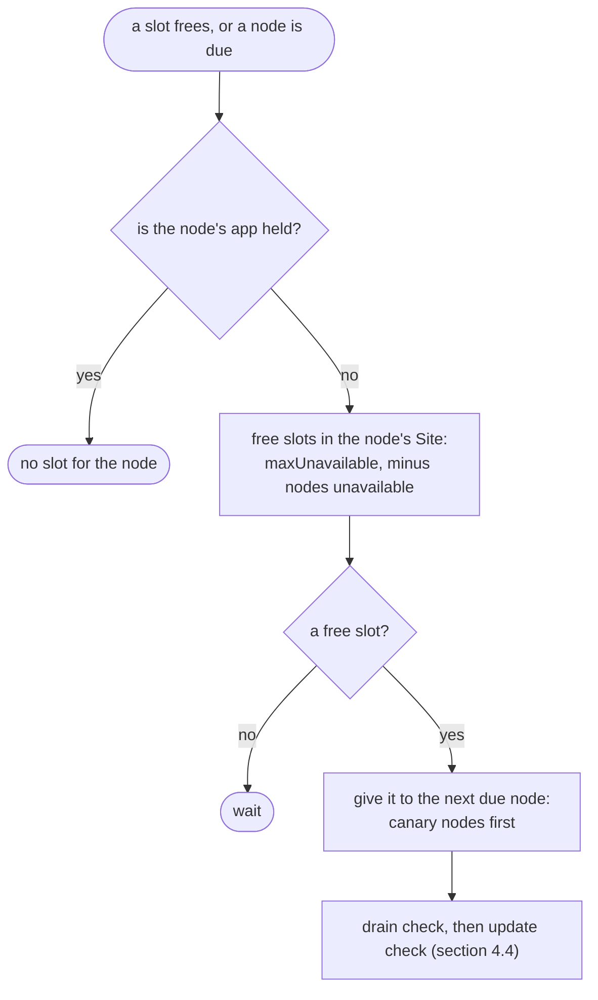
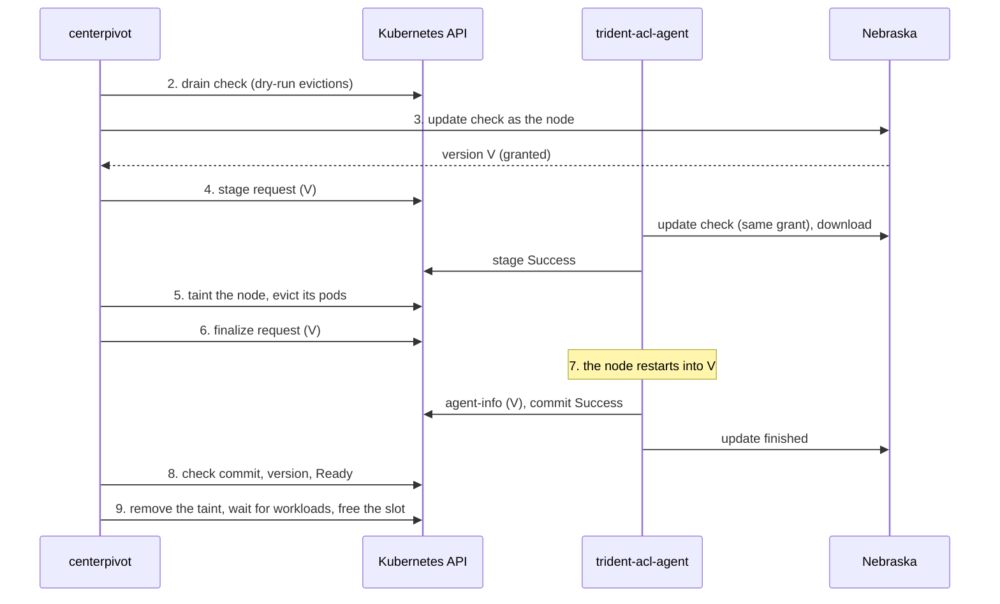
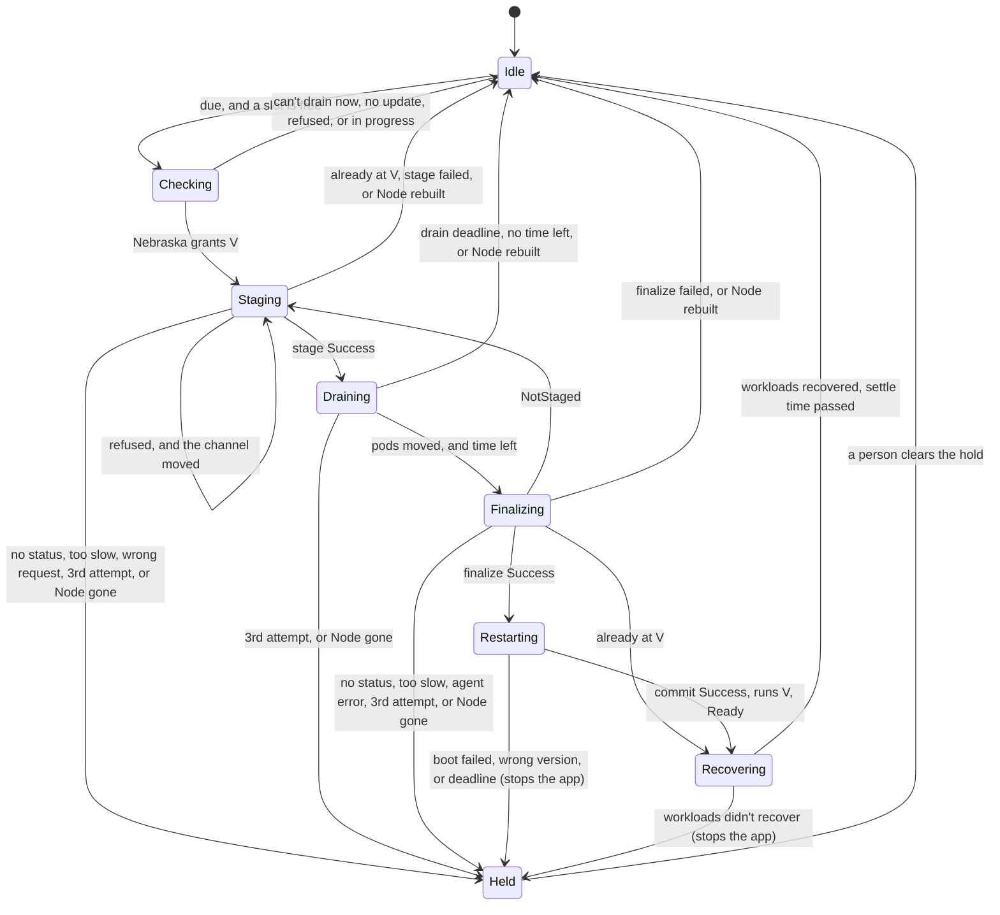

# Centerpivot: Updating Azure Container Linux Nodes from Nebraska

| Field | Value |
|---|---|
| Status | Draft for discussion |
| Scope | Automatic OS updates for Azure Container Linux (ACL) nodes, using Nebraska and `trident-acl-agent` |
| Audience | Unbounded maintainers, and the Trident and ACL teams |
| Repository baseline | `origin/main` at `1973dcf1a` |
| Date | 2026-11-18 |

## 1. Summary

ACL nodes update with an A/B update: the node writes the new OS into the copy
it isn't using, restarts into it, and keeps it if it boots. On each node,
`trident-acl-agent` runs the update when asked through annotations on the
node's Node object. Something in the cluster has to decide when each node
updates, and ask it. This document proposes that piece:

1. `centerpivot`, a service in the cluster. For each ACL node, it asks
   Nebraska, the update server ACL uses, whether a new version is ready. When
   one is, it moves the node's workloads elsewhere, asks the agent to install
   the version, and checks that the node came back running it.
2. `centerpivot-node-info`, a small temporary DaemonSet that publishes
   two facts about each node the service needs, until Trident provides them.

The service limits how many nodes in each Site update at once, drains nodes
with `kubectl drain`'s rules, and makes sure every update it starts in Nebraska
either finishes or is ended before Nebraska would count it as timed out.
Nebraska decides which version nodes get and how fast the fleet moves. When a
node doesn't come back healthy on a new version, the service stops updating
that image flavor until a person looks; a node whose update keeps failing
before its restart is held on its own.

The name comes from center-pivot irrigation, common on Nebraska's farms, which
brings fresh water to a field one section at a time.

## 2. Background

### 2.1 How an ACL node updates

`trident-acl-agent` reads one annotation on its Node and writes two, all under
a prefix set on the node
([Trident's annotation contract](https://github.com/microsoft/trident/blob/main/docs/Explanation/Trident-ACL-Agent.md#the-annotation-contract)):

1. `update-request`, written by the orchestrator, asks for `stage` (download the
   target version into the unused copy) or `finalize` (restart into it).
2. `update-status` reports the result of each request.
3. `update-commit-status` reports, after the restart, whether the node is
   running the new copy. The agent confirms this commit on its own.

A request names the target version and the Nebraska server, app ID, and track
to get it from. `nodeUpdateId` stays the same for one update's `stage`,
`finalize`, and commit; `operationId` is new for each request.

### 2.2 How Nebraska grants updates

A machine sends Nebraska an update check: its instance ID, its current version,
and a track, which Nebraska maps to a group. Each group follows a channel that
points at a version, and has rollout settings (Nebraska's
`backend/pkg/api/runtime/updates.go`, `GetUpdatePackage`):

1. **A check is a grant.** If the group's version is newer and its settings
   allow it, Nebraska answers with the update and records a grant for that
   instance. The grant counts against the group's limit until the machine
   reports the update finished or failed.
2. **A repeat check while granted** gets an update again, without using
   another slot of the group's limit. But Nebraska works out the version again
   from the group's current channel, so if the channel changed in between, the
   repeat check gets the new version.
3. **Once the machine reports download progress**, Nebraska answers further
   checks with "update in progress" until the machine reports the update
   finished or failed.
4. **Floors.** If the channel has floor versions, a grant is the next floor
   above the machine's version, not the channel's version. Reaching the
   channel's version can take several updates.
5. **Timeouts.** A grant that stays open longer than the group's update timeout
   counts as timed out. In safe mode, enough timeouts turn updates off for the
   whole group, in every cluster that uses it.
6. **Versions must be semver.** Nebraska refuses a check whose version isn't
   valid semver, and `trident-acl-agent` reports a version it can't parse as
   `0.0.0`, which is always offered an update. Semver ignores build metadata
   when comparing, so the part that changes with each build must be in the
   main version or the prerelease, not after a `+`.

So anyone who sends a check on a node's behalf must send exactly what the
node's agent sends, and must act on a grant right away.

## 3. Goals

1. Update ACL nodes automatically when Nebraska has a newer version for them.
2. Limit how many nodes in a Site update at once, and move workloads off a node
   before it restarts, without breaking a PodDisruptionBudget.
3. Let Nebraska decide which version nodes get, and how fast the fleet moves.
4. End every grant the service starts: finished, or reported failed, before
   Nebraska's timeout. Never create extra Nebraska instances.
5. Notice failed updates. Stop an image flavor's updates when a node doesn't
   come back healthy on its new version, and hold a node whose update keeps
   failing, until a person looks.

## 4. Design

### 4.1 Parts



1. **`centerpivot`** is an operator component, enabled per Site
   through `Site.Spec.Components`, like token-refresher. It runs as a
   Deployment in `unbounded-system` with two replicas, one active through
   leader election, on nodes it doesn't update, and reads its settings from
   the Site.
2. **`trident-acl-agent`** ships with ACL and runs on each host. Unbounded's
   host agent configures it (appendix, "Host agent").
3. **`centerpivot-node-info`** is a temporary DaemonSet (section 4.3).

This design covers ACL nodes that run kubelet in an nspawn machine, Unbounded's
default and what its ACL tests run. Unbounded also documents `container`
isolation for ACL. In that mode, the host's files in section 4.3 are mounted
into the node stack's container instead, and graceful node shutdown
(section 4.6) needs checking there too.

| Who | Controls |
|---|---|
| The service | How many nodes in each Site update at once, moving workloads first, and stopping after a failure. |
| Nebraska | Which version each group gets, in which order groups get it, the pace across the fleet, and pausing. |

### 4.2 Update slots

1. Each Site has `maxUnavailable` update slots: a number or a percentage of its
   managed nodes, one by default. A node takes a slot just before its update
   check, and keeps it until its update ends.
2. Nodes already unavailable for other reasons use slots too, each counted
   once: nodes that are not Ready, nodes someone else cordoned, and nodes whose
   Machine has an unfinished MachineOperation or no Node, as while it's
   rebuilt.
3. A node held after it restarted into a new version stops its app: no node of
   that app gets a slot, in any Site, until a person clears the hold. A node
   held for any other reason keeps only itself from updating (section 4.9).
4. A node whose last update left a grant to end gets no slot until it's ended
   (section 4.7).
5. Among the nodes due for a check, nodes labeled canary go first, then the
   node checked longest ago.
6. Slots are given out as soon as one frees, and every 30 seconds.



A node takes its slot *before* the update check because the check is the grant
(section 2.2). A node granted an update and then left waiting for a slot would
keep the grant open until it timed out. When Nebraska has nothing new, the node
gives the slot back at once, so a pass through the cluster with no update is a
series of quick checks.

### 4.3 Node identity

The service sends update checks as each node, so it needs two facts only the
host knows: the node's Nebraska instance ID, and the version the agent reports.
They are in one annotation on the Node, `centerpivot.unbounded-cloud.io/agent-info`:

```json
{
  "schemaVersion": "1.0",
  "machineId": "ebb9a2bb-9365-d34e-133f-8da0664e7366",
  "currentVersion": "3.0.20261106"
}
```

1. `machineId` is the ID the agent sends Nebraska: the first 16 bytes of the
   SHA-384 hash of the host's `/etc/machine-id`, written as a UUID
   (`crates/osutils/src/machine_id.rs` in Trident). It stays the same across
   the A/B switch, since both copies share the root partition. The service
   can't use the Node's `status.nodeInfo.machineID`: kubelet reads that inside
   the nspawn machine, which has its own `/etc/machine-id`.
2. `currentVersion` is the version the agent sends Nebraska, read from the
   running OS, and is left out if the agent couldn't read one. The service
   checks nothing for a node without it.
3. It is written when the node starts, and again when the values change.

Until Trident provides these (section 5.1), the DaemonSet writes the same
annotation. Unbounded's host agent binds the host's `/etc/machine-id`
read-only into an ACL node's nspawn machine at `/run/unbounded/host/machine-id`,
not over the machine's own, and systemd-nspawn already binds the host's
os-release at `/run/host/os-release`. The DaemonSet's pod reads both, computes
the ID the way the agent does, and reads the version from the same os-release
key as the agent, `VERSION_ID`. After a restart, the pod may write the new
version after the agent reports the commit, so the service waits for it rather
than reading it once.

### 4.4 An update, step by step

1. **Slot.** A due node gets a free slot (section 4.2).
2. **Drain check.** The service checks that the node could be drained now: the
   drain rules (section 4.6), and a dry-run eviction of each pod it would move.
   If not, it gives the slot back and records why. No grant was taken.
3. **Update check.** It sends Nebraska one check as the node: the instance ID
   and version from `agent-info`, the node's architecture (`arm64` sent as
   `aarch64`, as the agent does), and the server, the node's app ID, and the
   track the request will name. It never sends pings or progress events; the
   only event it sends is the one that ends a grant (section 4.7). Nebraska
   records the service's IP address for the node until the agent's next check.
   With no update, or a refusal, it gives the slot back. With "update in
   progress", it ends that update (section 4.7) and gives the slot back.
4. **Stage.** With a grant for version V, it writes a `stage` request at once.
   The agent's own check gets the same grant, and it downloads V into the
   unused copy while the node keeps running.
5. **Drain.** It taints the node with `centerpivot.unbounded-cloud.io/updating`
   (`NoSchedule`) and evicts its pods (section 4.6).
6. **Finalize.** If enough of the grant's time is left for the finalize and
   the restart (section 4.8), it writes `finalize`. Otherwise it ends the
   grant instead.
7. **Restart.** The agent restarts the node into V, commits, writes
   `update-commit-status`, and tells Nebraska the update finished.
8. **Check.** The service waits until the commit status is `Success`, the
   node's `agent-info` shows V, and the Node is Ready.
9. **Recover.** It removes its taint, then waits until the Deployments,
   StatefulSets, and ReplicaSets whose pods it moved have as many pods
   available as before the drain, or as many as they now want, if that's
   fewer, as after a scale-down. Then it waits a settle time, and gives the
   slot back. Pods of other controllers aren't tracked.



### 4.5 States

The service keeps each node's state in an annotation on its Machine,
`centerpivot.unbounded-cloud.io/state`, so it survives the Node being deleted to
rebuild it.



| State | What the service does | Leaves when | Deadline, and what happens at it |
|---|---|---|---|
| Idle | Nothing. | The node is due and gets a slot. | |
| Checking | The drain check, then the update check. | No update, a refusal, or a node it can't drain: back to Idle. A grant: Staging. "Update in progress": ends it, then Idle. | |
| Staging | Writes `stage`, and waits for its status. | `Success`: Draining. `AlreadyAtTarget`, or a failure: Idle. `InvalidRequest`: checks again, and stages the new version if the channel moved. | No status within the status deadline, or no final one within the stage deadline (section 4.8): holds the node. |
| Draining | Taints the node, and evicts its pods. | All pods moved and time left: Finalizing. | At the drain deadline, or with too little time left: removes the taint, and goes back to Idle. |
| Finalizing | Writes `finalize`. | `Success`: Restarting. `AlreadyAtTarget`: Recovering. `NotStaged`: Staging. A failure: Idle. | As in Staging, with the finalize deadline; holds the node, keeping the taint. |
| Restarting | Waits for the commit, the version, and Ready. | All three: Recovering. | At the restart deadline: holds the node, and stops its app. |
| Recovering | Removes its taint, and waits for the moved workloads, then the settle time. | Both: Idle, and the slot frees. | At the recovery deadline: holds the node, and stops its app. |
| Held | Nothing. | A person clears the hold. | |

Every way back to Idle or Held, except a finished update, ends the node's
grant (section 4.7). Every `stage` or `finalize` failure, every drain that
misses its deadline, and every drain left with too little time counts as an
attempt at V on that node. After 3 attempts, the node is held.

### 4.6 Moving workloads

Without a drain, Kubernetes moves pods off an unreachable node only after
5 minutes, by default, so they would wait out the restart on the node. The
service drains with `k8s.io/kubectl/pkg/drain`, the code behind
`kubectl drain`, and its rules:

| Pods | The drain |
|---|---|
| Static pods | Skips them. |
| DaemonSet pods | Skips them, as `kubectl drain --ignore-daemonsets` does. They restart with the node. |
| Pods with `emptyDir` data | Refuses, unless the "delete `emptyDir` data" setting is on (`--delete-emptydir-data`). |
| Pods with no controller | Refuses, unless the "move pods with no controller" setting is on (`--force`). |
| Every other pod | Evicts it through the eviction API, so PodDisruptionBudgets apply, with its own grace period. Refused evictions are tried again until the drain deadline. |

The service marks the node with its own `NoSchedule` taint rather than
cordoning it, so it never removes a cordon someone else set.

A drain that misses its deadline, despite the drain check, ends the grant at
once rather than waiting: the node starts again at a later check, and the
update downloads again. Repeated blocked drains hold that node, and only it
(section 4.5).

After the drain, only DaemonSet and static pods remain; they stop when the node
restarts. Kubelet's graceful node shutdown lets them stop cleanly, once we've
confirmed it works with kubelet inside the nspawn machine.

For applications, this means:

1. Two or more replicas and a PodDisruptionBudget keep an application available
   through updates. With one replica, it is out of service while its pod starts
   elsewhere, once per update of its node.
2. Pods with `emptyDir` data or no controller keep their node from updating
   until an administrator turns on the matching setting, and so does a budget
   that never allows an eviction. An Event on the Node, and the reason in the
   Machine's `state`, name them.

### 4.7 Ending a grant

When an update stops without finishing, the service ends its grant itself. As
the node, it sends Nebraska the event the agent sends when an update fails
(`report_failure` in Trident's `core/nebraska/client.rs`: "update complete",
with an error result), with the instance ID, app, track, and version of the
check that took the grant. Nebraska then counts the update as failed rather
than in progress, and the node's next check may be granted again. The node
keeps running its current version, and the next update overwrites anything
staged.

1. **It works whatever the agent did.** Nebraska accepts the event from the
   grant until the update finishes or fails, so it ends a grant the agent never
   started, as when the agent isn't configured or isn't running, as well as one
   it left partway.
2. **It's safe to repeat.** Nebraska ignores the event when no update is in
   progress, as when the agent already reported the failure, and an event never
   takes a grant. So the service sends it whenever an update stops without
   finishing, without needing to know what the agent reported.
3. **It's recorded.** The state records the grant to end before the event is
   sent, and keeps it through Idle and Held until Nebraska acknowledges the
   event. The node gets no slot until then. Nebraska acknowledges every event
   it reads, whether or not it changed anything, so the acknowledgment
   confirms only that Nebraska knew the app and track.
4. **An agent that starts late can't take a new grant.** An Idle or Held node
   carries no request, so the agent finds nothing to do.

The service ends a grant when:

1. a stage or finalize fails, or a drain misses its deadline;
2. too little of the grant's time is left to finalize and restart
   (section 4.8);
3. the agent doesn't answer or finish a request in time, or the Node is
   rebuilt or gone;
4. it holds the node;
5. its update check finds "update in progress", from an update interrupted
   earlier, or gets no answer, in case the check reached Nebraska.

Each ended grant is recorded in Nebraska as a failed update of that node
(section 5.3).

### 4.8 Timing

An update holds its grant from the service's update check until the agent
reports the update finished, after the restart. Each step has a deadline:

| Step | Deadline | Default |
|---|---|---|
| Stage | The agent's stage timeout, 20 minutes, plus the status deadline | 25 minutes |
| Drain | The drain deadline | 30 minutes |
| Finalize | The agent's finalize timeout, 10 minutes, plus the status deadline | 15 minutes |
| Restart | The restart deadline | 30 minutes |

The host agent sets the agent's two timeouts, so they stay what the service
expects. The Site's `updateTimeout` must be no longer than the update timeout
of the nodes' Nebraska groups, and the four deadlines, plus 10 minutes, must
fit in it: with the defaults, 100 minutes plus 10 fits the default of 2 hours.
The Site's CRD refuses settings that don't fit, and the service gives a Site
whose settings don't fit no slots.

So every update ends its grant at least 10 minutes before Nebraska would count
it as timed out. As a check, before writing `finalize`, the service confirms
that the time since the grant, plus the finalize and restart deadlines, still
fits. If not, it ends the grant and counts an attempt. With settings that fit,
that happens only if the service itself stopped for a while.

### 4.9 Failures and holds

| What happens | What the service does | Hold |
|---|---|---|
| `stage` reports `AlreadyAtTarget` | The node already runs V: back to Idle. The service's check took a grant with the older version `agent-info` showed, so it ends that grant. | |
| `stage` reports `OperationFailed` or `AgentInternalError` | Back to Idle; counts an attempt. | The node, after 3 attempts |
| `stage` reports `InvalidRequest` | Checks Nebraska again. If the channel moved, so the grant is now for another version, stages that, keeping the grant's time. Otherwise holds the node: the request is wrong. | The node |
| `finalize` reports `OperationFailed` | Removes the taint, back to Idle; counts an attempt. | The node, after 3 attempts |
| `finalize` reports `AgentInternalError` or `InvalidRequest` | Holds the node and keeps the taint. After `AgentInternalError`, the node may be set to start from the new copy at its next restart. | The node |
| `finalize` reports `NotStaged` | Stages again. | |
| `finalize` reports `AlreadyAtTarget` | The node already runs V, so no restart follows: it removes the taint, and waits for the workloads, as after a restart. Nothing reports the update to Nebraska, so it ends the grant. | |
| No status within the status deadline | The agent isn't answering: holds the node. | The node |
| `InProgress` past the stage or finalize deadline | The agent is stuck, or keeps restarting, since it writes `InProgress` again each time it starts: holds the node. | The node |
| The Node is gone past the restart deadline, before the restart | Holds the node. | The node |
| The commit reports `TargetBootFailed` | Holds the node. | The app |
| The commit reports `Success`, but `agent-info` still shows another version at the restart deadline (microsoft/trident#956) | Holds the node. | The app |
| The Node isn't Ready, or no commit status arrives, by the restart deadline | Holds the node. | The app |
| The moved workloads haven't recovered by the recovery deadline | Holds the node. | The app |

Holding a node means the service stops checking for it, removes its taint
unless the node may be set to start from the new copy, ends its grant, and
records the reason in the Machine's `state`.

1. **A hold after the node restarted into the new version stops its app.** No
   node of that app gets a slot, in any Site, since the version may be bad.
2. **Any other hold keeps only its node from updating.** Its update stopped
   before the restart, so nothing points at the version.

A person clears a hold by removing the Machine's `state` annotation, and the
service's next attempt uses new request IDs. It doesn't retry by itself: a
node hold needs a person to fix what kept the update from running, and after a
fallback, Nebraska may already list the update as finished and would offer the
same version again.

The agent reports a failed boot to Nebraska itself, so Nebraska's own safe
mode and statistics see it across clusters.

To make a stop visible:

1. The component's `CenterPivotReady` condition on each Site turns false with
   reason `UpdatesHeld` while a hold stops an app, naming the node and why. A
   node held on its own is named in the condition's message.
2. The service exports metrics: nodes per app and version
   (`centerpivot_nodes`), updates under way (`centerpivot_updating_nodes`),
   held nodes (`centerpivot_held_nodes`), and why a Site's due nodes can't
   start (`centerpivot_updates_blocked`, by Site: `held`; `unavailable`, when
   nodes that aren't updating use every slot; or `invalid_settings`).

### 4.10 Restarts, rebuilds, and other maintenance

1. **Leader changes.** All state is on Nodes and Machines, written with each
   object's `resourceVersion`, so a new leader continues where the old one
   stopped, and two overlapping leaders can't both write a request.
2. **Rebuilds.** Deleting a Node rebuilds the node's nspawn machine. The
   Machine's `state` survives, and `trident-acl-agent` waits for the Node to
   return. While the Node is gone, the Machine uses a slot. The service
   continues the update if the agent reports its commit, and otherwise ends the
   grant and starts over at a later check. If the Node isn't back by the
   restart deadline, the service holds the node. Labels the service reads
   should be set through the MachineConfiguration's `nodeLabels`, so they
   survive too.
3. **Other maintenance.** Unbounded has no shared way yet for components that
   restart or replace nodes to claim a node. Until it does, the service skips
   nodes whose Machine has an unfinished MachineOperation or is being rebuilt.
   When Unbounded defines such a claim, the service takes it for each update,
   and Unbounded's Karpenter plugin should respect it.
4. **Turning the component off.** Updates past `finalize` finish on the node.
   The service's taint stays on a node it was draining until the component is
   turned on again or a person removes it, and grants left to end are ended
   then, so turn it off when no update is under way.

## 5. Work needed from other teams

Each item says what's needed, why, what the service does until then, and
whether the first version needs it.

### 5.1 Trident

1. **A `stage` that takes whatever Nebraska grants (preferred).**
   - The ask: a `stage` request without `targetVersion`, which stages the
     version Nebraska grants, with a final status for "no update".
   - Why: today the agent compares `targetVersion` with the running version
     before it asks Nebraska, so the service has to learn the version first,
     by sending its own update check as the node. With this, only the agent
     would talk to Nebraska, and `agent-info` would need only the version, for
     the check after the restart.
   - Until then: the service checks as the node, using `agent-info`
     (section 4.3).
   - The first version needs it: no.
2. **Otherwise, `agent-info` written by the agent.**
   - The ask: the agent writes the `agent-info` annotation (section 4.3) on its
     Node when it starts, and again when the values change.
   - Why: the temporary `centerpivot-node-info` DaemonSet, and the host
     agent's bind of the machine ID, would no longer be needed.
   - Until then: the DaemonSet writes it.
   - The first version needs it: no.
3. **A final status when Nebraska refuses an update during `stage`.**
   - The ask: when the agent's own update check during a `stage` is refused,
     for example by a rollout limit, end the request with a final status.
   - Why: today the agent exits (`"Nebraska query failed"` in
     `annotations/orchestrator.rs`), and systemd restarts it, so the request
     never gets a final status, and the service holds the node at the stage
     deadline.
   - Until then: the service stages only right after its own check was
     granted, so a refusal in between is rare.
   - The first version needs it: no.
4. **Fix [microsoft/trident#956](https://github.com/microsoft/trident/issues/956).**
   - The problem: if the node falls back to the old copy during the restart,
     the agent still reports the commit as a success, and tells Nebraska the
     update finished.
   - Until then: the service accepts a commit only once `agent-info` shows the
     new version, and holds the node otherwise (section 4.9).
   - The first version needs it: no.
5. **Fix [microsoft/trident#957](https://github.com/microsoft/trident/issues/957).**
   - The problem: the agent writes no status for a request it can't parse,
     such as one with a field the contract doesn't define.
   - Until then: the service checks each request the way the agent does
     before writing it, and the status deadline catches anything else.
   - The first version needs it: no.

### 5.2 ACL images

1. **Confirm that `VERSION_ID` differs for every released build, and only
   increases.**
   - Why: the agent reports it to Nebraska as the node's version, and the
     service compares it with the granted version after the restart. If two
     released builds shared one, an update between them would look like a
     failed update, and the node would be held.
   - What we know: it's a date-based semver version, `3.0.20261104` and then
     `3.0.20261106` in the builds tested. It isn't the build's own date, so two
     builds might share one. ACL sets no `IMAGE_VERSION`, and its `BUILD_ID`,
     such as `1244962`, isn't semver, so there's no other key to use.
   - The first version needs it: yes.

### 5.3 Nebraska

1. **Checksums the agent can use.**
   - The ask: package labels with each image's checksum, which release 4.0.3
     doesn't have. Otherwise, packages published for the agent's
     `TRIDENT_ACL_AGENT_COSI_SHA384_SOURCE=hash` option, which the host
     agent's drop-in would then set.
   - Why: the agent checks each image against a checksum from Nebraska, and by
     default reads it from the package's labels.
   - The first version needs it: yes, one of the two.
2. **One database behind the update URL.**
   - Why: the service's check takes the grant, and the agent's own check
     during `stage` has to find it. If the URL spread checks across Nebraska
     instances with separate databases, the agent's check could miss the
     grant, and the node would count twice against the group's limits.
   - The first version needs it: yes.
3. **Each group's update timeout is at least the Site's `updateTimeout`.**
   - Why: the service ends every grant at least 10 minutes before the Site's
     `updateTimeout` (section 4.8). If a group's timeout were shorter,
     Nebraska would count updates as timed out, and in safe mode enough
     timeouts turn updates off for the group, in every cluster.
   - What we know: Nebraska's sample groups use 60 minutes, which the default
     deadlines don't fit. The stage and finalize deadlines take 40 minutes,
     leaving 10 for the drain and the restart together. The default
     `updateTimeout` of 2 hours fits them.
   - The first version needs it: yes.
4. **The Omaha secret.**
   - The ask: if Nebraska requires its Omaha secret, it's part of the update
     URL, so anyone who can read Sites or Node annotations can read it.
     Confirm that's acceptable, or offer another way to authenticate.
   - The first version needs it: only if the secret is used.
5. **`disableUpdatesOnFailedRollout` stays off.**
   - Why: with it on, Nebraska turns a group's updates off when the first node
     to try a version reports a failure (`backend/pkg/api/runtime/events.go`).
     The service reports every grant it ends as a failure, including drains
     that miss their deadline, which say nothing about the version, so one
     blocked drain could stop the group in every cluster.
   - What we know: upstream Nebraska always leaves it off
     (`runtime.Config{}` in `backend/cmd/nebraska/main.go`).
   - The first version needs it: yes.

### 5.4 Unbounded host agent

1. **Turn on kubelet's graceful node shutdown on ACL nodes.**
   - Why: after the drain, only DaemonSet and static pods are left on the node
     (section 4.6). With graceful shutdown, they stop cleanly when the node
     restarts. Without it, they stop at once.
   - Open: whether it works with kubelet in an nspawn machine (section 7), to
     check on the end-to-end test's nodes (section 6).
   - The first version needs it: no.

## 6. Testing

1. **Unit tests:** the state machine and the failure table, with a fake
   Kubernetes client and a fake Nebraska; counting slots; the drain rules with
   each setting; the timing checks; the request format against Trident's JSON
   schemas (`annotations/protocol.rs`); the update check and the failure
   report against the agent's (`core/nebraska/wire.rs`); the instance ID
   (`34a267d412544d6a9e97b5ba6762f6e7` gives
   `ebb9a2bb-9365-d34e-133f-8da0664e7366`); and the admission policies' rules.
2. **The end-to-end test,**
   [`hack/acl-abupdate/centerpivot_e2e.py`](../hack/acl-abupdate/README.md),
   with nothing faked. Two ACL VMs join a kind cluster through Unbounded's host
   agent, and the service updates them from a real Nebraska, built from
   source, through `trident-acl-agent` and Trident. Each scenario starts from a
   snapshot of the joined VMs, with a Nebraska app of its own:
   1. **Rolling:** both nodes update, with a workload whose
      PodDisruptionBudget keeps one pod available. No more than
      `maxUnavailable` nodes update at once, and the workload stays available.
   2. **Silent agent:** a node whose agent doesn't answer is held on its own,
      and the other node updates.
   3. **Blocked drain:** a drain that misses its deadline fails the attempt,
      and the next attempt updates the node.
   4. **Boot failure:** a node whose first boot of the new version fails is
      held, which stops its app.

   Each also checks Nebraska: the service's check and the agent's are one
   instance per node, and a grant the service ends shows as a failure, not a
   timeout.
3. **Cases that need many nodes, apps, or channel moves**, such as rollout
   limits, floors, and several apps, are unit tests, with the fakes of item 1.

## 7. Open questions

1. **Trident:** a `stage` without `targetVersion`, or `agent-info`?
2. **ACL's version:** does `VERSION_ID` differ for every released build?
3. **Graceful node shutdown:** does it work with kubelet in an nspawn machine,
   and in a container?
4. **`container` isolation on ACL:** when it's validated, which parts of this
   design change?
5. **Claiming a node for maintenance:** what form should Unbounded's shared
   claim take?
6. **Kubelet's renewed certificate (Trident):** `trident-acl-agent` reads
   kubelet's client certificate once, when it starts (`annotations/k8s.rs`).
   Kubelet renews the certificate before it expires, at the same path, so an
   agent still running when the old one expires can't reach the API server,
   and the service holds its node at the next update. The agent restarts with
   the node at each update, so this affects only a node that goes without one
   until then. Should the agent reload the certificate when it changes, or
   rebuild its client after the API server refuses it?

## 8. Other approaches we considered

1. **Letting Nebraska alone limit updates.** Its limits are shared by every
   cluster on a track, can be set loosely, and know nothing about workloads.
2. **Letting nodes stage on their own, and coordinating only restarts.** This
   is how the closest prior art works:
   [flatcar-linux-update-operator](https://github.com/flatcar/flatcar-linux-update-operator)
   lets each node's updater take any grant Nebraska offers and download it,
   then decides when nodes restart, and [kured](https://github.com/kubereboot/kured)
   only coordinates restarts. A node that has staged then waits for its turn
   to restart with its grant open, which can outlast Nebraska's timeout. That
   is why this design takes a slot before the update check.
3. **A DaemonSet that checks for its own node.** It can't notice its node not
   coming back, since it restarts with it, and limits across the cluster would
   have nowhere to live.
4. **An instance ID made up by the service.** Nebraska would count every node
   twice, and the made-up instance's grants would never finish.
5. **Reading the group's version from Nebraska's admin API.** It needs a
   login, and the agent's check at `stage` would still be the grant.
6. **Draining before the update check, or forcing pods off after a deadline.**
   The first moves workloads off every node checked, even with no update; the
   second breaks the promise PodDisruptionBudgets make.
7. **Annotations from other tools to protect pods.** They would tie the service
   to those tools; PodDisruptionBudgets are Kubernetes' own way to say how many
   pods may move.

## Appendix: Interfaces

### Settings

From the Site's `spec.components.centerPivot`. The component is off unless
`enabled` is `true`, and then needs `nebraskaURL` and at least one app.

| Field | Default | Meaning |
|---|---|---|
| `nebraskaURL` | none | Where to check. It must be `https`. |
| `apps` | none | The Nebraska applications the Site's nodes run, one for each image flavor, such as ACL with NVIDIA drivers and ACL with AMD drivers. Each has a `name`, an `appID`, and an optional `defaultTrack` for its nodes without a track label. A node runs the app its `app` label names, or the only app when there is one. A node whose app can't be told isn't updated. |
| `caConfigMap` | the image's certificates | A ConfigMap in Unbounded's namespace whose `ca.crt` signs Nebraska's certificate. |
| `maxUnavailable` | 1 | Update slots per Site: a number, or a percentage of its managed nodes that gives at least 1 unless it's `0%`. `0` and `0%` stop updates. |
| `checkInterval` | 1 hour | How often each node is checked. |
| `updateTimeout` | 2 hours | No longer than each group's update timeout, and long enough for every step's deadline (section 4.8). |
| `statusDeadline` | 5 minutes | How long the agent has to answer a request. It has 20 minutes more to finish a stage, and 10 to finish a finalize. |
| `drainDeadline` | 30 minutes | How long one drain may take. |
| `restartDeadline` | 30 minutes | How long a node has to come back after `finalize`. |
| `recoveryDeadline` | 30 minutes | How long moved workloads have to recover. |
| `settleTime` | 5 minutes | How long to wait after they recover. |
| `deleteEmptyDirData` | off | `kubectl drain --delete-emptydir-data` |
| `movePodsWithNoController` | off | `kubectl drain --force` |

The DaemonSet and the host agent's drop-in both read the version from
os-release's `VERSION_ID`. The DaemonSet's `--version-key` argument can be
changed with a workload override, but only together with the agent's.

### Labels, taints, and annotations

| Key | On | Written by | Meaning |
|---|---|---|---|
| `centerpivot.unbounded-cloud.io/managed` | Node label | MachineConfiguration `nodeLabels` | The service updates this node. |
| `centerpivot.unbounded-cloud.io/app` | Node label | MachineConfiguration `nodeLabels` | The Site app the node runs, when the Site has several. |
| `centerpivot.unbounded-cloud.io/track` | Node label | MachineConfiguration `nodeLabels` | The node's track, instead of its app's default. |
| `centerpivot.unbounded-cloud.io/canary` | Node label | MachineConfiguration `nodeLabels` | The node goes first among due nodes. |
| `centerpivot.unbounded-cloud.io/paused` | Node label | an administrator | Start no new updates on this node. |
| `centerpivot.unbounded-cloud.io/updating` | Node taint (`NoSchedule`) | the service | The node is being drained or updated. |
| `centerpivot.unbounded-cloud.io/update-request` | Node annotation | the service | Trident's contract |
| `centerpivot.unbounded-cloud.io/update-status`, `update-commit-status` | Node annotations | the agent | Trident's contract |
| `centerpivot.unbounded-cloud.io/agent-info` | Node annotation | the agent, or the temporary DaemonSet | Section 4.3 |
| `centerpivot.unbounded-cloud.io/state` | Machine annotation | the service | The node's state (section 4.5) |

An example `state`, with the request the agent is carrying out:

```json
{
  "phase": "Restarting",
  "since": "2026-11-18T10:31:00Z",
  "lastCheck": "2026-11-18T10:02:00Z",
  "nodeUid": "6f1c0a52-8d3e-4b7a-9c61-2f4e8a9b1d07",
  "targetVersion": "3.0.20261106",
  "attempts": 1,
  "grant": {
    "server": "https://nebraska.example.com/v1/update",
    "appId": "11111111-2222-3333-4444-555555555555",
    "track": "stable",
    "machineId": "ebb9a2bb-9365-d34e-133f-8da0664e7366",
    "version": "3.0.20261104",
    "arch": "amd64",
    "at": "2026-11-18T10:02:00Z"
  },
  "request": {
    "schemaVersion": "1.0",
    "nodeUpdateId": "550e8400-e29b-41d4-a716-446655440000",
    "operationId": "c9d6f0a2-3b41-4e8d-9f27-1a5b6c7d8e90",
    "operation": "finalize",
    "targetVersion": "3.0.20261106",
    "server": "https://nebraska.example.com/v1/update",
    "appId": "11111111-2222-3333-4444-555555555555",
    "track": "stable"
  },
  "requestedAt": "2026-11-18T10:29:00Z",
  "workloads": [
    {"kind": "Deployment", "namespace": "shop", "name": "web", "available": 3}
  ]
}
```

`grant` is the update check that took the grant, which the event that ends it
repeats. `endGrant`, in the same form, is a grant still to end, and `heldApp`
is the app ID a hold stops.

### Permissions

1. The service's account can get, list, watch, and patch Nodes and Machines;
   list and watch Sites and MachineOperations; list Pods and evict them,
   including dry-run evictions; get DaemonSets, ReplicaSets, Deployments, and
   StatefulSets; create Events; get ConfigMaps and use a Lease in its own
   namespace. The DaemonSet's account can get and patch Nodes.
2. Admission policies narrow what can be written:
   1. The service's account may change only its taint and `update-request` on
      Nodes, and `state` on Machines. A request must name the Nebraska URL and
      one of the app IDs of a Site that enables the service.
   2. The DaemonSet's account may change only `agent-info`, on its own Node,
      checked with the node name and UID in the pod's token, as
      `unbounded-net-node`'s policy does (`deploy/net/controller/09-vap.yaml.tmpl`).
3. The agent writes its statuses with the node's own credentials, which can
   change only its own Node. It accepts only an `https` Nebraska URL, and checks
   each image against a checksum from Nebraska.

### Host agent

On Azure Container Linux hosts, Unbounded's host agent:

1. Binds the host's `/etc/machine-id` read-only into the nspawn machine at
   `/run/unbounded/host/machine-id`. Existing machines get it at their next
   start.
2. On a node whose MachineConfiguration's `nodeLabels` set
   `centerpivot.unbounded-cloud.io/managed: "true"`, configures
   `trident-acl-agent` each time the node starts:
   1. `/etc/unbounded/trident-acl-agent/kubeconfig` names the API server, its
      CA, and kubelet's client certificate,
      `/var/lib/kubelet/pki/kubelet-client-current.pem`. That's a symlink
      kubelet writes with an absolute target inside the machine, and moves
      when it rotates the certificate, so the drop-in binds the active slot's
      `/var/lib/machines/<slot>/var/lib/kubelet/pki` read-only at
      `/var/lib/kubelet/pki` for the agent alone, where the link resolves.
   2. `/etc/systemd/system/trident-acl-agent.service.d/50-unbounded-centerpivot.conf`
      sets annotation mode, the prefix, that kubeconfig, `kubelet-cert` to find
      the Node's name, and `VERSION_ID`. It also sets the stage and finalize
      timeouts the service's deadlines build on (section 4.8), and makes the
      agent fail rather than report `0.0.0` when it can't read the version,
      since Nebraska always offers that an update. It turns on the agent's
      Nebraska affinity cookie, so where a load balancer in front of Nebraska
      offers one, the agent's later requests for an update reach the server
      its own check reached.
   3. It enables the agent, and restarts it when either file changed, as when
      the node moves to another slot.
3. Undoes step 2 when the label goes or the node is reset, and turns the agent
   off only if it turned it on.

Step 2 needs kubelet to join with a bootstrap token, which leaves it a client
certificate. With a direct kubeconfig or an exec credential, the host agent
logs that it can't configure `trident-acl-agent`.

### Code

The code's layout, and how to build and test it, are in
[`cmd/centerpivot/AGENTS.md`](../cmd/centerpivot/AGENTS.md).
