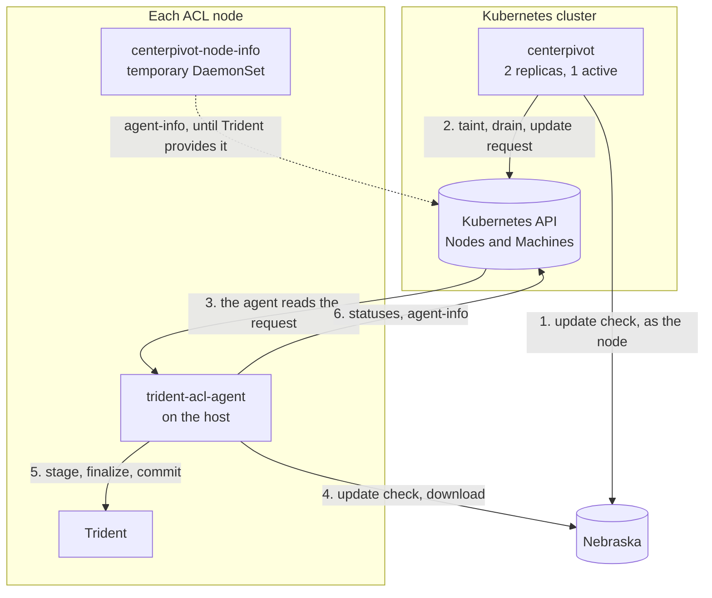
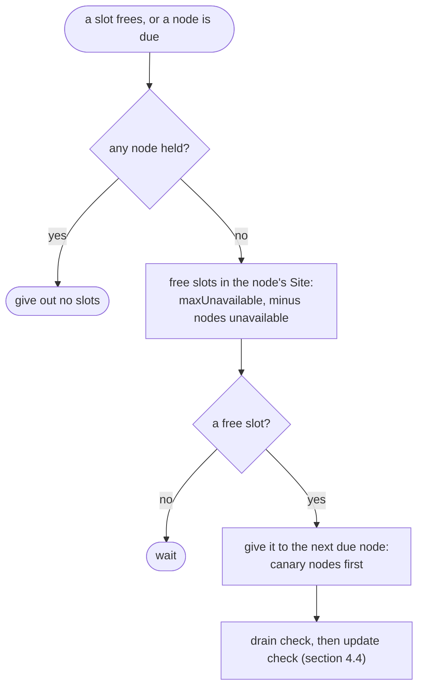
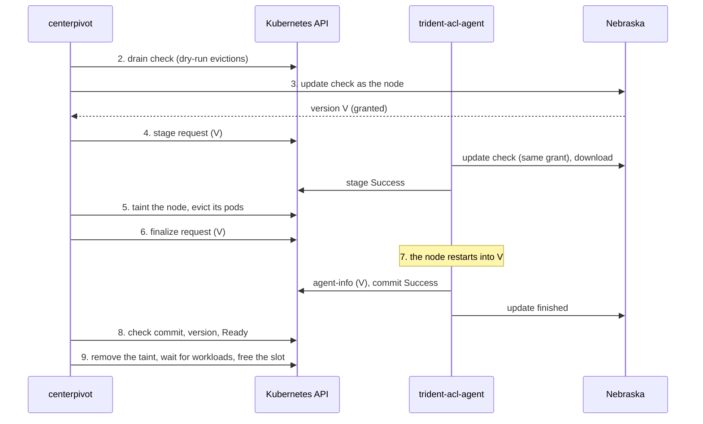
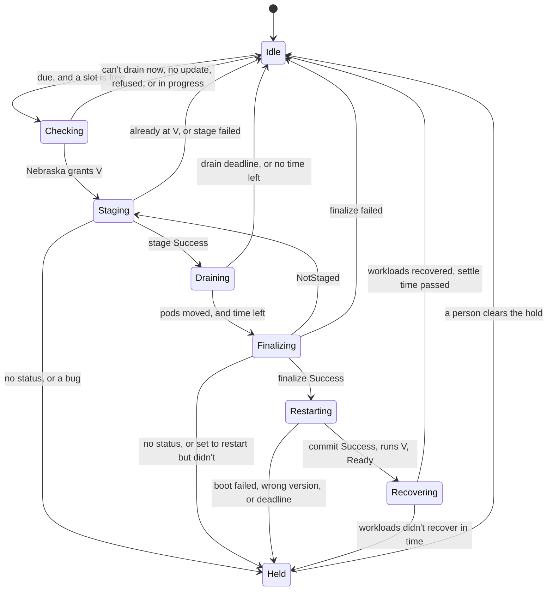

# Centerpivot: Updating Azure Container Linux Nodes from Nebraska

| Field | Value |
|---|---|
| Status | Draft for discussion |
| Scope | Automatic OS updates for Azure Container Linux (ACL) nodes, using Nebraska and `trident-acl-agent` |
| Audience | Unbounded maintainers, and the Trident and ACL teams |
| Repository baseline | `origin/main` at `1973dcf1a` |
| Date | 2026-11-18 |

## 1. Summary

ACL nodes update with an A/B update: the node writes the new OS into the copy
it isn't using, restarts into it, and keeps it if it boots. On each node,
`trident-acl-agent` runs the update when asked through annotations on the
node's Node object. Something in the cluster has to decide when each node
updates, and ask it. This document proposes that piece:

1. `centerpivot`, a service in the cluster. For each ACL node, it asks
   Nebraska, the update server ACL uses, whether a new version is ready. When
   one is, it moves the node's workloads elsewhere, asks the agent to install
   the version, and checks that the node came back running it.
2. `centerpivot-node-info`, a small temporary DaemonSet that publishes
   two facts about each node the service needs, until Trident provides them.

The service limits how many nodes in each Site update at once, drains nodes
with `kubectl drain`'s rules, and makes sure every update it starts in Nebraska
either finishes or is ended before Nebraska would count it as timed out.
Nebraska decides which version nodes get and how fast the fleet moves. When an
update fails, the service stops updating the cluster until a person looks.

The name comes from center-pivot irrigation, common on Nebraska's farms, which
brings fresh water to a field one section at a time.

## 2. Background

### 2.1 How an ACL node updates

`trident-acl-agent` reads one annotation on its Node and writes two, all under
a prefix set on the node
([Trident's annotation contract](https://github.com/microsoft/trident/blob/main/docs/Explanation/Trident-ACL-Agent.md#the-annotation-contract)):

1. `update-request`, written by the orchestrator, asks for `stage` (download the
   target version into the unused copy) or `finalize` (restart into it).
2. `update-status` reports the result of each request.
3. `update-commit-status` reports, after the restart, whether the node is
   running the new copy. The agent confirms this commit on its own.

A request names the target version and the Nebraska server, app ID, and track
to get it from. `nodeUpdateId` stays the same for one update's `stage`,
`finalize`, and commit; `operationId` is new for each request.

### 2.2 How Nebraska grants updates

A machine sends Nebraska an update check: its instance ID, its current version,
and a track, which Nebraska maps to a group. Each group follows a channel that
points at a version, and has rollout settings (Nebraska's
`backend/pkg/api/runtime/updates.go`, `GetUpdatePackage`):

1. **A check is a grant.** If the group's version is newer and its settings
   allow it, Nebraska answers with the update and records a grant for that
   instance. The grant counts against the group's limit until the machine
   reports the update finished or failed.
2. **A repeat check while granted** gets an update again, without using
   another slot of the group's limit. But Nebraska works out the version again
   from the group's current channel, so if the channel changed in between, the
   repeat check gets the new version.
3. **Once the machine reports download progress**, Nebraska answers further
   checks with "update in progress" until the machine reports the update
   finished or failed.
4. **Floors.** If the channel has floor versions, a grant is the next floor
   above the machine's version, not the channel's version. Reaching the
   channel's version can take several updates.
5. **Timeouts.** A grant that stays open longer than the group's update timeout
   counts as timed out. In safe mode, enough timeouts turn updates off for the
   whole group, in every cluster that uses it.
6. **Versions must be semver.** Nebraska refuses a check whose version isn't
   valid semver, and `trident-acl-agent` reports a version it can't parse as
   `0.0.0`, which is always offered an update. Semver ignores build metadata
   when comparing, so the part that changes with each build must be in the
   main version or the prerelease, not after a `+`.

So anyone who sends a check on a node's behalf must send exactly what the
node's agent sends, and must act on a grant right away.

### 2.3 What testing showed

The ACL update harness in AKSFlexNode
([Azure/AKSFlexNode#462](https://github.com/Azure/AKSFlexNode/pull/462)) drives
updates through `trident-acl-agent` with a test Nebraska:

1. The agent's instance ID is the first 16 bytes of the SHA-384 hash of the
   host's `/etc/machine-id`, written as a UUID (`crates/osutils/src/machine_id.rs`
   in Trident). It stays the same across the A/B switch: the agent's checks
   before and after the restart came from the same ID, since both copies share
   the root partition.
2. The agent writes no status for a request it can't parse, including one with
   a field the protocol doesn't define
   ([microsoft/trident#957](https://github.com/microsoft/trident/issues/957)).
3. If the node falls back to the old copy during the restart, the agent still
   reports the commit as a success, and tells Nebraska the update finished
   ([microsoft/trident#956](https://github.com/microsoft/trident/issues/956)).
4. ACL's `VERSION_ID`, such as `3.0.20261104`, can be the same for two builds,
   so it can't be the version Nebraska compares.
5. On Unbounded ACL nodes, kubelet and pods run inside an nspawn machine, so
   pods can't read the host's `/etc/machine-id` or `/etc/os-release`.

## 3. Goals and non-goals

Goals:

1. Update ACL nodes automatically when Nebraska has a newer version for them.
2. Limit how many nodes in a Site update at once, and move workloads off a node
   before it restarts, without breaking a PodDisruptionBudget.
3. Let Nebraska decide which version nodes get, and how fast the fleet moves.
4. End every grant the service starts: finished, or reported failed, before
   Nebraska's timeout. Never create extra Nebraska instances.
5. Notice failed updates, and stop the cluster's updates until a person looks.

Not in the first version: maintenance windows beyond Nebraska's office hours,
rolling back automatically, and choosing versions.

## 4. Design

### 4.1 Parts



1. **`centerpivot`** is an operator component, enabled per Site
   through `Site.Spec.Components`, like token-refresher. It runs as a
   Deployment in `unbounded-system` with two replicas, one active through
   leader election, and reads its settings from the Site.
2. **`trident-acl-agent`** ships with ACL and runs on each host. Unbounded's
   host agent configures it (section 5).
3. **`centerpivot-node-info`** is a temporary DaemonSet (section 4.3).

This design covers ACL nodes that run kubelet in an nspawn machine, Unbounded's
default and what its ACL tests run. Unbounded also documents `container`
isolation for ACL. In that mode, the host's files in section 4.3 are mounted
into the node stack's container instead, and graceful node shutdown
(section 4.6) needs checking there too.

| Who | Controls |
|---|---|
| The service | How many nodes in each Site update at once, moving workloads first, and stopping after a failure. |
| Nebraska | Which version each group gets, in which order groups get it, the pace across the fleet, and pausing. |

### 4.2 Update slots

1. Each Site has `maxUnavailable` update slots: a number or a percentage of its
   managed nodes, one by default. A node takes a slot just before its update
   check, and keeps it until its update ends.
2. Nodes already unavailable for other reasons use slots too, each counted
   once: nodes that are not Ready, nodes someone else cordoned, and nodes whose
   Machine has an unfinished MachineOperation or is being rebuilt.
3. While any managed node is held after a failure, no slots are given out in
   the cluster.
4. Among the nodes due for a check, nodes labeled canary go first, then the
   node checked longest ago.



A node takes its slot *before* the update check because the check is the grant
(section 2.2). A node granted an update and then left waiting for a slot would
keep the grant open until it timed out. When Nebraska has nothing new, the node
gives the slot back at once, so a pass through the cluster with no update is a
series of quick checks.

### 4.3 Node identity

The service sends update checks as each node, so it needs two facts only the
host knows: the node's Nebraska instance ID, and the version the agent reports.
They are in one annotation on the Node, `centerpivot.unbounded-cloud.io/agent-info`:

```json
{
  "schemaVersion": "1.0",
  "machineId": "ebb9a2bb-9365-d34e-133f-8da0664e7366",
  "currentVersion": "20261105.1.0"
}
```

1. `machineId` is the ID the agent sends Nebraska. The service can't use the
   Node's `status.nodeInfo.machineID`: kubelet reads that inside the nspawn
   machine, which has its own `/etc/machine-id`.
2. `currentVersion` is the version the agent sends Nebraska, read from the
   running OS, and is left out if the agent couldn't read one. The service
   checks nothing for a node without it.
3. It is written when the node starts, and again when the values change.

Until Trident provides these (section 5), the DaemonSet writes the same
annotation. Unbounded's host agent mounts the host's `/etc/machine-id` and
`/etc/os-release` read-only into the nspawn machine at their own paths, under
`/run/unbounded/host/`, not over the machine's own files. The DaemonSet's pod reads them,
computes the ID the way the agent does, and reads the version with the agent's
settings (`TRIDENT_ACL_AGENT_CURRENT_VERSION_PATH` and `_KEY`). After a
restart, the pod may write the new version after the agent reports the commit,
so the service waits for it rather than reading it once.

### 4.4 An update, step by step

1. **Slot.** A due node gets a free slot (section 4.2).
2. **Drain check.** The service checks that the node could be drained now: the
   drain rules (section 4.6), and a dry-run eviction of each pod it would move.
   If not, it gives the slot back and records why. No grant was taken.
3. **Update check.** It sends Nebraska one check as the node: the instance ID
   and version from `agent-info`, the node's architecture (`arm64` sent as
   `aarch64`, as the agent does), and the server, app ID, and track the request
   will name. It never sends progress events or pings. Nebraska records the
   service's IP address for the node until the agent's next check. With no
   update, or a refusal, it gives the slot back. With "update in progress", it
   ends that update (section 4.7) and gives the slot back.
4. **Stage.** With a grant for version V, it writes a `stage` request at once.
   The agent's own check gets the same grant, and it downloads V into the
   unused copy while the node keeps running.
5. **Drain.** It taints the node with `centerpivot.unbounded-cloud.io/updating`
   (`NoSchedule`) and evicts its pods (section 4.6).
6. **Finalize.** If enough of the grant's time is left for the restart
   (section 4.8), it writes `finalize`. Otherwise it ends the grant instead.
7. **Restart.** The agent restarts the node into V, commits, writes
   `update-commit-status`, and tells Nebraska the update finished.
8. **Check.** The service waits until the commit status is `Success`, the
   node's `agent-info` shows V, and the Node is Ready.
9. **Recover.** It removes its taint, then waits until the Deployments,
   StatefulSets, and ReplicaSets whose pods it moved have as many pods
   available as before the drain, plus a settle time, and gives the slot back.
   Pods of other controllers aren't tracked.



### 4.5 States

The service keeps each node's state in an annotation on its Machine,
`centerpivot.unbounded-cloud.io/state`, so it survives the Node being deleted to
rebuild it.



| State | What the service does | Leaves when | Deadline, and what happens at it | Nebraska grant when it leaves |
|---|---|---|---|---|
| Idle | Nothing. | The node is due and gets a slot. | | None open |
| Checking | The drain check, then the update check. | No update, a refusal, or a node it can't drain: back to Idle. A grant: Staging. "Update in progress": ends it, then Idle. | | None, granted, or ended |
| Staging | Writes `stage`, and waits for its status. | `Success`: Draining. `AlreadyAtTarget`, or a failure: Idle. | Writes the request again if no status comes within the status deadline; holds after 3 tries. | Failures are reported by the agent. With no status, the grant stays open until Nebraska times it out: the agent isn't answering. |
| Draining | Taints the node, and evicts its pods. | All pods moved and time left: Finalizing. | At the drain deadline, or with too little time left: ends the grant, removes the taint, and goes back to Idle. | Ended |
| Finalizing | Writes `finalize`. | `Success`: Restarting. `NotStaged`: Staging. A failure: Idle. | Status deadline, as in Staging. | Failures are reported by the agent. |
| Restarting | Waits for the commit, the version, and Ready. | All three: Recovering. | At the restart deadline: holds. | Finished, or reported failed by the agent |
| Recovering | Removes its taint, and waits for the moved workloads, then the settle time. | Both: Idle, and the slot frees. | At the recovery deadline: holds. | Finished |
| Held | Nothing; no new updates start in the cluster. | A person clears the hold. | | As the previous state left it |

Every `stage` or `finalize` failure, and every drain that misses its deadline,
counts as an attempt at V on that node. After 3 attempts, the node is held.

### 4.6 Moving workloads

Without a drain, Kubernetes moves pods off an unreachable node only after
5 minutes, by default, so they would wait out the restart on the node. The
service drains with `k8s.io/kubectl/pkg/drain`, the code behind
`kubectl drain`, and its rules:

| Pods | The drain |
|---|---|
| Static pods | Skips them. |
| DaemonSet pods | Skips them, as `kubectl drain --ignore-daemonsets` does. They restart with the node. |
| Pods with `emptyDir` data | Refuses, unless the "delete `emptyDir` data" setting is on (`--delete-emptydir-data`). |
| Pods with no controller | Refuses, unless the "move pods with no controller" setting is on (`--force`). |
| Every other pod | Evicts it through the eviction API, so PodDisruptionBudgets apply, with its own grace period. Refused evictions are tried again until the drain deadline. |

The service marks the node with its own `NoSchedule` taint rather than
cordoning it, so it never removes a cordon someone else set.

A drain that misses its deadline, despite the drain check, ends the grant at
once rather than waiting: the node starts again at a later check, and the
update downloads again. Repeated blocked drains hold the node (section 4.5).

After the drain, only DaemonSet and static pods remain; they stop when the node
restarts. Kubelet's graceful node shutdown lets them stop cleanly, once we've
confirmed it works with kubelet inside the nspawn machine.

For applications, this means:

1. Two or more replicas and a PodDisruptionBudget keep an application available
   through updates. With one replica, it is out of service while its pod starts
   elsewhere, once per update of its node.
2. Pods with `emptyDir` data or no controller keep their node from updating
   until an administrator turns on the matching setting, and so does a budget
   that never allows an eviction. The Site's condition and an Event name them.

### 4.7 Ending a grant

The service ends an update it can't finish by writing a new `stage` request.
Nebraska answers the agent's update check with "update in progress", so the
agent tells Nebraska the update failed, which closes the grant, and reports
`OperationFailed`. This is the agent's recovery for an update left in
progress (`UpdateInProgress` in `annotations/orchestrator.rs`). The node keeps
running its current version, and the staged copy is overwritten by the next
update.

The request must name a version other than the running one, because the agent
compares the two before it asks Nebraska. The service uses the version it last
tried for that node, or the running version with its patch number raised.

The service ends a grant when:

1. a drain misses its deadline;
2. too little of the grant's time is left to restart (section 4.8);
3. its update check finds "update in progress": an update that was interrupted,
   or that started before a hold was cleared or a Node was rebuilt.

### 4.8 Timing

The service has one setting for this: Nebraska's update timeout, which must
match the group's. Before writing `finalize`, the service checks that the
time since the grant, plus the restart deadline, stays at least 10 minutes
inside it. If not, it ends the grant instead. So every grant either finishes
or is ended before Nebraska would count it as timed out. The agent's own limits
bound the steps before that (20 minutes for a stage, 10 for a finalize, by
default), and so does the drain deadline.

### 4.9 Failures and holds

| What happens | What the service does | Nebraska grant |
|---|---|---|
| `stage` reports `AlreadyAtTarget` | The update is done. | None was used |
| `stage` reports `OperationFailed` or `AgentInternalError` | Back to Idle; counts an attempt. | Reported failed by the agent |
| `stage` reports `InvalidRequest` | Checks Nebraska again. If the channel moved, so the grant is now for another version, stages that. Otherwise holds the node: the request is wrong. | Kept, or open until it times out |
| `finalize` reports `OperationFailed` | Removes the taint, back to Idle; counts an attempt. | Reported failed by the agent |
| `finalize` reports `AgentInternalError` or `InvalidRequest` | Holds the node and keeps the taint. After `AgentInternalError`, the node may be set to start from the new copy at its next restart. | Reported failed, or open |
| `finalize` reports `NotStaged` | Stages again. | Kept |
| No status within the status deadline | Writes the same request again; the agent treats a repeat as one. Holds after 3 tries. | Open until it times out |
| The commit reports `TargetBootFailed` | Holds the node. | Reported failed by the agent |
| The commit reports `Success`, but `agent-info` still shows another version at the restart deadline (microsoft/trident#956) | Holds the node. | Recorded as finished |
| The Node isn't Ready, or no commit status arrives, by the restart deadline | Holds the node. | Open until the agent reports |
| The moved workloads haven't recovered by the recovery deadline | Holds the node. | Finished |

Holding a node means the service stops checking for it, removes its taint
unless the node may be set to start from the new copy, records the reason in
the Machine's `state`, and starts no new updates in the cluster until a person
clears the hold, by removing the Machine's `state` annotation. The service's
next attempt then uses new request IDs. It doesn't retry by itself because,
after a fallback, Nebraska may already list the update as finished and would
offer the same version again.

The agent reports a failed boot to Nebraska, so Nebraska's own safe mode and
statistics see it across clusters. The service never sends events to Nebraska.

To make a stop visible, the component's condition on the Site says why new
updates aren't starting, and the service exports metrics: nodes per version,
updates under way, held nodes, and the reason updates are blocked.

### 4.10 Restarts, rebuilds, and other maintenance

1. **Leader changes.** All state is on Nodes and Machines, written with each
   object's `resourceVersion`, so a new leader continues where the old one
   stopped, and two overlapping leaders can't both write a request.
2. **Rebuilds.** Deleting a Node rebuilds the node's nspawn machine. The
   Machine's `state` survives, and `trident-acl-agent` waits for the Node to
   return. The service continues the update if the agent reports its commit,
   and otherwise ends the grant and starts over at a later check. Labels the
   service reads (section 6) should be set through the MachineConfiguration's
   `nodeLabels`, so they survive too.
3. **Other maintenance.** Unbounded has no shared way yet for components that
   restart or replace nodes to claim a node. Until it does, the service skips
   nodes whose Machine has an unfinished MachineOperation or is being rebuilt.
   When Unbounded defines such a claim, the service takes it for each update,
   and Unbounded's Karpenter plugin should respect it.
4. **Turning the component off.** Updates past `finalize` finish on the node.
   The service's taint stays on a node it was draining until the component is
   turned on again or a person removes it, so turn it off when no update is
   under way.

## 5. Work needed from other teams

| Team | Ask | Blocks v1? | Until then |
|---|---|---|---|
| Trident | **Preferred:** a `stage` without `targetVersion` that stages whatever Nebraska grants, with a final status for "no update". Only the agent would then talk to Nebraska; the service would stop sending checks, and `agent-info` would need only the version, for the check after a restart. | No | The service checks as the node, using `agent-info`. |
| Trident | Otherwise: `agent-info` written by the agent (section 4.3). | No | The temporary DaemonSet |
| Trident | A final status when Nebraska refuses an update during `stage`. Today the agent exits, and systemd restarts it (`"Nebraska query failed"` in `annotations/orchestrator.rs`). | No | The service stages only after a grant, so this is rare. |
| Trident | Confirm that the recovery the service uses to end a grant (section 4.7) is intended and will stay, and document it. | No | |
| Trident | Fix microsoft/trident#956 and #957. | No | The version check after the restart, and the status deadline |
| Unbounded host agent | A `trident-acl-agent` drop-in: the prefix `centerpivot.unbounded-cloud.io`, kubelet's credentials, `kubelet-cert` to find the Node's name, and the version key. | Yes | |
| Unbounded host agent | Mount the host's `/etc/machine-id` and `/etc/os-release` into the nspawn machine under `/run/unbounded/host/`. | Until Trident provides the identity | |
| Unbounded host agent | Turn on kubelet's graceful node shutdown. | No | Pods left on the node stop at once. |
| ACL images | An os-release key with a version that differs for every build, is valid semver, and doesn't vary only in build metadata (section 2.2). | Yes | |
| Nebraska | Package labels, or the agent's `TRIDENT_ACL_AGENT_COSI_SHA384_SOURCE=hash` option. Release 4.0.3 has no labels. | Yes, one of the two | |
| Nebraska | One database behind the URL, so the service's grant and the agent's check reach the same Nebraska. | Yes | |
| Nebraska | Each group's update timeout matches the service's setting. | Yes | |

If Nebraska's Omaha secret is used, it is part of the URL path, so it is
readable by anyone who can read Node annotations or the Site.

## 6. Testing

1. **Unit tests:** the state machine and the failure table, with a fake
   Kubernetes client and a fake Nebraska; counting slots; the drain rules with
   each setting; the timing check; the request format against Trident's JSON
   schemas (`annotations/protocol.rs`); the instance ID
   (`34a267d412544d6a9e97b5ba6762f6e7` gives
   `ebb9a2bb-9365-d34e-133f-8da0664e7366`); and the admission policies' rules.
2. **The AKSFlexNode harness**, which runs kubelet in an nspawn machine: the
   service against its cluster, and graceful node shutdown.
3. **Unbounded's ACL end-to-end tests**, with several nodes and a workload with
   a PodDisruptionBudget: no more than `maxUnavailable` nodes update at once,
   and the workload stays available.
4. **A real Nebraska**, as Trident's tests use (`tools/storm/aclagent`): the
   agent's check after the service's gets the same grant, no extra instances
   appear, and ending a grant records a failure, not a timeout.

## 7. Open questions

1. **Trident:** a `stage` without `targetVersion`, or `agent-info`?
2. **ACL's version:** which os-release key carries the per-build version?
3. **The host's os-release:** does `systemd-nspawn` on ACL already provide it
   at `/run/host/os-release`?
4. **Graceful node shutdown:** does it work with kubelet in an nspawn machine,
   and in a container?
5. **`container` isolation on ACL:** when it's validated, which parts of this
   design change?
6. **Claiming a node for maintenance:** what form should Unbounded's shared
   claim take?
7. **The `managed` label:** set by Unbounded when the node joins, or by
   administrators?

## 8. Other approaches we considered

1. **Letting Nebraska alone limit updates.** Its limits are shared by every
   cluster on a track, can be set loosely, and know nothing about workloads.
2. **Letting nodes stage on their own, and coordinating only restarts.** This
   is how the closest prior art works:
   [flatcar-linux-update-operator](https://github.com/flatcar/flatcar-linux-update-operator)
   lets each node's updater take any grant Nebraska offers and download it,
   then decides when nodes restart, and [kured](https://github.com/kubereboot/kured)
   only coordinates restarts. A node that has staged then waits for its turn
   to restart with its grant open, which can outlast Nebraska's timeout. That
   is why this design takes a slot before the update check.
3. **A DaemonSet that checks for its own node.** It can't notice its node not
   coming back, since it restarts with it, and limits across the cluster would
   have nowhere to live.
4. **An instance ID made up by the service.** Nebraska would count every node
   twice, and the made-up instance's grants would never finish.
5. **Reading the group's version from Nebraska's admin API.** It needs a
   login, and the agent's check at `stage` would still be the grant.
6. **Draining before the update check, or forcing pods off after a deadline.**
   The first moves workloads off every node checked, even with no update; the
   second breaks the promise PodDisruptionBudgets make.
7. **Annotations from other tools to protect pods.** They would tie the service
   to those tools; PodDisruptionBudgets are Kubernetes' own way to say how many
   pods may move.

## Appendix: Interfaces

### Settings

From the component's spec on the Site:

| Setting | Default | Meaning |
|---|---|---|
| Nebraska URL, app ID, CA certificates | none, none, the image's | Where to check, and whom to trust. |
| Default track | none | The track for nodes without a track label. |
| `maxUnavailable` | 1 | Update slots per Site: a number or a percentage. |
| Check interval | 1 hour | How often each node is checked. |
| Nebraska update timeout | 2 hours | Must match each group's update timeout (section 4.8). |
| Status deadline | 5 minutes | How long to wait for a status before writing a request again. |
| Drain deadline | 30 minutes | How long one drain may take. |
| Restart deadline | 30 minutes | How long a node has to come back after `finalize`. |
| Recovery deadline | 30 minutes | How long moved workloads have to recover. |
| Settle time | 5 minutes | How long to wait after they recover. |
| Delete `emptyDir` data | off | `kubectl drain --delete-emptydir-data` |
| Move pods with no controller | off | `kubectl drain --force` |

### Labels, taints, and annotations

| Key | On | Written by | Meaning |
|---|---|---|---|
| `centerpivot.unbounded-cloud.io/managed` | Node label | MachineConfiguration `nodeLabels` | The service updates this node. |
| `centerpivot.unbounded-cloud.io/track` | Node label | MachineConfiguration `nodeLabels` | The node's track, instead of the default. |
| `centerpivot.unbounded-cloud.io/canary` | Node label | MachineConfiguration `nodeLabels` | The node goes first among due nodes. |
| `centerpivot.unbounded-cloud.io/paused` | Node label | an administrator | Start no new updates on this node. |
| `centerpivot.unbounded-cloud.io/updating` | Node taint (`NoSchedule`) | the service | The node is being drained or updated. |
| `centerpivot.unbounded-cloud.io/update-request` | Node annotation | the service | Trident's contract |
| `centerpivot.unbounded-cloud.io/update-status`, `update-commit-status` | Node annotations | the agent | Trident's contract |
| `centerpivot.unbounded-cloud.io/agent-info` | Node annotation | the agent, or the temporary DaemonSet | Section 4.3 |
| `centerpivot.unbounded-cloud.io/state` | Machine annotation | the service | The node's state (section 4.5) |

An example `state`:

```json
{
  "phase": "Restarting",
  "nodeUpdateId": "550e8400-e29b-41d4-a716-446655440000",
  "targetVersion": "20261106.1.0",
  "grantedAt": "2026-11-18T10:02:00Z",
  "attempts": 1
}
```

### Permissions

1. The service's account can get, list, watch, and patch Nodes and Machines;
   list and watch MachineOperations; list Pods and evict them, including dry-run
   evictions; get DaemonSets, ReplicaSets, Deployments, and StatefulSets; create
   Events; and use a Lease.
2. Admission policies narrow what can be written:
   1. The service's account may change only its taint and `update-request` on
      Nodes, and `state` on Machines. A request must name the configured
      Nebraska URL and app ID.
   2. The DaemonSet's account may change only `agent-info`, on its own Node,
      checked with the node name and UID in the pod's token, as
      `unbounded-net-node`'s policy does (`deploy/net/controller/09-vap.yaml.tmpl`).
3. The agent writes its statuses with the node's own credentials, which can
   change only its own Node. It accepts only an `https` Nebraska URL, and checks
   each image against a checksum from Nebraska.

### Code layout

| Part | Where |
|---|---|
| Binary, with `controller` and `node-info` subcommands | `cmd/centerpivot` |
| Shared code | `internal/centerpivot/...` |
| Operator component | `internal/operator/components/centerpivot`, and a `Site.Spec.Components` field |
| Manifests and admission policies | `deploy/centerpivot/` |
| Image | `images/centerpivot/` |
