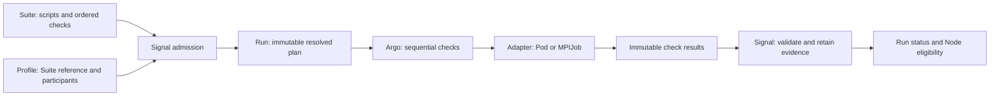

# Project Signal: certification alignment

**Status:** Alignment proposal grounded in the current implementation stack.

## Decision requested

Agree on a small certification foundation: **a Suite defines what runs, a
Profile selects participants, and a Run records exactly what happened.**
Signal owns certification policy and eligibility; Argo Workflows sequences
execution; an adapter runs the selected backend and reports evidence.

This replaces the broader lifecycle-platform proposal. Day 1 trust maintenance
and Day 2 recovery remain the direction, not prerequisites for landing the
certification foundation. This document does not approve every implementation
detail or claim that the stack has landed.

## Current review baseline

The implementation is split into four reviewable layers:

| Layer | PR | Responsibility |
|---|---|---|
| Contracts | [#1021](https://github.com/Azure/unbounded/pull/1021) | Suite, Profile, Run, and generated CRDs |
| Controller | [#1023](https://github.com/Azure/unbounded/pull/1023) | Admission, snapshots, reservations, orchestration, evidence, and eligibility |
| Adapter | [#1025](https://github.com/Azure/unbounded/pull/1025) | Pod/MPIJob execution and per-check results |
| Deployment | [#1026](https://github.com/Azure/unbounded/pull/1026) | Images, RBAC, WorkflowTemplate, and controller Deployment |

The baseline below is the stack at
[`bb5da95a4b70`](https://github.com/Azure/unbounded/commit/bb5da95a4b7031bcb6832a7db8f3b89bc3147636).
Source references use that revision because these files are not yet on the
design PR's base branch. Runner delivery is separate in
[#1001](https://github.com/Azure/unbounded/pull/1001).

## Problem and boundary

A successful diagnostic process is not enough to decide whether capacity is
usable. Operators need to know which policy, scripts, image, and participants
were tested; whether execution completed; what the diagnostic verdict was; and
whether temporary workloads and reservations were released.

Signal provides that certification record without becoming another provisioner,
workload scheduler, or host-operation executor.

## Three resources, one execution contract

| Resource | Owns | Does not own |
|---|---|---|
| `CertificationSuite` | Script-bundle reference/digest and ordered checks, including backend, resources, and deadline | Participant selection or direct Node mutation |
| `CertificationProfile` | Suite reference and participant count/selector | Copies of the Suite's scripts or checks |
| `CertificationRun` | Pinned Profile/Suite identities, participant identities, script snapshot, resolved checks, status, and evidence references | A live reference that can change an admitted plan |

Suites and Profiles are cluster-scoped; Runs are namespaced. Admission pins
source names, UIDs, and generations, participant Node UIDs, script digests, and
the deployment-supplied digest-pinned runner image. Later policy edits affect
future Runs, not an admitted Run. Checks have positional identity and execute
in order; this is not a general DAG or backend-plugin API.

The current schema bounds participants and check counts for resource safety.
Those limits are implementation guardrails, not the product abstraction.
See [API ownership](#implementation-references).

## One run, end to end

1. An operator requests certification by setting the Node's
   `signal.unbounded-cloud.io/certification-request` label to a Profile name.
   The controller resolves its Suite and validates the executable plan.
2. The controller selects the required participants, reserves and cordons them,
   and snapshots the scripts and resolved checks into a Run.
3. Argo invokes the adapter once per check, sequentially. The adapter resolves
   that check from the immutable Run and creates participant Pods or one
   coordinated MPIJob.
4. The adapter publishes an immutable per-check result ConfigMap. Signal
   validates its identity, ownership, digest, verdict, and backend evidence,
   then retains a final evidence bundle before recording terminal status.
5. Signal projects the outcome onto participant Nodes and tears down temporary
   execution resources. Successful Runs release automatically; other terminal
   outcomes require explicit release or Run deletion through finalization.

Ready, schedulable, and sufficiently allocatable does **not** mean idle:
admission does not inspect existing workload occupancy. Cordon blocks new
ordinary scheduling; it does not drain existing workloads. Reservations use
per-Node optimistic updates with rollback, not an atomic multi-Node transaction.
Deployments must arrange safe test capacity outside this admission mechanism.
See [admission and lifecycle](#implementation-references).

### Execution and result boundary

The controller owns admission, reservations, orchestration, result evaluation,
eligibility, and cleanup. Argo owns task sequencing and execution status, not
hardware policy. The adapter owns backend lifecycle and evidence capture; it
does not write Node eligibility.

The Workflow passes only five values per check: `run-name`, `execution-name`,
`run-uid`, `check-index`, and `result-configmap`. Full scripts and check payloads
do not travel through Workflow task outputs. The adapter reads the Run snapshot
and rejects a mismatched Run UID.

Each result ConfigMap is immutable and Workflow-owned, with a content digest
and Run/check identity metadata. Missing, mismatched, or incomplete evidence
cannot establish a passing check. A diagnostic Fail can still allow subsequent
checks to execute; an execution-boundary failure prevents downstream execution
and produces an inconclusive outcome. MPI workloads are quiesced between checks.
See [execution and results](#implementation-references).

### Outcome, evidence, and release are different

| Outcome | Certification meaning | Current lifecycle behavior |
|---|---|---|
| Pass | Required checks pass with accepted evidence | Run succeeds; production eligibility is projected; cleanup and automatic release follow |
| Fail | Completed diagnostics report a failure | Eligibility stays blocked; reservation remains until explicit release |
| Inconclusive or canceled | Execution or evidence cannot establish a pass | Eligibility stays blocked; reservation remains until explicit release |

Execution completion is not a diagnostic pass. Explicit release is not a pass
either: it releases the reservation without changing the diagnostic verdict.
Consumers must distinguish eligibility labels from the
`WorkloadCleanupComplete` and `Released` conditions. A production label alone
is not proof that cleanup has finished, nor an independent admission barrier.

Temporary check results belong to the Workflow. Final evidence is retained
separately in immutable compressed ConfigMaps, chunked when needed, and includes
the resolved plan, script contents, participant identities, results, and bounded
backend evidence. Logs are bounded, not an unlimited archive. This stack has no
automatic final-evidence retention policy; operators own access and retention.
See [evidence and projection](#implementation-references).

## What this foundation does not commit us to

- Recurring or idle-triggered certification, automatic retries, fleet-wide
  concurrency policy, queue integration, draining, or eviction.
- Automatic remediation or creation of `MachineOperation` requests.
- Rack/fabric gate graphs, additional workload backends, backend registries,
  dashboards, or an external evidence/audit service.
- A universal diagnostic suite, hardware-specific thresholds, or equivalence
  between different runners.

Argo Workflows is required. MPI suites additionally require the MPI operator;
Pod suites do not. Runner packaging and actual diagnostic coverage remain
separate concerns. The stack's execution contracts do not by themselves prove
accelerator health, collective correctness, or soak qualification.

Day 1 can later add evidence freshness and revalidation. Day 2 can later request
existing lifecycle operations, leaving execution with their existing owners.
The proposed safety rule for that extension is simple: **operation completion
must not restore trust without new certification evidence.** Neither capability
is claimed as implemented by this stack.

## Alignment questions

1. **Ownership:** Is Suite = executable plan, Profile = participant policy,
   Run = immutable execution the right foundation?
2. **Execution:** Is Argo sequencing plus a narrow Pod/MPIJob adapter sufficient
   for the first version, without a generalized orchestration platform?
3. **Safety:** Can the first version require operator-arranged safe capacity,
   with explicit non-pass release and separate cleanup conditions, rather than
   promise workload-aware idle admission or automatic recovery?
4. **Scope:** Can we review and land the four layers independently, then design
   recurring certification and Day 2 policy as separate extensions?

Agreement here establishes the boundary, not production readiness. Layer review
still needs to verify snapshot isolation, reservation ownership, result
validation, cancellation, retained evidence, and cleanup. Hardware qualification
requires separate end-to-end evidence for the selected runner and environment.

## Implementation references

These are source anchors at the baseline revision, not claims about `main`.

| Topic | Source |
|---|---|
| API ownership | [`certificationsuite_types.go:23-98`](https://github.com/Azure/unbounded/blob/bb5da95a4b7031bcb6832a7db8f3b89bc3147636/api/signal/v1alpha1/certificationsuite_types.go#L23-L98), [`certificationprofile_types.go:10-39`](https://github.com/Azure/unbounded/blob/bb5da95a4b7031bcb6832a7db8f3b89bc3147636/api/signal/v1alpha1/certificationprofile_types.go#L10-L39), [`certificationrun_types.go:100-139`](https://github.com/Azure/unbounded/blob/bb5da95a4b7031bcb6832a7db8f3b89bc3147636/api/signal/v1alpha1/certificationrun_types.go#L100-L139) |
| Admission and lifecycle | [`controller.go:439-625`](https://github.com/Azure/unbounded/blob/bb5da95a4b7031bcb6832a7db8f3b89bc3147636/internal/signal/controller.go#L439-L625), [`controller.go:814-1037`](https://github.com/Azure/unbounded/blob/bb5da95a4b7031bcb6832a7db8f3b89bc3147636/internal/signal/controller.go#L814-L1037), [`controller.go:3108-3279`](https://github.com/Azure/unbounded/blob/bb5da95a4b7031bcb6832a7db8f3b89bc3147636/internal/signal/controller.go#L3108-L3279) |
| Execution and results | [`controller.go:1651-1734`](https://github.com/Azure/unbounded/blob/bb5da95a4b7031bcb6832a7db8f3b89bc3147636/internal/signal/controller.go#L1651-L1734), [`controller.go:2146-2400`](https://github.com/Azure/unbounded/blob/bb5da95a4b7031bcb6832a7db8f3b89bc3147636/internal/signal/controller.go#L2146-L2400), [`runner.go:84-164`](https://github.com/Azure/unbounded/blob/bb5da95a4b7031bcb6832a7db8f3b89bc3147636/internal/signaladapter/runner.go#L84-L164), [`runner.go:302-331`](https://github.com/Azure/unbounded/blob/bb5da95a4b7031bcb6832a7db8f3b89bc3147636/internal/signaladapter/runner.go#L302-L331) |
| Evidence and projection | [`evidence.go:34-136`](https://github.com/Azure/unbounded/blob/bb5da95a4b7031bcb6832a7db8f3b89bc3147636/internal/signal/evidence.go#L34-L136), [`controller.go:1806-1826`](https://github.com/Azure/unbounded/blob/bb5da95a4b7031bcb6832a7db8f3b89bc3147636/internal/signal/controller.go#L1806-L1826), [`controller.go:2542-2604`](https://github.com/Azure/unbounded/blob/bb5da95a4b7031bcb6832a7db8f3b89bc3147636/internal/signal/controller.go#L2542-L2604), [`projection.go:39-109`](https://github.com/Azure/unbounded/blob/bb5da95a4b7031bcb6832a7db8f3b89bc3147636/internal/signal/projection.go#L39-L109) |

For deployment steps and limitations, see
[`deploy/signal/README.md`](https://github.com/Azure/unbounded/blob/bb5da95a4b7031bcb6832a7db8f3b89bc3147636/deploy/signal/README.md).
