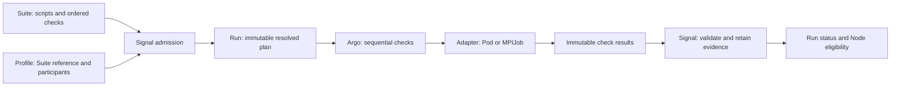

# Project Signal: certification controller

**Status:** Proposed design, grounded in the current implementation stack.

## Overview

Project Signal is the common, open-source, provider-agnostic certification
platform for compute and infrastructure capacity. All certification tests,
including deployment-specific tests, execute through Signal workflows rather
than a separate certification orchestrator. Diagnostic implementations are
supplied as test images and scripts, not embedded in controller policy.

**A Suite defines what runs, a Profile selects participants, and a Run pins the
execution plan and records its outcome.**
Signal owns certification policy and eligibility; Argo Workflows sequences
execution; an adapter runs the selected backend and reports evidence.

The initial certification scope is Day 0 qualification, including sustained
full-load testing and per-device health evidence. The current runtime provides
operator-requested execution, retained evidence, and eligibility projection;
it is a foundation, not complete coverage of that scope. Day 1 operations remain
undefined. Existing controllers retain ownership of provisioning and host
operations; this design adds no separate workload or recovery category.

## Problem and boundary

A successful diagnostic process is not enough to decide whether capacity is
usable. Operators need to know which policy, scripts, image, and participants
were tested; whether execution completed; what the diagnostic verdict was; and
whether temporary workloads and reservations were released.

Signal provides that certification record without becoming another provisioner,
workload scheduler, or host-operation executor. It is not limited to GPU
diagnostics: test domain and deployment-specific behavior belong in supplied
suites, while orchestration and result handling remain common.

## Certification scope

| Domain | Required coverage |
|---|---|
| Accelerators | Inventory, compute, device memory, device interconnect, and multi-node collective/RDMA behavior |
| Sustained node burn | Approximately one week at full load, with per-device load coverage and health evidence throughout the run |
| Storage | Scratch, shared, checkpoint, and attached-volume paths supplied by the deployment |
| Networking | General pod and IP connectivity and data-path behavior |
| Host | CPU and host-level checks |
| Optional performance | Service-transfer and image-pull tests, enabled explicitly rather than assumed for every certification |

These are platform fit requirements, not claims that packaged suites or
qualification evidence already exist. Test owners supply diagnostic procedures,
thresholds, and evidence requirements. A long-running process or elapsed week
alone is insufficient: qualification must establish the required load and health
coverage for each device. Interruptions and missing intervals must remain
visible and must not silently count as successful burn time.

## Resource model

| Resource | Owns | Does not own |
|---|---|---|
| `CertificationSuite` | Script-bundle reference/digest and ordered checks, including backend, resources, and deadline | Participant selection or direct Node mutation |
| `CertificationProfile` | Suite reference and participant count/selector | Copies of the Suite's scripts or checks |
| `CertificationRun` | Pinned Profile/Suite identities, participant identities, script snapshot, resolved checks, status, and evidence references | A live reference that can change an admitted plan |

Suites and Profiles are cluster-scoped; Runs are namespaced. Admission pins
source names, UIDs, and generations, participant Node UIDs, script digests, and
the deployment-supplied digest-pinned runner image. Later policy edits affect
future Runs, not an admitted Run. Checks have positional identity and execute
in order; this is not a general DAG or backend-plugin API.

The current schema bounds participants and check counts for resource safety.
Those limits are implementation guardrails, not the product abstraction.
See [API ownership](#implementation-references).

## Certification lifecycle

1. An operator requests certification by setting the Node's
   `signal.unbounded-cloud.io/certification-request` label to a Profile name.
   The controller resolves its Suite and validates the executable plan.
2. The controller selects the required participants, reserves and cordons them,
   and snapshots the scripts and resolved checks into a Run.
3. Argo invokes the adapter once per check, sequentially. The adapter resolves
   that check from the immutable Run and creates participant Pods or one
   coordinated MPIJob.
4. The adapter publishes an immutable per-check result ConfigMap. Signal
   validates its identity, ownership, digest, verdict, and backend evidence,
   then retains a final evidence bundle before recording terminal status.
5. Signal projects the outcome onto participant Nodes and tears down temporary
   execution resources. Successful Runs release automatically; other terminal
   outcomes require explicit release or Run deletion through finalization.

Ready, schedulable, and sufficiently allocatable does **not** mean idle:
admission does not inspect existing workload occupancy. Cordon blocks new
ordinary scheduling; it does not drain existing workloads. Reservations use
per-Node optimistic updates with rollback, not an atomic multi-Node transaction.
Deployments must arrange safe test capacity outside this admission mechanism.
See [admission and lifecycle](#implementation-references).

### Execution and result boundary

The controller owns admission, reservations, orchestration, result evaluation,
eligibility, and cleanup. Argo owns task sequencing and execution status, not
hardware policy. The adapter owns backend lifecycle and evidence capture; it
does not write Node eligibility.

The Workflow passes only five values per check: `run-name`, `execution-name`,
`run-uid`, `check-index`, and `result-configmap`. Full scripts and check payloads
do not travel through Workflow task outputs. The adapter reads the Run snapshot
and rejects a mismatched Run UID.

Each result ConfigMap is immutable and Workflow-owned, with a content digest
and Run/check identity metadata. Missing, mismatched, or incomplete evidence
cannot establish a passing check. A diagnostic Fail can still allow subsequent
checks to execute; an execution-boundary failure prevents downstream execution
and produces an inconclusive outcome. MPI workloads are quiesced between checks.
See [execution and results](#implementation-references).

### Outcomes, evidence, and release

| Outcome | Certification meaning | Current lifecycle behavior |
|---|---|---|
| Pass | Required checks pass with accepted evidence | Run succeeds; production eligibility is projected; cleanup and automatic release follow |
| Fail | Completed diagnostics report a failure | Eligibility stays blocked; reservation remains until explicit release |
| Inconclusive or canceled | Execution or evidence cannot establish a pass | Eligibility stays blocked; reservation remains until explicit release |

Execution completion is not a diagnostic pass. Explicit release is not a pass
either: it releases the reservation without changing the diagnostic verdict.
Consumers must distinguish eligibility labels from the
`WorkloadCleanupComplete` and `Released` conditions. A production label alone
is not proof that cleanup has finished, nor an independent admission barrier.

Temporary check results belong to the Workflow. Final evidence is retained
separately in immutable compressed ConfigMaps, chunked when needed, and includes
the resolved plan, script contents, participant identities, results, and bounded
backend evidence. Logs are bounded, not an unlimited archive. This stack has no
automatic final-evidence retention policy; operators own access and retention.
See [evidence and projection](#implementation-references).

## Extension boundaries and current gaps

The existing script bundle, ordered checks, Pod/MPIJob backends, resource
requirements, and immutable Run/result identities provide a shared execution
foundation. Pod checks permit zero GPUs; the current MPIJob contract requires
a positive GPU count. Backend availability does not establish that a domain's
tests, resource access, or acceptance policy are implemented.

| Area | Existing foundation | Extension or qualification needed |
|---|---|---|
| Test coverage | Supplied scripts, a deployment-selected runner image, and per-check workload policy | Package and validate the required domain suites; support their approved inputs and resource access, including storage volumes |
| Sustained burn | Per-check deadlines, typed results, and bounded backend evidence | Define and verify full-load duration, per-device sampling, health thresholds, and missing-coverage behavior across the week |
| Scale | Immutable participant set and coordinated execution | Extend and validate the current eight-participant bound for larger qualification groups |
| Interruption | Cancellation and inconclusive outcomes | Specify attempt history, retry/resume policy, and whether an interrupted burn must restart; do not infer completion from retries |
| Multi-run coordination | Individually requested immutable Runs | Define Signal-owned successive cohorts, replacement Runs, coverage accounting, cooldowns, and aggregate metrics without a second orchestrator |
| Evidence and reporting | Immutable, bounded Kubernetes evidence tied to Run identity | Define export and reporting contracts for long-duration evidence without putting full telemetry in Kubernetes objects |

Multi-run coordination belongs above individual Runs within Signal. A future
campaign model may select successive node cohorts and track coverage, but its
resource name and API remain undefined. It must preserve each Run's identity,
evidence, and verdict rather than rewrite history. Campaign scheduling and
automatic retries are not implemented by the four-layer baseline.

The burn policy must explicitly define whether the required week is continuous
or permits evidenced resumption. A conservative option is one uninterrupted
burn check in one Run, with an interrupted attempt remaining Inconclusive and a
replacement Run starting its duration from zero. This option is not yet a
selected policy. Until continuity and resumption rules are defined and
validated, neither transparent workflow retries nor aggregation of shorter Runs
establishes week-long burn qualification.

The workload policy currently exposes resources, privileges, host networking,
and restricted host paths, not arbitrary Pod templates or volume claims.
The participant ceiling is explicit in the API. See
[`certificationsuite_types.go:21-67`](https://github.com/Azure/unbounded/blob/bb5da95a4b7031bcb6832a7db8f3b89bc3147636/api/signal/v1alpha1/certificationsuite_types.go#L21-L67)
and
[`certificationprofile_types.go:10-16`](https://github.com/Azure/unbounded/blob/bb5da95a4b7031bcb6832a7db8f3b89bc3147636/api/signal/v1alpha1/certificationprofile_types.go#L10-L16).

Deployment-specific tests remain supplied suites. External evidence sinks and
product-facing reports are integration boundaries to define, not already
implemented plugins. Export must preserve Run identity, provenance, and verdict
semantics; a reporting integration must not become a competing certification
authority. These gaps are addressed within Signal, not by bypassing it with
another test platform.

## Non-goals

- Provisioning, host lifecycle execution, automatic remediation, or creation of
  `MachineOperation` requests.
- Defining Day 1 operations or a separate workload/recovery category.
- Workload scheduling, draining, eviction, or queue integration.
- Embedding deployment-specific diagnostics, storage services, or reporting
  systems in the provider-agnostic core.

Argo Workflows is required. MPI suites additionally require the MPI operator;
Pod suites do not. Runner packaging and actual diagnostic coverage remain
separate concerns. The stack's execution contracts do not by themselves prove
accelerator health, collective correctness, or soak qualification.

## Design requirements

1. **Immutable execution:** Admission must resolve and snapshot the selected
   policy, scripts, runner image, and participant identities. Changes to source
   resources must not alter an admitted Run.
2. **Single policy owner:** The Signal controller owns certification eligibility.
   Argo and backend execution status must not independently grant eligibility.
3. **Evidence-backed outcomes:** A pass requires accepted evidence for every
   required check. Missing or invalid evidence must not become a pass, and
   execution interruption must remain distinct from diagnostic failure.
4. **Explicit capacity protection:** Deployments must supply safe test capacity.
   The controller reserves and cordons participants; it does not infer workload
   idleness or drain Nodes. Reservation and cleanup mutations must be fenced by
   resource identity and ownership.
5. **Independent release state:** Diagnostic verdict, eligibility, workload
   cleanup, and reservation release must remain separately observable. Explicit
   release must not change a non-passing verdict into a pass.
6. **Retained evidence:** Final evidence must be persisted before terminal status
   and retained independently of temporary execution resources. Operators own
   evidence access and retention policy.
7. **Common certification path:** Accelerator, storage, networking, host, and
   explicitly enabled performance tests must use Signal workflows and the same
   Run/result contract. Deployment-specific implementations must not require a
   second certification orchestrator.

## Acceptance criteria

Contract and lifecycle tests must demonstrate snapshot isolation, Run UID
fencing, result identity and digest validation, fail-closed evidence handling,
cancellation, ownership-safe cleanup, and release behavior for passing and
non-passing Runs. Recovery tests must demonstrate that controller restarts do
not reinterpret admitted policy or release resources belonging to another Run.

These criteria establish correctness of the certification control plane, not
hardware qualification. Qualification requires separate end-to-end evidence for
the selected runner and environment.

Platform acceptance additionally requires demonstrated coverage of the
certification domains above, including the sustained full-load burn, per-device
health evidence, and documented interruption handling. The current stack alone
does not satisfy that broader acceptance bar. Closing these gaps requires
separately reviewed implementation work, not an implicit expansion of the
existing four PRs.

## Implementation baseline

The implementation is split into four independently reviewable layers:

| Layer | PR | Responsibility |
|---|---|---|
| Contracts | [#1021](https://github.com/Azure/unbounded/pull/1021) | Suite, Profile, Run, and generated CRDs |
| Controller | [#1023](https://github.com/Azure/unbounded/pull/1023) | Admission, snapshots, reservations, orchestration, evidence, and eligibility |
| Adapter | [#1025](https://github.com/Azure/unbounded/pull/1025) | Pod/MPIJob execution and per-check results |
| Deployment | [#1026](https://github.com/Azure/unbounded/pull/1026) | Images, RBAC, WorkflowTemplate, and controller Deployment |

The baseline is the stack at
[`bb5da95a4b70`](https://github.com/Azure/unbounded/commit/bb5da95a4b7031bcb6832a7db8f3b89bc3147636).
Source references use that revision because these files are not yet on the
design PR's base branch. Runner delivery is separate in
[#1001](https://github.com/Azure/unbounded/pull/1001).

## Implementation references

These are source anchors at the baseline revision, not claims about `main`.

| Topic | Source |
|---|---|
| API ownership | [`certificationsuite_types.go:23-98`](https://github.com/Azure/unbounded/blob/bb5da95a4b7031bcb6832a7db8f3b89bc3147636/api/signal/v1alpha1/certificationsuite_types.go#L23-L98), [`certificationprofile_types.go:10-39`](https://github.com/Azure/unbounded/blob/bb5da95a4b7031bcb6832a7db8f3b89bc3147636/api/signal/v1alpha1/certificationprofile_types.go#L10-L39), [`certificationrun_types.go:100-139`](https://github.com/Azure/unbounded/blob/bb5da95a4b7031bcb6832a7db8f3b89bc3147636/api/signal/v1alpha1/certificationrun_types.go#L100-L139) |
| Admission and lifecycle | [`controller.go:439-625`](https://github.com/Azure/unbounded/blob/bb5da95a4b7031bcb6832a7db8f3b89bc3147636/internal/signal/controller.go#L439-L625), [`controller.go:814-1037`](https://github.com/Azure/unbounded/blob/bb5da95a4b7031bcb6832a7db8f3b89bc3147636/internal/signal/controller.go#L814-L1037), [`controller.go:3108-3279`](https://github.com/Azure/unbounded/blob/bb5da95a4b7031bcb6832a7db8f3b89bc3147636/internal/signal/controller.go#L3108-L3279) |
| Execution and results | [`controller.go:1651-1734`](https://github.com/Azure/unbounded/blob/bb5da95a4b7031bcb6832a7db8f3b89bc3147636/internal/signal/controller.go#L1651-L1734), [`controller.go:2146-2400`](https://github.com/Azure/unbounded/blob/bb5da95a4b7031bcb6832a7db8f3b89bc3147636/internal/signal/controller.go#L2146-L2400), [`runner.go:84-164`](https://github.com/Azure/unbounded/blob/bb5da95a4b7031bcb6832a7db8f3b89bc3147636/internal/signaladapter/runner.go#L84-L164), [`runner.go:302-331`](https://github.com/Azure/unbounded/blob/bb5da95a4b7031bcb6832a7db8f3b89bc3147636/internal/signaladapter/runner.go#L302-L331) |
| Evidence and projection | [`evidence.go:34-136`](https://github.com/Azure/unbounded/blob/bb5da95a4b7031bcb6832a7db8f3b89bc3147636/internal/signal/evidence.go#L34-L136), [`controller.go:1806-1826`](https://github.com/Azure/unbounded/blob/bb5da95a4b7031bcb6832a7db8f3b89bc3147636/internal/signal/controller.go#L1806-L1826), [`controller.go:2542-2604`](https://github.com/Azure/unbounded/blob/bb5da95a4b7031bcb6832a7db8f3b89bc3147636/internal/signal/controller.go#L2542-L2604), [`projection.go:39-109`](https://github.com/Azure/unbounded/blob/bb5da95a4b7031bcb6832a7db8f3b89bc3147636/internal/signal/projection.go#L39-L109) |

For deployment steps and limitations, see
[`deploy/signal/README.md`](https://github.com/Azure/unbounded/blob/bb5da95a4b7031bcb6832a7db8f3b89bc3147636/deploy/signal/README.md).
