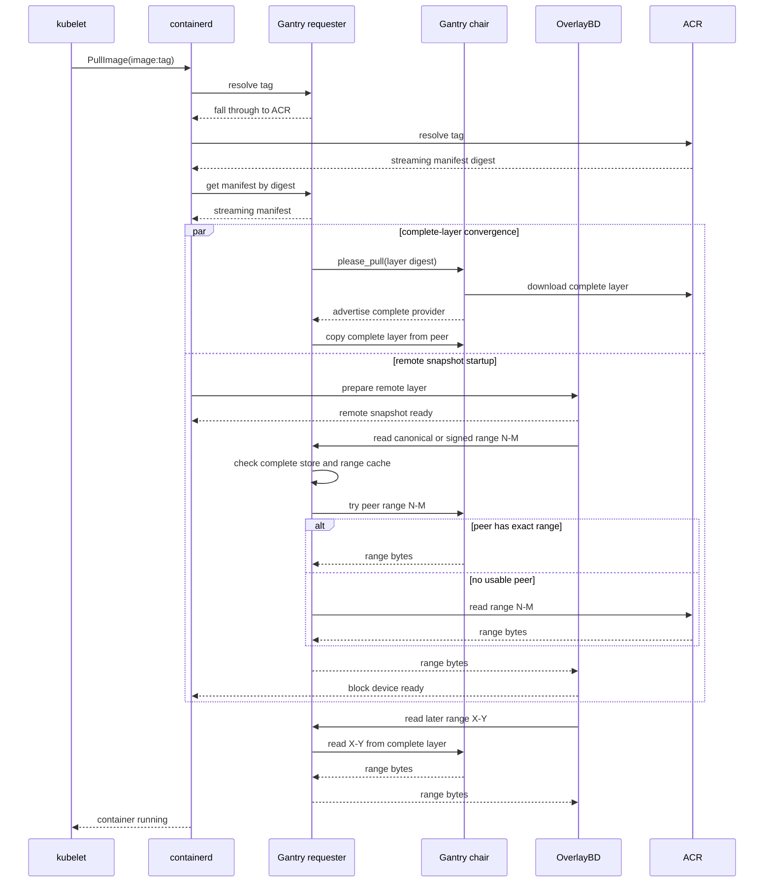

# Gantry with ACR Artifact Streaming

**Status:** Implemented and validated on AKS

## Summary

ACR Artifact Streaming and Gantry solve different parts of container startup.

ACR Artifact Streaming lets a container start without downloading every image
layer in full. OverlayBD mounts the image as a remote block device and reads
only the byte ranges required by the container.

Gantry reduces repeated registry traffic across the cluster. After recognizing
an ACR Artifact Streaming manifest, Gantry warms its mount-critical ranges,
asks a bounded set of chairs to download complete layers, and keeps reconciling
until every participating node has complete local content. Complete layers and
cached ranges both become peer sources.

This design combines both behaviors:

```text
first Pod:   read required ranges immediately
background:  Gantry warms indexes and distributes complete layers
later Pods:  read ranges or complete content from local storage and peers
```

The complete background downloads are intentional. They are the value Gantry
adds to Artifact Streaming: fast first startup followed by cluster-wide
convergence on complete local content.

## The problem

Artifact Streaming improves startup latency, but by itself each node can keep
reading image data from ACR. During a large rollout, many nodes may request the
same ranges or eventually consume most of the same layers.

Gantry already prevents this duplication for normal OCI pulls. It coordinates
a small number of complete origin downloads and distributes the resulting
objects between peers. However, OverlayBD does not request complete OCI objects
while a container is running. It requests byte ranges through either a
canonical ACR blob URL or a signed ACR data URL.

Gantry therefore needs to support two related data paths:

1. its existing complete-object path for proactive layer seeding; and
2. a new range path used by OverlayBD while complete layers are unavailable or
   while only a subset of their bytes is needed.

## Goals

- Preserve Artifact Streaming's ability to start the first Pod without waiting
  for complete image layers.
- Preserve Gantry's proactive, bounded complete-layer pulls.
- Serve OverlayBD ranges from local or peer content as soon as the exact range
  or a complete layer is available anywhere in the cluster.
- Keep signed ACR URLs on the node that received them.
- Require no Pod specification changes.
- Continue using containerd as the source of truth for complete content.
- Continue using Gantry's digest-keyed DHT for complete provider discovery.
- Keep regular OCI images on the existing Gantry path.
- Keep all Artifact Streaming runtime work disabled unless the feature is
  explicitly enabled and the manifest satisfies the streaming contract.

## Activation and compatibility

Artifact Streaming is disabled by default. Enabling it makes the node-local
range endpoint, range cache, index prefetcher, and convergence reconciler
available, but an image enters the streaming path only when all of these checks
pass:

1. the registry host ends in `.azurecr.io`;
2. the manifest is immutable and available in the local content store; and
3. every layer has matching OverlayBD `blob-digest` and `blob-size`
   annotations and no external URLs.

An ordinary ACR image, a non-ACR image, or a partially annotated manifest fails
closed to the existing complete-object Gantry path. Enabling the cluster
feature does not make every image an Artifact Streaming image.

## Two paths run at the same time

The easiest way to understand the design is to separate the complete-layer path
from the range-read path.

### Complete-layer path

Gantry observes the resolved streaming manifest and extracts its child layer
digests. Three deterministic active-chair coordinators are selected by default
from the manifest digest. They group missing children by their HRW-ranked seed
chairs, bound concurrent outbound groups, and add deterministic dispatch jitter.
The normal configuration has 64 chairs and eight seed chairs.

Each chair:

1. downloads its assigned complete layer from ACR;
2. commits the layer to its local containerd content store;
3. verifies the layer's OCI digest; and
4. advertises itself as a provider for that digest.

A per-manifest reconciler repeats this dispatch every 30 seconds until the
local containerd store contains every layer. In parallel, a per-node seeder
polls the DHT and copies complete layers from peers into that node's containerd
store. Origin fallback for this every-node seeder is disabled by default; the
chair cohort is responsible for bounded origin bootstrap. This work runs in the
background and does not block remote snapshot creation.

### Range-read path

OverlayBD reads only the byte ranges required to mount and use the image. It
sends each range to a node-local Gantry endpoint. Before the first mount,
Gantry also warms the first 256 KiB and last 2 MiB of each sized layer by
default, preferring peers before origin.

Gantry serves the range from the best source currently available:

1. the complete layer in the local containerd store;
2. the exact range in the local partial-range cache;
3. a Gantry peer that can serve the exact range from complete or partial
  content; or
4. the configured ACR endpoint or signed ACR data URL supplied by OverlayBD.

The source can change between requests. An early request may use ACR while a
chair is still downloading the layer. A later request can use a cached partial
range or a completed peer copy.

## Cold Pull walkthrough

Assume a Pod using `acr.azurecr.io/team/app:latest` is scheduled to a node that
has none of the image locally. ACR Artifact Streaming is enabled and containerd
uses the OverlayBD snapshotter.

### 1. Kubelet requests the image

Kubelet calls containerd's CRI `PullImage` operation with the tagged image.
Containerd selects the OverlayBD snapshotter for the workload.

No large layer has been downloaded yet.

### 2. ACR resolves the tag to the streaming image

Containerd first asks Gantry to resolve the tag:

```text
HEAD /v2/team/app/manifests/latest?ns=acr.azurecr.io
```

Gantry deliberately does not cache or resolve mutable tags. It returns `503`,
which makes containerd continue to ACR. ACR resolves the tag to the generated
streaming manifest and returns its immutable digest.

### 3. Containerd fetches the streaming manifest through Gantry

Containerd now fetches the immutable manifest:

```text
GET /v2/team/app/manifests/sha256:<manifest>
```

Because this request is digest-addressed, Gantry handles it through its normal
local, peer, chair, and origin logic. The manifest contains the image config and
the streaming layer descriptors.

### 4. Gantry starts complete-layer pulls

After serving the manifest, Gantry verifies the ACR host and OverlayBD
annotations before entering the streaming path. It starts two asynchronous jobs:

1. warm each layer's mount-critical head and tail ranges into the partial-range
  cache; and
2. start the durable complete-layer reconciler for every missing layer.

The reconciler selects active coordinators, ranks seed chairs per layer, and
sends grouped `please_pull` requests. It keeps checking the local containerd
store and repeats incomplete work until the node converges.

The selected chairs begin downloading complete layers immediately. Different
layers can be assigned to different chairs, spreading origin and disk work
across the seed cohort.

This work is asynchronous. Containerd does not wait for the complete downloads.

### 5. Containerd creates remote snapshots

Containerd passes the image reference, layer digest, layer size, and OverlayBD
annotations to the snapshotter. The snapshotter creates backing-store metadata
similar to:

```json
{
  "repoBlobUrl": "https://acr.azurecr.io/v2/team/app/blobs",
  "lowers": [
    {
      "digest": "sha256:<streaming-layer>",
      "size": 123456789
    }
  ]
}
```

The snapshotter commits a remote snapshot. Under containerd's remote snapshot
protocol, this tells containerd that it does not need to download and unpack the
complete layer before continuing.

At this point the manifest and config are local, while the large layer data may
still be remote.

### 6. OverlayBD requests layer data through Gantry

When containerd creates the container root filesystem, the snapshotter asks the
OverlayBD daemon to attach the remote image.

The supported OverlayBD change tries its configured accelerator before registry
resolution. It first sends Gantry a canonical blob URL such as:

```text
https://acr.azurecr.io/v2/team/app/blobs/sha256:<streaming-layer>
```

Gantry recognizes the digest in that URL and maps the request to the configured
ACR upstream, including the node-local ACR Artifact Streaming endpoint used on
AKS. Older or fallback OverlayBD flows that resolve ACR first can instead send
the signed ACR data or Azure Blob Storage URL. Both URL forms are accepted under
the configured host-suffix policy.

### 7. OverlayBD asks Gantry for a range

OverlayBD needs small reads to load layer indexes and later to satisfy
filesystem I/O. With P2P acceleration enabled, it sends the resolved URL and the
exact range to Gantry:

```http
GET /blobs/<canonical-or-signed-url>
Range: bytes=N-M
```

The canonical path or signed URL contains enough information for Gantry to
identify the streaming layer digest. Query credentials stay inside the local
request and are never used for peer discovery.

Gantry then chooses a source:

- **Local complete layer:** read `N-M` from the local containerd store.
- **Local cached range:** read `N-M` from the non-durable range cache.
- **Peer range source:** ask a discovered peer for `N-M` by digest. The peer may
  hold the complete layer or that exact cached range.
- **No usable provider yet:** fetch `N-M` through the configured ACR endpoint or
  signed URL.

The first range never needs to wait for a complete chair pull. Gantry can use
origin while complete seeding continues. Small peer or origin responses up to
4 MiB are cached by default and advertised for later exact-range requests.

### 8. The container starts

After OverlayBD has loaded enough index and filesystem metadata, it exposes the
block device, the root filesystem mounts, and containerd starts the process.

The application can continue producing range reads while the chairs download
complete layers in the background.

### 9. Gantry takes over later reads

When a chair finishes a layer, containerd verifies and commits it. Gantry then
advertises that chair as a provider for the layer digest. The node reconciler's
peer-first seeder copies the complete layer into each remaining node's
containerd store.

Subsequent range requests can use the peer's complete copy:

```text
OverlayBD on node A
  -> Gantry on node A
  -> Gantry chair holding the complete layer
  -> exact requested bytes
```

ACR is no longer involved in those reads.

## End-to-end sequence



The diagram shows the coldest case, where the first range reaches ACR before a
chair finishes. If a chair finishes first, Gantry can serve the first range from
that peer instead.

## Warm and scale-out behavior

When the same image is scheduled on more nodes, its complete layers are likely
already advertised by Gantry providers.

Containerd still creates OverlayBD remote snapshots, so startup remains lazy.
OverlayBD range requests can resolve to the node's range cache or cluster peers
rather than ACR. Each new node first receives only its startup ranges, then its
background reconciler copies complete layers from peers until its containerd
store converges.

The result is:

- first-node startup remains range-based;
- origin downloads remain bounded by the chair cohort;
- scale-out traffic moves to the cluster network; and
- the cluster converges on complete, verified layers without making every node
  download each layer from ACR.

## Content and trust boundaries

Complete layers and partial ranges have different trust properties.

### Complete layers

Complete layers are stored in containerd and verified against their OCI digest
before Gantry advertises them. The DHT still uses the layer digest as its key,
but a provider record alone no longer proves that the provider holds the whole
object because partial-range providers use the same discovery mechanism. The
transfer endpoint determines whether it can serve the complete object or the
exact requested range.

### Signed origin ranges

The signed URL is a temporary origin capability obtained by OverlayBD. Gantry
uses it only on the local node when no local cache or peer can serve the exact
range.

Gantry must not:

- log the complete URL or SAS query;
- put it in metrics;
- advertise it in the DHT; or
- send it to a peer.

Peer range requests contain only the layer digest and requested byte range.

### Partial range cache

Gantry now has a separate disk-backed partial-range cache. It is not part of
containerd and is reset on every agent start because its in-memory interval
index is the authority for which bytes are valid. The default capacity is 4
GiB per node, and only individual requests up to 4 MiB are cached. When the
capacity is reached, the cache stops admitting new blob digests rather than
evicting its existing working set.

A node with any cached range for a digest advertises that digest through the
normal DHT provider mechanism. A DHT record therefore means that the peer may
hold the complete object or one or more exact ranges. The transfer endpoint
first tries the complete containerd object and then serves an exact range only
when the cache proves that the whole requested interval is present. Signed URLs
are still never advertised or sent to peers.

## Failure behavior

### A chair is still downloading

The range request uses the configured canonical origin or signed origin URL. It
does not wait indefinitely for the chair. Later requests can use the peer after
the complete layer is committed and advertised.

### A provider is stale or unavailable

Gantry suppresses a failed provider for that digest, tries up to three peers by
default, and then uses origin for that range. Provider lookup is bounded to 250
milliseconds by default so first startup does not wait on complete-layer
convergence.

### ACR is unavailable

Existing complete local and peer layers remain usable. A range with no complete
or partial local or peer source cannot be satisfied until ACR recovers or
another provider appears.

### The range cache reaches capacity

Existing cache entries remain readable, and new ranges for an existing digest
can still be recorded. The cache stops creating entries for new digests. A
cache-eligible remote response that cannot be stored currently returns a gateway
error rather than streaming uncached, so capacity must be sized for the active
working set or range caching must be disabled explicitly.

### Gantry restarts

An active OverlayBD device depends on its node-local Gantry endpoint while P2P
configuration is enabled. This integration does not change OverlayBD to add a
second fail-open path. Production rollout therefore keeps the Gantry DaemonSet
available, uses its readiness and drain behavior for controlled replacement,
and drains active streaming workloads before disabling the OverlayBD P2P
configuration or removing the Gantry endpoint.

The partial-range cache is discarded and recreated on restart. Complete layers
remain in containerd and are rediscovered by the normal inventory scan.

## Deployment model

Gantry exposes the OverlayBD endpoint on its existing node-local listener:

```text
http://localhost:5000/blobs
```

OverlayBD is configured with:

```json
{
  "p2pConfig": {
    "enable": true,
    "address": "http://localhost:5000/blobs"
  }
}
```

Both `gantry.artifactStreaming.enabled` and `overlaybdConfig.enabled` default to
`false`. A standalone Helm deployment enables both and gives the OverlayBD
configurator an explicit node selector. An operator-managed deployment enables
Artifact Streaming through `Site.spec.components.gantry.artifactStreaming`.
Every enabling Site must use the same non-empty node selector because Gantry is
a cluster-wide singleton.

When enabled, the Gantry pod uses the host network and binds the shared mirror
and range listener to loopback. The node configurator:

1. waits for `/artifact-streaming/readyz`;
2. locks and snapshots the existing host OverlayBD configuration;
3. uses the AKS-provided configuration tool to set the P2P endpoint;
4. restarts OverlayBD services only when the configuration changed; and
5. restores the original file on removal only if no other writer changed the
  managed file.

The streaming readiness path deliberately does not wait for chair availability.
The first Pod can read ranges from origin while chairs initialize and complete
layers asynchronously. During shutdown, Gantry drains the range endpoint before
stopping the shared transfer and mirror services.

The node must also:

- run the OverlayBD daemon and snapshotter;
- register the snapshotter socket with containerd;
- select OverlayBD for Artifact Streaming workloads; and
- enable containerd's remote snapshot annotations.

AKS Artifact Streaming node pools already provide most of this stack. For nodes
without that AKS-provided stack, provisioning and managing OverlayBD is out of
scope for this integration.

No containerd change is required. OverlayBD needs the accelerator-first
RegistryFS behavior proposed in
[containerd/overlaybd#469](https://github.com/containerd/overlaybd/pull/469):
try the configured Gantry endpoint with the canonical blob URL before registry
authentication and redirect resolution, while preserving the existing resolved
URL fallback. The existing remote snapshot contracts continue to provide the
required image reference, digest, size, backing-store configuration, and mount
behavior.

## Current defaults

| Setting | Default | Purpose |
| --- | ---: | --- |
| Active chairs | 64 | Complete-layer dispatch population |
| Seed chairs | 8 | Bounded origin bootstrap per layer |
| Streaming coordinators | 3 | Manifest consumers allowed to dispatch chair work |
| Concurrent prefetch groups | 64 | Per-manifest outbound chair-call bound |
| Complete-layer seed concurrency | 8 | Per-node peer copy concurrency |
| Seeder peer patience | 45 minutes | Wait for bounded chair seeds without fleet-wide origin fallback |
| Reconcile interval | 30 seconds | Retry incomplete local convergence |
| Range cache capacity | 4 GiB | Non-durable partial-range working set |
| Maximum cached range | 4 MiB | Exclude bulk reads from the range cache |
| Concurrent small range serves | 512 | Keep index reads separate from bulk-layer serve slots |
| Index prefetch | 256 KiB head, 2 MiB tail | Warm mount-critical regions |
| Index prefetch concurrency | 8 | Bound per-node warm-up work |
| Index prefetch jitter | 2 seconds | Spread cold fleet demand |
| Peer lookup timeout | 250 milliseconds | Bound range-source discovery latency |
| Peer attempts | 3 | Bound stale or unavailable providers per range |

## Validation status

The corrected AKS benchmark used run `run-20261016-052815-2f1c1a39` with 1,000
worker nodes and a fresh 40 GiB image. The source image had 40 generated payload
layers; the converted manifest exposed 41 total layers per host.

Measured results:

- 1,000 of 1,000 explicitly node-bound pull Pods succeeded;
- the first observation of all Pod completions was 2 minutes 26 seconds after
  launch;
- the physical verifier inspected 1,000 unique host content stores;
- all 1,000 hosts contained all 41 layers;
- fleet totals were 41,000 layer files and 43,325,418,496,000 bytes; and
- the first complete physical scan was 18 minutes 1 second after launch. The
  preceding scan at 12 minutes 31 seconds was incomplete, so actual full-fleet
  convergence occurred within that interval.

The run's post-pull metric-settlement gate timed out while 231 transfers were
still active. It therefore did not persist final P95 startup or settled origin
traffic measurements. The Pod counts and physical host-store measurements above
are direct observations and do not depend on that missing phase artifact.


