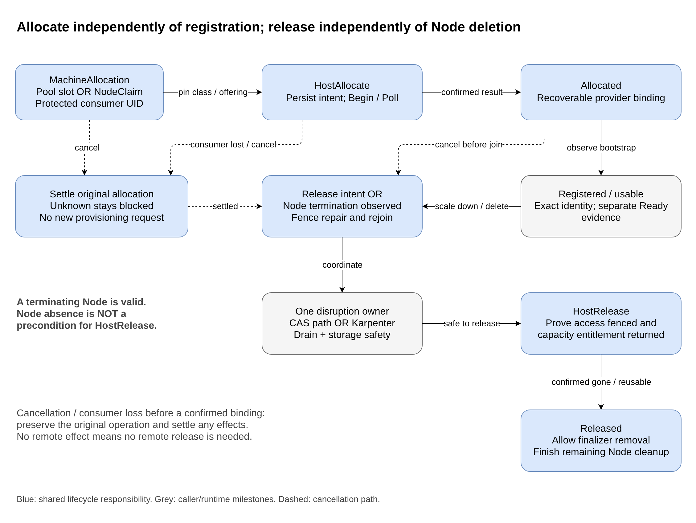

# Provider-independent autoscaling for Unbounded

**Status:** revised proposal for review; no CRDs or controllers implemented.

**Decision:** introduce `MachineClass`, `MachinePool`, and `MachineAllocation`, backed by the existing provider and `MachineOperation` modules.

## 1. Goal and architectural test

> A provider implements Unbounded's capacity contract once. Unchanged
> `unbounded-cas-plugin` and `unbounded-karp-plugin` can then manage its capacity.

The plugins must not import provider implementations, interpret provider-specific CRs, or call infrastructure APIs. They translate autoscaler contracts into Unbounded primitives. Scheduling and disruption policy remain with the autoscaler; infrastructure knowledge remains with the provider adapter.

"Out of the box" means a configured provider passes an **autoscaling conformance profile**. It does not mean every existing reboot-only provider becomes autoscaling-capable, or that every optional autoscaler feature is enabled. The decisive test is adding an inventory-reservation provider alongside ANS and running both plugins unchanged.

Scope is worker capacity across sites serving one target cluster, not multi-cluster scheduling. A Site scopes provider authority; it is not automatically a scheduling zone. Initial ANS support can expose one homogeneous offering per configured source.

## 2. Why these three CRs

| Alternative | Benefit | Limitation / cost | Decision |
|---|---|---|---|
| Operations plus existing Machine | Least new machinery | No durable pre-host demand, generic discovery, or group contract | Insufficient |
| Allocation plus operations | Reusable per-instance lifecycle | Still requires provider-specific CAS groups and Karpenter discovery/configuration translation | Superseded first draft |
| **Class + Pool + Allocation** | Complete common discovery, group, and instance interfaces | Three CRDs, shared reconcilers, and explicit provider conformance | **Recommend** |
| Additional Provider, Offering, Binding, or Retirement CRs | More independently managed objects | Extra lifetimes and controllers without a demonstrated need | Defer |

The distinction is **what can be supplied**, **how many are desired**, and **one use of capacity**. These are different lifetimes, not three wrappers around the same object.

## 3. Architecture and software modules


[Editable draw.io source](diagrams/architecture.drawio). Solid arrows show demand/execution; dashed arrows show normalized discovery. Both plugins use Kubernetes resources, not provider callbacks.

| Module | Responsibility |
|---|---|
| `unbounded-cas-plugin` | CAS group discovery, templates, target changes, membership, and selected-node deletion |
| `unbounded-karp-plugin` | Karpenter CloudProvider methods, NodeClass integration, inventory, drift, and registration/termination translation |
| Shared pool controller | Reconcile count-managed demand into allocation slots and durable resize transactions |
| Shared class/allocation reconcilers | Resolve class state; freeze allocation inputs; bind identities; observe lifecycle; recover and release |
| Provider SDK and adapter | Shared reconciliation/operation code plus provider-specific configuration, discovery, reservation, bootstrap, observation, and release callbacks |
| Conformance suite | Verify the common interface against both plugins and materially different providers |

These are logical modules, not six new deployments. Class/allocation reconcilers can be shared SDK code hosted in existing provider-controller processes beside their operation executors. They exclusively reconcile their registered provider; adapters return normalized results rather than independently patching the same status. The pool controller is provider-independent. No central provider RPC service is required.

The CAS plugin can use the external-gRPC integration model. The Karpenter plugin is a CloudProvider implementation packaged with a compatible self-hosted Karpenter controller, not an assumed remote plugin protocol or managed AKS NAP extension.

## 4. Resource contracts

All three proposed CRs are cluster-scoped. Field names below are illustrative; immutable inputs, authority, and recovery semantics are the contract.

### MachineClass: launch configuration and discovery

An operator selects Site/provider, a typed provider-configuration reference, and an existing Unbounded machine configuration. The provider SDK publishes a normalized resolved revision, readiness, capabilities, and offerings. Autoscalers never dereference provider-specific configuration.

Each offering describes a feasible combination of instance type, topology, capacity type, resources, runtime overhead, availability, and price. Do not flatten correlated type/zone choices into combinations the provider cannot supply. Preserve unavailable shapes for discovery and scale-from-zero templates; availability is advisory until reservation.

Initial bounded catalogs live in class status with observation/expiry times. Stale or failed observations mean **unknown**, not empty inventory or zero price. Oversized catalogs must fail explicitly, not truncate; a later paginated discovery interface can sit behind the same generic client. No per-SKU CR is needed initially.

`Ready` must reflect the observed generation and referenced configuration. The resolved launch revision excludes volatile price/availability changes. Existing allocations pin that revision and immutable configuration content; a numbered `MachineConfigurationVersion` alone is insufficient while still editable.

### MachinePool: homogeneous count-managed demand

A pool selects one class and a fixed scheduling shape, plus labels, taints, desired replicas, and scaling bounds. Its controller produces allocations; it does not implement ANS tenant accounting.

Scale-from-zero templates must include capacity, allocatable resources, topology, labels/taints, and runtime default-pod overhead without observing a live Node. Reject shape-changing template edits on populated pools rather than silently make a CAS group heterogeneous.

Resizing is a shared transaction, not separate "decrement count" and "delete allocation" writes. Persist target plus exact retirement/cancellation UIDs in one resource-version-checked pool update; serialize admission and retain a bounded pending intent until checkpointed. Derive allocation slots from pool UID and accepted resize identity. Return CAS success only after durable target acceptance.

`DecreaseTargetSize` cancels only unfulfilled demand; it must not silently delete an established Node. Selected-node deletion verifies pool/allocation/Node identities. A release selected for scale-down lowers target in the same intent; releasing for replacement preserves target. This prevents the pool controller from immediately recreating scaled-down capacity.

### MachineAllocation: one durable capacity obligation

The pool controller or Karpenter plugin creates an allocation with an immutable consumer UID, class reference, resource requirements, and node template. The shared reconciler freezes class/Site/source UIDs, launch revision, selected offering, and configuration before effects.

Status contains normalized provider identity, actual resources/image, Machine/Node bindings, operation references, and lifecycle/drift conditions. An allocation UID identifies one use of capacity; reuse of a physical host requires a new allocation UID.

`spec.lifecycle` moves only from `Active` to `Released`; deletion also requests release. Finalizers protect outstanding effects. Only the consumer's authorized controller or an operator may request retirement. A deletion or recreated consumer with the same name cannot transfer ownership.

The existing `Machine.spec.host.external.machineRef` remains the provider-owned host reference. Preserve its immutability. Add a small UID-bearing reverse allocation reference on Machine, claim it with optimistic concurrency, and recover partial binding writes. Do not impose owner references on provider inventory or agent-created Machines.

Unbounded-runtime allocations bind a Machine when it appears. A different runtime may bind its provider resource and Node without manufacturing an agent-managed Machine.

## 5. Proposed CR examples

**Illustrative review examples, not deployable manifests.** API versions/fields are proposed. Names, UIDs, resources, availability, prices, and timestamps are synthetic; they are not ANS capabilities or measurements. Status is controller-written and shown only to explain the interface.

### Class with one normalized offering

```yaml
apiVersion: unbounded-cloud.io/v1alpha3
kind: MachineClass
metadata:
  name: ans-east
spec:
  siteRef:
    name: east-lab
  provider: ANS
  providerConfigRef:
    apiGroup: infrastructure.aks-unbounded.goms.io
    kind: OneESPool
    name: ans-east-source
  configurationRef:
    name: linux-workers
    version: 7
status:
  observedGeneration: 1
  resolvedRevision: launch-r1
  autoscalingProfile: v1
  conditions:
    - type: Ready
      status: "True"
      reason: Resolved
      observedGeneration: 1
      lastTransitionTime: "2026-10-21T22:00:00Z"
  offerings:
    observedAt: "2026-10-21T22:00:00Z"
    validUntil: "2026-10-21T22:05:00Z"
    items:
      - id: example-4cpu-east-1
        instanceType: example-4cpu
        labels:
          kubernetes.io/arch: amd64
          kubernetes.io/os: linux
          topology.kubernetes.io/region: east
          topology.kubernetes.io/zone: east-1
        capacityType: OnDemand
        capacity:
          cpu: "4"
          memory: 16Gi
          pods: "110"
        overhead:
          kubeReserved:
            cpu: 100m
            memory: 256Mi
          systemReserved:
            cpu: 100m
            memory: 512Mi
          evictionThreshold:
            memory: 256Mi
        availability: Available
        price:
          currency: USD
          perHour: "0.20"
```

The common client derives allocatable CPU `3800m` and memory `15Gi`. Runtime default pods remain separately represented where required; plugins must not double-count their resources. Pricing uses a common currency/unit across selectable offerings; missing pricing never becomes a fabricated free offering.

### CAS-managed pool

```yaml
apiVersion: unbounded-cloud.io/v1alpha3
kind: MachinePool
metadata:
  name: batch-workers
spec:
  scalingOwner: ClusterAutoscaler
  replicas: 3
  minReplicas: 0
  maxReplicas: 10
  template:
    classRef:
      name: ans-east
    offeringRef:
      id: example-4cpu-east-1
    labels:
      workload.example.com/group: batch
    taints:
      - key: workload.example.com/batch
        value: "true"
        effect: NoSchedule
```

The shared pool controller creates three allocation slots with this pool's UID as consumer identity. The class reference/offering becomes a UID/revision-pinned input before provisioning. The resize journal and status counts are omitted here; they are not additional CRs.

### Individual allocation produced for a NodeClaim

```yaml
apiVersion: unbounded-cloud.io/v1alpha3
kind: MachineAllocation
metadata:
  name: claim-7b4d
spec:
  consumerRef:
    apiGroup: karpenter.sh
    kind: NodeClaim
    name: batch-7b4d
    uid: 11111111-1111-4111-8111-111111111111
  classRef:
    name: ans-east
  lifecycle: Active
  requests:
    cpu: "2"
    memory: 8Gi
  requirements:
    - key: kubernetes.io/arch
      operator: In
      values:
        - amd64
    - key: topology.kubernetes.io/zone
      operator: In
      values:
        - east-1
  nodeTemplate:
    labels:
      workload.example.com/group: batch
    taints:
      - key: workload.example.com/batch
        value: "true"
        effect: NoSchedule
```

The reconciler resolves an eligible offering without changing this request. A pool-created allocation instead identifies `MachinePool` as its consumer and carries the pool's fixed offering. Real plugins copy all required scheduling constraints, labels, and startup taints; this shortened example is not a complete hydrated NodeClaim.

### Karpenter uses the same class, not MachinePool

```yaml
apiVersion: karpenter.sh/v1
kind: NodePool
metadata:
  name: batch-workers
spec:
  template:
    spec:
      nodeClassRef:
        group: unbounded-cloud.io
        kind: MachineClass
        name: ans-east
      requirements:
        - key: kubernetes.io/arch
          operator: In
          values:
            - amd64
```

This is an **alternative** to the CAS example, not a second scaler for the same ANS source. Karpenter retains its native NodePool/NodeClaim policy. The plugin must implement its supported-NodeClass and readiness interfaces for MachineClass; a reference alone does not establish compatibility. No extra `UnboundedNodeClass` wrapper CR is proposed.

## 6. Closing both autoscaler contracts

| Contract | Provider-independent implementation |
|---|---|
| CAS groups, bounds, templates | MachinePool plus resolved MachineClass; support scale from zero |
| CAS increase / decrease target | Durable pool resize; cancel unfulfilled slots without removing established Nodes |
| CAS membership / deletion | Allocation inventory, including provisioning instances; exact member identity and accepted target changes |
| Karpenter instance types / offerings | Normalize class discovery, including currently unavailable types, feasible topology/capacity choices, overhead, and price |
| Karpenter Create | One allocation per NodeClaim UID; retries resolve that allocation; return hydrated provider identity/resources only after confirmed allocation |
| Karpenter Get / List / Delete | Owned allocation inventory; asynchronous release; report not-found only when release is confirmed |
| Karpenter drift / registration | Compare pinned launch revision plus normalized provider drift evidence; honor registration hooks without circular readiness waits |
| Optional autoscaler features | Explicit capabilities and standard unsupported behavior, never provider-specific plugin branches |

The baseline supports configured CAS groups and normal Karpenter provisioning/termination. CAS node-group autoprovisioning, atomic batch provisioning, DRA, reservations, and provider-specific repair policies require additional capability qualification. Karpenter's `RepairPolicies()` is provider-wide: default to no extra policies rather than pretend arbitrary per-class policies fit it.

The provider contract must distinguish insufficient capacity, invalid configuration, transient observation failure, ambiguous acceptance, and confirmed absence. Shared adapters translate those outcomes into autoscaler errors. CAS delta RPCs have no universal request UID: durable controller recovery does not imply exactly-once handling of indistinguishable client retries.

Karpenter v1.14.2 has default five-minute launch and fifteen-minute registration budgets. Qualify provider timing against those budgets; an ANS thirty-minute provisioning setting does not override them. Also watch consumer UID disappearance: an unlaunched NodeClaim may finalize without invoking provider Delete.

## 7. Execution, recovery, and safe retirement



[Editable draw.io source](diagrams/lifecycle.drawio). Milestones are not a new universal phase enum. Allocation, registration, and Node Ready are separate observations.

Extend `MachineOperation` with typed allocation targeting, `HostAllocate`, `HostRelease`, and richer results. Keep the existing Machine-target path unchanged; allocation operations must work before a Machine exists. Reuse Begin/Poll, input snapshots, persisted handles, and cleanup rather than build another execution engine.

`HostAllocate` completes when exactly one recoverable reservation/instance exists with stable identity and resolved shape. `HostRelease` completes when the allocation cannot rejoin the cluster and its capacity entitlement has been returned. Neither means that the Node object has disappeared.

Persist protected intent before effects. Use deterministic operation names and allocation UID as the durable reservation identity; retain operations until results are checkpointed into allocation status. A stored handle resumes by observation only. Lost acceptance requires replay-safe backend semantics or lookup; a correlation ID is insufficient. Unknown or partially failed outcomes remain protected until settled, including after consumer deletion. Never turn a timeout into proof that nothing was allocated.

Retirement fences competing repair/rejoin, then obtains workload/storage safety from exactly one disruption owner:

- **CAS:** preserve its scale-down/PDB behavior; shared retirement verifies or completes the remaining runtime/storage steps.
- **Karpenter:** it owns drain and Node finalizers. Node termination triggers the early rejoin guard; its provider-delete call authorizes release later. Do not run a second drain policy or require Node absence.
- **Orphan cancellation:** settle original effects and establish workload/storage safety without depending on a vanished consumer. Before submission, release needs no remote mutation.

Authorization is UID-bound and RBAC-protected, not a public `skipDrain` switch. Preserve caller-authorized deadline/force behavior without inventing new bypasses. A late join cannot revive released demand.

Allocation-managed Machines need a narrow Machina/agent guard against automatic repave/rejoin after retirement or autoscaler Node deletion. This is coordination, not proof of revoked access: release still requires runtime/provider fencing evidence. Unmanaged Machines retain existing behavior; explicit repair shares the allocation operation fence.

## 8. Provider adoption and bounded changes

Providers implement normalized class resolution/discovery and per-allocation reserve/provision, observe, drift, and release callbacks. The SDK owns common status/finalizers and operation recovery. Route through existing Site/provider credential selection with explicit provisioning authorization; never place credentials in these CRs.

**ANS:** retain `OneESPool` as provider configuration and tenant coordination, but remove its independent desired-count authority for opted-in sources. MachinePool owns generic count/membership. The provider adapter records allocation-UID admissions and correlates aggregate tenant mutations to exact hosts; one host satisfies at most one allocation. Karpenter never bypasses that coordinator.

Split ANS's terminating-Node rejection and Public Flex's Node-absence wait from provider release, preserving reset and registration cleanup. Qualify scalable-pool replay/retention guarantees against live ANS; legacy correlation does not satisfy the new recovery contract.

Start with empty, explicitly opted-in sources and one scaling authority per source. Existing populated pools stay on the old path until an identity-checked import exists. Minimum capacity must be accounted allocations, not background growth outside the shared model.

| Location | Change |
|---|---|
| Unbounded provider model / machina definitions | Three CRDs, normalized capacity types, operation target/results, small Machine binding |
| Unbounded machine-operations SDK | Shared class/allocation reconciliation, recovery, observation, and retirement |
| Shared pool controller | Count management, homogeneous templates, durable resize and membership |
| Autoscaler plugin modules | Implement each autoscaler contract once over Unbounded CRs |
| ANS provider repository | Implement capacity callbacks and opt-in migration; preserve tenant/bootstrap internals |
| Machina/agent | Narrow managed-allocation retirement guard |

No Site/network redesign, provider deployment CR, new bootstrap language, or broad agent rewrite. Dynamic multi-offering selection can grow inside the same contract; generic Class and Pool semantics are part of the initial design, not deferred provider-specific work.

## 9. Delivery and acceptance

Build the first vertical slice with one offering: class discovery -> pool or NodeClaim demand -> allocation -> registration -> safe release. Require both plugins and a materially different inventory-reservation adapter before declaring the profile complete.

Conformance must cover scale from zero and overhead accuracy; unavailable/stale offerings; class mutation/drift; duplicate requests and leader handoff; UID reuse and competing bindings; resize/delete atomicity; canceled and late allocations; orphan cleanup; finalizer ordering; and site/auth outages. Verify old host operations and unmanaged Machine behavior remain unchanged.

**Acceptance: introduce the second provider without changing either plugin or the shared pool controller.** Fixtures establish controller behavior; live provider recovery and runtime fencing remain separate qualification gates.

## Evidence and diagram provenance

Source review: Unbounded `30df1e73b4fe091ecead0465be3de9eb93003339`; ANS `c20a745` from the preceding investigation. ANS pins Unbounded v0.12.0; upgrading that dependency is a separate compatibility gate.

- [Typed provider reference and host ownership](https://github.com/Azure/unbounded/blob/30df1e73b4fe091ecead0465be3de9eb93003339/api/machina/v1alpha3/machine_types.go#L165-L264): existing reference does not contain a UID.
- [Operation kinds, snapshots, targets, and TTL](https://github.com/Azure/unbounded/blob/30df1e73b4fe091ecead0465be3de9eb93003339/api/machina/v1alpha3/machineoperation_types.go#L51-L344): current operations target existing Machines.
- [Begin/Poll contract](https://github.com/Azure/unbounded/blob/30df1e73b4fe091ecead0465be3de9eb93003339/pkg/machineops/provider.go#L28-L38) and [resumable execution](https://github.com/Azure/unbounded/blob/30df1e73b4fe091ecead0465be3de9eb93003339/internal/machineops/resumable.go#L29-L111): safe resubmission is required, not supplied by correlation.
- [Agent registration](https://github.com/Azure/unbounded/blob/30df1e73b4fe091ecead0465be3de9eb93003339/cmd/agent/internal/daemon/daemon.go#L303-L346): preexisting Machines are left intact; otherwise the agent creates one. Precreation is possible when identity is known, not mandatory for every provider.
- [Configuration-driven repave](https://github.com/Azure/unbounded/blob/30df1e73b4fe091ecead0465be3de9eb93003339/cmd/agent/internal/daemon/controller_node.go#L26-L105) and [configuration-version lifetime](https://github.com/Azure/unbounded/blob/30df1e73b4fe091ecead0465be3de9eb93003339/api/machina/v1alpha3/machineconfigurationversion_types.go#L47-L90): versions remain editable until deployed; new allocation inputs need explicit freezing.
- [Provider design intent](https://github.com/Azure/unbounded/blob/30df1e73b4fe091ecead0465be3de9eb93003339/designs/machine-provider-operations-requirements.md): optional capabilities and transport-neutral adapters are consistent with this proposal.
- ANS [recovery contract](https://msazure.visualstudio.com/DefaultCollection/CloudNativeCompute/_git/unbounded-providers?path=/docs/ans-operation-recovery.md&version=GCc20a74560ea54563f6d66d865f16cac7f0a18814), [retirement entry](https://msazure.visualstudio.com/DefaultCollection/CloudNativeCompute/_git/unbounded-providers?path=/ans-machine-ops-controller/internal/autoscaling/retirement.go&version=GCc20a74560ea54563f6d66d865f16cac7f0a18814), and [Public Flex retirement](https://msazure.visualstudio.com/DefaultCollection/CloudNativeCompute/_git/unbounded-providers?path=/ans-machine-ops-controller/internal/autoscaling/flex/public_retirement.go&version=GCc20a74560ea54563f6d66d865f16cac7f0a18814): why provider recovery and Node cleanup cannot be generalized unchanged.
- [Karpenter termination](https://github.com/kubernetes-sigs/karpenter/blob/v1.14.2/pkg/controllers/node/termination/controller.go) and [liveness](https://github.com/kubernetes-sigs/karpenter/blob/v1.14.2/pkg/controllers/nodeclaim/lifecycle/liveness.go): infrastructure release precedes finalizer removal; provisioning budgets are distinct.
- [Karpenter NodeClaim finalization](https://github.com/kubernetes-sigs/karpenter/blob/v1.14.2/pkg/controllers/nodeclaim/lifecycle/controller.go): an unlaunched claim with no providerID can finalize without invoking provider deletion.
- [Karpenter v1.14.2 provider interface](https://github.com/kubernetes-sigs/karpenter/blob/v1.14.2/pkg/cloudprovider/types.go): discovery, overhead, pricing, drift, supported NodeClasses, and provider-wide repair policies.
- [CAS contract reference, v1.34.0](https://github.com/kubernetes/autoscaler/blob/cluster-autoscaler-1.34.0/cluster-autoscaler/cloudprovider/cloud_provider.go): target-size acceptance, unfulfilled-demand cancellation, instance inventory, and group templates. Pin and qualify the actual CAS/external-gRPC version during implementation; this reference is not a deployment compatibility claim.

Diagrams describe the proposal, not an extracted running system. Authored as editable draw.io XML using [Agents365-ai/drawio-skill](https://github.com/Agents365-ai/drawio-skill) at `57270820d3cd71cbdf4fb6b2f7091d4fb37bb019`. PNGs are rendered locally with the diagrams.net viewer; no design content is sent to a hosted renderer.
