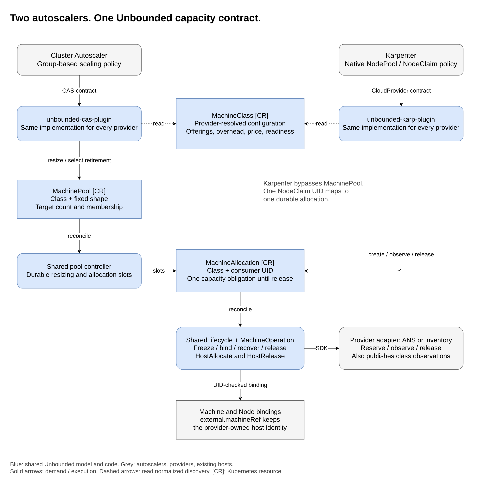

# Provider-independent autoscaling for Unbounded

| Field | Value |
| --- | --- |
| Status | Revised design for review, informed by a successful Azure/AWS Karpenter POC |
| Scope | Provider-independent host operations and worker lifecycle, with optional autoscaling, for one target cluster |
| Audience | Maintainers, provider authors, operators, and agents preparing an implementation plan |
| Repository baseline | Local POC implementation on `8728a2e4099cbf6a1f8f4b898c324ed343073c76`; implementation changes are uncommitted |
| Date | 2026-10-22 |

## Review guide

- Sections 1-4 explain the problem, scope, current implementation, and resource lifetimes.
- Sections 5-7 describe the contracts, examples, and component ownership.
- Sections 8-13 cover launch, retirement, recovery, bootstrap, reporting, and scale.
- Sections 14-16 define the provider SDK interface, remaining CAS/provider work,
  and verification gates.
- Section 17 lists decisions still needed before implementation planning.
  Section 18 explains the alternatives considered.

For a short account of what ran and what it proved, read the
[POC explainer](poc.md). Environment-specific deployment and reproduction
instructions are retained locally, outside this design review.

## 1. Purpose and context

Unbounded connects workers from different environments to a Kubernetes control
plane. As it integrates with more providers, it needs a consistent way to
manage host lifecycle operations: allocating capacity, observing hosts,
rebooting or replacing them, and safely releasing their resources. Each
provider can require different APIs, recovery behavior, and cleanup logic.

It makes sense to align those host lifecycle integrations with a generic
autoscaling contract rather than build a separate integration for every
provider/autoscaler pair. The autoscaler decides what capacity workloads need;
Unbounded coordinates the shared lifecycle; provider adapters implement the
custom logic needed to discover, provision or reserve, recover, and release
their capacity.

> A provider implements Unbounded's capacity contract once. The same
> `unbounded-cas-plugin` and `unbounded-karp-plugin` implementations can then
> manage that provider without provider-specific changes.

The core primitives do not require an autoscaler. An operator should also be
able to declare and manage the cluster's worker topology through the same
cluster's Kubernetes API: which providers and Sites supply workers, what
capacity to allocate, and when to retire it. Autoscalers are optional consumers
of this infrastructure API, not a prerequisite for using it.

Providers can therefore customize how they fulfill autoscaling requests without
changing the plugins or introducing a competing scaling policy. The plugins
must not import cloud SDKs, interpret provider configuration, or call
infrastructure APIs. They translate their autoscaler's contract into Unbounded
resources. When an autoscaler is used, scheduling and disruption policy stay
with it; infrastructure identity, allocation, and cleanup stay with the provider
adapter.

The POC tested this boundary with AzureVM and AWSEC2. One self-hosted Karpenter
deployment managed both providers in the same AKS cluster without changing its
source or image when AWS was added. Both workers ran workloads, communicated
across clouds, survived provisioning-time controller restarts, and released
their infrastructure through normal termination.

That is evidence for the Karpenter boundary, not proof that every provider or
autoscaler already works. Both tested adapters create cloud VMs. A provider that
reserves existing inventory, and the Cluster Autoscaler path, still need their
own qualification.

### 1.1 How to read this design

"Must" identifies a required invariant. "Should" identifies a recommendation.
"May" identifies an optional feature. These terms describe the target design;
they do not imply that every requirement is implemented.

**POC behavior** describes code present in this worktree. **Proposed** describes
remaining work. API examples are labeled accordingly. Source references use
repository-relative `file:line` locations in the local implementation, not a
claim that the implementation is contained in the baseline commit or has been
rebased and verified against the latest main branch.

### 1.2 Main design choices

1. Separate supply (`MachineClass`), count-managed demand (`MachinePool`), and
   one use of capacity (`MachineAllocation`).
2. Let Karpenter keep its native NodePool/NodeClaim policy. It does not need a
   MachinePool or a provider-specific NodeClass wrapper.
3. Reuse the provider SDK and MachineOperation Begin/Poll execution model.
4. Give each allocation a durable identity before a remote host exists.
5. Treat allocation, registration, Node readiness, and release as different facts.
6. Assign drain policy to one owner. Fencing a host does not authorize its deletion.
7. Recover the original operation and native resources, rather than creating
   replacements until a test becomes green.
8. Qualify providers against explicit behavior, not merely interface registration.

## 2. Goals and scope

### 2.1 Goals

- Scale from zero using truthful capacity, overhead, topology, and price.
- Support different infrastructure providers behind unchanged autoscaler plugins.
- Let operators manage worker capacity and placement from within the same
  cluster, without deploying an autoscaler.
- Preserve consumer, allocation, Machine, operation, and native-resource identity
  across retries and controller restarts.
- Safely settle canceled requests and partially completed remote operations.
- Prevent a retiring allocation from repaving or rejoining as fresh capacity.
- Release only resources whose ownership is established.
- Keep lookups, observation refreshes, and reconciliation work bounded.
- Add providers without redesigning Sites, networking, or the agent runtime.

The scope is worker capacity across Sites serving one target cluster, not
multi-cluster scheduling. A Site scopes authority and connectivity; it is not
automatically an availability zone or a capacity group.

### 2.2 What the accepted POC does not cover

- The CAS plugin, MachinePool CRD/controller, or CAS resize transactions.
- Reservation of existing inventory or adoption of populated provider pools.
- General multi-offering, Spot, accelerator, architecture, or image qualification.
- Full outage, late-join, ambiguous-create, storage-detach, repair, and drift coverage.
- Load testing or a production-scale conformance profile.
- Automatic cleanup when ownership or workload safety cannot be established.

These are qualification or design gaps, not permission to add provider-specific
branches to the plugins. CAS node-group autoprovisioning, atomic batch placement,
DRA, reservations, and specialized repair policies remain separate extensions.

## 3. How this fits the current code

| Current POC behavior | Where to find it | Design consequence |
| --- | --- | --- |
| MachineClass references a Site, provider, immutable ConfigMap, and versioned machine configuration. | `api/machina/v1alpha3/machineclass_types.go:65-116` | Keep provider settings behind a reference. Arbitrary provider-CR references are not implemented. |
| Allocation inputs are immutable except for the one-way lifecycle intent. | `api/machina/v1alpha3/machineallocation_types.go:95-145` | Changes to an existing request cannot silently launch a different machine. |
| Class resolution and pure identity planning are separate from long-running effects. | `pkg/machineops/capacity.go:15-109`, `:148-169` | Extend the existing SDK, not a new provider RPC service. |
| A snapshot is persisted before launch, and launch ensures a Machine before creating HostAllocate. | `internal/capacity/allocation_launch.go:48-130`; `internal/capacity/allocation_controller.go:240-321` | The POC precreates an Unbounded Machine; late binding for inventory providers remains design work. |
| Karpenter creates one allocation named from the NodeClaim UID. | `plugins/karpenter/internal/provider/provider.go:59-197` | Create retries refer to the same durable request. |
| Karpenter Delete writes release intent; confirmed release is reported separately. | `plugins/karpenter/internal/provider/inventory.go:177-230` | Accepted deletion is not proof that infrastructure is gone. |
| Retirement fences the Machine and revokes bootstrap before checking release authorization. | `internal/capacity/allocation_release.go:158-212`, `:247-309` | Deletion, fencing, and safe release are distinct. |
| Allocation-backed Machines reject HostReplace, HostPowerOff, and HostPowerOn even if the provider registers them. | `internal/machineops/allocation.go:64-96` | Provider capability and permission to operate on a particular Machine are separate; broader support needs lifecycle review. |
| A recorded allocate operation cannot be silently replaced. | `internal/capacity/allocation_controller.go:247-262`; `internal/machineops/allocation.go:250-268` | Losing the recorded journal requires recovery, not another launch. |
| Providers record actual attached resources, including results from failed allocation. | `internal/machineops/providers/azurevm/capacity.go:659-795`; `internal/machineops/providers/awsec2/capacity.go:883-963` | Cleanup cannot be derived from a naming convention alone. |
| Related-object indexes and selective class watches limit reconciliation fan-out. | `internal/capacity/indexes.go:16-101`; `internal/capacity/setup.go:187-249` | An offering refresh must not wake every healthy allocation. |
| Provider/Site selection gives controllers separate leader leases; AWS is explicitly enabled. | `cmd/machine-ops-controller/main.go:180-230` | Providers can share code without sharing cloud credentials or a global leader. |

The earlier proposal used provider-specific CR references, illustrative
`requests` and `offerings.items` fields, and a late-binding Machine model.
The POC instead uses ConfigMaps, `resources`, a direct `offerings` list, and a
precreated Machine. This revision distinguishes those implemented contracts from
the remaining extensions rather than treating the old examples as deployable.

## 4. What the three resources mean

| Resource | Question it answers | Lifetime | State |
| --- | --- | --- | --- |
| MachineClass | What can this configured provider supply? | Operator-managed launch configuration and refreshed observations | Implemented |
| MachinePool | How many machines of one fixed shape should exist? | Count-managed group, independent of individual replacements | Proposed |
| MachineAllocation | Which consumer owns this one use of capacity? | From durable demand until every effect is settled and released | Implemented |

These are different lifetimes, not three wrappers around one object. Existing
Machine resources describe managed hosts; MachineOperations record execution.
Neither replaces the need for pre-host demand or scale-from-zero discovery.

Karpenter's **NodePool** is not Unbounded's proposed **MachinePool**. Karpenter
chooses individual machines through NodeClaims. CAS manages a group's target
count and therefore needs the additional count-managed contract.

The target resources are cluster-scoped. A source must have one scaling
authority; two plugins must not independently manage the same capacity.

### 4.1 Using the primitives without an autoscaler

Operators can manage these resources through `kubectl`, GitOps, or their own
in-cluster automation. The target contract supports both individual requests
and explicitly sized groups:

- MachineClass describes the provider, Site, configuration, and available shapes.
- MachineAllocation requests one use of capacity, with a valid UID-bound
  consumer, without requiring a Karpenter NodeClaim.
- The proposed MachinePool lets an operator set a desired replica count.
  Its controller maintains that count without requiring Cluster Autoscaler.

The same shared lifecycle and provider adapters reconcile those requests.
Without an autoscaler, the operator or designated automation owns placement,
target changes, and safe retirement, including drain and storage preparation
before authorizing release. It must not compete with an autoscaler for the same
demand or bypass identity, fencing, and cleanup safeguards.

This manages the worker topology of an existing cluster, not initial
control-plane bootstrap. The API and lifecycle controllers still need available
management capacity. The live POC exercised the Karpenter path only;
MachinePool remains proposed, and operator-managed consumer and retirement
workflows still need end-to-end qualification.

## 5. Resource contracts

### 5.1 MachineClass: configuration and discovery

The operator selects the Site and provider, an immutable provider-configuration
reference, and a MachineConfiguration version. Only the provider interprets the
configuration. The POC supports immutable ConfigMaps in a configured namespace;
other reference kinds require an explicit API extension.

The shared reconciler resolves input identities and publishes:

| Field or observation | Meaning |
| --- | --- |
| `observedGeneration` and `Ready` | The current class inputs resolved successfully. |
| `resolvedRevision` | Identity of resolved launch inputs, used to detect drift. |
| Site and credential UIDs | The authority under which the class was resolved. |
| Configuration and bootstrap hashes | The exact referenced content expected at allocation time. |
| `offerings` | Feasible instance-type, zone, purchase-model, resource, overhead, and price combinations. |
| `OfferingsCurrent` | In the POC, at least one currently available offering exists. |

`Ready=True` is not a capacity guarantee. The POC retained a resolved Azure
class while its original SKU became unavailable. Restoring supply required a
new immutable provider configuration and matching NodePool constraint, not an
autoscaler patch.

The revision excludes volatile offering observations. A change to launch
configuration changes the revision; a timestamp refresh alone does not.
Prices embedded in provider configuration can still change that configuration's
hash. See `internal/capacity/class_controller.go:351-418`.

### 5.2 MachineAllocation: protected demand

The consumer supplies its UID, the class name and UID, resource requirements,
labels, taints, and startup taints. The controller freezes the selected offering,
class revision, Site and credential identities, configuration template, and
content references before effects.

The snapshot stores the machine configuration template itself. Provider and
bootstrap ConfigMaps remain UID/hash-checked references, not copied secret
payloads. Do not delete inputs while an unsubmitted Begin may still need them
(`api/machina/v1alpha3/machineallocation_types.go:350-419`).

`spec.lifecycle` moves only from `Active` to `Released`. `Fenced` is a condition
and a Machine guard, not a third spec value. Setting `Released` is the trusted
consumer's authorization to release after its workload/storage safety steps.
Deleting the allocation starts retirement but is not an equivalent drain bypass.

An allocation UID represents one use of capacity. Reusing a physical host
requires a new allocation UID. Names alone cannot transfer ownership.

### 5.3 Identity before and after creation

| Identity | Purpose |
| --- | --- |
| Consumer UID | Identifies the requesting Kubernetes object, such as a NodeClaim or an operator-managed consumer. |
| Allocation UID | Correlates all effects for one capacity obligation. |
| Node provider ID | `unbounded:///machineallocations/<allocation-uid>`, independent of cloud. |
| Planned host locator | Provider-specific identity usable before the host exists. |
| Native resource ID | Actual ARM ID, EC2 instance ARN, or future reservation identity. |
| Owned resource ID and native ID | Evidence for identifying and releasing the actual resource incarnation. |

Azure can plan an ARM path before creation. EC2 assigns an instance ID remotely,
so the AWS adapter plans an opaque account/region/zone/allocation locator and
reports the instance ARN later. A generic contract must allow both; it must not
require a fabricated native ID.

The POC binds the planned locator through `Machine.spec.host.external.providerID`.
Existing `external.machineRef` remains a provider-owned host reference, not an
allocation reference. Its immutability must be preserved
(`api/machina/v1alpha3/machine_types.go:259-275`).

## 6. Examples

### 6.1 Class using the POC API

This illustrates the implemented field shape, not a complete deployment.
The Site, immutable provider ConfigMap, configuration version, and scoped
credential must already exist. No provider settings or credentials are exposed
to Karpenter.

```yaml
apiVersion: unbounded-cloud.io/v1alpha3
kind: MachineClass
metadata:
  name: example-workers
spec:
  siteRef:
    name: example-site
  provider: AzureVM
  providerConfigRef:
    kind: ConfigMap
    namespace: unbounded-system
    name: example-provider-v1
  configurationRef:
    name: example-linux
    version: 1
```

An AWSEC2 class has the same structure with `provider: AWSEC2` and its own
provider configuration, Site, and authority. The autoscaler does not inspect
those configuration contents.

### 6.2 Karpenter references the class directly

```yaml
apiVersion: karpenter.sh/v1
kind: NodePool
metadata:
  name: example-workers
spec:
  template:
    spec:
      nodeClassRef:
        group: unbounded-cloud.io
        kind: MachineClass
        name: example-workers
      requirements:
        - key: kubernetes.io/arch
          operator: In
          values:
            - amd64
        - key: karpenter.sh/capacity-type
          operator: In
          values:
            - on-demand
```

The integration implements Karpenter's supported-NodeClass and readiness
interfaces; the reference alone is not what makes it compatible. No
`UnboundedNodeClass` or provider-specific wrapper is needed.

### 6.3 Allocation produced for a NodeClaim

The UIDs below are synthetic. The plugin copies the real NodeClaim request,
class UID, labels, and taints; operators normally do not author this resource.

```yaml
apiVersion: unbounded-cloud.io/v1alpha3
kind: MachineAllocation
metadata:
  name: nodeclaim-11111111-1111-4111-8111-111111111111
spec:
  consumerRef:
    apiGroup: karpenter.sh
    kind: NodeClaim
    name: example-workers-abcde
    uid: 11111111-1111-4111-8111-111111111111
  classRef:
    name: example-workers
    uid: 22222222-2222-4222-8222-222222222222
  resources:
    cpu: "2"
    memory: 8Gi
  requirements:
    - key: kubernetes.io/arch
      operator: In
      values:
        - amd64
  nodeTemplate:
    labels:
      karpenter.sh/nodepool: example-workers
    startupTaints:
      - key: karpenter.sh/unregistered
        effect: NoExecute
  lifecycle: Active
```

The controller selects one matching current offering without changing the
request. The actual selection, native identity, operations, and bindings are
reported in status.

### 6.4 Proposed count-managed pool

**Not implemented and not accepted by the current CRDs.** These fields preserve
the earlier proposal's intent; the resize journal and admission API still need
review. This is an alternative scaling owner, not a second scaler for section 6.2.

```yaml
apiVersion: unbounded-cloud.io/v1alpha3
kind: MachinePool
metadata:
  name: example-batch
spec:
  scalingOwner: ClusterAutoscaler
  replicas: 3
  minReplicas: 0
  maxReplicas: 10
  template:
    classRef:
      name: example-workers
    offeringRef:
      id: example-fixed-shape
    labels:
      workload.example.com/group: batch
```

## 7. How the pieces fit together

Read the diagram from top to bottom. Both plugins read the same discovery
contract. Karpenter creates allocations directly; CAS reaches them through a
count-managed MachinePool. Both paths use the same host lifecycle and provider
interface. This diagram focuses on autoscaler integrations; the operator-managed
path in section 4.1 enters at MachineAllocation or MachinePool without either
plugin.



The green paths were exercised in the POC. The amber CAS/MachinePool path is
proposed, and additional providers require qualification. The diagram groups
each autoscaler with its plugin for readability; it does not imply that CAS
or every host lifecycle operation has been qualified.
[Editable draw.io source](diagrams/architecture.drawio).

| Component owns | Component does not own |
| --- | --- |
| Autoscaler: scheduling, placement constraints, disruption policy | Cloud credentials or provider-specific resource discovery |
| Plugin: translate autoscaler requests and observations | Provider API calls or a second drain policy |
| Shared controllers: snapshots, identity binding, status, finalizers, fencing | Cloud-specific request parameters |
| MachineOperation engine: durable Begin/Poll execution | An invented exactly-once guarantee for every backend |
| Provider adapter: discovery, replay-safe submission, observation, native cleanup | Autoscaler policy or independent desired-count growth |
| Host agent/runtime: bootstrap, registration, local lifecycle guards | Permission to revive a released allocation |

These are logical modules, not a requirement for a deployment per module.
The POC hosts shared capacity reconciliation beside provider operations in
`machine-ops-controller`. Each provider/Site scope has one elected writer.
Adapters return normalized results; they do not race the shared controller to
patch allocation status. The Karpenter plugin is packaged with a compatible
self-hosted controller, not a remote plugin protocol or managed AKS NAP extension.
The provider-facing callback and registration interface is defined in
[section 15.1](#151-provider-interface-host-operations-and-machine-lifecycle).

## 8. Launching capacity and deciding when it is usable

1. The plugin creates or finds the allocation for the same consumer UID.
2. The shared controller persists ownership metadata and a finalizer.
3. It checks the class and selects a current offering satisfying the complete
   request, including any `minValues` flexibility floor.
4. It computes a provider locator without remote effects and persists the snapshot.
5. The POC creates a short-lived bootstrap credential, ensures the bound Machine,
   and creates HostAllocate with deterministic naming.
6. The operation engine begins or resumes the provider operation.
7. The provider reports a confirmed native host, shape, and owned resources.
8. The plugin returns a hydrated NodeClaim; registration and Node readiness are
   observed independently.

`Allocated` must not depend on Node Ready. Requiring that would couple cloud
creation to Karpenter's later registration lifecycle. Conversely, a successful
cloud API response is not evidence that the node bootstrapped or can run a pod.

The POC fixes reinforce those separate checks: digest-pinned rootfs extraction
had to work, installer errors had to remain failures, and actual Node resource
lists had to accept omitted zero-valued resources without allowing positive
over-advertising. Scale-from-zero discovery must match the real runtime, not
just the advertised VM size.

Keep upstream launch and registration budgets in qualification. A provider's
longer internal timeout does not extend Karpenter's budgets. Consumer UID
disappearance must be watched because an unlaunched claim can disappear without
the normal provider Delete callback.

## 9. Retiring capacity safely

### 9.1 One disruption owner

Karpenter owns normal drain, PDB handling, storage safety, and Node finalizers.
The shared controller fences launch/repave/rejoin as soon as retirement is
observed, but waits for Karpenter's provider Delete call to authorize release.
The plugin then writes `spec.lifecycle: Released`.

```text
Node/consumer termination observed
    -> fence Machine and revoke bootstrap
    -> Karpenter drains under its own policy
    -> plugin authorizes release
    -> settle any in-flight HostAllocate
    -> HostRelease confirms native cleanup
    -> finish allocation and Node/NodeClaim finalization
```

A terminating Node is valid during HostRelease. Requiring Node absence first
would deadlock with Karpenter's finalizer ordering. The accepted POC proved that
both providers remained present while PDBs blocked drain, then released normally.

### 9.2 Consumer loss is a separate path

If the consumer is confirmed gone, no consumer remains to drain the node. The
POC cordons orphan Nodes and checks their workloads and reported volume use.
It deletes only Nodes with no blocking workload/storage observations, respects
their finalizers, and waits for them to disappear before releasing the host.
Startup taints are not proof of safety; tolerating workloads can run there
(`internal/capacity/allocation_release.go:280-429`).

An orphan with real workloads requires operator intervention. The controller
does not force eviction or clear another controller's finalizers. The regression
test preserves the workload and blocks release until it is removed
(`internal/capacity/orphan_test.go:103-144`).

### 9.3 Cleanup means all owned effects

Deleting a VM is not enough. Release must account for the actual NICs, disks,
ENIs, volumes, reservations, and credentials that belong to the allocation.
Record native identities while ownership is provable, including partial failure
results. Read both allocation status and its UID-matched allocate operation so a
delayed status copy does not lose cleanup evidence
(`internal/machineops/allocation.go:135-244`).

Names are insufficient: Azure created a suffixed NIC, and EC2 assigned native
identities after launch. Missing metadata during creation requires observation,
not fabricated resource names or premature success. Unknown ownership must
block deletion and be reported.

The [lifecycle diagram](diagrams/lifecycle.png) and
[editable source](diagrams/lifecycle.drawio) show the general milestones.
Its Node-absence note describes authorized normal release; the orphan path
above deliberately has a stricter safety gate.

## 10. Resuming safely after failures

The existing operation engine persists provider handles and polls them after
restart. A crash between remote acceptance and saving the handle can still
cause Begin to run again. Each adapter must explain how it recovers that window;
a correlation string alone is not a recovery contract
(`internal/machineops/resumable.go:29-175`).

| Event | Required behavior |
| --- | --- |
| Reconcile or Create repeats | Find the original allocation and operation by identity. |
| Controller restarts with a saved handle | Observe the same native operation; Poll must not create a host. |
| Create was accepted but its response/status was lost | Use documented replay semantics or an ownership-checked native lookup. |
| Provider lookup is temporarily empty | Do not equate eventual inconsistency with confirmed absence. |
| A previously recorded host disappears | Do not resurrect it under the same allocation. |
| Recorded HostAllocate is missing or has another UID | Report ProviderConflict and retain the old reference; do not recreate it. |
| Allocation fails after creating resources | Retain observed owned resources for release. |
| Consumer disappears during create | Fence, settle the original create, then follow safe orphan release. |
| Site or credential is recreated | Do not silently transfer authority to the new UID. |
| Release cannot prove ownership or completion | Keep protection and expose the reason; no success-shaped fallback. |

The recorded-operation fence is exercised with both ordinary and lagging-cache
reads in `internal/capacity/allocate_fence_test.go:84-174`. It is also checked
before provider Begin, so recreating the operation cannot bypass the controller.

### 10.1 What the AWS adapter taught us

The AWS adapter uses an allocation-derived client token, a frozen account,
region, zone, subnet, and launch request, and targeted instance lookup. With a
saved instance identity it refuses a missing or terminal instance rather than
launching a replacement. Its ten-minute visibility bound limits observation of
an accepted instance; it is not a claim about how long EC2 retains tokens
(`internal/machineops/providers/awsec2/capacity.go:506-621`, `:815-880`).

The [EC2 idempotency contract](https://docs.aws.amazon.com/ec2/latest/devguide/ec2-api-idempotency.html)
is zonal for RunInstances with a subnet. Retrying in another zone or region is
not the same allocation attempt. Do not invent an undocumented token-retention
window or use a new token to hide uncertain results.

Tests assert identical replay parameters and one fake native instance, reject
changed user data, and refuse replacement of recorded instances
(`internal/machineops/providers/awsec2/capacity_test.go:517-670`). The live test
proves restart recovery, not every ambiguous-submission interleaving.

### 10.2 Remaining recovery limits

There is still a gap between creating a MachineOperation and recording its UID
on the allocation. A retry can adopt the existing deterministic operation, but
if that operation is deleted inside the gap, the recorded-operation fence has
no reference to protect. Recovery then depends on provider replay/lookup
semantics. The POC does not prove safe recovery after both the operation journal
and native replay evidence are lost.

Rendered user data also depends on some live bootstrap inputs and the controller
implementation. CA/version changes or an upgrade during an ambiguous Begin can
change the request. AWS parameter mismatch fails rather than deliberately
launching under a different token; that is not seamless upgrade recovery.

Unrecorded live resources, out-of-band Machine deletion, replaced authority, or
lost child-resource evidence can require manual recovery. Do not remove
finalizers or delete journals to turn these cases into apparent success.
Section 17 asks how to close and operate these gaps.

## 11. Bootstrap and authority boundaries

Provider independence includes bootstrap, not just VM creation. A newly launched
host must reach the target API, obtain the pinned artifacts, register the expected
identity, and join the Site's network without embedding provisioning credentials.

| Boundary | Requirement and POC approach |
| --- | --- |
| Autoscaler | Kubernetes access to generic resources; no cloud credentials. |
| Provider controller | Site/provider-scoped authority; separate Azure and AWS workload identities in the POC. |
| Provider configuration | Administrator-controlled immutable input; no secrets or bearer URLs. |
| Worker artifact access | Narrow host identity permissions: private Blob or exact-version S3 access, followed by digest verification. |
| Cluster bootstrap | Short-lived per-allocation credential, revoked when fenced. |
| Later host starts | Check the UID-bound Machine fence using the daemon credential. |

Bootstrap hooks run as root, so permission to publish referenced bootstrap
files is privileged provisioning authority, not an ordinary workload setting
(`api/machina/v1alpha3/machineclass_types.go:131-163`).

The agent's launch guard uses bootstrap authorization before it has a daemon
certificate and the bound Machine afterward
(`cmd/agent/internal/daemon/allocation_fence.go:65-204`). This is a lifecycle
guard, not proof that deleting a token revokes every already-issued credential
or stops an already-running kubelet. Full late-join and outage qualification
remains required.

Transport limits belong in adapters. The AWS adapter deterministically gzips
the complete payload and checks EC2's 16-KiB decoded user-data limit before
submission; errors report sizes, never the payload
(`internal/machineops/providers/awsec2/capacity.go:663-684`).

Connectivity must be tested end to end. Node Ready alone did not establish
API-server-to-kubelet access or cross-cloud service routing. The POC used the
existing Unbounded overlay and the AKS Konnectivity agent; no new VPN or public
kubelet ingress was needed. Other control-plane/network setups need their own
proof, not an assumption that AKS behavior is universal.

## 12. Offerings, status, and errors

### 12.1 Discovery is a scheduling contract

An offering is a feasible tuple, not independent lists of sizes and zones.
Preserve correlations between instance type, zone, purchase model, capacity,
overhead, and price. Preserve unavailable offerings for discovery, but do not
launch from unknown or expired availability.

The plugin translates neutral offerings into the pinned upstream scheduler's
requirements. Extra labels must not accidentally exclude every candidate, and
translation must not drop caller constraints. Tests invoke the actual pinned
scheduler, not just the conversion helper
(`plugins/karpenter/internal/provider/offerings.go:57-84`;
`plugins/karpenter/internal/provider/scheduler_test.go:36-150`).

Subtract kube/system reserves and eviction thresholds from capacity; do not
double-count autoscaler-accounted DaemonSet overhead. Once a Node registers,
report its observed allocatable resources. Omitted capacity entries can mean
zero, as the hugepage regression demonstrated, but positive unadvertised or
over-capacity values must still fail
(`plugins/karpenter/internal/provider/inventory.go:326-353`;
`plugins/karpenter/internal/provider/resources_test.go:21-130`).

The common API permits unknown price; the current Karpenter integration
requires a sourced, timestamped, finite nonnegative USD hourly price. Unknown
must not become zero. Price age policy beyond the current validation remains
an open decision (`plugins/karpenter/internal/provider/offerings.go:199-224`).

### 12.2 Status must distinguish different facts

| Observation | Meaning |
| --- | --- |
| Class Ready | Inputs resolved for the observed generation. |
| Offering available and current | A launch candidate, not a reservation or quota guarantee. |
| Allocated | Provider confirmed the host and required owned-resource evidence. |
| Registered | Expected Node identity observed. |
| Node Ready | Kubernetes runtime health, separate from allocation. |
| Drifted | In the POC, frozen class revision differs from the resolved class. |
| Fenced | No further launch/repave/rejoin is authorized; infrastructure may still exist. |
| Released | Cleanup confirmed, not merely requested. |

Normalize terminal launch failures as InsufficientCapacity, QuotaExceeded,
InvalidRequest, AuthFailed, ProviderConflict, or ProviderFailed. Retryable
observation errors remain distinguishable from terminal failures and confirmed
absence. Karpenter Get/List must not hide uncertain infrastructure; Delete must
not report confirmed absence merely because release intent was written
(`plugins/karpenter/internal/provider/inventory.go:91-230`).

Provider-native drift/repair signals and a capability profile are future
extensions. The current SDK does not expose general drift callbacks, and the
Karpenter POC returns no additional repair policies
(`plugins/karpenter/internal/provider/provider.go:55-57`).

## 13. Keeping reconciliation scalable

The design must not require a whole-cluster or whole-account scan for each
allocation. Use indexed relationships, targeted provider lookups, shared
discovery caches, rate limits, and bounded concurrency.

The POC already indexes allocations by UID, class, pending class, and consumer,
and Nodes by provider ID. Revision changes can wake related allocations;
offering changes wake pending allocations; timestamp-only refreshes do not fan
out to healthy allocations (`internal/capacity/setup.go:187-249`).

Keep bounded offerings in class status initially. Before expanding catalogs,
define object-size and cardinality limits and reject oversize results explicitly.
The current one-offering adapters do not establish those production limits.
If pagination becomes necessary, design it behind a provider-neutral interface;
do not silently truncate the scheduler's view or create a CR per SKU.

Reuse allocation/operation state and native idempotency facilities. The POC
rejected creating one EC2 launch template solely as a journal for every
allocation: that would introduce another quota-limited resource and cleanup
lifetime without resolving the shared recovery model.

Provider/Site scopes allow separate deployments and credentials. They do not,
by themselves, establish a large-fleet sharding strategy. API pressure, status
size, provider throttling, observation cache behavior, and mass retirement
still need measurement. Safety takes precedence over throughput when ownership
is uncertain.

## 14. Completing the CAS and MachinePool path

**Proposed, not implemented.** A MachinePool selects a class and a fixed
scheduling shape, labels/taints, desired replicas, and scaling bounds. Its shared
controller turns accepted demand into allocation slots. It must not implement
provider tenant accounting or change a populated group into a heterogeneous one.
The target can come from an operator or from CAS; MachinePool itself does not
decide when to change it. Explicit scaling ownership keeps operator-managed
and autoscaler-managed demand from competing.

| CAS contract | Required shared behavior |
| --- | --- |
| Group discovery and bounds | Read MachinePools and their configured scaling ownership. |
| Scale-from-zero template | Supply resources, allocatable, topology, labels/taints, and runtime overhead without a live Node. |
| Increase target | Persist accepted target and deterministic slot identities before effects. |
| Decrease target | Cancel only unfulfilled demand; do not silently delete established Nodes. |
| Membership | Include provisioning and established allocations with exact identities. |
| Selected-node deletion | Verify pool/allocation/Node UIDs and atomically record target reduction plus selected retirements. |
| Replacement | Release the selected allocation without reducing the target. |

Resizing is one durable transaction, not an unrelated replica decrement and
allocation delete. Persist target and exact retirement/cancellation identities
in one resource-version-checked update, serialize admission, and retain bounded
pending intent until checkpointed. Otherwise the pool controller can immediately
recreate capacity that CAS intended to remove.

CAS success means durable target acceptance, not that provisioning finished.
CAS delta RPCs have no universal request UID: controller crash recovery alone
cannot guarantee exactly-once handling of indistinguishable client retries.
Pin the actual external-gRPC/CAS version and settle that behavior explicitly.

Karpenter continues to bypass MachinePool. The eventual CAS implementation must
reuse the allocation lifecycle without changing the proven Karpenter contract.

## 15. Adopting providers and deploying changes

### 15.1 Provider interface: host operations and machine lifecycle

A provider implements **one registration with two capability families**:
operations on an existing host, and discovery/allocation/release of capacity.
Both use `pkg/machineops`; there is no separate provider interface for CAS,
Karpenter, or operator-managed demand.

The proposed contract extends the existing callback-registration SDK, rather
than requiring a monolithic Go interface with unsupported methods. An adapter
can implement callbacks as methods or functions. Registration declares exactly
which operations the provider supports.

| Capability | Provider implementation | Requirement |
| --- | --- | --- |
| Existing-host operations | Register supported `HostReboot`, `HostPowerOn`, `HostPowerOff`, and `HostReplace` kinds. | Optional per kind; host-operation-only providers remain valid. |
| Class discovery | `ResolveClass` returns normalized, expiring offerings from provider configuration and authority. | Required for capacity lifecycle. |
| Pre-host planning | `PlanAllocation` returns a deterministic host locator and image without remote calls or reservations. | Required for capacity lifecycle. |
| Allocation | `BeginAllocate` and `PollAllocate`, registered as `HostAllocate`. | Required for capacity lifecycle; long-running. |
| Release | `BeginRelease` and `PollRelease`, registered as `HostRelease`. | Required for capacity lifecycle; long-running. |
| Replacement cleanup | Optional cleanup after the shared controller applies an operation result. | Not a substitute for `HostRelease`. |

The capacity capability is an all-or-nothing bundle: discovery and planning
plus both long-running allocation and release operations. A reboot-only
provider must not advertise capacity; a capacity-only provider must not
advertise unsupported power or replacement operations. The constructor and
tests enforce the capacity bundle
(`pkg/machineops/capacity.go:104-169`;
`pkg/machineops/capacity_test.go:44-144`).

#### Public callback signatures

These are the SDK callback types used by the POC, proposed as the common
provider boundary. The request/result types are summarized below; they are not
autoscaler-specific.

```go
type ResolveClassFunc func(context.Context, ClassRequest) (ClassResolution, error)

type PlanAllocationFunc func(context.Context, AllocationPlanRequest) (AllocationPlan, error)

type ExecuteFunc func(context.Context, OperationRequest) (OperationResult, error)

type BeginFunc func(context.Context, OperationRequest) (BeginResult, error)

type PollFunc func(context.Context, OperationRequest, ProviderOperation) (PollResult, error)

type CleanupFunc func(context.Context, OperationRequest, OperationResult) error
```

An existing-host operation chooses either one immediate `Execute` callback or
a resumable `Begin`/`Poll` pair. `HostAllocate` and `HostRelease` always use
Begin/Poll. Callback types and operation modes are defined in
`pkg/machineops/provider.go:15-41`; discovery and planning types are in
`pkg/machineops/capacity.go:87-95`.

#### Example: one adapter supporting both families

This registration sketch uses the existing SDK signatures. `Provider` and its
callback bodies are adapter-owned and omitted here. It illustrates a provider
that supports all four existing-host operations; providers register only the
kinds they actually support. This example chooses Begin/Poll for each operation,
but does not require rewriting existing immediate-operation adapters.

```go
func (p *Provider) Registration() (*machineops.Provider, error) {
	return machineops.NewProvider(
		"ExampleCloud",
		machineops.WithCapacity(p.ResolveClass, p.PlanAllocation),
		machineops.WithLongRunningOperation(
			unboundedv1alpha3.OperationHostAllocate,
			p.BeginAllocate,
			p.PollAllocate,
		),
		machineops.WithLongRunningOperation(
			unboundedv1alpha3.OperationHostRelease,
			p.BeginRelease,
			p.PollRelease,
		),
		machineops.WithLongRunningOperation(
			unboundedv1alpha3.OperationHostReboot,
			p.BeginReboot,
			p.PollReboot,
		),
		machineops.WithLongRunningOperation(
			unboundedv1alpha3.OperationHostPowerOn,
			p.BeginPowerOn,
			p.PollPowerOn,
		),
		machineops.WithLongRunningOperation(
			unboundedv1alpha3.OperationHostPowerOff,
			p.BeginPowerOff,
			p.PollPowerOff,
		),
		machineops.WithLongRunningOperation(
			unboundedv1alpha3.OperationHostReplace,
			p.BeginReplace,
			p.PollReplace,
			machineops.RequiresReplaceUserData(),
			machineops.WithCleanup(p.CleanupReplace),
		),
	)
}
```

`machineops` is `github.com/Azure/unbounded/pkg/machineops`;
`unboundedv1alpha3` is `github.com/Azure/unbounded/api/machina/v1alpha3`.
The `Begin*` methods have the `BeginFunc` signature, the `Poll*` methods have
the `PollFunc` signature, and `CleanupReplace` has the `CleanupFunc` signature.
The registration binds method names to operation kinds; these method names
are not a second interface enforced by the SDK.

For immediate operations, use `WithImmediateOperation(kind, execute)`.
`ReplaySafe()` is an explicit claim that repeating that immediate operation
after interruption is safe; it must not be added simply to enable retries.
`RequiresReplaceUserData()` requests shared bootstrap rendering for
HostReplace. Providers using an existing provider-owned Machine CR can
optionally declare its GroupKind with `WithProviderMachineKind`
(`pkg/machineops/provider.go:47-68`, `:140-209`).

#### Requests and results across the boundary

| Type | Information and obligation |
| --- | --- |
| `ClassRequest` | Class name/UID, Site name, immutable provider configuration, and resolved auth. The provider interprets its own configuration. |
| `ClassResolution` | Normalized offerings with correlated shape/topology, overhead, availability expiry, and optional price. No infrastructure allocation occurs here. |
| `AllocationPlanRequest` | Allocation name/UID, planned Machine name, provider configuration, and selected offering. Planning is pure. |
| `AllocationPlan` | `ProviderID` is the pre-host locator, not necessarily a native instance ID; `HostImage` identifies the launch image. |
| `OperationRequest` | Machine name/UID/generation, operation name/UID/kind, provider locator/reference, image, parameters, and resolved auth. `Allocation` is set only for HostAllocate/HostRelease. |
| `AllocationRequest` | Allocation and class identities, host name, frozen offering, and recorded owned resources. Provider configuration and credential-bearing user data are supplied for HostAllocate Begin, not for Poll or release. |
| `BeginResult` | Nonempty `ProviderOperation.OperationID`, optional `ResumeToken`, safe status message, and optional `RequeueAfter`. The shared engine persists the handle. |
| `PollResult` | `InProgress`, `Succeeded`, `Failed`, or `Canceled`, plus result, reason/message, and polling delay. Transient observation errors must not be reported as terminal failure or absence. |
| `OperationResult` | Optional changed provider ID, cleanup identity, and allocation result. The shared controller applies the result. |
| `AllocationResult` | Confirmed native resource ID, actual instance type/zone/image, and provably owned resources with native identities. A failed allocation may still report resources requiring release. |

The full types are in `pkg/machineops/types.go:16-128` and
`pkg/machineops/capacity.go:15-85`. The shared request builder supplies launch
inputs only when needed (`internal/machineops/allocation.go:111-182`).
Resume tokens and status messages must not contain credentials or user data.
For capacity, providers must be able to observe and release accepted effects
using persisted identity/handles and the frozen authority, without depending
on a subsequently deleted class configuration.

#### Required execution behavior

1. **Replay the same intent.** Begin may repeat before its handle is persisted.
   Use the stable operation UID and, for capacity ownership, the allocation UID.
   Explain the backend's replay/lookup guarantees; a matching string alone is
   not exactly-once execution.
2. **Observe accepted work.** Poll resumes the saved operation. It must not
   launch replacement capacity when a recorded host is absent or when discovery
   changes. Observation uncertainty remains explicit.
3. **Report complete effects.** Preserve native and child-resource identities,
   including partial failures. Release succeeds only after the recorded effects
   are gone or, for inventory, safely returned under the provider's contract.
4. **Keep authority explicit.** Use the supplied credential context and frozen
   allocation ownership. Do not log or persist bootstrap payloads or secret material.
5. **Separate errors from outcomes.** For Begin/Poll, ordinary callback errors
   are retried; `PermanentError` stops retries. Poll can report a terminal
   failed outcome together with an allocation result for cleanup. Immediate
   Execute errors currently fail the operation; they do not use the same retry
   contract (`internal/machineops/controller.go:224-227`).
6. **Bound work.** Honor context cancellation, use bounded API calls and shared
   discovery caches, and return polling delays rather than waiting indefinitely
   inside a reconciliation. Do not add account-wide scans per allocation.
7. **Leave shared lifecycle to Unbounded.** Adapters do not independently
   resize demand, drain Nodes, patch shared allocation status, or remove shared
   finalizers. The same callbacks serve autoscalers and operator-managed demand.

There is no generic `Cancel`, drift, or repair callback in the current contract.
Consumer cancellation fences the allocation; the shared controller settles the
original operation before release. A provider-observed `Canceled` outcome does
not prove that partial resources are absent. Optional capabilities and stronger
recovery guarantees remain subject to sections 10 and 17, not implied by these
signatures (`internal/machineops/resumable.go:29-279`).

#### Capability does not bypass lifecycle policy

Registering an operation means the provider can execute it, not that it is safe
for every Machine in every state. The shared lifecycle authorizes dispatch.
In the POC, allocation-backed Machines reject HostReplace, HostPowerOff, and
HostPowerOn even while active. A fence blocks further host operations except
release and observation of an already accepted allocation
(`internal/machineops/allocation.go:64-96`;
`internal/machineops/controller.go:142-144`).

Supporting power or replacement operations on those Machines needs an explicit
policy for allocation identity, readiness, bootstrap, and old/new native-resource
ownership. This is an open decision in R3, not functionality established by the
combined registration example. Machines without an allocation keep their
existing host-operation path.

#### Connecting the registration to controllers

Supply the same `[]*machineops.Provider` registrations to
`machineops/controller.AddToManager` for MachineOperations and
`machineops/controller.AddCapacityToManager` for MachineClass/MachineAllocation
reconciliation. The latter selects registrations that declare capacity.
Scope their provider, Site, credentials, configuration namespace, and consumer
watch consistently; use one elected writer per scope
(`pkg/machineops/controller/controller.go:27-84`, `:116-204`).

The shared controllers own generic resource creation, snapshots, Machine/Node
binding, fencing, and release authorization. The provider owns native effects
and observations. A provider-specific host CR is an optional backend model,
not a replacement for that shared ownership boundary.

The AzureVM POC already combines existing-host operations and capacity in one
registration (`internal/machineops/providers/azurevm/provider.go:39-96`;
`internal/machineops/providers/azurevm/capacity.go:88-98`). The AWSEC2 POC
registers capacity only; it does not implement host power or replacement
operations (`internal/machineops/providers/awsec2/provider.go:18-39`).
The accepted dual-cloud proof qualifies the tested allocation/release paths,
not every registered host operation or every provider.

### 15.2 Inventory providers remain qualification work

An inventory provider must reserve an existing host exclusively and bind one
host to at most one active allocation. Returning capacity to inventory must
include isolation/reset evidence, not merely deleting a cloud resource.
Late Machine binding or a runtime without an Unbounded agent needs an explicit
extension to the POC's precreated-Machine path.

Providers may coordinate shared backend pools or reserve capacity through
custom admission logic. They must still correlate each allocation to an exact
host and preserve one scaling authority. Generic count belongs to MachinePool;
provider coordination must not introduce independent desired-count growth.
Karpenter must use the same provider admission logic through the shared contract.

Start with empty, explicitly opted-in sources. Existing populated pools need an
identity-checked import path; baseline/minimum capacity must become accounted
allocations, not hidden background growth. Review Node-termination and
Node-absence assumptions in provider retirement before reuse.

### 15.3 Keep rollout changes bounded

Generate API/deepcopy changes through the repository workflow and account for
the operator's embedded CRDs. Deploy compatible shared controllers, provider
adapters, agent/bootstrap, RBAC, and networking before enabling demand.
Adding another provider string alone is not a schema change.

Keep upstream autoscaler dependencies isolated where their Kubernetes library
versions differ. The Karpenter POC uses its own module. Preserve existing
Machine-operation behavior and unmanaged Machine paths; do not introduce
cross-`cmd/` imports or broad agent/network refactors.

Do not upgrade the controller or replace referenced authority during an
ambiguous Begin without a reviewed recovery procedure. Environment availability
is a separate operational concern: the POC recovered from an unavailable AKS
system-node SKU without changing Karpenter, but retained system capacity and
gateway connectivity remain prerequisites for the controllers to operate.

## 16. How we will verify it

### 16.1 Evidence already obtained

The accepted run on 2026-10-22 proved the following for one Azure and one AWS
offering in the same cluster:

| Area | Live evidence |
| --- | --- |
| Provider independence | AWS added with unchanged Karpenter source and image. |
| Scale from zero | Pending workloads caused real cloud workers to join and run them. |
| Recovery | All provider-controller and Karpenter pods replaced while each allocation was pending; original allocation, operation, and native identities retained. |
| Connectivity | Bidirectional Pod-IP and Service-DNS HTTP, plus exec/logs on both workers. |
| Disruption | PDBs blocked fenced drain for at least 30 seconds on each provider. |
| Release | Normal lifecycle removed instances, actual children, Nodes, and claims; final worker demand and resources were zero. |

The [short POC explanation](poc.md) links the detailed record. The accepted
JSONL is retained locally at
`tmp/karpenter-poc/aws/dual-acceptance-20261022T143255723461Z.jsonl:19-68`.
The earlier Azure-only proof and failed first dual-cloud attempt are also
retained locally. Cloud calls in the acceptance helper observe infrastructure; normal
Kubernetes lifecycle controllers perform release
(`hack/karpenter-poc/dual-cloud-acceptance.py:595-860`).

### 16.2 Gates before broader conformance

| Area | Cases still requiring qualification |
| --- | --- |
| API and authority | Immutable inputs, recreated UIDs, unauthorized references, secret/config retention, generated schema compatibility. |
| Discovery | Multiple correlated offerings, stale/unknown availability, missing/old prices, overhead accuracy, resource edge cases, catalog limits. |
| Recovery | Lost create response, lost status writes, leader handoff, deleted journal, expired native evidence, bootstrap changes, controller upgrades. |
| Retirement | Cancellation at every launch boundary, late join/reboot, orphan workloads and volumes, partial child cleanup, credential/Site outage. |
| CAS | Homogeneous scale-from-zero groups, resize/delete atomicity, repeated deltas, target-preserving replacement, selected-node ownership. |
| Provider diversity | Exclusive inventory reservation and shared-backend admission, not only VM-creation adapters. |
| Scale | Bounded watch fan-out, provider/API rate pressure, status size, mass launch/retirement, cache behavior, recovery backlog. |
| Compatibility | Existing host operations and unmanaged Machines keep their intended behavior. |

Use unit/regression tests for deterministic boundaries and disposable live
resources for native effects and runtime fencing. Assert original identities,
not just eventual Ready replacements. Wait for complete observable child
metadata before testing it; do not call a still-creating VM's metadata complete.

The final architectural gate remains: add a materially different provider and
run **both plugins unchanged**, with no provider-specific changes to the shared
pool controller. The POC passed the two-cloud Karpenter gate, not this entire gate.

## 17. Questions to settle before further implementation planning

### R1. How do we close the missing-journal window?

Choose the durable pre-submission authority and recovery path for an operation
deleted before its UID was recorded. Define what survives native idempotency
expiry and how operators resolve uncertain outcomes without duplicate effects.
Do not infer exactly-once creation from an allocation UID alone.

### R2. Which bootstrap inputs must survive retries and upgrades?

Decide whether to retain the exact rendered payload, freeze more rendering
inputs, or prohibit particular changes while Begin is uncertain. Any retained
payload contains credentials and needs explicit storage, access, and retention
rules. The current immutable configuration snapshot is not the entire payload.

### R3. What is the provider conformance profile?

Define required capabilities, normalized topology/resources, price-age policy,
timeouts, cleanup evidence, and supported runtime behavior. Decide how adapters
advertise optional drift/repair/reservation features without plugin branches.
Do not add a profile field merely to imply untested capabilities.
Decide which registered host operations may run on allocation-backed Machines,
and how power or replacement operations preserve the allocation contract.
The POC restrictions in section 15.1 must not be removed without that policy.

### R4. What is the exact MachinePool resize API?

Choose the transaction/journal representation, slot identities, admission
serialization, conflict handling, and CAS retry semantics. Define who authorizes
target changes and release in operator-managed mode, and release after CAS
workload/storage preparation. The illustrative fields in section 6.4 do not
settle those decisions.

### R5. How do inventory providers bind and retire hosts?

Choose late binding and import behavior, enforce exclusive reservation, and
specify the evidence required to return a host safely to inventory. Review each
candidate provider's lifecycle, admission logic, and dependency compatibility
before planning its adapter.

### R6. What bounds and operational recovery do we support?

Set catalog/status limits, refresh and concurrency budgets, deployment/sharding
rules, and observable recovery procedures for blocked ownership or authority.
Define how to retain/recover journals and credentials until release completes.
Do not introduce a new quota-limited cloud object per allocation as a shortcut.

### R7. What must the next live qualification demonstrate?

Choose the next provider/runtime and the failure/scale matrix before claiming
broader support. Include complete cross-site connectivity and API-to-kubelet
access, not only Ready status. Decide which optional features remain deferred.

### 17.1 Guidance for the implementation plan

1. Re-read implementation, test assertions, and this design at the selected base.
   Do not treat the uncommitted POC as an already released API.
2. Settle the relevant review questions before changing contracts or defaults.
3. Keep provider-specific changes in adapters; shared behavior needs shared tests.
4. Plan API generation, deployment/RBAC, bootstrap/agent compatibility, migration,
   observability, and operator recovery together.
5. Preserve the POC evidence and unchanged-plugin test as regression baselines.
6. Obtain review before broad refactors, dependencies, destructive migration,
   or import of populated provider capacity.

## 18. Alternatives considered

| Alternative | Why we chose a different approach |
| --- | --- |
| Add cloud logic to each autoscaler plugin | Duplicates provider behavior and defeats unchanged-plugin adoption. |
| Use only Machine and MachineOperation | Neither expresses generic discovery, durable pre-host demand, or CAS group semantics. |
| Add only MachineAllocation | Leaves scale-from-zero discovery and CAS count ownership provider-specific. |
| Require MachinePool for Karpenter | Duplicates native NodePool/NodeClaim policy and introduces competing desired counts. |
| Add provider-specific NodeClass wrappers | Makes autoscaler configuration depend on each provider instead of the shared class contract. |
| Require a native instance ID before creation | Does not fit APIs such as EC2 that assign identity remotely. |
| Put price/availability in the launch revision | Turns observation refreshes into unnecessary drift and reconciliation. |
| Delete infrastructure when fencing or a Node disappears | Confuses denied rejoin with completed workload/storage preparation. |
| Wait for Node absence during normal Karpenter release | Conflicts with Karpenter's infrastructure-before-finalizer ordering. |
| Infer children from deterministic names | Misses generated NIC suffixes and resources whose identities arrive later. |
| Recreate missing journals or assume token retention | Can duplicate or resurrect native effects after evidence is lost. |
| Create a launch-template journal per AWS allocation | Adds a quota-limited resource and cleanup lifecycle to a shared-state problem. |
| Add Provider, Offering, Binding, and Retirement CRs immediately | Adds independently managed lifetimes without demonstrated need; revisit only with measured requirements. |

### References and diagram provenance

- Style reference:
  [Azure/unbounded#977](https://github.com/Azure/unbounded/pull/977),
  `designs/host-upgrade.md` at `2120f29e77bca1a33020c6e58b4bd235841f7663`.
- Earlier source review: Unbounded `30df1e73b4fe091ecead0465be3de9eb93003339`.
  This explains the original proposal, not the current POC.
- [Karpenter v1.14.2 provider interface](https://github.com/kubernetes-sigs/karpenter/blob/v1.14.2/pkg/cloudprovider/types.go),
  [termination](https://github.com/kubernetes-sigs/karpenter/blob/v1.14.2/pkg/controllers/node/termination/controller.go),
  and [NodeClaim lifecycle](https://github.com/kubernetes-sigs/karpenter/blob/v1.14.2/pkg/controllers/nodeclaim/lifecycle/controller.go).
- [CAS v1.34.0 contract reference](https://github.com/kubernetes/autoscaler/blob/cluster-autoscaler-1.34.0/cluster-autoscaler/cloudprovider/cloud_provider.go).
  Pin and qualify the actual CAS/external-gRPC version before implementation.

The diagrams have editable draw.io sources and locally rendered PNGs. The
architecture view separates POC-tested paths from proposed or unqualified paths.
The original diagrams were authored using
[Agents365-ai/drawio-skill](https://github.com/Agents365-ai/drawio-skill) at
`57270820d3cd71cbdf4fb6b2f7091d4fb37bb019`.
