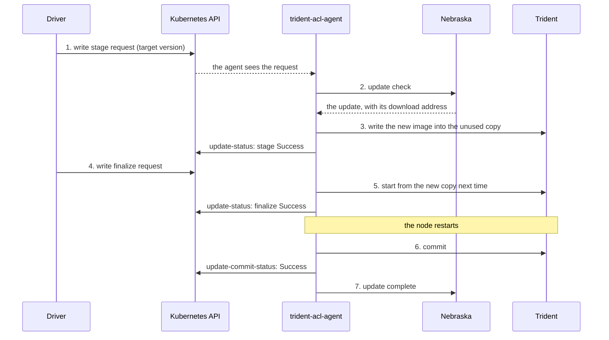
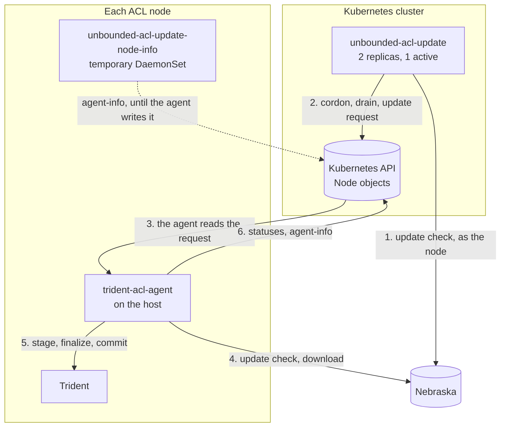
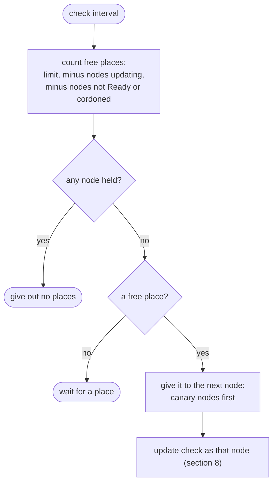
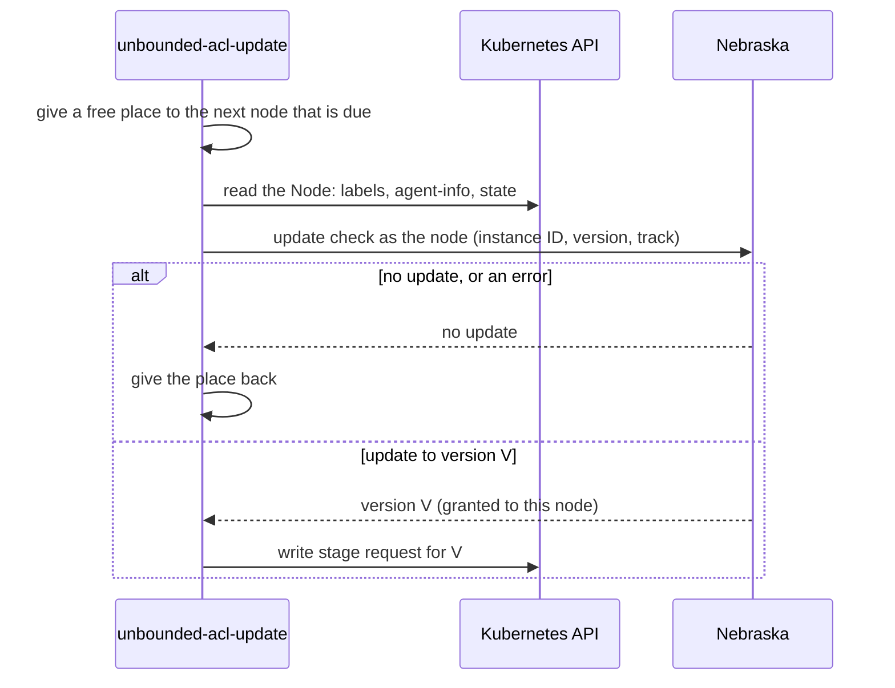
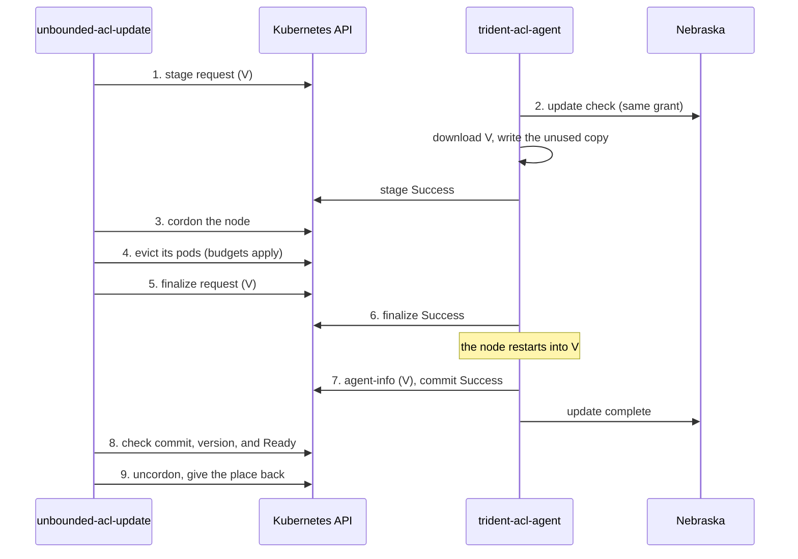
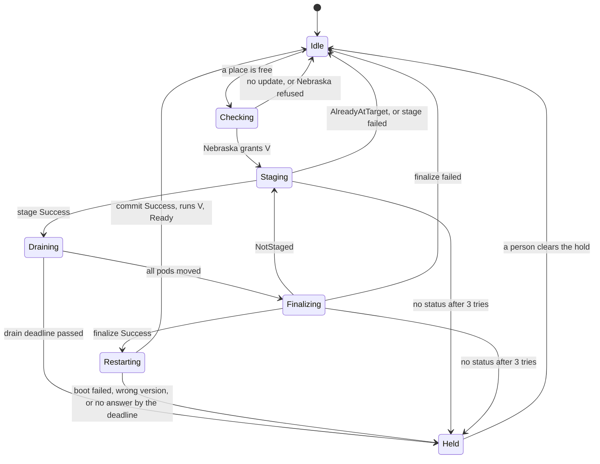

# Updating Azure Container Linux Nodes from Nebraska

| Field | Value |
|---|---|
| Status | Draft for discussion |
| Scope | Automatic OS updates for Azure Container Linux (ACL) nodes, using Nebraska and `trident-acl-agent` |
| Audience | Unbounded maintainers, and the Trident and ACL teams |
| Repository baseline | `origin/main` at `1973dcf1a` |
| Date | 2026-11-18 |

## 1. Summary

ACL nodes update their operating system with an A/B update: the node keeps two
copies of the OS, writes the new version into the copy it isn't using, and
restarts into it. A program on each ACL node, `trident-acl-agent`, performs the
update when it is asked to through annotations on the node's Kubernetes Node
object.

Something in the cluster has to decide when each node updates, and ask it to.
This document proposes that piece:

1. `unbounded-acl-update`, one service in the cluster. For each ACL node, it
   asks Nebraska, the update server ACL uses, whether a new version is ready
   for that node. When one is, it moves the node's workloads to other nodes,
   asks the node's agent to install the new version, and checks that the node
   came back running it.
2. `unbounded-acl-update-node-info`, a small temporary DaemonSet. It publishes
   two facts about each node that the service needs, until `trident-acl-agent`
   publishes them itself.

The service never takes more than a set number of nodes in the cluster out of
service at once, one by default, so workloads always have somewhere to run.
Nebraska decides which version nodes get, and how fast the whole fleet moves.
When an update fails, the service stops updating the cluster and waits for a
person.

Limiting updates and moving workloads raise two questions that still need
answers before we build this. Section 17 describes them.

## 2. Background

### 2.1 Words used in this document

- **ACL**: Azure Container Linux, an OS image whose `/usr` is read-only.
- **A/B update**: an update that writes the new OS into a second copy (slot A
  or B), restarts into it, and keeps it only if it boots.
- **Trident**: the program on ACL that writes OS images to disk and switches
  between the two copies.
- **`trident-acl-agent`**: runs on each ACL host. It watches its Node object for
  update requests and runs Trident.
- **Nebraska**: an update server from the Flatcar project
  ([flatcar/nebraska](https://github.com/flatcar/nebraska)). It knows which OS
  versions exist and decides which machines may update now.
- **Update check**: a message a machine sends Nebraska that says who it is,
  which version it runs, and which track it follows, and asks for an update.
  Nebraska answers "no update" or describes an update to download. The format
  is the Omaha protocol.
- **Track and group**: a machine names a track in its update check. Nebraska
  maps the track to a group. Each group points at one version and has rollout
  settings, such as how many machines may update at a time.
- **Grant**: when Nebraska answers an update check with an update, it records
  that this machine is now updating. This is a grant.
- **Instance ID**: the ID a machine sends in its update checks. Nebraska keeps
  its records per instance ID.
- **Cordon**: mark a node so that Kubernetes schedules no new pods on it.
- **Drain**: move a node's pods to other nodes, by asking Kubernetes to evict
  them one at a time.
- **PodDisruptionBudget**: a rule an application sets, such as "keep at least 2
  of my pods running". Kubernetes refuses an eviction that would break it.
- **Place**: in this document, one of the slots that limit how many nodes the
  service updates at once (section 7).
- **nspawn machine**: on Unbounded ACL nodes, kubelet and its pods run inside a
  container on the host, started with `systemd-nspawn`. Pods see that
  container's files, not the host's.

### 2.2 How an ACL node updates

`trident-acl-agent` reads and writes three annotations on its Node, all under
one prefix that is configured on the node
([the annotation contract](https://github.com/microsoft/trident/blob/main/docs/Explanation/Trident-ACL-Agent.md#the-annotation-contract)):

- `update-request`: written by whoever drives the update. It asks for
  `stage`, `finalize`, or `rollback`.
- `update-status`: written by the agent. It reports how the request went.
- `update-commit-status`: written by the agent after the restart. It reports
  whether the node is running the new version.

An update goes like this:

1. The driver writes a `stage` request. It names the target version and the
   Nebraska server, app ID, and track to get it from.
2. The agent sends Nebraska an update check, and makes sure the version offered
   is the target version.
3. The agent downloads the image and writes it into the unused copy. It reports
   `Success` in `update-status`.
4. The driver writes a `finalize` request for the same update.
5. The agent tells Trident to start from the new copy next time, reports
   `Success`, and restarts the node.
6. After the restart, the agent confirms the node started from the new copy.
   Trident calls this commit. The agent reports `Success` in
   `update-commit-status`.
7. The agent tells Nebraska the update is complete.



Trident leaves the driver to the cluster. Nothing in Unbounded drives these
annotations today. This document adds the driver.

### 2.3 How Nebraska decides which machines update

1. A machine sends an update check with its instance ID, its current version,
   and its track.
2. Nebraska finds the group for the track. If the group's version is newer than
   the machine's, and the group's rollout settings allow it, Nebraska answers
   with the update and records a grant for that instance.
3. The grant counts against the group's limit until the machine reports the
   update complete, or until the group's update timeout passes. In safe mode,
   too many timed-out grants turn updates off for the whole group.
4. If the same instance asks again while its grant is open, Nebraska answers
   with the same update. It doesn't count it twice or check the settings
   again.

So the update check is what grants the update. Two things follow for anyone
who sends an update check on a node's behalf:

- It must send exactly what the node's agent sends: the same instance ID,
  version, track, and architecture. Otherwise Nebraska sees a second machine,
  and gives it a grant that never finishes.
- It must start the update right away after a grant, and finish it before the
  group's update timeout. A grant left waiting uses up the group's limit, and
  ends as a timeout.

The details are in Nebraska's `backend/pkg/api/runtime/updates.go`
(`GetUpdatePackage`).

### 2.4 What testing showed

The ACL update harness in AKSFlexNode
([Azure/AKSFlexNode#462](https://github.com/Azure/AKSFlexNode/pull/462),
`hack/acl-abupdate`) drives updates through `trident-acl-agent` with a test
Nebraska. These findings shape this design:

1. The agent's instance ID is the first 16 bytes of the SHA-384 hash of the
   host's `/etc/machine-id`, written as a UUID
   (`crates/osutils/src/machine_id.rs` in Trident). The harness confirmed it on
   a test node.
2. The agent ignores a request it can't parse, and writes no status for it
   ([microsoft/trident#957](https://github.com/microsoft/trident/issues/957)).
   That includes a request with any field the protocol doesn't define. The
   driver must write requests exactly to the schema, and must notice when no
   status appears.
3. If the node falls back to the old copy during the restart, the agent still
   reports the commit as a success
   ([microsoft/trident#956](https://github.com/microsoft/trident/issues/956)).
   The driver should check which version the node actually runs.
4. ACL's `VERSION_ID`, such as `3.0.20261104`, can be the same for two builds,
   so it can't be the version Nebraska compares. ACL images need a version
   that is different for every build.
5. On Unbounded ACL nodes, pods run inside the nspawn machine. They can't read
   the host's `/etc/machine-id` or `/etc/os-release`.

## 3. Goals

1. Update ACL nodes automatically when Nebraska has a newer version for them.
2. Never take more than a set number of the cluster's nodes out of service at
   once, and move workloads off a node before it restarts.
3. Let Nebraska decide which version nodes get, and how fast the whole fleet
   moves.
4. Never create extra Nebraska instances, or grants that a node won't use.
5. Notice failed updates, missing statuses, and nodes that don't come back, and
   stop the cluster's updates for a person.
6. Keep all state on the Node objects, so the service can restart at any time.

## 4. Not in the first version

1. Maintenance windows, beyond Nebraska's office hours setting.
2. Separate limits per node pool or zone. The first version has one limit for
   all the nodes it manages.
3. Rolling back automatically.
4. Choosing versions. Nebraska decides which version each group gets.
5. Replacing, or depending on, the HostUpgrade design
   ([host-upgrade.md](host-upgrade.md)). See section 18.

## 5. Overview



There are three parts:

1. **`unbounded-acl-update`** is a Deployment in `unbounded-system` with two
   replicas. Leader election keeps one active. It watches the Nodes that carry
   its `managed` label. It decides which of them may update now, sends their
   update checks to Nebraska, moves their workloads, and writes their update
   requests.
2. **`trident-acl-agent`** ships with ACL and runs on each host. Unbounded
   configures it (section 15).
3. **`unbounded-acl-update-node-info`** is a temporary DaemonSet that writes
   each node's `agent-info` annotation (section 6).

### 5.1 Who controls what

| Control | Who | Why |
|---|---|---|
| How many of the cluster's nodes are out of service at once | the service: a limit, one node by default (section 7) | Workloads always have somewhere to run, however Nebraska is set up. |
| Moving workloads off a node before it restarts | the service: cordon, then drain (section 9) | Pods move first, within their PodDisruptionBudgets. |
| Stopping after a failure | the service (section 10) | One failed node stops updates in this cluster until a person looks. |
| Which version, in which order of groups, at what pace across the fleet, and pausing | Nebraska | Releases are managed in one place, across every cluster. |

### 5.2 Where the code would live

| Part | Where | Follows |
|---|---|---|
| Service and DaemonSet binary | `cmd/unbounded-acl-update`, with `controller` and `node-info` subcommands | `cmd/token-refresher` (leader election with controller-runtime) |
| Shared code | `internal/aclupdate/...` | |
| Manifests | `deploy/acl-update/` | `deploy/token-refresher/`, `deploy/net/node/` |
| Admission policies | `deploy/acl-update/` | `deploy/net/controller/09-vap.yaml.tmpl` |
| Image | `images/unbounded-acl-update/` | `images/token-refresher/` |

## 6. Node information: `agent-info`

The service sends update checks as each node, so it needs two facts that only
the host knows:

1. The node's Nebraska instance ID.
2. The version the agent reports to Nebraska.

They go in one annotation on the Node,
`acl-update.unbounded-cloud.io/agent-info`:

```json
{
  "schemaVersion": "1.0",
  "machineId": "ebb9a2bb-9365-d34e-133f-8da0664e7366",
  "currentVersion": "20261105.1.0"
}
```

The rules:

1. It's written when the agent starts, before the agent finishes an update that
   was waiting for the restart. So by the time a commit status appears,
   `agent-info` describes the new boot.
2. `machineId` is the ID the agent sends to Nebraska, the hash, not the raw
   `/etc/machine-id`. systemd says to keep the raw ID private.
3. `currentVersion` is exactly the version the agent sends to Nebraska, read
   from the running OS. If the agent couldn't read it and would fall back to a
   placeholder, the field is left out, and the service doesn't send update
   checks for that node.

The service gets everything else it needs from the Node itself:

- The architecture, from the `kubernetes.io/arch` label. `arm64` is sent to
  Nebraska as `aarch64`, as the agent does.
- Whether the node restarted, from `status.nodeInfo.bootID`.
- The agent's version, from `tridentVersion` in its status annotations.

### 6.1 Until the agent writes it

Writing `agent-info` is a change to `trident-acl-agent`, which we need to agree
with the Trident team. Until it ships, the `node-info` DaemonSet writes the same
annotation:

1. Unbounded's host agent makes the host's `/etc/machine-id` and
   `/etc/os-release` readable, read-only, inside the nspawn machine.
2. The DaemonSet's pod reads both files through `hostPath` volumes.
3. It computes the instance ID the same way the agent does: the SHA-384 hash of
   the 16 bytes of the machine ID, cut to 16 bytes, written as a UUID.
4. It reads the version with the same settings the agent uses
   (`TRIDENT_ACL_AGENT_CURRENT_VERSION_PATH` and `_KEY`), which it gets from a
   ConfigMap.
5. It writes `agent-info` when it starts, and again whenever the values change.

The DaemonSet and the agent read the same files the same way, so they write
the same annotation. One difference: after a restart, the DaemonSet's pod may
start after the agent has already reported the commit. So the service waits
for `agent-info` to show the new version, rather than reading it once
(section 9). Once the agent writes `agent-info` itself, we stop deploying the
DaemonSet, and the service doesn't change.

## 7. How many nodes update at once

Updating a node takes it out of service: its pods move away, and it restarts.
If many nodes did that at once, their workloads would have nowhere to run. So
the service limits it in the cluster, whatever Nebraska allows.

### 7.1 Places

1. The service has a fixed number of places: the "nodes out of service at
   once" setting, one by default.
2. A node holds a place from just before its update check until its update is
   done, or has failed.
3. Nodes that are already out of service for other reasons use up places too:
   managed nodes that are not Ready, or that someone else cordoned. So the
   service never takes a node down while the cluster is already short.
4. While any managed node is held after a failure (section 10), the service
   gives out no places. Updates in the cluster stop until a person looks.
5. Free places go to nodes with the canary label first, then to the node that
   was checked longest ago.



### 7.2 Why a node takes a place before its update check

The update check is what grants the update (section 2.3). If a node were granted
an update and then had to wait for a place, Nebraska's grant would stay open
until it timed out, and in safe mode timeouts can turn updates off for the
whole group. Taking the place first means the service acts on every grant
right away.

When Nebraska has nothing new, the node gives its place back at once. So when
there's no update, a pass through the cluster is just a series of quick checks.

### 7.3 Nebraska's part

1. The two limits stack. A node updates only when it has a place and Nebraska
   grants it an update.
2. Nebraska's group settings still apply:
   - Tracks give rings. Put canary nodes on their own track, and release a
     version to that group's channel first.
   - "Max updates per period" sets the pace across every cluster that uses the
     track.
   - Safe mode lets one machine try a new version first.
   - "Updates enabled" pauses the group, and office hours limit updates to
     working hours.
3. If Nebraska refuses an update because a limit is reached or updates are
   off, nothing was granted. The node gives its place back and is checked again
   at the next interval.
4. The group's update timeout must be longer than an update can take: staging,
   the drain deadline, and the restart deadline together. Otherwise Nebraska
   counts updates that are still running as timed out.

## 8. Checking for updates

1. Each managed node is due for a check once per check interval (one hour by
   default). Whenever a place is free, the service gives it to the next node
   that is due (section 7).
2. It skips the node if any of these is true:
   - The node is paused.
   - The node is held after a failed update.
   - Its `agent-info` is missing, or has no `currentVersion`.
3. It sends Nebraska one update check as the node: the node's instance ID and
   version, its architecture, and the server, app ID, and track the request
   will name. It never sends progress events or "ping" messages; those belong
   to the agent.
4. If Nebraska answers "no update", the node gives its place back. Nebraska now
   lists the node with its current version.
5. If Nebraska answers with version V, it has granted V to the node. The
   service writes the `stage` request right away (section 9).
6. If Nebraska answers with an error, such as "updates disabled" or "limit
   reached", nothing was granted. The node gives its place back.



## 9. Running an update

1. The service writes a `stage` request for version V, with a new
   `nodeUpdateId` and `operationId`. It records the update in its `state`
   annotation. The node keeps running its workloads while it downloads.
2. The agent sends its own update check. Nebraska returns the same grant. The
   agent downloads V, writes it into the unused copy, and reports `stage`
   `Success`.
3. The service cordons the node, and records that it did.
4. The service drains the node. It evicts every pod except DaemonSet pods and
   static pods (pods kubelet runs from files on the node). Kubernetes refuses an
   eviction that would break a PodDisruptionBudget, so the service tries those
   again until the drain deadline. Which pods to evict is one of the open
   questions (section 17.2).
5. The service writes a `finalize` request with the same `nodeUpdateId`, a new
   `operationId`, and the same version.
6. The agent prepares the new copy, reports `finalize` `Success`, and restarts
   the node.
7. The node starts from the new copy. The agent writes `agent-info`, commits,
   writes `update-commit-status` `Success`, and tells Nebraska the update is
   complete.
8. The service waits until three things are true: the commit status is
   `Success` for this `nodeUpdateId`, `agent-info` says the node runs V, and
   the Node is Ready. If they aren't all true by the restart deadline, it holds
   the node (section 10).
9. The service uncordons the node, if it cordoned it, and gives its place back.
   The update is done.

Whenever a node leaves an update early, because a step failed or the node was
held, the service also uncordons it, if it cordoned it, and gives its place
back.

The service keeps watching while the node restarts. If the active replica runs
on the node being drained, the drain moves it, and the other replica takes over.



The service tracks each node in one of these states:



## 10. When something goes wrong

| What happens | What the service does |
|---|---|
| `stage` reports `AlreadyAtTarget` | Marks the update done. The node already runs V. |
| `stage` or `finalize` reports `OperationFailed` or `AgentInternalError` | Leaves the update. The next check decides again. |
| A request gets `InvalidRequest` | Records an Event and leaves the update. This points to a bug in the request. |
| `finalize` reports `NotStaged` | Starts again with `stage`. |
| The drain isn't done by the drain deadline | Holds the node. Nebraska's grant stays open; see section 17.1. |
| The commit reports `TargetBootFailed` | Holds the node. |
| The commit reports `Success`, but `agent-info` still shows another version at the restart deadline | Holds the node. This is the case in microsoft/trident#956. |
| No status appears for a request within 5 minutes | Writes the same request again. The agent treats a repeated request as one. After 3 tries, holds the node. |
| A status stays `InProgress`, but isn't refreshed for 5 minutes | Records an Event. If the step still isn't done by the step deadline, holds the node. |
| After `finalize`, the Node isn't Ready, or there's no commit status, within 30 minutes | Holds the node. |

Holding a node means:

1. The service stops sending update checks for the node.
2. It writes the reason, and the version that failed, in the node's `state`
   annotation.
3. It records a Kubernetes Event on the Node.
4. It uncordons the node, if it cordoned it, and gives its place back.
5. While the node is held, the service starts no new updates anywhere in the
   cluster (section 7.1).
6. A person looks at the node, then removes the `state` annotation to let the
   service continue.

The service holds the node instead of trying again because, after a failed
restart, Nebraska may already list the update as complete (microsoft/trident#956).
Nebraska would then offer the same version again, and the node would repeat the
same failed update.

## 11. Leader election and restarts

1. The service runs two replicas. A Lease keeps one active.
2. All state is on the Node objects. A new leader continues where the old one
   stopped, including counting places.
3. The service writes every annotation change together with the Node's
   `resourceVersion`. If two leaders overlap for a moment, only one write
   succeeds, so a node never gets two different requests.
4. The two replicas should run on different nodes. A PodDisruptionBudget keeps
   one of them running while the service drains the node the other is on.

## 12. Settings

The service reads its settings from a ConfigMap:

| Setting | Default | Meaning |
|---|---|---|
| Nebraska URL | none | The `https` address of Nebraska's update endpoint. |
| App ID | none | Nebraska's app ID for ACL. |
| CA certificates | the image's | Certificates to trust for Nebraska. |
| Default track | none | The track for nodes without a track label. |
| Nodes out of service at once | 1 | How many places there are (section 7). |
| Check interval | 1 hour | How often each node is checked. |
| Status deadline | 5 minutes | How long to wait for a status before writing a request again. |
| Step deadline | 1 hour | How long `stage` or `finalize` may stay `InProgress` before the service holds the node. |
| Drain deadline | 30 minutes | How long the drain may take. It must be shorter than the Nebraska group's update timeout. |
| Restart deadline | 30 minutes | How long to wait for a node to come back after `finalize`. |

The annotation prefix is fixed: `acl-update.unbounded-cloud.io`.
`trident-acl-agent` on each node must use the same prefix (section 15).

## 13. Annotations and labels

| Key | Kind | Written by | Meaning |
|---|---|---|---|
| `acl-update.unbounded-cloud.io/managed` | label | Unbounded at join, or an administrator | The service updates this node. |
| `acl-update.unbounded-cloud.io/track` | label | an administrator | The Nebraska track for this node, instead of the default. |
| `acl-update.unbounded-cloud.io/canary` | label | an administrator | This node gets a place before the others. |
| `acl-update.unbounded-cloud.io/paused` | label | an administrator | Don't start new updates on this node. |
| `acl-update.unbounded-cloud.io/update-request` | annotation | the service | The request to the agent (Trident's contract). |
| `acl-update.unbounded-cloud.io/update-status` | annotation | the agent | The result of a request (Trident's contract). |
| `acl-update.unbounded-cloud.io/update-commit-status` | annotation | the agent | The result after the restart (Trident's contract). |
| `acl-update.unbounded-cloud.io/agent-info` | annotation | the agent, or the temporary DaemonSet | The node's instance ID and version (section 6). |
| `acl-update.unbounded-cloud.io/state` | annotation | the service | The node's update, whether the service cordoned it, and why it's held, if it is. |

An example `state`:

```json
{
  "phase": "Held",
  "nodeUpdateId": "550e8400-e29b-41d4-a716-446655440000",
  "targetVersion": "20261106.1.0",
  "cordoned": false,
  "reason": "commit reported Success, but the node runs 20261105.1.0",
  "since": "2026-11-18T10:42:00Z"
}
```

## 14. Permissions and safety

1. The service's account can get, list, watch, and patch Nodes, list Pods,
   evict Pods, create Events, and use a Lease for leader election.
2. Patching Nodes is a broad permission, so two admission policies narrow what
   can be written:
   1. The service's account may change only the `update-request` and `state`
      annotations, and whether the node is cordoned (`spec.unschedulable`). A
      request must name the configured Nebraska URL and app ID, so a stolen
      token can't point nodes at another server.
   2. The DaemonSet's account may change only `agent-info`, and only on its own
      Node. The policy checks the node name and UID in the pod's token, as
      `unbounded-net-node`'s policy does (`deploy/net/controller/09-vap.yaml.tmpl`).
3. Evictions go through Kubernetes' eviction API, so PodDisruptionBudgets
   always apply. The service never deletes pods directly.
4. The agent writes its statuses and `agent-info` with the node's own
   credentials, which can only change the node's own Node object.
5. The agent only accepts an `https` Nebraska URL, and only `https` or `oci`
   image addresses. It checks each image against a checksum from Nebraska.
6. The DaemonSet runs unprivileged, with two read-only files from the host.

## 15. Work needed elsewhere

**Trident (`trident-acl-agent`):**

1. Write `agent-info` (section 6).
2. Report a final status when Nebraska refuses an update during `stage`.
   Reading the code, the agent exits instead, and systemd restarts it; the
   status stays `InProgress` and the agent asks Nebraska again each time
   (`crates/trident-acl-agent/src/annotations/orchestrator.rs`, the
   `"Nebraska query failed"` error). The service makes this rare, since it only
   asks for `stage` after a grant, but it shouldn't happen at all.
3. Possibly, a `cancel` operation that discards a staged update and tells
   Nebraska the update failed. It depends on how we answer section 17.1.
4. Fix microsoft/trident#956: a fallback to the old copy is reported as a
   successful commit.
5. Fix microsoft/trident#957: a request the agent can't parse gets no status.

**Unbounded's host agent:**

1. Configure `trident-acl-agent` on ACL hosts with a systemd drop-in:
   - the annotation prefix, `acl-update.unbounded-cloud.io`;
   - kubelet's credentials, and `kubelet-cert` to find the Node's name;
   - where to read the version (see the ACL images item).
2. Make the host's `/etc/machine-id` and `/etc/os-release` readable inside the
   nspawn machine, for the temporary DaemonSet.
3. Set the `managed` label when the node joins, if we choose to.

**ACL images:**

1. Carry a version in `/etc/os-release` that is different for every build and
   matches the versions in Nebraska. Trident's documentation uses
   `IMAGE_VERSION` as its example.

**Nebraska:**

1. Run a release with package labels. 4.0.3 has none, and the agent reads the
   image's checksum from a label by default.
2. Keep every server behind the URL on one database, so the service's grant
   and the agent's update check are seen by the same Nebraska.
3. Set each group's update timeout longer than an update can take (section 7.3).

## 16. Testing

1. Unit tests:
   - the state machine, with a fake Kubernetes client and a fake Nebraska;
   - counting places: nodes that are updating, not Ready, or cordoned by
     someone else, and no places while a node is held;
   - the drain: evictions a PodDisruptionBudget refuses, and the drain
     deadline;
   - the request format, against the JSON schemas in Trident's
     `annotations/protocol.rs`;
   - the instance ID: `/etc/machine-id` `34a267d412544d6a9e97b5ba6762f6e7`
     gives `ebb9a2bb-9365-d34e-133f-8da0664e7366`;
   - the admission policies' rules, as
     `internal/operator/components/net/vap_test.go` tests unbounded-net's.
2. The AKSFlexNode harness: its test Nebraska and annotation scenarios, with
   the service running against the harness's cluster.
3. Unbounded's ACL end-to-end tests (`agent-e2e-kind`, host `acl`), with
   several ACL nodes and a workload with a PodDisruptionBudget, to show that
   only one node is out of service at a time and the workload keeps running.
4. A real Nebraska, to confirm that the agent's update check after the
   service's gets the same grant, and that no extra instances appear. Trident's
   own tests run a real Nebraska the same way (`tools/storm/aclagent`).

## 17. Questions to answer before building this

Limiting updates and moving workloads first raise two questions we don't have
answers to yet. Both need an answer before implementation starts.

### 17.1 A drain that never finishes

What happens:

1. A node takes a place, Nebraska grants it version V, and it stages V.
2. The service starts the drain, but a PodDisruptionBudget keeps refusing an
   eviction. For example, an application with one replica and a budget of
   "keep 1 running".
3. The service can't restart the node without moving that pod, and Trident's
   contract has no way to cancel a staged update.
4. Nebraska's grant stays open until the group's update timeout, then counts
   as timed out. In safe mode, enough timeouts turn updates off for the whole
   group, in every cluster that uses it.

Possible answers, none chosen yet:

1. **A drain deadline.** Keep it shorter than the group's update timeout. At
   the deadline, uncordon the node and hold it (the current text of this
   design). This is simple, but the grant still ends as a timeout in Nebraska.
2. **A `cancel` operation in `trident-acl-agent`.** It discards the staged
   update and tells Nebraska the update failed, which closes the grant cleanly.
   This needs the Trident team.
3. **Check that the node can be drained before its update check.** Ask
   Kubernetes whether each pod on the node could be evicted now (a dry-run
   eviction), and skip the node if one couldn't. This makes blocked drains
   rare, but not impossible, since things can change before the drain starts.
4. **Drain before the update check.** No grant is open while the drain waits.
   But it moves workloads off every node it checks, even when there's no
   update, so it disrupts the cluster every interval.

### 17.2 Workloads a drain doesn't protect

What happens:

1. A drain moves pods one at a time and respects their budgets. But an
   application with one replica is still down while its pod starts again on
   another node.
2. Some pods can't be moved:
   - Pods with no controller. Nothing creates them again elsewhere.
   - DaemonSet pods. They run on every node, so they stop with the node.
   - Pods that keep data in `emptyDir` volumes, scratch space on the node. The
     data is lost when they move.
3. Pods still on the node when it restarts stop without warning, unless
   kubelet's graceful node shutdown works inside the nspawn machine. That
   hasn't been checked yet.
4. Without a drain, Kubernetes moves pods off a node only after it has been
   unreachable for 5 minutes, by default. A restart is often shorter, so the
   pods would wait for the node and come back on it. That's why the drain is
   in the first version.

Possible answers, none chosen yet:

1. **Follow `kubectl drain`'s rules.** Skip DaemonSet pods. Refuse to drain a
   node with pods that have no controller, or that keep `emptyDir` data, unless
   a setting allows it. Such a node then behaves like a blocked drain
   (section 17.1).
2. **Evict every pod except DaemonSet pods and static pods** (the current text
   of this design), and accept losing unmanaged pods and `emptyDir` data.
3. **Turn on graceful node shutdown** inside the nspawn machine, once it's
   confirmed to work, so the pods that stay on the node stop cleanly.
4. **Ask applications to set PodDisruptionBudgets,** and document that an
   application with one replica sees a short outage on each update.

## 18. Other open questions

1. **HostUpgrade.** [host-upgrade.md](host-upgrade.md) proposes driving Trident
   from Unbounded's host agent instead. Both can't drive the same node. Should
   this be a separate path for ACL nodes that use `trident-acl-agent`, or should
   the service create HostUpgrade operations instead of writing annotations?
   host-upgrade.md expects "the caller or a separate rollout controller" to
   drain nodes, which this service now does.
2. **`agent-info` in Trident.** Will the Trident team add it, under this name
   and format?
3. **ACL's version.** Which os-release key will carry the per-build version?
4. **The host's os-release.** Does `systemd-nspawn` on ACL already show it at
   `/run/host/os-release`?
5. **The `managed` label.** Should Unbounded set it when the node joins, or
   should administrators?
6. **Later versions.** Separate limits per node pool or zone, and maintenance
   windows: in this service, or in a shared rollout controller?

## 19. Other approaches we considered

1. **Letting Nebraska alone limit updates.** Its limits are shared by every
   cluster that uses a track, can be set loosely, and know nothing about
   workloads. A cluster could lose all its nodes at once.
2. **Taking a place after the grant.** Granted nodes would wait for places with
   their grants open, and those grants would time out.
3. **A DaemonSet that checks for its own node.** It could read the host's files
   directly. But a pod restarts with its node, so it can't notice a node that
   doesn't come back. Each pod would need its own narrow permissions, and
   decisions about the whole cluster, such as places and draining, would have
   nowhere to live.
4. **An instance ID made up by the service.** Nebraska would count every node
   twice. The made-up instance's grants would never finish, and in safe mode
   their timeouts can turn updates off for the group.
5. **Reading the group's version from Nebraska's admin API.** Only the agent's
   update check would then ask for the update. But the admin API needs a login,
   and when Nebraska refuses an update, the agent currently exits instead of
   reporting it (section 15).
6. **A fixed target version in the cluster's settings.** This is simple, and is
   how Trident's example works (a track named `pin-<version>`). But someone has
   to change the setting for every release.
7. **Using `VERSION_ID` as the version.** Several builds can share it.
