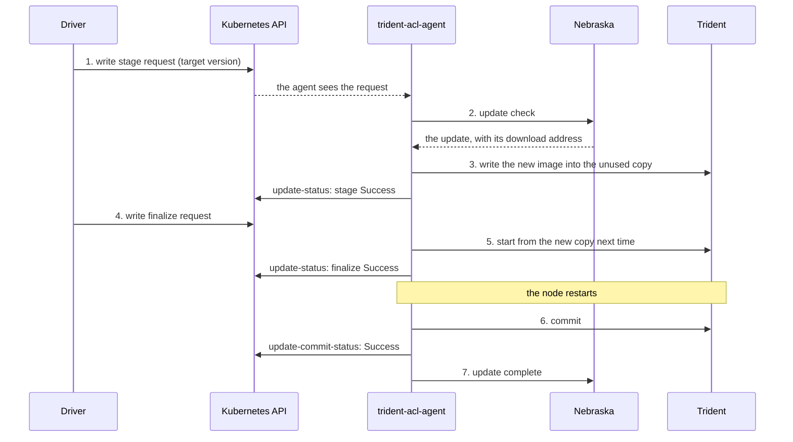
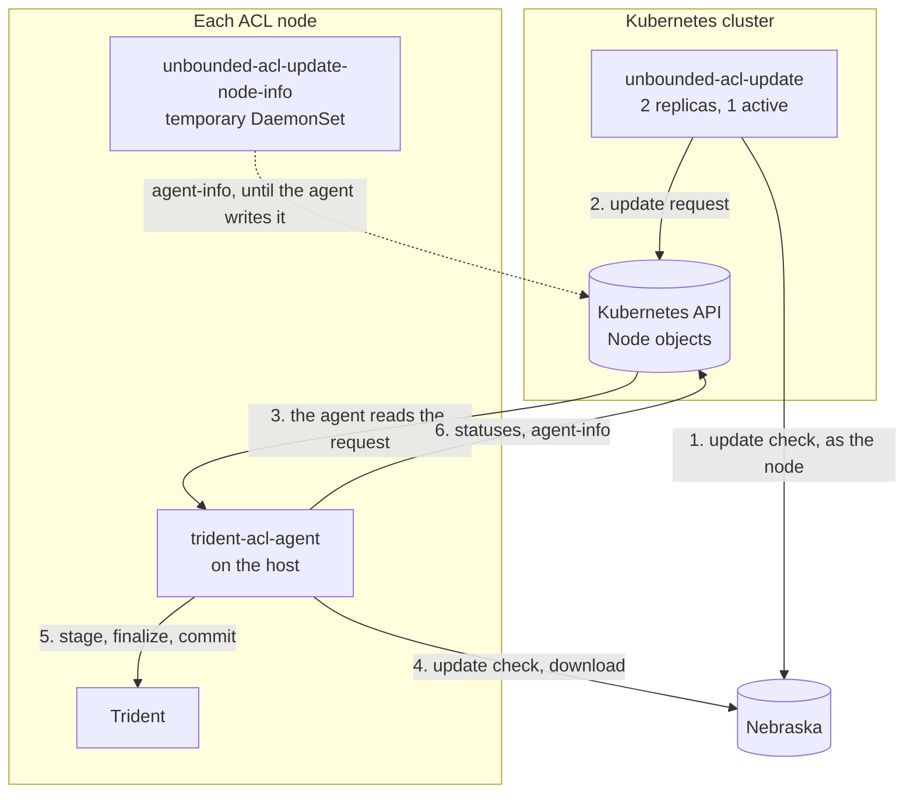
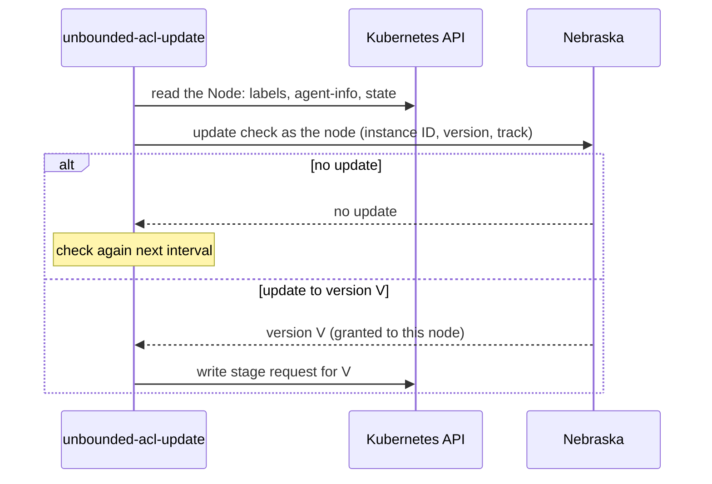
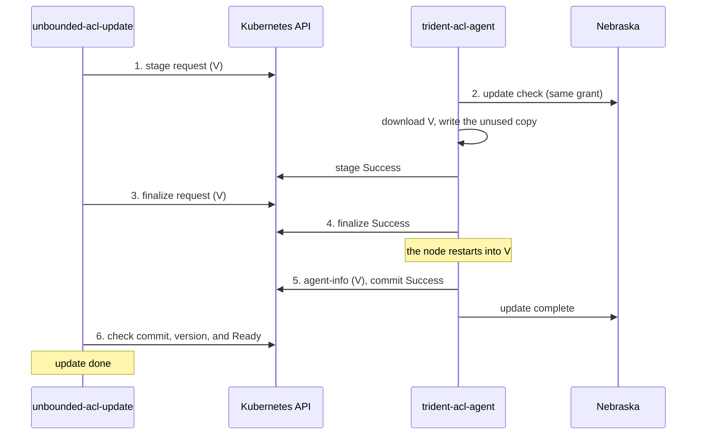
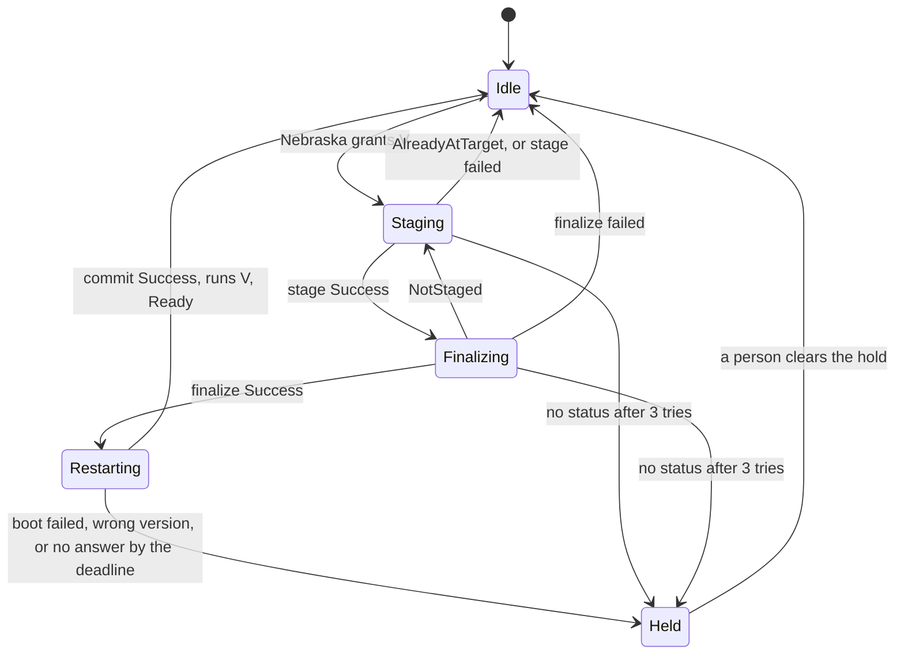

# Updating Azure Container Linux Nodes from Nebraska

| Field | Value |
|---|---|
| Status | Draft for discussion |
| Scope | Automatic OS updates for Azure Container Linux (ACL) nodes, using Nebraska and `trident-acl-agent` |
| Audience | Unbounded maintainers, and the Trident and ACL teams |
| Repository baseline | `origin/main` at `1973dcf1a` |
| Date | 2026-11-18 |

## 1. Summary

ACL nodes update their operating system with an A/B update: the node keeps two
copies of the OS, writes the new version into the copy it isn't using, and
restarts into it. A program on each ACL node, `trident-acl-agent`, performs the
update when it is asked to through annotations on the node's Kubernetes Node
object.

Something in the cluster has to decide when each node updates, and ask it to.
This document proposes that piece:

1. `unbounded-acl-update`, one service in the cluster. For each ACL node, it
   asks Nebraska, the update server ACL uses, whether a new version is ready
   for that node. When one is, it asks the node's agent to install it, and
   checks that the node came back running it.
2. `unbounded-acl-update-node-info`, a small temporary DaemonSet. It publishes
   two facts about each node that the service needs, until `trident-acl-agent`
   publishes them itself.

The first version doesn't drain nodes or limit restarts beyond what Nebraska's
own rollout settings allow. It stops and asks for a person when an update
fails.

## 2. Background

### 2.1 Words used in this document

- **ACL**: Azure Container Linux, an OS image whose `/usr` is read-only.
- **A/B update**: an update that writes the new OS into a second copy (slot A
  or B), restarts into it, and keeps it only if it boots.
- **Trident**: the program on ACL that writes OS images to disk and switches
  between the two copies.
- **`trident-acl-agent`**: runs on each ACL host. It watches its Node object for
  update requests and runs Trident.
- **Nebraska**: an update server from the Flatcar project
  ([flatcar/nebraska](https://github.com/flatcar/nebraska)). It knows which OS
  versions exist and decides which machines may update now.
- **Update check**: a message a machine sends Nebraska that says who it is,
  which version it runs, and which track it follows, and asks for an update.
  Nebraska answers "no update" or describes an update to download. The format
  is the Omaha protocol.
- **Track and group**: a machine names a track in its update check. Nebraska
  maps the track to a group. Each group points at one version and has rollout
  settings, such as how many machines may update at a time.
- **Grant**: when Nebraska answers an update check with an update, it records
  that this machine is now updating. This is a grant.
- **Instance ID**: the ID a machine sends in its update checks. Nebraska keeps
  its records per instance ID.
- **nspawn machine**: on Unbounded ACL nodes, kubelet and its pods run inside a
  container on the host, started with `systemd-nspawn`. Pods see that
  container's files, not the host's.

### 2.2 How an ACL node updates

`trident-acl-agent` reads and writes three annotations on its Node, all under
one prefix that is configured on the node
([the annotation contract](https://github.com/microsoft/trident/blob/main/docs/Explanation/Trident-ACL-Agent.md#the-annotation-contract)):

- `update-request`: written by whoever drives the update. It asks for
  `stage`, `finalize`, or `rollback`.
- `update-status`: written by the agent. It reports how the request went.
- `update-commit-status`: written by the agent after the restart. It reports
  whether the node is running the new version.

An update goes like this:

1. The driver writes a `stage` request. It names the target version and the
   Nebraska server, app ID, and track to get it from.
2. The agent sends Nebraska an update check, and makes sure the version offered
   is the target version.
3. The agent downloads the image and writes it into the unused copy. It reports
   `Success` in `update-status`.
4. The driver writes a `finalize` request for the same update.
5. The agent tells Trident to start from the new copy next time, reports
   `Success`, and restarts the node.
6. After the restart, the agent confirms the node started from the new copy.
   Trident calls this commit. The agent reports `Success` in
   `update-commit-status`.
7. The agent tells Nebraska the update is complete.



Trident leaves the driver to the cluster. Nothing in Unbounded drives these
annotations today. This document adds the driver.

### 2.3 How Nebraska decides which machines update

1. A machine sends an update check with its instance ID, its current version,
   and its track.
2. Nebraska finds the group for the track. If the group's version is newer than
   the machine's, and the group's rollout settings allow it, Nebraska answers
   with the update and records a grant for that instance.
3. The grant counts against the group's limit until the machine reports the
   update complete, or until the group's update timeout passes. In safe mode,
   too many timed-out grants turn updates off for the whole group.
4. If the same instance asks again while its grant is open, Nebraska answers
   with the same update. It doesn't count it twice or check the settings
   again.

So the update check is what grants the update. Two things follow for anyone
who sends an update check on a node's behalf:

- It must send exactly what the node's agent sends: the same instance ID,
  version, track, and architecture. Otherwise Nebraska sees a second machine,
  and gives it a grant that never finishes.
- It must start the update right away after a grant. A grant left waiting uses
  up the group's limit, and ends as a timeout.

The details are in Nebraska's `backend/pkg/api/runtime/updates.go`
(`GetUpdatePackage`).

### 2.4 What testing showed

The ACL update harness in AKSFlexNode
([Azure/AKSFlexNode#462](https://github.com/Azure/AKSFlexNode/pull/462),
`hack/acl-abupdate`) drives updates through `trident-acl-agent` with a test
Nebraska. These findings shape this design:

1. The agent's instance ID is the first 16 bytes of the SHA-384 hash of the
   host's `/etc/machine-id`, written as a UUID
   (`crates/osutils/src/machine_id.rs` in Trident). The harness confirmed it on
   a test node.
2. The agent ignores a request it can't parse, and writes no status for it
   ([microsoft/trident#957](https://github.com/microsoft/trident/issues/957)).
   That includes a request with any field the protocol doesn't define. The
   driver must write requests exactly to the schema, and must notice when no
   status appears.
3. If the node falls back to the old copy during the restart, the agent still
   reports the commit as a success
   ([microsoft/trident#956](https://github.com/microsoft/trident/issues/956)).
   The driver should check which version the node actually runs.
4. ACL's `VERSION_ID`, such as `3.0.20261104`, can be the same for two builds,
   so it can't be the version Nebraska compares. ACL images need a version
   that is different for every build.
5. On Unbounded ACL nodes, pods run inside the nspawn machine. They can't read
   the host's `/etc/machine-id` or `/etc/os-release`.

## 3. Goals

1. Update ACL nodes automatically when Nebraska has a newer version for them.
2. Let Nebraska's rollout settings decide how fast nodes update.
3. Never create extra Nebraska instances, or grants that a node won't use.
4. Notice failed updates, missing statuses, and nodes that don't come back, and
   stop for a person.
5. Keep all state on the Node objects, so the service can restart at any time.

## 4. Not in the first version

1. Draining nodes before they restart. Workloads stop when the node restarts;
   see section 10.
2. Limiting how many nodes restart at once, beyond Nebraska's settings.
3. Maintenance windows, beyond Nebraska's office hours setting.
4. Rolling back automatically.
5. Choosing versions. Nebraska decides which version each group gets.
6. Replacing, or depending on, the HostUpgrade design
   ([host-upgrade.md](host-upgrade.md)). See section 17.

## 5. Overview



There are three parts:

1. **`unbounded-acl-update`** is a Deployment in `unbounded-system` with two
   replicas. Leader election keeps one active. It watches the Nodes that carry
   its `managed` label, sends update checks to Nebraska for them, and writes
   their update requests.
2. **`trident-acl-agent`** ships with ACL and runs on each host. Unbounded
   configures it (section 15).
3. **`unbounded-acl-update-node-info`** is a temporary DaemonSet that writes
   each node's `agent-info` annotation (section 6).

The code would follow existing Unbounded components:

| Part | Where | Follows |
|---|---|---|
| Service and DaemonSet binary | `cmd/unbounded-acl-update`, with `controller` and `node-info` subcommands | `cmd/token-refresher` (leader election with controller-runtime) |
| Shared code | `internal/aclupdate/...` | |
| Manifests | `deploy/acl-update/` | `deploy/token-refresher/`, `deploy/net/node/` |
| Admission policies | `deploy/acl-update/` | `deploy/net/controller/09-vap.yaml.tmpl` |
| Image | `images/unbounded-acl-update/` | `images/token-refresher/` |

## 6. Node information: `agent-info`

The service sends update checks as each node, so it needs two facts that only
the host knows:

1. The node's Nebraska instance ID.
2. The version the agent reports to Nebraska.

They go in one annotation on the Node,
`acl-update.unbounded-cloud.io/agent-info`:

```json
{
  "schemaVersion": "1.0",
  "machineId": "ebb9a2bb-9365-d34e-133f-8da0664e7366",
  "currentVersion": "20261105.1.0"
}
```

The rules:

1. It's written when the agent starts, before the agent finishes an update that
   was waiting for the restart. So by the time a commit status appears,
   `agent-info` describes the new boot.
2. `machineId` is the ID the agent sends to Nebraska, the hash, not the raw
   `/etc/machine-id`. systemd says to keep the raw ID private.
3. `currentVersion` is exactly the version the agent sends to Nebraska, read
   from the running OS. If the agent couldn't read it and would fall back to a
   placeholder, the field is left out, and the service doesn't send update
   checks for that node.

The service gets everything else it needs from the Node itself:

- The architecture, from the `kubernetes.io/arch` label. `arm64` is sent to
  Nebraska as `aarch64`, as the agent does.
- Whether the node restarted, from `status.nodeInfo.bootID`.
- The agent's version, from `tridentVersion` in its status annotations.

### 6.1 Until the agent writes it

Writing `agent-info` is a change to `trident-acl-agent`, which we need to agree
with the Trident team. Until it ships, the `node-info` DaemonSet writes the same
annotation:

1. Unbounded's host agent makes the host's `/etc/machine-id` and
   `/etc/os-release` readable, read-only, inside the nspawn machine.
2. The DaemonSet's pod reads both files through `hostPath` volumes.
3. It computes the instance ID the same way the agent does: the SHA-384 hash of
   the 16 bytes of the machine ID, cut to 16 bytes, written as a UUID.
4. It reads the version with the same settings the agent uses
   (`TRIDENT_ACL_AGENT_CURRENT_VERSION_PATH` and `_KEY`), which it gets from a
   ConfigMap.
5. It writes `agent-info` when it starts, and again whenever the values change.

The DaemonSet and the agent read the same files the same way, so they write
the same annotation. One difference: after a restart, the DaemonSet's pod may
start after the agent has already reported the commit. So the service waits
for `agent-info` to show the new version, rather than reading it once
(section 8). Once the agent writes `agent-info` itself, we stop deploying the
DaemonSet, and the service doesn't change.

## 7. Checking for updates

1. Every check interval (one hour by default), the service checks each managed
   node once. Each node's turn is spread across the interval by its name, so
   the checks don't all go out at once.
2. It skips the node if any of these is true:
   - The node is paused.
   - An update is already running on it.
   - The node is on hold after a failed update.
   - Its `agent-info` is missing, or has no `currentVersion`.
3. It sends Nebraska one update check as the node: the node's instance ID and
   version, its architecture, and the server, app ID, and track the request
   will name. It never sends progress events or "ping" messages; those belong
   to the agent.
4. If Nebraska answers "no update", there's nothing to do. Nebraska now lists
   the node with its current version.
5. If Nebraska answers with version V, it has granted V to the node. The
   service writes the `stage` request right away (section 8).
6. If Nebraska answers with an error, such as "updates disabled" or "limit
   reached", nothing was granted. The service tries again at the next interval.



## 8. Running an update

1. The service writes a `stage` request for version V, with a new
   `nodeUpdateId` and `operationId`. It records the update in its `state`
   annotation.
2. The agent sends its own update check. Nebraska returns the same grant. The
   agent downloads V, writes it into the unused copy, and reports `stage`
   `Success`.
3. The service writes a `finalize` request with the same `nodeUpdateId`, a new
   `operationId`, and the same version.
4. The agent prepares the new copy, reports `finalize` `Success`, and restarts
   the node.
5. The node starts from the new copy. The agent writes `agent-info`, commits,
   writes `update-commit-status` `Success`, and tells Nebraska the update is
   complete.
6. The service waits until three things are true: the commit status is
   `Success` for this `nodeUpdateId`, `agent-info` says the node runs V, and
   the Node is Ready. Then it marks the update done. If they aren't all true by
   the restart deadline, it holds the node (section 9).

The service keeps watching while the node restarts. If the active replica runs
on the node that restarts, the other replica takes over.



The service tracks each node in one of these states:



## 9. When something goes wrong

| What happens | What the service does |
|---|---|
| `stage` reports `AlreadyAtTarget` | Marks the update done. The node already runs V. |
| `stage` or `finalize` reports `OperationFailed` or `AgentInternalError` | Goes back to Idle. The next check decides again. |
| A request gets `InvalidRequest` | Records an Event and goes back to Idle. This points to a bug in the request. |
| `finalize` reports `NotStaged` | Starts again with `stage`. |
| The commit reports `TargetBootFailed` | Holds the node. |
| The commit reports `Success`, but `agent-info` still shows another version at the restart deadline | Holds the node. This is the case in microsoft/trident#956. |
| No status appears for a request within 5 minutes | Writes the same request again. The agent treats a repeated request as one. After 3 tries, holds the node. |
| A status stays `InProgress`, but isn't refreshed for 5 minutes | Records an Event. If the step still isn't done by the step deadline, holds the node. |
| After `finalize`, the Node isn't Ready, or there's no commit status, within 30 minutes | Holds the node. |

Holding a node means:

1. The service stops sending update checks for the node.
2. It writes the reason, and the version that failed, in the node's `state`
   annotation.
3. It records a Kubernetes Event on the Node.
4. A person looks at the node, then removes the `state` annotation to let the
   service continue.

The service holds the node instead of trying again because, after a failed
restart, Nebraska may already list the update as complete (microsoft/trident#956).
Nebraska would then offer the same version again, and the node would repeat the
same failed update.

## 10. How many nodes update at once

1. In the first version, only Nebraska limits this. A grant stays open from the
   update check until the agent reports the update complete after the restart,
   so the group's "max updates per period" setting also caps how many nodes are
   updating at the same time.
2. Nebraska's settings apply per group. Clusters whose nodes use the same track
   share one limit.
3. We recommend turning on safe mode. Nebraska then lets only one machine try a
   new version first, and turns updates off for the group if updates time out.
4. Nebraska's "updates enabled" setting pauses every node in the group. Its
   office hours setting limits updates to working hours.
5. Nodes aren't drained. Their workloads stop when the node restarts. We
   recommend turning on kubelet's graceful node shutdown, which gives pods time
   to stop. Whether it works inside the nspawn machine still needs checking.

## 11. Leader election and restarts

1. The service runs two replicas. A Lease keeps one active.
2. All state is on the Node objects. A new leader continues where the old one
   stopped.
3. The service writes every annotation change together with the Node's
   `resourceVersion`. If two leaders overlap for a moment, only one write
   succeeds, so a node never gets two different requests.
4. The two replicas should run on different nodes. They can run on nodes the
   service doesn't update.

## 12. Settings

The service reads its settings from a ConfigMap:

| Setting | Default | Meaning |
|---|---|---|
| Nebraska URL | none | The `https` address of Nebraska's update endpoint. |
| App ID | none | Nebraska's app ID for ACL. |
| CA certificates | the image's | Certificates to trust for Nebraska. |
| Default track | none | The track for nodes without a track label. |
| Check interval | 1 hour | How often each node is checked. |
| Checks at once | 10 | How many update checks the service sends at the same time. |
| Status deadline | 5 minutes | How long to wait for a status before writing a request again. |
| Step deadline | 1 hour | How long `stage` or `finalize` may stay `InProgress` before the service holds the node. |
| Restart deadline | 30 minutes | How long to wait for a node to come back after `finalize`. |

The annotation prefix is fixed: `acl-update.unbounded-cloud.io`.
`trident-acl-agent` on each node must use the same prefix (section 15).

## 13. Annotations and labels

| Key | Kind | Written by | Meaning |
|---|---|---|---|
| `acl-update.unbounded-cloud.io/managed` | label | Unbounded at join, or an administrator | The service updates this node. |
| `acl-update.unbounded-cloud.io/track` | label | an administrator | The Nebraska track for this node, instead of the default. |
| `acl-update.unbounded-cloud.io/paused` | label | an administrator | Don't start new updates on this node. |
| `acl-update.unbounded-cloud.io/update-request` | annotation | the service | The request to the agent (Trident's contract). |
| `acl-update.unbounded-cloud.io/update-status` | annotation | the agent | The result of a request (Trident's contract). |
| `acl-update.unbounded-cloud.io/update-commit-status` | annotation | the agent | The result after the restart (Trident's contract). |
| `acl-update.unbounded-cloud.io/agent-info` | annotation | the agent, or the temporary DaemonSet | The node's instance ID and version (section 6). |
| `acl-update.unbounded-cloud.io/state` | annotation | the service | The node's update, and why it's held, if it is. |

An example `state`:

```json
{
  "phase": "Held",
  "nodeUpdateId": "550e8400-e29b-41d4-a716-446655440000",
  "targetVersion": "20261106.1.0",
  "reason": "commit reported Success, but the node runs 20261105.1.0",
  "since": "2026-11-18T10:42:00Z"
}
```

## 14. Permissions and safety

1. The service's account can get, list, watch, and patch Nodes, create Events,
   and use a Lease for leader election.
2. Patching Nodes is a broad permission, so two admission policies narrow what
   can be written:
   1. The service's account may change only the `update-request` and `state`
      annotations. A request must name the configured Nebraska URL and app ID,
      so a stolen token can't point nodes at another server.
   2. The DaemonSet's account may change only `agent-info`, and only on its own
      Node. The policy checks the node name and UID in the pod's token, as
      `unbounded-net-node`'s policy does (`deploy/net/controller/09-vap.yaml.tmpl`).
3. The agent writes its statuses and `agent-info` with the node's own
   credentials, which can only change the node's own Node object.
4. The agent only accepts an `https` Nebraska URL, and only `https` or `oci`
   image addresses. It checks each image against a checksum from Nebraska.
5. The DaemonSet runs unprivileged, with two read-only files from the host.

## 15. Work needed elsewhere

**Trident (`trident-acl-agent`):**

1. Write `agent-info` (section 6).
2. Report a final status when Nebraska refuses an update during `stage`.
   Reading the code, the agent exits instead, and systemd restarts it; the
   status stays `InProgress` and the agent asks Nebraska again each time
   (`crates/trident-acl-agent/src/annotations/orchestrator.rs`, the
   `"Nebraska query failed"` error). The service makes this rare, since it only
   asks for `stage` after a grant, but it shouldn't happen at all.
3. Fix microsoft/trident#956: a fallback to the old copy is reported as a
   successful commit.
4. Fix microsoft/trident#957: a request the agent can't parse gets no status.

**Unbounded's host agent:**

1. Configure `trident-acl-agent` on ACL hosts with a systemd drop-in:
   - the annotation prefix, `acl-update.unbounded-cloud.io`;
   - kubelet's credentials, and `kubelet-cert` to find the Node's name;
   - where to read the version (see the ACL images item).
2. Make the host's `/etc/machine-id` and `/etc/os-release` readable inside the
   nspawn machine, for the temporary DaemonSet.
3. Set the `managed` label when the node joins, if we choose to.

**ACL images:**

1. Carry a version in `/etc/os-release` that is different for every build and
   matches the versions in Nebraska. Trident's documentation uses
   `IMAGE_VERSION` as its example.

**Nebraska:**

1. Run a release with package labels. 4.0.3 has none, and the agent reads the
   image's checksum from a label by default.
2. Keep every server behind the URL on one database, so the service's grant
   and the agent's update check are seen by the same Nebraska.

## 16. Testing

1. Unit tests:
   - the state machine, with a fake Kubernetes client and a fake Nebraska;
   - the request format, against the JSON schemas in Trident's
     `annotations/protocol.rs`;
   - the instance ID: `/etc/machine-id` `34a267d412544d6a9e97b5ba6762f6e7`
     gives `ebb9a2bb-9365-d34e-133f-8da0664e7366`;
   - the admission policies' rules, as
     `internal/operator/components/net/vap_test.go` tests unbounded-net's.
2. The AKSFlexNode harness: its test Nebraska and annotation scenarios, with
   the service running against the harness's cluster.
3. Unbounded's ACL end-to-end tests (`agent-e2e-kind`, host `acl`).
4. A real Nebraska, to confirm that the agent's update check after the
   service's gets the same grant, and that no extra instances appear. Trident's
   own tests run a real Nebraska the same way (`tools/storm/aclagent`).

## 17. Open questions

1. **HostUpgrade.** [host-upgrade.md](host-upgrade.md) proposes driving Trident
   from Unbounded's host agent instead. Both can't drive the same node. Should
   this be a separate path for ACL nodes that use `trident-acl-agent`, or should
   the service create HostUpgrade operations instead of writing annotations?
   host-upgrade.md expects "the caller or a separate rollout controller" to
   drain nodes, which this service could become.
2. **`agent-info` in Trident.** Will the Trident team add it, under this name
   and format?
3. **ACL's version.** Which os-release key will carry the per-build version?
4. **Graceful node shutdown.** Does it work for kubelet inside the nspawn
   machine?
5. **The host's os-release.** Does `systemd-nspawn` on ACL already show it at
   `/run/host/os-release`?
6. **The `managed` label.** Should Unbounded set it when the node joins, or
   should administrators?
7. **The next version.** Draining nodes and limiting restarts per cluster: in
   this service, or in a shared rollout controller?

## 18. Other approaches we considered

1. **A DaemonSet that checks for its own node.** It could read the host's files
   directly. But a pod restarts with its node, so it can't notice a node that
   doesn't come back. Each pod would need its own narrow permissions, and
   decisions about the whole cluster, such as draining or restart limits,
   would have nowhere to live.
2. **An instance ID made up by the service.** Nebraska would count every node
   twice. The made-up instance's grants would never finish, and in safe mode
   their timeouts can turn updates off for the group.
3. **Reading the group's version from Nebraska's admin API.** Only the agent's
   update check would then ask for the update. But the admin API needs a login,
   and when Nebraska refuses an update, the agent currently exits instead of
   reporting it (section 15).
4. **A fixed target version in the cluster's settings.** This is simple, and is
   how Trident's example works (a track named `pin-<version>`). But someone has
   to change the setting for every release.
5. **Using `VERSION_ID` as the version.** Several builds can share it.
