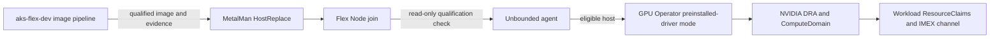

This document records the selected ownership model for NVIDIA GPU Operator,
Dynamic Resource Allocation (DRA), ComputeDomains, and IMEX on Unbounded GB200
nodes. It also records why the first Hillsboro deployment was stopped.

## Decision

Hillsboro uses **preinstalled-driver mode**:

```yaml
driver:
  enabled: false
```

Unbounded does not install, upgrade, downgrade, or repair the NVIDIA driver,
IMEX packages, kernel modules, or firmware during enrollment or reconciliation.
The `aks-flex-dev` repository owns the versioned Hillsboro host profile/image
and the GPU Operator/DRA deployment definition. That pipeline must produce and
test a complete GPU Operator-ready image before MetalMan applies it. Flex Node
then joins that already-qualified host. The agent validates the immutable
qualification evidence and current runtime state, and fails closed if either
has drifted.

GPU Operator fully managed driver mode (`driver.enabled=true`) was evaluated
but is not selected for Hillsboro. It would transfer kernel driver ownership to
an in-cluster controller and requires a separate compatibility program for
Linux arm64, GB200, the selected Ubuntu stack, the Unbounded nspawn boundary,
and rollback.



## Pinned Hillsboro baseline

| Component | Evaluated version |
|---|---|
| Kubernetes | `1.34.3` |
| NVIDIA GPU Operator chart and app | `v26.7.2` |
| NVIDIA DRA driver | `v0.5.1` |
| Existing standalone NVIDIA device plugin | `v0.20.0` |
| Ubuntu NVIDIA driver | `580.178.04` |
| Excluded Azure Linux NVIDIA driver | `580.159.04` |

DRA driver v0.5.1 requires Kubernetes 1.34.2 or later for GPU allocation and
documents driver branch 580 or later for the evaluated ComputeDomain path.
GPU Operator v26.7.2 defaults to DRA v0.5.1 when its DRA operands are enabled.
Its published values also default to driver `595.91.07`, Container Toolkit
`v1.20.1`, CDI enabled, and ComputeDomains enabled. Hillsboro overrides driver
ownership with `driver.enabled=false`; these defaults are evidence for chart
review, not permission to replace the host driver.
Use the official
[DRA installation guide](https://docs.nvidia.com/datacenter/cloud-native/gpu-operator/latest/dra-intro-install.html),
[ComputeDomain guide](https://docs.nvidia.com/datacenter/cloud-native/gpu-operator/latest/dra-cds.html),
and [IMEX guide](https://docs.nvidia.com/multi-node-nvlink-systems/imex-guide/gettingstarted.html)
as the versioned upstream contract.

Primary version-pinned sources:

- [GPU Operator v26.7.2](https://github.com/NVIDIA/gpu-operator/tree/v26.7.2)
  and its
  [chart values](https://github.com/NVIDIA/gpu-operator/blob/v26.7.2/deployments/gpu-operator/values.yaml).
- [NVIDIA DRA driver v0.5.1](https://github.com/kubernetes-sigs/dra-driver-nvidia-gpu/tree/v0.5.1),
  including
  [prerequisites](https://github.com/kubernetes-sigs/dra-driver-nvidia-gpu/blob/v0.5.1/site/content/docs/prerequisites.md)
  and
  [ComputeDomains](https://github.com/kubernetes-sigs/dra-driver-nvidia-gpu/blob/v0.5.1/site/content/docs/concepts/compute-domains.md).
- [Pinned NVIDIA cloud-native platform documentation](https://github.com/NVIDIA/cloud-native-docs/tree/ca002206c61c3372d0ddc5ad8888afd200faa0f1).
- [Pinned NVIDIA driver-container source](https://github.com/NVIDIA/gpu-driver-container/tree/883d2c86946e5116c864f1a338606eadb4239cea).

## Current Hillsboro facts

The following is a point-in-time preflight record, not a desired-state
declaration:

| Hillsboro name | Kubernetes Node | Host OS and kernel | Driver and host tooling | Local NVLink | Current GPU owner | Other constraint |
|---|---|---|---|---|---|---|
| gb200-4 | `gb2002159d2424` | Ubuntu 24.04.4, `6.14.0-1009-azure-nvidia` | `580.178.04`; Container Toolkit `1.19.1`; containerd `2.1.8`; IMEX qualification pending | Healthy: links 0/1 at 53.125 GB/s, NV2 all pairs, Fabric `Completed/Success/Healthy/Full` | Standalone device plugin `0.20.0` | NVLink acceptance target; MetalMan is pinned here and must not be evicted |
| gb200-3 | `gb2002159d2425` | Ubuntu 24.04.4, `6.14.0-1009-azure-nvidia` | `580.178.04`; Container Toolkit `1.19.1`; containerd `2.1.8`; IMEX qualification pending | Healthy: links 0/1 at 53.125 GB/s, NV2 all pairs, Fabric `Completed/Success/Healthy/Full` | Standalone device plugin `0.20.0` | NVLink acceptance target and preferred first canary after image qualification |
| gb200-2 | `gb2002159d2426` | Ubuntu 24.04, `6.14.0-1009-azure-nvidia` | `580.178.04`; host `nvidia-smi`; IMEX package absent | Previously degraded: GPU 0 had four active links; GPUs 1-3 reported no active links | Standalone device plugin `0.20.0` | Non-NVLink scope only; it must not block gb200-3/4 fabric qualification |
| gb200-1 | `gb2002159d2427` | Azure Linux 3, `6.18.48.1-1.azl3` | `580.159.04`; no host `nvidia-smi`; no IMEX package in configured repositories; Container Toolkit `1.19.1` present | Previously unhealthy | Standalone device plugin `0.20.0` | Cordoned and excluded from this rollout |

All four Nodes were Ready, had `DiskPressure=False`, and advertised four legacy
`nvidia.com/gpu` resources when the deployment was stopped. No GPU Operator,
GPUCluster, ComputeDomain, ResourceClaim, or DRA ResourceSlice was installed.

### Current rollout blockers

The latest read-only preflight found gb200-2/3/4 Ready and advertising four
GPUs in the existing Racer domain. gb200-1 is Ready but cordoned and excluded.
That does not make any node eligible for the new Ubuntu profile:

- The producer has named the Ubuntu profile, but has not generated a canonical
  qualification artifact, digest, authenticity attestation, or final consumer
  schema. Its status is `not-generated-unqualified`.
- gb200-3 and gb200-4 have authoritative rack, MAC, and target-disk mappings:
  gb200-3 is Node `gb2002159d2425`, rack slot 26, MAC ending `9c:d7`, and disk
  WWID ending `ef1a0`; gb200-4 is Node `gb2002159d2424`, rack slot 25, MAC
  ending `0b:37`, and disk WWID ending `f7034`.
- The immutable Ubuntu image digest and provenance are still absent, and the
  corresponding Machines remain `ConfigurationPending`.
- gb200-2 is outside NVLink/ComputeDomain/IMEX acceptance. Its earlier degraded
  local NVLink evidence must not be converted into an eligibility claim.
- gb200-1 was provisioned through an externally initiated direct Machine patch
  without a durable MachineConfiguration or MachineConfigurationVersion. It
  remains cordoned and is not a source profile for this rollout.

These are producer/MetalMan preflight blockers, not inputs that the Unbounded
agent can infer or repair. Do not set the DRA MachineConfiguration or begin
node lifecycle mutation until the selected image/profile, Machine netboot
identity, rack mapping, and host authenticity baseline all agree.

## Selected host profile

The proposed Ubuntu image contract is named:

```text
hillsboro-gb200-ubuntu-gpu-operator-ready/v2026.10.14-1
```

The producer source of truth is `aks-flex-dev` commit
`9c285427b1bc38b5c468470fcf51ac9638168e33` and
[ADO PR 17532408](https://dev.azure.com/msazure/09706533-03bf-4b43-9a9b-b49c75429646/_git/678b10b4-3043-4c26-9eb1-46f7c336019b/pullrequest/17532408).
The profile root is:

```text
labs/gb200-hillsboro/gpu-operator-ownership/host-profiles/hillsboro-gb200-ubuntu-gpu-operator-ready/v2026.10.14-1/
```

The producer documentation is
`labs/gb200-hillsboro/gpu-operator-ownership/docs/hillsboro-gb200-ubuntu-host-profile.md`;
the future consumer example is
`labs/gb200-hillsboro/gpu-operator-ownership/unbounded/machineconfiguration-hillsboro-gb200-ubuntu.example.yaml`.
The contract identifier is
`hillsboro.ubuntu-nvidia-host-capabilities/v1`.

This profile is **not generated and unqualified**. Approved IMEX, Fabric
Manager, NSCQ, immutable image provenance, canonical evidence, digest, and
authenticity gates remain unresolved. PR #913 must not hardcode provisional
Ubuntu values or accept the old Azure Linux fixture as authorization for an
Ubuntu join.

The producer proposes the artifact path
`/etc/unbounded/host-capabilities/nvidia-gpu-operator-ubuntu.json`. The
Unbounded consumer must not adopt that path or new contract constants until
the producer commits the final closed schema, canonical qualified artifact,
sidecar format, digest, and attestation semantics.

The consumer maintains an explicit registry keyed by exact profile and profile
version. Each entry binds one contract version, canonical artifact path,
closed-field decoder, and semantic validator. It does not select a contract
from the detected OS. The existing Azure Linux entry remains supported; the
Ubuntu profile intentionally has no registry entry until its final contract is
published.

The prior Azure Linux blocked artifact and digest remain useful only as
decoder regression fixtures. They do not qualify any Hillsboro node and are
not the selected rollout contract.

| Field | Required value |
|---|---|
| `profile` | `hillsboro-gb200-ubuntu-gpu-operator-ready` |
| `profileVersion` | `v2026.10.14-1` |
| `contractVersion` | `hillsboro.ubuntu-nvidia-host-capabilities/v1` |
| proposed artifact | `/etc/unbounded/host-capabilities/nvidia-gpu-operator-ubuntu.json` |
| producer status | `not-generated-unqualified` |

After the producer publishes and PR #913 implements the final schema, a future
MachineConfiguration will supply the exact producer digest:

```bash
kubectl unbounded machine config create hillsboro-gb200-dra \
  --nvidia-imex-mode=DRA \
  --nvidia-host-profile=hillsboro-gb200-ubuntu-gpu-operator-ready \
  --nvidia-host-profile-version=v2026.10.14-1 \
  --nvidia-host-profile-digest=sha256:<producer-published-qualified-digest>
```

Do not run this command while the producer status is
`not-generated-unqualified`. The final consumer must fail closed unless:

- The final producer schema, profile, profile version, contract/result
  versions, canonical digest and sidecar, immutable Ubuntu image identity,
  authenticity, OS/version, architecture, kernel, driver/userspace/package
  versions, Fabric Manager, NSCQ, IMEX, runtime/CDI evidence, capability scope,
  GPU count, local NVLink result, and versioned acceptance result are complete
  and match the contract.
- The running OS/version, architecture, kernel, driver version, GPU count, and
  local NVLink health match the evidence.
- `nvidia-imex` and `nvidia-imex-ctl` already exist on the host.
- `/proc/driver/nvidia/capabilities/fabric-imex-mgmt` exists.
- `/proc/devices` contains the `nvidia-caps-imex-channels` class.
- `/dev/nvidia-caps` and `/dev/nvidia-caps-imex-channels` already exist.
- `nvidia-imex.service` is inactive and masked for DRA ownership.
- The profile asserts that containerd CDI was tested and ready; the nspawn
  NVIDIA image must also successfully configure CDI from `/run/nvidia/driver`
  during join.

Unbounded does not create the channel directory, install packages, change
service state, or repair any failed prerequisite. Qualification failure
prevents Node registration. With usable bootstrap credentials, and during
repave, the Machine reports `NVIDIAIMEXPrepared=False` with reason
`HostQualificationFailed` and the exact mismatch. An attestation-based first
boot can fail before cluster credentials exist; it still remains quarantined
because no Node is registered.

### Image acceptance tests

The image pipeline must run these tests before publishing the profile:

```bash
test "$(uname -m)" = aarch64
test -n "$(uname -r)"
test -x /usr/bin/nvidia-smi
test -x /usr/bin/nvidia-imex
test -x /usr/bin/nvidia-imex-ctl
nvidia-smi --query-gpu=index,name,driver_version --format=csv,noheader
test -f /proc/driver/nvidia/capabilities/fabric-imex-mgmt
grep -q 'nvidia-caps-imex-channels$' /proc/devices
test -d /dev/nvidia-caps
test -d /dev/nvidia-caps-imex-channels
test "$(systemctl is-active nvidia-imex.service || true)" = inactive
test "$(systemctl is-enabled nvidia-imex.service || true)" = masked
nvidia-ctk --version
containerd --version
test -d /etc/cdi || test -d /var/run/cdi
```

The distro package database must additionally prove that the IMEX package
version matches the running driver version. Use `rpm -q` on Azure Linux and
`dpkg-query -W` on Ubuntu. Publish a versioned acceptance-test result and the
exact image identifier/digest, kernel, driver/userspace, IMEX package,
Container Toolkit, containerd/CDI, GPU count, and paired nspawn NVIDIA image
digest.

## Ownership matrix

| Surface | Owner | Required outcome |
|---|---|---|
| External NVSwitch, NVLSM, cables, and external InfiniBand | Rack/platform operator | Healthy physical fabric before MNNVL validation |
| Ubuntu host image, kernel, headers, NVIDIA driver/userspace, IMEX package, Container Toolkit, and qualification marker | `aks-flex-dev` Hillsboro image pipeline | Immutable, tested `hillsboro-gb200-ubuntu-gpu-operator-ready/v2026.10.14-1` image |
| Applying the qualified host image | MetalMan under a separately approved HostReplace | Serial replacement with rollback image retained |
| Joining the qualified host | Flex Node and Unbounded agent | Read-only validation, nspawn device/library exposure, Node registration |
| GPU Operator deployment definition | `aks-flex-dev` | Pinned chart values, image digests, rollout and rollback inputs |
| GPU Operator control plane | NVIDIA GPU Operator | `GPUCluster`, DRA controller and kubelet plugin, CRDs, DeviceClasses |
| IMEX membership and channels | NVIDIA DRA and ComputeDomain controllers | Daemon lifecycle/config, channel minors, CDI claims, readiness |
| GPU and channel requests | Workload author | ResourceClaims tied to a ready ComputeDomain |

## Mode comparison

| Decision | Preinstalled driver (`driver.enabled=false`) | Fully managed driver (`driver.enabled=true`) |
|---|---|---|
| Hillsboro status | **Selected** | Rejected for the current rollout |
| Driver owner | Host image pipeline | GPU Operator driver operand |
| Unbounded behavior | Read-only qualification and exposure | Would need to coexist with in-cluster host driver mutation |
| Downtime | HostReplace and any image-required reboot occur before join | Driver removal/install and possible reboot are part of rollout |
| Heterogeneous nodes | Explicit versioned image profiles | Depends on operator OS/kernel/image support for every node |
| Rollback | Reapply the previous qualified image, then rejoin | Remove operands, restore prior host driver, and verify module/runtime recovery |
| Main benefit | Clear immutable ownership and reproducibility | Centralized driver lifecycle |
| Main risk | Image pipeline must publish every prerequisite as a tested unit | Kernel/module ownership conflicts with nspawn, loaded drivers, and host lifecycle |

### Why fully managed mode is not selected

NVIDIA publishes Linux arm64, HGX GB200 NVL72, and Ubuntu 24.04 support for the
evaluated operator generation. Azure Linux 3 is absent from the published
platform matrix. An arm64 manifest was observed for
`nvcr.io/nvidia/driver:595.91.07-ubuntu24.04`, and that image contains IMEX
components, but neither fact establishes Azure Linux support or compatibility
with Unbounded's shared-kernel nspawn architecture.

The following gates are unresolved for this environment:

| Gate | Verification method | Success criterion |
|---|---|---|
| Linux arm64 GB200 driver image | Render GPU Operator 26.7.2, identify the exact driver image, and inspect its manifest | Image has an arm64 manifest and documents GB200 support for the selected branch |
| Azure Linux 3 support | Compare the official platform matrix with the exact OS and kernel | Azure Linux 3 and the exact kernel family are explicitly supported |
| Kernel build inputs | On a disposable host, verify exact matching headers/devel packages | Driver container builds or loads modules without fetching unpinned inputs |
| Secure Boot | Inspect firmware state and NVIDIA signing requirements | Required modules load under the deployed Secure Boot policy |
| Existing loaded driver | Test documented precompiled-driver removal and rollback on a disposable host | No mixed module/userspace state; rollback restores the previous driver |
| nspawn shared kernel | Test driver operand host mounts and module operations with Unbounded active | Operator does not mutate the nspawn rootfs or confuse host/container driver roots |
| Persistence and mounts | Inspect rendered driver DaemonSet host paths | All state survives restart and cleanup is deterministic |
| containerd/CDI | Run CDI generation and a claimed GPU workload | DRA injects the requested devices without legacy advertisement |
| MANA networking | Run node networking checks before and after the driver operand | MANA interfaces, routes, and host networking remain unchanged |
| IMEX contents | Inspect the exact driver image filesystem | Matching `nvidia-imex`, `nvidia-imex-ctl`, libraries, and supported daemon integration are present |
| Upgrade and rollback | Exercise one forward and backward version transition | Both transitions restore healthy GPUs without manual residue |

Unknowns must remain unknown until these tests pass. Do not infer support from a
generic Linux or arm64 statement.

## No-apply compatibility spike

This spike is documentation and offline inspection only until a disposable host
and separate mutation approval are available.

1. Pin and verify:
   - GPU Operator chart/app `v26.7.2`.
   - DRA driver `v0.5.1`.
   - Every rendered image by digest.
   - The target Ubuntu host image, kernel, driver, IMEX package, and nspawn
     NVIDIA image by immutable identifier.
2. Render both modes without applying:

   ```bash
   helm template gpu-operator nvidia/gpu-operator \
     --version v26.7.2 \
     --namespace gpu-operator \
     --set clusterPolicy.deployCR=false \
     --set gpuCluster.deployCR=true \
     --set draDriver.computeDomains.enabled=true \
     --set driver.enabled=false > preinstalled.yaml

   helm template gpu-operator nvidia/gpu-operator \
     --version v26.7.2 \
     --namespace gpu-operator \
     --set clusterPolicy.deployCR=false \
     --set gpuCluster.deployCR=true \
     --set draDriver.computeDomains.enabled=true \
     --set driver.enabled=true > managed.yaml
   ```

3. Extract every image from the rendered output, resolve its digest, inspect
   multi-architecture manifests, and inspect the selected driver image
   filesystem for IMEX binaries and libraries.
4. On a disposable Ubuntu GB200 host only, verify exact kernel build
   inputs, module signing, driver-container startup, module load/unload,
   Container Toolkit/CDI generation, IMEX device creation, MANA stability, one
   reboot, one upgrade, and one rollback.
5. Stop on any unsupported platform statement, missing arm64 image, missing
   matching kernel package, unsigned module, driver/userspace mismatch, missing
   IMEX component, MANA regression, nondeterministic cleanup, or required
   manual repair.

Passing this spike would establish technical feasibility. It would not change
the Hillsboro ownership decision without a new design review.

## Selected rollout runbook

Each phase requires captured evidence and an explicit rollback point.
Before phase 1, compare the approved Machine netboot identity, rack slot/MAC
mapping, host image digest, and SSH/attestation baseline. Missing or conflicting
identity input stops the rollout before cordon, drain, HostReplace, or join.

1. **Build and qualify the image.**
   - In `aks-flex-dev`, add the exact driver, userspace, IMEX package,
     Container Toolkit, service state, acceptance tests, and qualification
     marker to the versioned Hillsboro image/profile definition.
   - Run the image acceptance tests and publish immutable artifact identities.
2. **Review the HostReplace plan.**
   - Snapshot Nodes, Machines, workloads, PDBs, standalone plugin values, and
     the previous host image.
   - Confirm no MachineOperation or concurrent maintenance.
   - Keep MetalMan on gb200-4; migrate that node last and never evict or modify
     the MetalMan pod as part of GPU work.
3. **Canary the qualified image under separate approval.**
   - Cordon and PDB-aware drain one node.
   - Apply the reviewed HostReplace.
   - Roll back to the previous image if the host qualification or ordinary GPU
     acceptance tests fail.
4. **Join with Flex Node.**
   - Flex Node supplies the expected profile, profile version, canonical
     qualification digest, and paired NVIDIA nspawn image.
   - Require `Machine.status.conditions[type=NVIDIAIMEXPrepared]` to report
     `True` with reason `HostQualified`.
   - Require Node labels
     `nvidia.unbounded-cloud.io/host-profile`,
     `nvidia.unbounded-cloud.io/host-profile-version`, and
     `nvidia.unbounded-cloud.io/imex-mode`, plus the full
     `nvidia.unbounded-cloud.io/host-profile-digest` annotation.
5. **Install GPU Operator preinstalled-driver mode.**
   - Apply the reviewed deployment definition from `aks-flex-dev`; Unbounded
     does not render or own these operands.
   - Use GPU Operator `v26.7.2`, DRA `v0.5.1`, `driver.enabled=false`,
     `clusterPolicy.deployCR=false`, `gpuCluster.deployCR=true`, and
     `draDriver.computeDomains.enabled=true`.
   - Do not install a second standalone DRA chart with GPUCluster.
6. **Transfer GPU ownership.**
   - Remove standalone device-plugin and MPS advertisement from a node before
     DRA advertises that node.
   - Verify there is never simultaneous `nvidia.com/gpu` and DRA ownership for
     the same GPU.
7. **Validate ComputeDomain and IMEX.**
   - Require healthy DRA controller and kubelet-plugin operands, DeviceClasses,
     ResourceSlices, ComputeDomain status, daemon membership, channel devices,
     CDI specs, and workload-scoped claims.
8. **Run bounded NCCL validation.**
   - Use only gb200-3 and gb200-4 for NVLink/ComputeDomain/IMEX acceptance.
   - Disable external IB for the test, use the agreed 32 MiB and 20-iteration
     profile, and require true MNNVL transport.
   - NET/Socket fallback is failure, not partial success.
9. **Expand only after success.**
   - Keep gb200-2 outside the NVLink/ComputeDomain scope. Its independent
     non-NVLink qualification must not block gb200-3/4.
   - Keep cordoned gb200-1 excluded from this rollout.
   - Migrate gb200-4 last while preserving MetalMan.
10. **Capture the PR acceptance evidence.**
    - Record a simple 10-20 second video only after the qualified producer
      profile is unblocked, the HostReplace is separately approved, and the
      host successfully rejoins.
    - Show the immutable profile/digest being accepted,
      `NVIDIAIMEXPrepared=True` with reason `HostQualified`, the Node Ready
      with four GPUs, and either GPU Operator/DRA/ComputeDomain readiness or
      the exact PR-specific terminal result.
    - Keep the producer-owned Operator deployment visibly separate from the
      Unbounded validation step. The video must not imply that PR #913 installs
      GPU Operator.
    - Attach the detailed commands, YAML, events, and logs separately. Do not
      compress diagnostic output into the video.
    - A blocked or failing run is useful diagnostic evidence, but it does not
      satisfy this acceptance gate and must not be presented as success.

Rollback reverses test workloads and claims, ComputeDomains, DRA advertisement,
and Operator operands before restoring the standalone plugin. If host
qualification failed, restore the previous host image through a separately
approved HostReplace. Uncordon only after four legacy GPUs or the intended DRA
resources are healthy and there is no duplicate advertisement.

## Evidence checklist

- Host image identifier and qualification marker.
- OS, kernel, architecture, driver, IMEX package, and Container Toolkit.
- Service state and IMEX capability/device checks.
- Paired nspawn NVIDIA image digest and successful CDI generation.
- Before/after Node capacity, ResourceSlices, DeviceClasses, and DaemonSets.
- No duplicate GPU advertisement.
- ComputeDomain and ResourceClaim status.
- IMEX channel device and CDI injection evidence.
- NCCL topology and transport logs proving MNNVL.
- Exact rollback artifacts and post-rollback health.
- A 10-20 second end-to-end video showing the accepted immutable profile,
  `HostQualified`, Node Ready with four GPUs, and the terminal DRA result.
- Separate detailed command output and logs supporting every state shown in
  the video.

The video and detailed logs are a hard PR completion gate. They can be
captured only after the producer profile is qualified and the live canary is
separately authorized; neither the current blocked profile nor a failed
rejoin satisfies the gate.

## Non-goals

- GPU Operator cannot repair physical NVLink/NVSwitch faults. gb200-2 is
  outside this rollout's NVLink scope, and gb200-1 is excluded.
- GPU Operator does not repair external InfiniBand.
- Unbounded does not globally inject static IMEX channel 0 as a multi-tenant
  solution.
- The standalone device plugin and DRA must not own the same GPU.
- Node Ready, GPU count, or the host-qualified condition alone is not
  ComputeDomain or MNNVL readiness.

## Why deployment stopped

The first live plan evaluated preinstalled-driver mode and assumed every host
already had a supported driver-matched IMEX package path. Preflight disproved
that assumption. The Azure Linux node lacked the required host tooling and is
now excluded, while the selected Ubuntu producer profile is not yet generated
or qualified. gb200-2 also had degraded local NVLink and is outside the
NVLink/ComputeDomain acceptance scope.

Switching to `driver.enabled=true` would be a different and more disruptive
ownership design, not a parameter change. Hillsboro therefore stopped before
installing GPU Operator. The selected fix is to qualify and apply a proper host
image, then join it through Flex Node and use GPU Operator in
preinstalled-driver mode.
