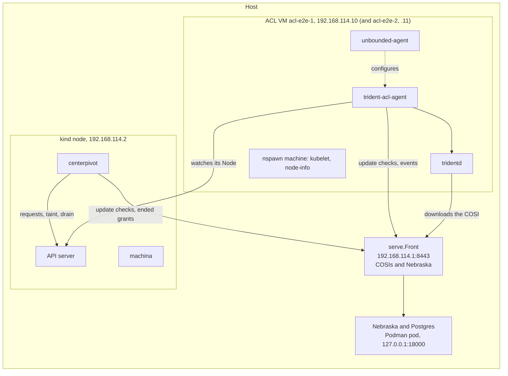

# Azure Container Linux test harness

This directory runs Azure Container Linux (ACL) in local KVM VMs, for two jobs:

1. **centerpivot's end-to-end test**, [`centerpivot_e2e.py`](centerpivot_e2e.py).
   Two ACL VMs join a kind cluster as Unbounded nodes, through Unbounded's host
   agent, and [centerpivot](../../designs/centerpivot.md) updates them from a
   real Nebraska, through `trident-acl-agent` and Trident. Nothing is faked.
2. **A/B updates by hand**, [`abupdate.py`](abupdate.py). One ACL VM, whose
   Trident A/B updates you run and check step by step, and save and restore at
   any point. The end-to-end test runs each of its VMs with it.

The rest are modules both use:

| File | |
|---|---|
| [`cluster.py`](cluster.py) | The kind cluster, on root Podman, and the bridge its node and the VMs share |
| [`serve.py`](serve.py) | The harness's HTTPS port: COSIs, and Nebraska behind it |
| [`nebraska.py`](nebraska.py) | Nebraska, built from source, in a Podman pod with Postgres |
| [`cosibuild.py`](cosibuild.py) | Custom COSIs, for `abupdate.py image build` |
| [`scenarios.py`](scenarios.py) | `abupdate.py`'s scenarios |

## Requirements

1. Linux on x86-64, with KVM (`/dev/kvm` readable and writable). The end-to-end
   test runs two VMs of 4 GiB each, and needs about 20 GiB of disk; `abupdate.py`
   alone, one VM of 6 GiB.
2. `qemu-system-x86_64`, `qemu-img`, OVMF firmware (the `ovmf` or `edk2-ovmf`
   package), `ssh`, `setsid`, and `openssl`; and `xorriso`, `genisoimage`,
   `mkisofs`, or `bsdtar`, for the seed ISO.
3. ACL images, from an OCI registry or as local files; see
   [The images](#the-images). For a registry in Azure Container Registry, `az`,
   logged in with permission to pull. The harness downloads ORAS if it isn't
   installed.
4. For the end-to-end test, also `podman`, `kind`, `kubectl`, `go`, `sudo`
   without a password prompt, for kind on root Podman and its bridge, and
   `fs.inotify.max_user_instances` of at least 512, which kind needs.
5. For custom builds, `podman`, `zstd`, mtools, and `sudo` without a password
   prompt.

## The images

Both tools need a KVM installer ISO of the base build, and COSIs of the base and
update builds, all for amd64. Say where they are; there are no defaults:

```bash
export ACL_AB_REGISTRY=<registry>.azurecr.io/<namespace>
export ACL_AB_ISO_REPO=<installer ISO repository>
export ACL_AB_COSI_REPO=<COSI repository>
export ACL_AB_BASE_TAG=<build to install>
export ACL_AB_UPDATE_TAG=<later build to update to>
```

In a registry, each image is an ORAS artifact whose one layer is the file,
tagged with its build: the ISO in `ACL_AB_ISO_REPO`, the COSIs in
`ACL_AB_COSI_REPO`, both under `ACL_AB_REGISTRY`. `oras repo tags
<registry>/<repository>` lists the published builds. Don't mix in images for
other hypervisors, or Azure VHDs.

For Azure Container Registry, the token comes from `az acr login
--expose-token`, in the subscription `ACL_AB_SUBSCRIPTION` names, or `az`'s
current one, and is passed to `oras login` on stdin. It's kept in the cache's
own registry config, not in `~/.docker/config.json`, and is renewed after two
hours, or when the registry refuses it. `unauthorized` after a login means the
identity can't pull from the repository.

Local files can stand in for the downloads: `ACL_AB_BASE_ISO`,
`ACL_AB_BASE_COSI`, and `ACL_AB_UPDATE_COSI`. With all three, no registry is
needed; the tags still name the builds.

The downloads, builds, and installed bases are kept in
`.vm/acl-abupdate-cache`, or `ACL_AB_CACHE_DIR`, which both tools share. Each
installed base is kept per seed, since the image reads the seed on its first
boot only: a harness with another seed never replaces a base a VM runs on.

## centerpivot's end-to-end test

```bash
hack/acl-abupdate/centerpivot_e2e.py test                 # up, every scenario, then down
```

Or a step at a time:

```bash
hack/acl-abupdate/centerpivot_e2e.py up                   # build, start, join, snapshot
hack/acl-abupdate/centerpivot_e2e.py run [SCENARIO...]    # every scenario by default
hack/acl-abupdate/centerpivot_e2e.py status
hack/acl-abupdate/centerpivot_e2e.py down                 # everything but the runs' artifacts
```

`up` is done once; `run` can then run scenarios again and again, each from the
same joined VMs. `test --keep` leaves the environment up afterward.

### What runs



The VMs and the kind node share the bridge `virbr-acle2e`,
`192.168.114.0/24`, which `cluster.py` makes: each VM has a second NIC on a TAP
device in it, and the kind node joins it by a veth. SSH, the internet, and the
host's other services stay on each VM's first NIC, QEMU's user networking.
aclab's cluster, if you run one, uses `192.168.113.0/24`, so both can run at
once.

Nebraska is [flatcar/nebraska](https://github.com/flatcar/nebraska)'s backend,
built from source at a pinned commit, since no release has package labels yet,
which `trident-acl-agent` reads each COSI's checksum from. It runs with
`-auth-mode=noop`, so it listens on the host's loopback only. The VMs and
centerpivot reach it through the harness's one HTTPS port, on the bridge, which
also serves the COSI. That port's CA is made once; the VMs trust it in their
system store, and centerpivot through the Site's `caConfigMap`.

### How `up` works

1. It builds `unbounded-agent`, `kubectl-unbounded`, machina, and centerpivot
   from this checkout, machina's and centerpivot's images, and Nebraska's image.
   It renders machina's and centerpivot's manifests.
2. It fetches the images with `abupdate.py image fetch`.
3. It creates the kind cluster `acl-e2e`, and loads machina's and centerpivot's
   images into it.
4. It installs machina, the CRDs, a bootstrap token, and Site `e2e`, with
   centerpivot off.
5. It brings each VM up with `abupdate.py up`, with its own hostname and machine
   ID, so each has its own Nebraska instance ID, and its NIC on the bridge. Each
   VM then trusts the harness's CA.
6. It joins both VMs as Unbounded's ACL path does:
   `kubectl-unbounded machine manual-bootstrap --variant ignition` renders the
   agent's config, binary, and bootstrap unit, with the label
   `centerpivot.unbounded-cloud.io/managed=true`. They go over SSH, since the
   VMs are provisioned already, and the bootstrap unit joins the node.
7. It installs centerpivot from its rendered manifests, as the operator applies
   them. centerpivot's image is imported into each node's containerd, for the
   node-info DaemonSet.
8. It checks what centerpivot needs of each node: the host agent configured and
   started `trident-acl-agent`, which watches its Node, and node-info published
   the node's `agent-info`.
9. It saves both VMs, memory included, as snapshot `joined`.

### How a scenario runs

1. It turns centerpivot off, restores both VMs to `joined`, paused, and returns
   their Nodes and Machines to how they were then: centerpivot's annotations,
   its taint, its labels, and the Machine's `state`. Then it resumes the VMs,
   and restarts `trident-acl-agent`, whose watch went stale while the snapshot
   waited.
2. It makes a Nebraska app of the scenario's own, which offers the update COSI
   at its `VERSION_ID`, on track `e2e`. The group's update timeout is 120
   minutes, longer than the Site's `updateTimeout`, and safe mode is off
   (designs/centerpivot.md, section 5.3).
3. It sets centerpivot's admission policy to allow the app, and turns
   centerpivot on in the Site, with these settings:

   | Setting | Value |
   |---|---|
   | `maxUnavailable` | 1 |
   | `checkInterval` | 2m |
   | `updateTimeout` | 60m |
   | `statusDeadline` | 2m |
   | `drainDeadline` | 4m |
   | `restartDeadline` | 8m |
   | `recoveryDeadline` | 5m |
   | `settleTime` | 30s |

4. It samples each node's phase every 5 seconds, from its Machine's `state`,
   until the scenario's end, then checks the timeline, the nodes, the VMs, and
   Nebraska's instances.

Nebraska starts empty at each `run`.

### Scenarios

| Scenario | What happens | What it checks |
|---|---|---|
| `rolling` | Both nodes update, with a Deployment of two pods on them and a PodDisruptionBudget that keeps one available. | No more than one node updates at once; the Deployment stays available; each node stages, drains, finalizes, restarts, and recovers, boots the new version, and ends with no taint and no grant; Nebraska has the update `Complete`, after the agent reported its download and install; each node is one Nebraska instance, the ID its `agent-info` shows; centerpivot's `centerpivot_phase_seconds` counts each phase of both updates. |
| `silent-agent` | The canary node's `trident-acl-agent` is stopped. | The canary is held because its agent didn't answer, alone, without its app; its grant is ended, and Nebraska has its update as failed; the other node waited for the canary, then updates. |
| `blocked-drain` | Once the node stages, its PodDisruptionBudget lets no pod go. The other node is paused. | The drain misses its deadline, which fails the attempt, removes the taint, and ends the grant, which Nebraska has as failed; once the budget lets a pod go again, the next attempt updates the node; the paused node gets no slot. |
| `boot-failure` | The canary node's first boot of the new version fails, with `abupdate.py fail-next-boot`, and the firmware falls back to the old one. | The canary is held, which stops its app; it runs the old version; the other node gets no slot. |

With Trident 0.30.0, the fallback isn't detected (microsoft/trident#956):
`trident-acl-agent` reports the commit a success. centerpivot then holds the
node at the restart deadline, since `agent-info` still shows the old version,
which `boot-failure` accepts too.

Cases that need many nodes, apps, or channel moves, such as rollout limits,
floors, and several apps, are unit tests of centerpivot's controller.

### Artifacts

Each `run` writes `.vm/centerpivot-e2e/runs/<time>/`, with `results.json`, and
a directory for each scenario:

| File | |
|---|---|
| `results.json` | Each check, and whether it passed |
| `timeline.json` | Each sample: every node's phase, reason, taint, version, and request, and the Deployment's available pods |
| `nebraska.json` | The app, and each instance with its status history |
| `omaha.json` | The Omaha requests the front passed to Nebraska, and its answers, from both centerpivot and the agents |
| `diagnostics/` | The cluster's nodes, Machines, Sites, events, and logs, and Nebraska's log. After a failure, each VM's journals of `trident-acl-agent`, Trident, the host agent, and kubelet, Trident's Host Status, and its serial log |

A failed `up` writes its diagnostics to `runs/<time>-up/`.

### Settings

| Variable | Default | |
|---|---|---|
| `CP_E2E_STATE_DIR` | `.vm/centerpivot-e2e` | The VMs, the kubeconfig, the build, the CA, and the runs |
| `CP_E2E_VM_MEMORY` | `4096` | Each VM's memory, in MiB |
| `CP_E2E_SSH_PORT` | `2240` | VM *n*'s SSH is forwarded from this port plus *n* |
| `CP_E2E_FRONT_PORT` | `8443` | The harness's HTTPS port, on the bridge |
| `CP_E2E_NEBRASKA_PORT` | `18000` | Nebraska's port, on the host's loopback |
| `CP_E2E_KIND_NODE_IMAGE` | kind's default | The kind node image, for another Kubernetes version |

The `ACL_AB_` settings of [The images](#the-images) apply too.

### Looking around

1. `status` shows each node's phase and version, and how to SSH to its VM.
2. The cluster's kubeconfig is `.vm/centerpivot-e2e/kubeconfig`.
3. `ACL_AB_STATE_DIR=.vm/centerpivot-e2e/vm1 hack/acl-abupdate/abupdate.py
   status` shows the first VM's Trident and UEFI state; any other
   `abupdate.py` command works on it the same way.
4. On a VM, `sudo /opt/unbounded/agent/bin/unbounded-agent exec -- CMD` runs a
   command in the node's nspawn machine.

## A/B updates by hand

`abupdate.py` installs a base build of ACL in a VM, then drives Trident A/B
updates to a later build and back, and checks the VM after every step: the slot
it boots, the image it runs, Trident's status, the UEFI boot order, and that
files under `/etc`, `/var`, `/opt`, and `/home` survive. It needs no root.

```bash
hack/acl-abupdate/abupdate.py up
hack/acl-abupdate/abupdate.py status
hack/acl-abupdate/abupdate.py update        # one A/B update, checked
hack/acl-abupdate/abupdate.py test          # every scenario, each from a fresh snapshot
hack/acl-abupdate/abupdate.py ssh           # a shell on the VM
hack/acl-abupdate/abupdate.py down          # remove the VM
```

`up` remembers the settings, so later commands don't need them. The first `up`
downloads the images and runs the installer; later ones start from the
installed base it keeps (`--fresh-install` installs again).

How it works: the installer ISO streams the base image to the VM's disk, and an
Ignition config on a volume labelled `ACLSEED` provisions SSH access on its
first boot. An update copies a later build's COSI into the VM and runs
`trident update` with an image-only Host Configuration, which writes it to the
inactive A/B slot, then boots that slot and commits it. The VM uses QEMU's user
networking, with SSH forwarded from `127.0.0.1`. Only the download uses Azure.

## Commands

Run `abupdate.py COMMAND --help` for each command's options. With `--json`
before the command, the result is printed as JSON on stdout and the log goes to
stderr.

### Images

| Command | |
|---|---|
| `image fetch [TAG...]` | Pulls the base tag's installer ISO and the base and update COSIs, or the COSIs of the tags given. `--iso` also pulls the given tags' ISOs, and `--refresh` pulls again what's cached. |
| `image list` | Lists the cached images, builds, and installed bases: each one's build or source, OS version, `/usr` verity root hash, and `metadata.json` sha384. |
| `image build NAME` | Builds a COSI from an existing one and your files or Image Customizer config; see [Custom builds](#custom-builds). |
| `image delete NAME` | Deletes a build, or a tag's cached images. |

`up` and the update commands pull anything they need that isn't cached, so
`image fetch` is only needed to download ahead of time.

### The VM

| Command | |
|---|---|
| `up` | Installs the base image in a new VM, or starts from the base installed earlier. Then it runs check B1 and saves snapshot `base`. Options: `--base-tag`, `--update-tag`, `--fresh-install`, `--memory`, `--cpus`, `--ssh-port`, and those below. |
| `start [--snapshot NAME]` | Starts the stopped VM, from a snapshot if one is given. |
| `stop [--hard]` | Powers the VM off. `--hard` stops QEMU at once, as pulling the power would. |
| `down` | Stops the VM and removes the state directory. The cache stays. |
| `status` | Shows the booted image and slot, Trident's `servicingState`, `abActiveVolume`, and `lastError`, the UEFI `BootCurrent`, `BootNext`, and `BootOrder`, `trident-acl-agent.service`'s state, and any update that's staged or committed. |
| `ssh [COMMAND]` | Opens a shell on the VM, or runs a command there. |
| `console [-f]` | Shows the VM's serial console log, and with `-f` keeps following it. |
| `fail-next-boot` | Resets the VM as its next kernel starts. Start it before a reboot into a new slot: the firmware has used its one-time `BootNext` by then, so it boots the old slot, as after a failed first boot. |

Several VMs can run at once, each with its own `ACL_AB_STATE_DIR` and
`--ssh-port`. These `up` options are for that:

| Option | |
|---|---|
| `--hostname NAME` | Gives the VM its own hostname and machine ID, and reboots it, since VMs from one installed base would otherwise share one. |
| `--nic-tap TAP --nic-address IP` | Adds a second NIC on a TAP device you made, in a bridge you own, with the address given in a `/24`. Its MAC comes from the address. |

### Snapshots

| Command | |
|---|---|
| `snapshot save NAME [--force]` | Saves the running VM, memory included. |
| `snapshot restore NAME [--hold]` | Returns the VM to a snapshot without a reboot. If the VM is stopped, it starts from the snapshot. `--hold` leaves it paused, so you can set what it talks to back first. |
| `resume [--restart UNIT]...` | Runs a VM `--hold` left paused, steps its clock to the host's, and restarts the units given, such as one whose watch went stale while the snapshot waited. |
| `snapshot list` | Lists the snapshots. |
| `snapshot delete NAME` | Deletes a snapshot. |

A snapshot saves both the disk and the UEFI variables. BootNext and BootOrder
are part of what an update changes, so a snapshot saved mid-update restores to
the same point in it. The harness's own state is saved with each snapshot, and
restored with it: the marker files it wrote, the staged update, and the slot
devices it has seen. Snapshots are kept in the VM's disk overlay, so `down`
removes them. A restore steps the VM's clock to the host's, since the image
runs no NTP client and the restored clock is behind.

### Steps

Each step runs its checks, and on failure collects diagnostics into its run
directory; see [Run artifacts](#run-artifacts).

| Command | Checks | |
|---|---|---|
| `update [--to TARGET]` | A1 to A4 | Runs `stage`, `finalize`, and `commit`. `--no-commit` stops once the new slot has booted. `--failing-health-check` runs the health-check rollback instead (H1). |
| `stage [--to TARGET]` | A1 | Writes the image to the inactive slot without rebooting. |
| `finalize` | A2, A3 | Finalizes what's staged. Trident sets BootNext and reboots into the new slot. |
| `commit` | A4 | Commits the boot into the new slot, unless a trident unit committed it at boot. |
| `rollback [--check]` | R1 | Runs `trident rollback --ab`. `--check` only reports what `trident rollback --check` says. |
| `reboot [--hard]` | | Reboots the VM, or with `--hard` resets it, and reports the slot it booted. |
| `verify` | V1 | Checks the VM's state without changing it. `--expect TARGET`, `--expect-slot a` or `b`, and `--expect-state STATE` add expectations. |

`--to` defaults to `other`. With Trident versions that have
`--allowed-operations`, staging and finalizing run as separate
`trident update` calls. A failed stage is then told apart from a failed reboot,
and the VM can be snapshotted between the two. `--single-step` runs them as one
call, and the harness falls back to that when Trident lacks the option.

The state is kept between commands, so an update can be run by hand:

```bash
hack/acl-abupdate/abupdate.py stage --to update
hack/acl-abupdate/abupdate.py snapshot save staged
hack/acl-abupdate/abupdate.py finalize
hack/acl-abupdate/abupdate.py status
hack/acl-abupdate/abupdate.py commit
hack/acl-abupdate/abupdate.py snapshot restore staged   # and finalize again
```

### Scenarios

| Command | |
|---|---|
| `scenarios` | Lists the scenarios. |
| `run SCENARIO... [--from SNAPSHOT]` | Runs scenarios in the order given, or `all` of them. `--from` restores the snapshot before each one, so the scenarios run independently; without it they run one after another on the running VM. `--rounds N` sets pingpong's rounds (default 2), and `--to` sets the scenarios' target. `--keep-going` runs the rest after a scenario fails. |
| `test` | Same as `run all --from base --keep-going`. `--stop-on-failure` stops at the first failure. |

A scenario that needs the VM in a particular state first runs steps to get it
there, and those steps are labelled `setup`. With `--no-setup`, the scenario
fails if the VM isn't already in that state. A scenario fails if any of its
checks fails. It's skipped if the image can't run it, for example when its
Trident has no `rollback` command.

| Scenario | | Checks |
|---|---|---|
| `forward` | Updates to `--to` (default `update`): stage, boot the new slot, commit. | A1 to A4 |
| `reboot-after-commit` | Reboots after a committed update; the VM must stay on the new slot. | A5 |
| `manual-rollback` | `trident rollback --ab` after a committed update. | R1 |
| `pingpong` | Updates back and forth between the base and update images, `--rounds` times. | P*n*/A1 to A4 |
| `health-rollback` | An update with a health check that fails; commit must roll back. Experimental. | H1 |

## Targets

A `TARGET` is one of:

1. `base` or `update`: the tags `up` was given
2. `other`: whichever of those two the VM doesn't run
3. a build's name, from [`image build`](#custom-builds)
4. a build tag in `ACL_AB_COSI_REPO`, pulled if it isn't cached
5. a path to a `.cosi` file

The harness identifies the booted image by comparing `/usr`'s dm-verity root
hash with the COSIs it knows.

## Custom builds

`image build` makes an update of your own: an existing build of ACL with your
files, or an [Image Customizer](https://github.com/microsoft/azure-linux-image-tools)
config, added. It's a COSI that the VM can A/B-update to like any other target,
so you can try a change to the OS image without an image pipeline. To try it:

```bash
mkdir -p my-build/usr/bin my-build/etc/hello
printf '#!/bin/sh\necho "hello from my build: $(cat /etc/hello/hello.conf)"\n' > my-build/usr/bin/hello
chmod 755 my-build/usr/bin/hello
echo greeting=hi > my-build/etc/hello/hello.conf

hack/acl-abupdate/abupdate.py image build hello --files my-build
hack/acl-abupdate/abupdate.py update --to hello                    # the usual checks, A1 to A4
hack/acl-abupdate/abupdate.py ssh -- hello
hack/acl-abupdate/abupdate.py update --to base                     # and back
```

Building needs no VM. Once built, every command and scenario that takes a
target takes the build's name.

A build gets its own OS version, as a new release of ACL does: its
os-release's `VERSION_ID` is its source's with `-NAME.N`, such as
`3.0.20261104-hello.1`. So `/etc/os-release` changes after an update to it, as
after one to a newer release. Semver sorts that below its source's version, so
Nebraska wouldn't offer it over the source; `--os-version` gives one that sorts
above.

| Option | |
|---|---|
| `--files DIR` | Files to add, laid out like the root: `usr/...` goes in `/usr`, and `etc/...` in `/etc`. Each keeps its mode and is owned by root, and new `/etc` files get their SELinux label from the image's policy. Other top-level directories, symlinks, and special files are refused, with the reason: `opt/`, `var/`, and `home/`, for example, are on the root partition, which both slots share and an update doesn't write. |
| `--config FILE` | An [Image Customizer config](https://github.com/microsoft/azure-linux-image-tools/blob/v1.7.0/docs/imagecustomizer/api/configuration/configuration.md) to apply too, for scripts, services, users, and more files. Paths in it are relative to its directory. |
| `--from TARGET` | The image to build on: `base` (the default), `update`, a tag, another build, or a `.cosi` file. |
| `--os-version VERSION` | The build's `VERSION_ID`, which must be semver, as Nebraska needs. By default, its source's, with `-NAME.N` for the Nth build of NAME. |
| `--keep-work` | Keeps the work directory, with its raw disks, to look inside. |

Give at least one of `--files` and `--config`. A config like this adds a
systemd service and enables it, and runs a script in the image:

```yaml
os:
  additionalFiles:
  - source: files/hello-world.service
    destination: /usr/lib/systemd/system/hello-world.service
  services:
    enable:
    - hello-world
scripts:
  postCustomization:
  - name: stamp
    content: |
      echo "stamped by the world build" > /usr/share/hello-stamp
```

Building a name again replaces the build. `image list` lists the builds, and
`image delete NAME` removes one. Each is kept in the cache's `builds/NAME/`,
with `info.json` (what it was built from and with), the config the harness gave
Image Customizer, and Image Customizer's log.

### How a build works

Image Customizer v1.7.0 does the customizing, in its released container, which
the harness runs with `sudo podman`, privileged, for loop devices. Its support
for ACL is a preview: it adds the files, folds changes to `/etc` into `/etc`'s
baseline in `/usr/share/distro/etc`, and re-seals `/usr`'s dm-verity. It doesn't
know ACL's A/B layout, so the harness does the rest:

1. It expands the source COSI into a sparse raw disk, since Image Customizer
   takes a disk, and gives `/usr` a new btrfs filesystem UUID, so the two slots
   don't carry the same filesystem.
2. It gives os-release the build's `VERSION_ID` in place of its source's, with
   a script Image Customizer runs. The script writes over the file rather than
   replacing it, so the file keeps its SELinux label.
3. Of Image Customizer's output, it keeps `/usr` and its hash partition, and
   checks the new root hash by recomputing the hash tree.
4. It keeps the source's boot partition, and patches the new root hash into the
   UKI addons that carry `usrhash=`: both slots' templates in
   `/acl/uki-addons`, and the UKI's own. Image Customizer would give the update
   slot an addon with slot A's arguments.
5. It repacks the source COSI with those three partitions replaced and its
   `metadata.json` updated, including its OS version.

The limits that follow:

1. **Secure Boot:** the patched addons aren't signed, so a build boots only with
   Secure Boot off, as in the harness's VM.
2. **The boot partition** is the source's, so a config can't change the kernel
   command line, the SELinux mode, the kernel, or the initramfs. The harness
   compares Image Customizer's boot partition with the source's, and stops if it
   changed more than the verity arguments.
3. **Packages:** Image Customizer installs packages only on images that have
   `tdnf`, which stock ACL doesn't.
4. **`/etc`:** an update changes only the overlay's lower layer, so a file the
   node changed or removed in `/etc` keeps the node's version. Files a config
   adds to `/etc`, such as a service's enablement link, aren't given SELinux
   labels, as `--files`' are; a script in the config can run `setfiles` on them.
5. **Space:** `/usr` has about 1.5 GiB free. A build needs about 10 GiB free in
   the cache while it runs.

The Image Customizer container is pinned by digest; `ACL_AB_IMAGE_CUSTOMIZER`
names another, such as a later release.

## What the checks cover

| ID | Where | Checks |
|---|---|---|
| B1 | `up` | `/usr` is a read-only dm-verity device on the VM's disk, not the installer's. A root hash that differs from the base COSI's is only a warning, since the ISO may embed another build. |
| A1 | stage | The COSI's `metadata.json` sha384 in the VM is the expected one. Staging doesn't reboot the VM. `servicingState` is `ab-update-staged`. The slot and `abActiveVolume` are unchanged, and there's no `lastError`. |
| A2 | finalize | The VM booted the other slot, and `/usr`'s root hash is the target's. |
| A3 | finalize | Every marker the harness wrote under `/etc`, `/var/lib`, `/opt`, and `/home/core` is still there, and `/usr` is read-only. |
| A4 | commit | `servicingState` is `provisioned` with no `lastError`. `abActiveVolume` flipped and names the slot the VM booted. The Host Status names the update's image URL and sha384, and `BootCurrent` is first in `BootOrder`. |
| A5 | reboot-after-commit | A plain reboot comes back on the same slot and image, still `provisioned`. This shows commit changed BootOrder, not just the one-time BootNext. |
| R1 | rollback | `trident rollback --check` reports `ab`. Afterwards the VM runs the other slot and the image that slot held, `provisioned`, with `abActiveVolume` flipped back, no `lastError`, and the markers kept. |
| H1 | health-rollback | The config adds a health check that always fails. Commit runs it, and Trident reboots into the previous slot and ends `provisioned` there, on the previous image. `lastError` reports the check, and a failure log is in `/var/lib/trident`. If the journal keeps earlier boots, there were two boots since the update. |
| V1 | verify | The expectations given, the slot `abActiveVolume` names, `BootCurrent` (when `provisioned`), and the markers. |

`provisioned` alone doesn't show an update worked: a failed update also ends
there, with `lastError` set and the active volume unchanged. So A4 and R1 also
check the slot, the root hash, and `lastError`.

The slot is identified by `/usr`'s verity data and hash devices, from
`veritysetup status usr`; `findmnt /usr` shows `/dev/dm-0` for either slot.
The harness learns which devices belong to `volume-a` and `volume-b` from the
first `provisioned` status it reads, and checks that Trident's later reports
agree with it.

Each update writes a new token to every marker file, and A3 checks that all the
tokens written so far are there. A missing token means that directory doesn't
survive an A/B update. If every token survives, a node's state in those
directories would survive too.

## Adding a scenario

Scenarios are in [`scenarios.py`](scenarios.py). Each is a function of the run's
context, registered with `@scenario`:

```python
@scenario("restage", "Stage the update twice before finalizing; the second staging replaces the first",
          needs=Needs.OFF_TARGET, checks=("A1", "A2", "A3", "A4"))
def restage(ctx: Context) -> None:
    ctx.stage(ctx.target("update"))
    ctx.update(ctx.target("update"))
```

The context's steps are the step commands' own: `stage`, `finalize`, `commit`,
`update`, `reboot`, `rollback`, `health_rollback`, and `verify`. They return
probes of the VM's state, and `ctx.checks.expect(ok, ID, description, detail)`
adds checks of your own. `ctx.scope(name)` prefixes the IDs of the checks run
inside it, as pingpong's `P1/A1` shows. To skip the scenario, raise `Skip`; to
stop it as failed, raise `StepError`.

`needs` declares what the scenario expects of the VM: `Needs.NONE`,
`Needs.OFF_TARGET` (the VM doesn't run the target yet), or
`Needs.COMMITTED_UPDATE`. Hard resets go through QEMU's control socket, as in
`ctx.reboot(hard=True)`, which is enough for power-loss scenarios.

centerpivot's end-to-end scenarios are in
[`centerpivot_e2e.py`](centerpivot_e2e.py), registered with its own
`@scenario`, as functions of its `Context`.

## Settings

| Variable | Default | |
|---|---|---|
| `ACL_AB_BASE_TAG`, `ACL_AB_UPDATE_TAG` | none | The builds `up` installs and updates to; `up --base-tag` and `--update-tag` too |
| `ACL_AB_REGISTRY` | none | The images' registry and namespace, such as `example.azurecr.io/acl` |
| `ACL_AB_ISO_REPO`, `ACL_AB_COSI_REPO` | none | The installer ISO's and the COSIs' repositories under it |
| `ACL_AB_BASE_ISO`, `ACL_AB_BASE_COSI`, `ACL_AB_UPDATE_COSI` | | Local files to use instead of the downloads |
| `ACL_AB_SUBSCRIPTION` | `az`'s current one | The registry's subscription, for `az acr login` |
| `ACL_AB_VM_MEMORY`, `ACL_AB_VM_CPUS` | `6144`, `2` | VM size, and `up`'s defaults |
| `ACL_AB_DISK_SIZE` | `64G` | Disk size for an install |
| `ACL_AB_SSH_PORT` | `2222` | Host port forwarded to the VM's SSH |
| `ACL_AB_GUEST_DIR` | `/var/tmp/acl-abupdate` | Where COSIs are copied in the VM; `/tmp` may be in memory |
| `ACL_AB_INSTALL_TIMEOUT`, `ACL_AB_BOOT_TIMEOUT`, `ACL_AB_STAGE_TIMEOUT` | `2400`, `900`, `3600` | Seconds |
| `ACL_AB_STATE_DIR` | `.vm/acl-abupdate` | VM disk overlay, UEFI variables, SSH key, snapshots, and run artifacts |
| `ACL_AB_CACHE_DIR` | `.vm/acl-abupdate-cache` | Downloads, builds, installed bases, and ORAS; `down` keeps it |
| `ACL_AB_IMAGE_CUSTOMIZER` | v1.7.0, by digest | The Image Customizer container image `image build` runs |

## Run artifacts

Each command that runs checks writes a directory under
`.vm/acl-abupdate/runs/`. It holds:

1. numbered snapshots of the VM's state before and after each step, with the
   raw `veritysetup`, Trident Host Status, and UEFI variables
2. each Trident command's output, and the Host Configuration it was given
3. `summary.json`, with every check, scenario result, and timing: copy, stage,
   finalize to SSH, and commit

When a step or scenario fails, `diagnostics-NAME/` has the current and previous
boots' journals, `trident get status` and `last-error`, the trident units,
`trident-acl-agent.service`'s unit and journal, the host agent's journal,
`lsblk`, `efibootmgr -v`, the network, a `trident diagnose` bundle, and the end
of the serial log.

## Troubleshooting

1. **The install:** `console -f` follows it. `WAITING FOR CONFIGURATION MEDIA`
   means the installed image didn't find the `ACLSEED` volume; `up` gives up
   after five minutes of it. On the installer's console, Ctrl-C then `s` opens a
   diagnostic shell, which `console` can't drive. Use it only to look around,
   and don't run updates from it.
2. **The installer and the disk:** the installer overwrites the smallest disk
   that fits the image. The harness's VM has only its own disk attached. After
   the install, the installer ISO and seed are detached, so a disk that stops
   booting can't fall through to the installer and be reinstalled, which would
   look like a rollback.
3. **Trident's datastore:** a freshly installed image has no Host Status until
   its first update, so `status` shows none, and `trident get status` fails.
4. **Tags:** a build tag isn't the OS's `VERSION_ID`: build 20261105.1 has
   `3.0.20261104`. The installer ISO's image and its build's COSI have the same
   `VERSION_ID` but different `/usr` root hashes, so an update from one to the
   other leaves `/etc/os-release` as it was. The root hash shows which image
   runs.
5. **Disk space in the VM:** COSIs are kept in `ACL_AB_GUEST_DIR` while there's
   room for the next one, so pingpong copies each only once.
6. **The image's `sha384`** in the Host Configuration is the SHA-384 of the
   COSI's `metadata.json`, not of the whole file, and is computed for each
   target.
